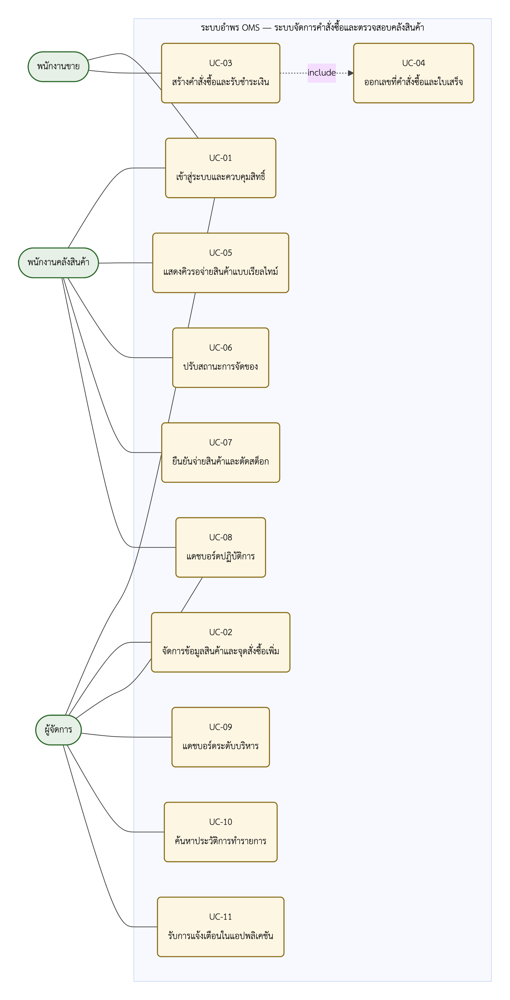
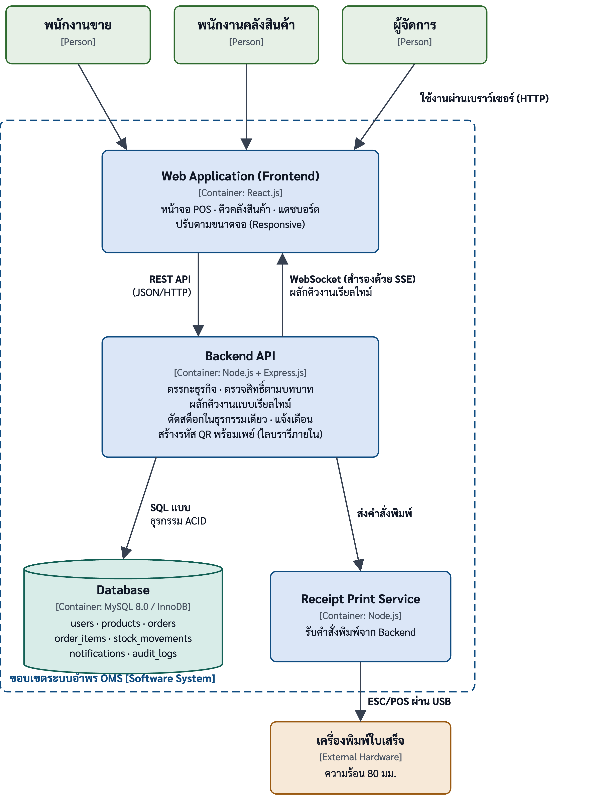

เอกสารข้อกำหนดความต้องการซอฟต์แวร์

Software Requirements Specification

โครงงาน: ระบบจัดการคำสั่งซื้อและตรวจสอบคลังสินค้า กรณีศึกษาร้านวัสดุก่อสร้างอำพรคอนกรีต (อำพร OMS)

นายตรัยรัตน์ วงษ์สิทธิ์ 67543210028-6   |   นายพนาวุฒน์ อภิปสันติ 67543210040-1

อาจารย์ที่ปรึกษา: อาจารย์ธนิต เกตุแก้ว   |   เวอร์ชัน: 1.0   |   วันที่: 18/09/2569

หลักสูตรวิศวกรรมซอฟต์แวร์ คณะวิศวกรรมศาสตร์ มหาวิทยาลัยเทคโนโลยีราชมงคลล้านนา

# 1 บทนำ (Introduction)

## 1.1 วัตถุประสงค์ของเอกสาร (Purpose)

เอกสารฉบับนี้กำหนดความต้องการซอฟต์แวร์ของระบบจัดการคำสั่งซื้อและตรวจสอบคลังสินค้า (อำพร OMS) ของร้านวัสดุก่อสร้างอำพรคอนกรีต ให้ครบถ้วน ตรวจสอบได้ และสอบกลับได้ เพื่อใช้เป็นข้อตกลงร่วมระหว่างผู้จัดทำโครงงาน อาจารย์ที่ปรึกษา และเจ้าของสถานประกอบการ ว่าระบบต้องทำอะไรได้บ้างและต้องมีคุณภาพระดับใด

เอกสารครอบคลุมความต้องการเชิงหน้าที่ (FR-01 ถึง FR-09) ความต้องการนอกเหนือหน้าที่ (NFR-01 ถึง NFR-09) ข้อจำกัด และวิธีทวนสอบของแต่ละข้อ รหัสความต้องการทุกรหัสในเอกสารนี้เป็นชุดเดียวกับที่ใช้ในปริญญานิพนธ์บทที่ 3 เพื่อให้สอบกลับได้ทั้งสองทิศทางระหว่างเอกสารนี้ ปริญญานิพนธ์ และซอร์สโค้ดของระบบ

## 1.2 ขอบเขตของผลิตภัณฑ์ (Product Scope)

ชื่อระบบ — ระบบจัดการคำสั่งซื้อและตรวจสอบคลังสินค้า เป็นเว็บแอปพลิเคชันสำหรับร้านวัสดุก่อสร้างอำพรคอนกรีต ซึ่งมีจุดชำระเงินหน้าร้านและจุดรับสินค้าที่คลังอยู่คนละพื้นที่

ปัญหาที่ระบบแก้ (ปริญญานิพนธ์บทที่ 1 หัวข้อ 1.1) — ร้านบันทึกการขายด้วยใบเสร็จและบิลกระดาษที่ไม่มีระบบยืนยัน ข้อมูลกระจัดกระจายตรวจสอบย้อนหลังยาก หน้าร้านกับคลังไม่มีช่องทางสื่อสารแบบเรียลไทม์ ลูกค้าต้องถือใบเสร็จเดินไปคลังเองจึงเกิดคอขวด พนักงานคลังอ่านใบเสร็จด้วยสายตาจึงหยิบผิด มีการนำบิลเก่ามารับสินค้าซ้ำ ยอดสต็อกคลาดเคลื่อนจากของจริง และผู้จัดการต้องรอสรุปยอดตอนท้ายวัน

เป้าหมาย (วัตถุประสงค์ 1.2.1–1.2.4) — (1) ลดข้อผิดพลาดในการบันทึกการขายและจัดการสินค้าคงคลัง (2) ลดระยะเวลารอคอยของลูกค้าโดยให้คลังเริ่มจัดของได้ทันทีที่ชำระเงิน (3) ให้ยอดสินค้าคงเหลือในระบบตรงกับของจริงและป้องกันการรับสินค้าซ้ำ (4) ให้ผู้บริหารติดตามยอดขาย สต็อก และคิวงานได้แบบเรียลไทม์

สิ่งที่ระบบทำได้ — แต่ละข้อตรงกับขอบเขตของโครงงานในปริญญานิพนธ์บทที่ 1

| ขอบเขตในเล่ม | สิ่งที่ระบบทำได้ |
|:--------------------:|------------------------------------------------------------------------------|
| 1.3.1 | เว็บแอปพลิเคชันแบบเรสปอนซีฟ รองรับผู้ใช้สามบทบาท คือพนักงานขาย พนักงานคลังสินค้า และผู้จัดการ |
| 1.3.2 | เข้าสู่ระบบและควบคุมสิทธิ์ตามบทบาท และจัดการข้อมูลสินค้า หมวดหมู่ ราคา หน่วยนับ และจุดสั่งซื้อเพิ่ม |
| 1.3.3 | สร้างคำสั่งซื้อ รับชำระเงินผ่านรหัสคิวอาร์พร้อมเพย์ พิมพ์ใบเสร็จผ่านเครื่องพิมพ์ใบเสร็จความร้อน และส่งคำสั่งซื้อเข้าคิวคลังสินค้าแบบเรียลไทม์ทันทีที่ยืนยันรับเงิน |
| 1.3.4 | แสดงคิวรอจ่ายสินค้าที่อัปเดตเอง และให้พนักงานคลังยืนยันจ่ายสินค้าพร้อมตัดสต็อกแบบอะตอมมิก |
| 1.3.5 | แดชบอร์ดปฏิบัติการและระดับบริหาร ประวัติการทำรายการ และการแจ้งเตือนภายในแอปพลิเคชัน |

สิ่งที่ระบบไม่ทำ (ขอบเขต 1.3.6) — ระบบบัญชีเต็มรูปแบบ การชำระเงินผ่านเพย์เมนต์เกตเวย์หรือเครื่องรูดบัตร การตรวจสอบสถานะการชำระเงินอัตโนมัติผ่านเอพีไอของธนาคาร แอปพลิเคชันแบบเนทีฟบนโทรศัพท์เคลื่อนที่ การเชื่อมต่อระบบอีอาร์พีหรือซัพพลายเออร์ภายนอก การแจ้งเตือนผ่านบริการภายนอก เช่น ไลน์โนติฟาย หรืออีเมล และโมดูลปัญญาประดิษฐ์ช่วยวิเคราะห์ ซึ่งเป็นงานในอนาคต

ประโยชน์ที่คาดหวัง — พนักงานขายไม่ต้องคิดเลขหรือเขียนบิลด้วยมือ คลังรู้คำสั่งซื้อก่อนลูกค้าเดินไปถึง ยอดสต็อกในระบบเชื่อถือได้ และผู้จัดการตัดสินใจสั่งซื้อจากข้อมูลจริงแทนประสบการณ์

## 1.3 นิยาม คำย่อ และคำศัพท์ (Definitions, Acronyms, and Abbreviations)

| คำศัพท์/คำย่อ | ความหมาย |
|-----------------------------------|-----------------------------------------------------------------|
| SRS | Software Requirements Specification — เอกสารข้อกำหนดความต้องการซอฟต์แวร์ฉบับนี้ |
| FR / NFR | รหัสความต้องการเชิงหน้าที่ และนอกเหนือหน้าที่ ชุดเดียวกับปริญญานิพนธ์บทที่ 3 |
| UC / AC | รหัสกรณีการใช้งาน และเกณฑ์การยอมรับ ชุดเดียวกับปริญญานิพนธ์บทที่ 3 |
| RBAC | Role-Based Access Control — การควบคุมสิทธิ์การเข้าถึงตามบทบาทของผู้ใช้ |
| คำสั่งซื้อ | รายการขายหนึ่งครั้งที่รับชำระเงินแล้ว มีเลขที่ไม่ซ้ำและมีรายการสินค้าอย่างน้อยหนึ่งรายการ |
| คิวรอจ่ายสินค้า | รายการคำสั่งซื้อที่ชำระเงินแล้วแต่ยังไม่ได้จ่ายสินค้าออกจากคลัง เรียงตามเวลาชำระ |
| การจ่ายสินค้า | การที่พนักงานคลังยืนยันว่าจ่ายสินค้าตามคำสั่งซื้อออกไปแล้ว ซึ่งตัดสต็อกไปพร้อมกัน |
| ตัดสต็อกแบบอะตอมมิก | การหักยอดคงเหลือที่เกิดขึ้นครบทุกรายการหรือไม่เกิดเลย ไม่มีสภาพครึ่งทาง |
| จุดสั่งซื้อเพิ่ม | ยอดคงเหลือที่เมื่อต่ำกว่าค่านี้ ระบบจะแจ้งเตือนให้สั่งซื้อสินค้าเพิ่ม ค่า 0 หมายถึงยังไม่ตั้ง |
| ธุรกรรม / เอซิด | ชุดคำสั่งฐานข้อมูลที่สำเร็จทั้งหมดหรือย้อนกลับทั้งหมด มีคุณสมบัติความเป็นหน่วยเดียว ความสอดคล้อง การแยกจากกัน และความคงทน |
| ล็อกเชิงบวก | การใส่เงื่อนไขสถานะเดิมไว้ในคำสั่งปรับปรุงข้อมูล ถ้าสถานะถูกเปลี่ยนไปก่อนแล้วจะไม่มีแถวใดถูกแก้ไข |
| พร้อมเพย์ / อีเอ็มวีโค | บริการโอนเงินผ่านรหัสคิวอาร์ที่สร้างตามมาตรฐานอีเอ็มวีโคแบบร้านค้าเป็นผู้แสดงรหัส |
| อีเอสซีโพส | ชุดคำสั่งมาตรฐานสำหรับสั่งงานเครื่องพิมพ์ใบเสร็จความร้อน |
| TIS-620 | รหัสอักขระไทยที่เครื่องพิมพ์ใบเสร็จเข้าใจ ต้องแปลงข้อความก่อนส่ง |
| เว็บซ็อกเก็ต / SSE | ช่องทางที่เปิดค้างไว้ให้เซิร์ฟเวอร์ผลักข้อมูลมาหาหน้าจอได้เอง (สองทาง / ทางเดียว) |

## 1.4 ภาพรวมของเอกสาร (Overview)

หัวข้อ 2 อธิบายภาพรวมของระบบ ได้แก่ มุมมองผลิตภัณฑ์พร้อมแผนภาพบริบท หน้าที่หลัก กลุ่มผู้ใช้ ข้อจำกัด และข้อสมมติ หัวข้อ 3 เป็นความต้องการเฉพาะ ได้แก่ ส่วนต่อประสานภายนอกทั้งสี่ด้าน ความต้องการเชิงหน้าที่ FR-01 ถึง FR-09 พร้อมรายละเอียดกรณีการใช้งานที่ซับซ้อน ความต้องการนอกเหนือหน้าที่ NFR-01 ถึง NFR-09 จัดกลุ่มตามด้านคุณภาพ และข้อจำกัดการออกแบบ หัวข้อ 4 กำหนดวิธีทวนสอบและเกณฑ์ผ่านของทุกรหัสความต้องการ หัวข้อ 5 เป็นภาคผนวก ได้แก่ แบบจำลอง ข้อมูลสนับสนุนจากหน้างาน และดัชนีความต้องการสำหรับตารางสอบกลับของปริญญานิพนธ์

# 2 รายละเอียดโดยรวม (Overall Description)

## 2.1 มุมมองผลิตภัณฑ์ (Product Perspective)

อำพร OMS เป็นระบบใหม่ ที่พัฒนาขึ้นทดแทนกระบวนการกระดาษเดิมของร้านทั้งหมด ไม่ได้ต่อยอดจากระบบเดิมใด ระบบอยู่ระหว่างผู้มีส่วนได้ส่วนเสีย สามกลุ่ม คือพนักงานขายที่จุดชำระเงิน พนักงานคลังสินค้าที่จุดรับของ และผู้จัดการซึ่งติดตามภาพรวม

ระบบเชื่อมต่อกับองค์ประกอบภายนอกเพียงสองรายการ (ปริญญานิพนธ์บทที่ 3 หัวข้อ 3.5.1) คือไลบรารีสร้างรหัสคิวอาร์พร้อมเพย์ ซึ่งทำงานภายในกระบวนการเดียวกัน และเครื่องพิมพ์ใบเสร็จความร้อนเอปสัน TM-T82 ที่ต่อผ่านยูเอสบีระบบไม่เชื่อมต่อกับผู้ให้บริการรับชำระเงิน หรือระบบของธนาคาร การยืนยันว่าได้รับเงินแล้วจึงเป็นการกระทำของพนักงานขายหลังตรวจการแจ้งเตือนเงินเข้าจากแอปพลิเคชันธนาคารด้วยตนเอง ลูกค้าไม่ปรากฏเป็นผู้ใช้ระบบ เพราะไม่มีบัญชีและไม่กระทำการใดกับระบบโดยตรง

*รูปที่ 1 แผนภาพบริบทของระบบ (Context Diagram) — ผู้ใช้สามบทบาท ระบบอำพร OMS และองค์ประกอบภายนอกสองรายการ*

## 2.2 หน้าที่หลักของผลิตภัณฑ์ (Product Functions)

หน้าที่หลักของระบบสรุปได้เก้าข้อ สอดคล้องกับความต้องการเชิงหน้าที่ FR-01 ถึง FR-09 ในหัวข้อ 3.2

1. เข้าสู่ระบบ และควบคุมสิทธิ์ตามบทบาท สามบทบาท
2. จัดการข้อมูลสินค้า ได้แก่ รหัส ชื่อ หมวดหมู่ หน่วยนับ ราคา จุดสั่งซื้อเพิ่ม และการปรับสต็อกด้วยมือพร้อมเหตุผล
3. สร้างคำสั่งซื้อ คำนวณยอด แสดงรหัสคิวอาร์พร้อมเพย์ และสั่งพิมพ์ใบเสร็จเมื่อยืนยันรับชำระเงิน
4. แสดงคิวรอจ่ายสินค้า บนหน้าจอคลังที่อัปเดตเองเมื่อมีคำสั่งซื้อใหม่
5. ให้พนักงานคลังยืนยันจ่ายสินค้าจากรายการในคิว
6. ตัดยอดสินค้าคงเหลือในธุรกรรมเดียวกับการเปลี่ยนสถานะคำสั่งซื้อ และป้องกันการจ่ายซ้ำ
7. แสดงแดชบอร์ด สรุปยอดขาย ระดับสต็อก และสถานะคิวงาน ทั้งระดับปฏิบัติการและระดับบริหาร
8. แจ้งเตือนภายในแอปพลิเคชัน เมื่อสินค้าต่ำกว่าจุดสั่งซื้อเพิ่มหรือคิวค้างผิดปกติ
9. บันทึกประวัติการทำรายการ ทุกเหตุการณ์สำคัญและค้นหาย้อนหลังได้

## 2.3 คุณลักษณะของผู้ใช้ (User Characteristics)

| กลุ่มผู้ใช้ | ลักษณะ/ความรู้ที่ต้องมี | สิทธิ์การใช้งาน |
|-------------------------------|--------------------------------|------------------------------------|
| พนักงานขาย | ประจำจุดชำระเงินหน้าร้าน ทำงานเร็วในช่วงที่มีลูกค้ารอ คุ้นกับใบเสร็จกระดาษ ไม่จำเป็นต้องมีความรู้ด้านไอที | หน้าขายหน้าร้าน: ค้นหาสินค้า สร้างคำสั่งซื้อ แสดงรหัสคิวอาร์และยืนยันรับชำระเงิน |
| พนักงานคลังสินค้า | เดินระหว่างชั้นวางในโกดัง ใช้สมาร์ตโฟนหรือแท็บเล็ตขณะสวมถุงมือ | คิวรอจ่ายสินค้า ยืนยันจ่ายสินค้า แดชบอร์ดปฏิบัติการ และอ่านการแจ้งเตือน |
| ผู้จัดการ | เจ้าของร้าน ดูภาพรวมเป็นระยะระหว่างวัน ไม่ได้อยู่หน้าจอตลอดเวลา | ทุกหน้าจอของระบบ รวมทั้งจัดการข้อมูลสินค้า แดชบอร์ดระดับบริหาร ประวัติการทำรายการ และทำเครื่องหมายอ่านการแจ้งเตือน — เข้าหน้าของพนักงานขายและคลังได้ด้วย เพราะต้องทำงานแทนเมื่อคนไม่พอ (ปริญญานิพนธ์บทที่ 3 หัวข้อ 3.4.2) |

สิทธิ์ผู้ดูแลระบบ รวมอยู่ในบทบาทผู้จัดการ ไม่มีบทบาทที่สี่แยกต่างหาก เนื่องจากขนาดของร้านไม่จำเป็นต้องแยก

## 2.4 ข้อจำกัด (Constraints)

1. เทคโนโลยี — ชั้นการนำเสนอเป็นรีแอ็กต์ร่วมกับไวต์ ชั้นตรรกะทางธุรกิจเป็นโหนดเจเอสร่วมกับเอ็กซ์เพรสเจเอส และชั้นข้อมูลเป็นมายเอสคิวแอล 8.0 บนเอนจินอินโนดีบีตามตารางที่ 3.17 ของปริญญานิพนธ์ เพราะอินโนดีบีเท่านั้นที่ให้ธุรกรรมแบบเอซิด และการล็อกระดับแถว ที่ NFR-04 ต้องการ
2. ความมั่นคงปลอดภัย — ผู้ใช้เข้าถึงระบบผ่านเอชทีทีพีเอสเท่านั้น ทุกคำขอต้องแนบโทเคน และถูกตรวจสิทธิ์ที่ฝั่งเซิร์ฟเวอร์ก่อนประมวลผล รหัสผ่านเก็บเป็นค่าที่ผ่านการเข้ารหัส
3. เครื่องพิมพ์ — ใบเสร็จต้องพิมพ์ด้วยชุดคำสั่งอีเอสซีโพสและรหัสอักขระ TIS-620 ตามที่เครื่องเอปสัน TM-T82 ของร้านรองรับ บริการพิมพ์ต้องทำงานบนเครื่องที่ต่อกับเครื่องพิมพ์เสมอ
4. การรับชำระเงิน — สร้างรหัสคิวอาร์ตามมาตรฐานอีเอ็มวีโค และให้พนักงานยืนยันรับเงินด้วยตนเอง เพราะไม่มีเพย์เมนต์เกตเวย์ในขอบเขตโครงงาน
5. ทรัพยากรและเวลา — ทีมพัฒนาสองคน ระยะเวลาหนึ่งภาคการศึกษา ตามแผนการดำเนินงานในปริญญานิพนธ์บทที่ 1

## 2.5 ข้อสมมติและการพึ่งพา (Assumptions and Dependencies)

| รหัส | ข้อสมมติ / การพึ่งพา | ผลกระทบหากไม่เป็นจริง |
|:--------------:|--------------------------------------------|-----------------------------------------|
| A-01 | พนักงานขายตรวจการแจ้งเตือนเงินเข้าจากแอปพลิเคชันธนาคารก่อนกดยืนยันรับชำระ | ระบบจะบันทึกคำสั่งซื้อที่ยังไม่ได้รับเงินจริง |
| A-02 | เครือข่ายภายในร้าน ครอบคลุมถึงคลังสินค้าและมีเสถียรภาพเพียงพอ | หน้าจอคิวจะไม่ได้รับข้อมูลทันที และเกณฑ์เวลา NFR-02 อาจไม่ผ่าน |
| A-03 | เครื่องพิมพ์ TM-T82 ของร้านรองรับตารางรหัสอักขระไทย 21 | ภาษาไทยบนใบเสร็จจะพิมพ์ไม่ถูกต้อง ต้องเปลี่ยนตารางรหัสในการตั้งค่า |
| A-04 | ยอดสต็อกตั้งต้นที่นำเข้าระบบตรงกับจำนวนสินค้าจริงในคลัง | ยอดในระบบจะคลาดเคลื่อนตั้งแต่เริ่มใช้งาน แม้ระบบจะทำงานถูกต้อง |
| A-05 | พนักงานคลังจ่ายสินค้าผ่านระบบทุกครั้ง ไม่จ่ายออกโดยไม่บันทึก | ยอดคงเหลือในระบบจะไม่ตรงกับของจริงตามวัตถุประสงค์ข้อ 1.2.3 |

# 3 ความต้องการเฉพาะ (Specific Requirements)

## 3.1 ความต้องการส่วนต่อประสานภายนอก (External Interface Requirements)

### 3.1.1 ส่วนต่อประสานผู้ใช้ (User Interfaces)

ระบบแสดงผลผ่านเว็บเบราว์เซอร์ในรูปแบบเรสปอนซีฟดีไซน์ใช้ภาษาไทยเป็นภาษาหลัก แสดงจำนวนเงินในรูปแบบสกุลเงินบาททศนิยมสองตำแหน่ง และยึดหลักการออกแบบสามข้อตามปริญญานิพนธ์บทที่ 3 หัวข้อ 3.9.1

1. หนึ่งหน้าจอมีงานหลักเพียงงานเดียว — ปุ่มของงานหลักเด่นที่สุดในหน้า เพราะผู้ใช้ทำงานในช่วงที่มีลูกค้ารอ
2. ตัวเลขที่ใช้ตัดสินใจอ่านง่ายที่สุด — ยอดเงินและจำนวนแสดงขนาดใหญ่ จัดชิดขวาให้เทียบกันได้ในแนวตั้ง
3. ยืนยันซ้ำก่อนการกระทำที่ย้อนกลับไม่ได้ — การยืนยันจ่ายสินค้าต้องกดยืนยันสองครั้ง

| หน้าจอ | บทบาทที่เข้าถึงได้ | องค์ประกอบหลัก |
|---------------------|--------------------------|----------------------------------------------------|
| เข้าสู่ระบบ | ทุกคนที่ยังไม่เข้าสู่ระบบ | ชื่อผู้ใช้ รหัสผ่าน หลังเข้าสำเร็จพาไปหน้าแรกของบทบาทนั้น |
| ขายหน้าร้าน | พนักงานขาย, ผู้จัดการ | ปุ่มเลือกหมวดหมู่สินค้า ช่องค้นหา ตารางรายการที่เลือก ยอดรวม ปุ่มแสดงรหัสคิวอาร์และปุ่มยืนยันรับชำระเงิน |
| คิวรอจ่ายสินค้า | พนักงานคลังสินค้า, ผู้จัดการ | รายการคำสั่งซื้อเรียงตามเวลาชำระ พร้อมสถานะและเวลารอของแต่ละรายการ อัปเดตเองโดยไม่ต้องกดรีเฟรช |
| ยืนยันจ่ายสินค้า | พนักงานคลังสินค้า, ผู้จัดการ | รายการสินค้าที่ต้องจัด จำนวน ยอดคงเหลือในคลัง และปุ่มยืนยันที่ต้องกดยืนยันซ้ำ |
| แดชบอร์ดปฏิบัติการ | ผู้จัดการ, พนักงานคลังสินค้า | ยอดขายวันนี้ จำนวนคิวค้าง และรายการสินค้าที่ต่ำกว่าจุดสั่งซื้อเพิ่ม |
| แดชบอร์ดระดับบริหาร | ผู้จัดการ | แนวโน้มยอดขายย้อนหลัง และสินค้าขายดี |
| จัดการข้อมูลสินค้า | ผู้จัดการ | ตารางสินค้ากรองตามหมวดหมู่ ช่องแก้ไขหมวดหมู่ ราคาและจุดสั่งซื้อเพิ่ม และการปรับสต็อกด้วยมือพร้อมช่องระบุเหตุผล |
| การแจ้งเตือน | ผู้จัดการ, พนักงานคลังสินค้า | รายการแจ้งเตือนที่ยังไม่อ่านก่อน ปุ่มทำเครื่องหมายอ่านแล้วเฉพาะผู้จัดการ |
| ประวัติการทำรายการ | ผู้จัดการ | ตัวกรองตามช่วงเวลาและประเภทการกระทำ พร้อมผลการค้นหา |

หน้าจอคิวรอจ่ายสินค้าและหน้าจอยืนยันจ่ายสินค้าต้องใช้งานได้บนแท็บเล็ตและสมาร์ตโฟน (NFR-03) ปุ่มต้องใหญ่พอกดด้วยนิ้วขณะสวมถุงมือ ส่วนหน้าจออื่นออกแบบสำหรับจอคอมพิวเตอร์เป็นหลัก เมนูที่แสดงถูกกรองตามบทบาท แต่การป้องกันจริงอยู่ที่ฝั่งเซิร์ฟเวอร์ตาม NFR-01 ต้นแบบหน้าจอ แสดงในปริญญานิพนธ์บทที่ 3 รูปที่ 3.14 ถึง 3.19

### 3.1.2 ส่วนต่อประสานฮาร์ดแวร์ (Hardware Interfaces)

ระบบเชื่อมต่อกับฮาร์ดแวร์ภายนอกหนึ่งรายการ คือเครื่องพิมพ์ใบเสร็จความร้อนเอปสัน TM-T82 (รุ่น M325A) ที่ร้านใช้อยู่

| หัวข้อ | ข้อกำหนด |
|-------------------------|---------------------------------------------------------------------------|
| ช่องทางเชื่อมต่อ | ยูเอสบีผ่านคิวพิมพ์ของระบบปฏิบัติการ บนเครื่องคอมพิวเตอร์หน้าร้าน รองรับเครือข่ายผ่าน TCP พอร์ต 9100 ด้วยหากเปลี่ยนเครื่องในอนาคต |
| โพรโทคอลสั่งงาน | อีเอสซีโพส |
| ตารางรหัสอักขระ | TIS-620 เลือกด้วยคำสั่ง `ESC t 21` อักขระนอกชุดรหัสแทนด้วยช่องว่าง |
| ความกว้างกระดาษ | 80 มิลลิเมตร เท่ากับ 48 ตัวอักษรต่อบรรทัด |
| ผู้ส่งคำสั่ง | บริการพิมพ์ใบเสร็จ ซึ่งเป็นกระบวนการแยกจากระบบหลังบ้าน และต้องทำงานบนเครื่องที่ต่อกับเครื่องพิมพ์ |
| จังหวะการทำงาน | สั่งพิมพ์ทันทีที่พนักงานขายยืนยันรับชำระเงิน หลังบันทึกคำสั่งซื้อสำเร็จ |
| ข้อมูลที่พิมพ์ | ชื่อร้าน เลขที่คำสั่งซื้อ วันเวลา พนักงานขาย รายการสินค้า จำนวน ราคาต่อหน่วย ยอดรวม และข้อความให้รับสินค้าที่คลัง |
| เกณฑ์เวลา | พิมพ์สำเร็จภายใน 5 วินาทีหลังยืนยันรับชำระ (NFR-05) |
| การจัดการข้อผิดพลาด | หากเครื่องพิมพ์ไม่พร้อม ระบบต้องแจ้งพนักงานขายบนหน้าจอ และต้องไม่ทำให้การบันทึกคำสั่งซื้อหรือการส่งคิวคลังล้มเหลวตามไปด้วย |

ระบบไม่ใช้เครื่องอ่านบาร์โค้ด เครื่องสแกนคิวอาร์ หรือกล้อง

### 3.1.3 ส่วนต่อประสานซอฟต์แวร์ (Software Interfaces)

| ระบบ/บริการ | บทบาท | รูปแบบการเชื่อมต่อ | ข้อมูลที่แลกเปลี่ยน |
|--------------------|--------------------------------------------|---------------|----------------------|
| ไลบรารีสร้างรหัสคิวอาร์พร้อมเพย์ | สร้างรหัสคิวอาร์ตามมาตรฐานอีเอ็มวีโคแบบร้านค้าเป็นผู้แสดงรหัส | ไลบรารีภายในกระบวนการของระบบหลังบ้าน ไม่เรียกบริการภายนอก | ส่งเข้า: หมายเลขพร้อมเพย์ของร้านและยอดเงิน · รับกลับ: สตริงข้อความคิวอาร์ |
| บริการพิมพ์ใบเสร็จ | แปลงข้อมูลใบเสร็จเป็นชุดคำสั่งอีเอสซีโพสแล้วส่งเครื่องพิมพ์ | เอชทีทีพีภายในเครือข่ายร้าน พอร์ต 4100 | ส่งเข้า: ข้อมูลใบเสร็จ · รับกลับ: ผลการพิมพ์และเวลาที่ใช้ |
| มายเอสคิวแอล 8.0 | จัดเก็บข้อมูลทั้งหมดของระบบ | การเชื่อมต่อฐานข้อมูลแบบมีธุรกรรมจากระบบหลังบ้าน | อ่านและเขียนตารางทั้งเจ็ดตามตารางที่ 3.19 ของปริญญานิพนธ์ |

ระบบไม่เชื่อมต่อเพย์เมนต์เกตเวย์เอพีไอของธนาคาร ระบบอีอาร์พีระบบซัพพลายเออร์ภายนอก หรือบริการแจ้งเตือนภายนอกใด ๆ

### 3.1.4 ส่วนต่อประสานการสื่อสาร (Communication Interfaces)

| โพรโทคอล | ใช้ระหว่าง | วัตถุประสงค์ | ข้อกำหนด |
|----------------------------|-------------|-------------------------|----------------------------------|
| เอชทีทีพีเอส | เบราว์เซอร์ของผู้ใช้ ↔ ระบบอำพร OMS | ช่องทางเข้าใช้งานทุกหน้าจอและทุกคำขอ | เข้ารหัสการรับส่งข้อมูลทั้งหมด |
| เรสต์เอพีไอ | ชั้นการนำเสนอ ↔ ระบบหลังบ้าน | คำขอที่ผู้ใช้เป็นฝ่ายเริ่ม รวม 19 เส้นทางตามตารางที่ 3.18 ของปริญญานิพนธ์ | ทุกคำขอแนบโทเคนในหัวข้อคำขอ และถูกตรวจสิทธิ์ตามบทบาทก่อนประมวลผล |
| เว็บซ็อกเก็ต | ระบบหลังบ้าน → หน้าจอที่เปิดค้างอยู่ | ผลักเหตุการณ์คำสั่งซื้อใหม่ เปลี่ยนสถานะ จ่ายสินค้าแล้ว และการแจ้งเตือนใหม่ | คำสั่งซื้อใหม่ต้องปรากฏบนหน้าจอคิวภายใน 3 วินาที (NFR-02) |
| เซิร์ฟเวอร์เซนต์อีเวนต์ | ระบบหลังบ้าน → หน้าจอที่เปิดค้างอยู่ | ช่องทางสำรองเมื่อยกระดับการเชื่อมต่อเป็นเว็บซ็อกเก็ตไม่ได้ | ส่งเหตุการณ์ชุดเดียวกันและคงเกณฑ์เวลาเดียวกัน |

เบราว์เซอร์กำหนดหัวข้อคำขอของเว็บซ็อกเก็ตและ SSE เองไม่ได้ ระบบจึงรับโทเคนผ่านสตริงคำค้น สำหรับสองช่องทางนี้ แต่ยังตรวจสอบโทเคนด้วยกลไกเดียวกับเส้นทางอื่น การผ่อนปรนนี้จำกัดไว้เฉพาะช่องทางรับเหตุการณ์ซึ่งเป็นการอ่านอย่างเดียว

## 3.2 ความต้องการเชิงหน้าที่ (Functional Requirements)

รหัส FR และ UC เป็นชุดเดียวกับตารางที่ 3.3 และ 3.8 ของปริญญานิพนธ์ ความสำคัญกำหนดจากวัตถุประสงค์ที่รองรับ: สูง คือเส้นทางหลักจากการขายถึงการจ่ายสินค้าซึ่งตอบวัตถุประสงค์ 1.2.1–1.2.3 โดยตรง ปานกลาง คือส่วนที่เส้นทางหลักต้องพึ่ง และต่ำ คือส่วนที่อ่านข้อมูลอย่างเดียว ระบบขายได้แม้ยังไม่มี

| REQ-ID | ชื่อความต้องการ | คำอธิบาย | ที่มา (UC) | ความสำคัญ |
|:----------------:|----------------|-------------------------------|:--------------:|:----------------:|
| FR-01 | เข้าสู่ระบบและควบคุมสิทธิ์ | ผู้ใช้เข้าสู่ระบบด้วยชื่อผู้ใช้และรหัสผ่าน ระบบออกโทเคนที่ระบุบทบาท และตรวจสิทธิ์ทุกคำขอตามบทบาทสามบทบาท คือพนักงานขาย พนักงานคลังสินค้า และผู้จัดการ | UC-01 | ปานกลาง |
| FR-02 | จัดการข้อมูลสินค้า | ผู้จัดการเพิ่มและแก้ไขข้อมูลสินค้า ได้แก่ รหัส ชื่อ หมวดหมู่ หน่วยนับ ราคา จุดสั่งซื้อเพิ่ม และปรับยอดคงเหลือด้วยมือพร้อมเหตุผล ทุกบทบาทค้นหาสินค้าได้ | UC-02 | ปานกลาง |
| FR-03 | สร้างคำสั่งซื้อและออกใบเสร็จ | พนักงานขายเลือกสินค้า ระบบคำนวณยอดจากราคาในฐานข้อมูล แสดงรหัสคิวอาร์พร้อมเพย์ตามยอด เมื่อยืนยันรับชำระเงินระบบบันทึกคำสั่งซื้อพร้อมเลขที่ไม่ซ้ำ สั่งพิมพ์ใบเสร็จ และผลักเข้าคิวคลังในการกระทำเดียว | UC-03, UC-04 | สูง |
| FR-04 | แสดงคิวรอจ่ายสินค้า | หน้าจอคลังแสดงคำสั่งซื้อที่รอจ่ายเรียงตามเวลาชำระ อัปเดตเองเมื่อมีรายการใหม่โดยไม่ต้องกดรีเฟรช และให้ปรับสถานะการจัดของได้ตามแผนภาพสถานะ | UC-05, UC-06 | ปานกลาง |
| FR-05 | ยืนยันจ่ายสินค้า | พนักงานคลังยืนยันจ่ายสินค้าจากรายการในคิว โดยต้องยืนยันซ้ำก่อน เพราะสถานะส่งมอบสำเร็จย้อนกลับไม่ได้ | UC-07 | สูง |
| FR-06 | ตัดสต็อกแบบอะตอมมิกและป้องกันการจ่ายซ้ำ | การเปลี่ยนสถานะคำสั่งซื้อ การหักยอดคงเหลือ และการบันทึกการเคลื่อนไหวสต็อก อยู่ในธุรกรรมเดียวกัน คำสั่งซื้อหนึ่งใบจ่ายได้ครั้งเดียว และยอดคงเหลือต้องไม่ติดลบ | UC-07 | สูง |
| FR-07 | แดชบอร์ด | แสดงยอดขาย ระดับสต็อก และสถานะคิวงาน ระดับปฏิบัติการสำหรับผู้จัดการและพนักงานคลัง ระดับบริหารสำหรับผู้จัดการ โดยคำนวณสดจากฐานข้อมูล | UC-08, UC-09 | ต่ำ |
| FR-08 | แจ้งเตือนภายในแอปพลิเคชัน | ระบบสร้างการแจ้งเตือนเองเมื่อสินค้าต่ำกว่าจุดสั่งซื้อเพิ่ม (ตรวจหลังทุกครั้งที่สต็อกเปลี่ยน) หรือคิวค้างเกินเกณฑ์ (ตรวจทุก 60 วินาที) โดยไม่สร้างซ้ำขณะที่ใบเดิมยังไม่อ่าน | UC-11 | ปานกลาง |
| FR-09 | ประวัติการทำรายการ | บันทึกทุกเหตุการณ์สำคัญพร้อมผู้กระทำ เวลา ข้อมูลที่ถูกกระทำ และหมายเลขไอพี ในธุรกรรมเดียวกับงานที่เกิด และให้ผู้จัดการค้นหาย้อนหลังตามช่วงเวลาและประเภทการกระทำ | UC-10 | ต่ำ |

รายละเอียดกรณีการใช้งานทั้งสิบเอ็ดกรณีอยู่ในเอกสารยูสเคสเอกซ์ ซึ่งเป็นเอกสารคู่กัน ในที่นี้ขยายเฉพาะสองกรณีที่ซับซ้อนและมีทางเลือกกับข้อยกเว้นหลายทาง คือ UC-03 และ UC-07 ตามตารางที่ 3.9 และ 3.10 ของปริญญานิพนธ์

รายละเอียดกรณีการใช้งาน UC-03

| หัวข้อ | รายละเอียด |
|-----------------------------------------------|-----------------------------------------------------|
| รหัส/ชื่อกรณีการใช้งาน | UC-03 / สร้างคำสั่งซื้อและออกใบเสร็จ |
| ผู้กระทำ | พนักงานขาย (ผู้จัดการทำแทนได้) |
| เงื่อนไขก่อน | เข้าสู่ระบบแล้ว มีสินค้าเปิดขายในระบบ และตั้งหมายเลขพร้อมเพย์ของร้านไว้แล้ว |
| ลำดับเหตุการณ์หลัก | 1. เลือกหมวดหมู่หรือค้นหาสินค้า แล้วระบุจำนวน 2. ระบบดึงราคาปัจจุบันจากฐานข้อมูลมาคำนวณยอดรวม 3. ระบบสร้างและแสดงรหัสคิวอาร์พร้อมเพย์ตามยอด 4. ลูกค้าสแกนและโอนเงิน 5. พนักงานตรวจการแจ้งเตือนเงินเข้าแล้วกดยืนยันรับชำระ 6. ระบบออกเลขที่ไม่ซ้ำ (UC-04) บันทึกคำสั่งซื้อและรายการสินค้าพร้อมราคา ณ เวลาขายในธุรกรรมเดียว 7. ระบบสั่งพิมพ์ใบเสร็จและผลักคำสั่งซื้อเข้าคิวคลัง |
| เหตุการณ์ทางเลือก/ข้อยกเว้น | A1 ลูกค้าเปลี่ยนใจก่อนชำระ — ไม่มีข้อมูลใดถูกเขียน เพราะระบบเขียนเมื่อชำระแล้วเท่านั้น · A2 เลขที่ชนกับเครื่องอื่นที่บันทึกพร้อมกัน — ระบบขอเลขถัดไปแล้วบันทึกซ้ำอัตโนมัติ · E1 พิมพ์ใบเสร็จไม่สำเร็จ — คำสั่งซื้อยังถูกบันทึกและเข้าคิวตามปกติ พร้อมแจ้งพนักงานบนหน้าจอ · E2 สินค้าที่เลือกถูกปิดขายแล้ว — ปฏิเสธพร้อมระบุชื่อสินค้า · E3 ยังไม่ตั้งหมายเลขพร้อมเพย์ — ปฏิเสธพร้อมชี้ว่าต้องตั้งค่าที่ใด |
| เงื่อนไขหลัง | มีคำสั่งซื้อสถานะรอจ่ายสินค้าพร้อมเลขที่ไม่ซ้ำและเวลารับชำระ ใบเสร็จถูกพิมพ์ รายการปรากฏบนหน้าจอคิวของคลัง และมีบันทึกในประวัติการทำรายการ |

รายละเอียดกรณีการใช้งาน UC-07

| หัวข้อ | รายละเอียด |
|-----------------------------------------------|-----------------------------------------------------|
| รหัส/ชื่อกรณีการใช้งาน | UC-07 / ยืนยันจ่ายสินค้าและตัดสต็อก |
| ผู้กระทำ | พนักงานคลังสินค้า (ผู้จัดการทำแทนได้) |
| เงื่อนไขก่อน | คำสั่งซื้ออยู่ในสถานะรอจ่ายสินค้าหรือกำลังจัดของ |
| ลำดับเหตุการณ์หลัก | 1. เปิดรายการจากคิว ระบบแสดงสินค้า จำนวนที่ต้องจัด และยอดคงเหลือในคลัง 2. ตรวจของแล้วกดยืนยัน ระบบถามยืนยันซ้ำ 3. ระบบเปิดธุรกรรม เปลี่ยนสถานะเป็นส่งมอบสำเร็จโดยมีเงื่อนไขว่าสถานะเดิมต้องยังไม่ใช่ส่งมอบสำเร็จ 4. หักยอดคงเหลือทีละรายการโดยมีเงื่อนไขว่ายอดต้องเพียงพอ 5. บันทึกการเคลื่อนไหวสต็อกพร้อมยอดหลังเปลี่ยน และบันทึกประวัติ 6. ยืนยันธุรกรรม 7. หลังธุรกรรมสำเร็จ ผลักเหตุการณ์ให้คิวทุกหน้าจอ และตรวจจุดสั่งซื้อเพิ่ม |
| เหตุการณ์ทางเลือก/ข้อยกเว้น | E1 คำสั่งซื้อถูกจ่ายไปแล้วโดยเครื่องอื่น — ไม่มีแถวตรงเงื่อนไข ระบบยกเลิกธุรกรรมและแจ้งว่าถูกจ่ายไปแล้ว · E2 สต็อกไม่พอสำหรับรายการใดรายการหนึ่ง — ยกเลิกธุรกรรมทั้งหมด รายการที่หักไปแล้วย้อนกลับ สถานะไม่เปลี่ยน · E3 ไม่พบคำสั่งซื้อ — ปฏิเสธ |
| เงื่อนไขหลัง | สถานะเป็นส่งมอบสำเร็จพร้อมผู้จ่ายและเวลา ยอดคงเหลือลดลงตามจำนวนพอดี มีบันทึกการเคลื่อนไหวหนึ่งแถวต่อสินค้า คำสั่งซื้อหายจากคิวทุกหน้าจอ และมีการแจ้งเตือนถ้าสินค้าใดต่ำกว่าจุดสั่งซื้อเพิ่ม |

## 3.3 ความต้องการนอกเหนือหน้าที่ (Non-functional Requirements)

รหัส NFR เป็นชุดเดียวกับตารางที่ 3.4 ของปริญญานิพนธ์ จัดกลุ่มตามด้านคุณภาพ บางด้านมีมากกว่าหนึ่งรหัส

| REQ-ID | ด้านคุณภาพ | ความต้องการ/เกณฑ์ที่วัดได้ | วิธีทวนสอบ |
|:---------------:|-------------------------------------|--------------------------|--------------------|
| NFR-02 | ประสิทธิภาพ | คำสั่งซื้อใหม่ปรากฏบนหน้าจอคิวภายใน 3 วินาทีหลังยืนยันรับชำระ | จับเวลาตั้งแต่ยืนยันรับชำระจนรายการปรากฏบนหน้าจอคิว วัดซ้ำหลายครั้ง |
| NFR-05 | ประสิทธิภาพ | ใบเสร็จพิมพ์สำเร็จภายใน 5 วินาทีหลังยืนยันรับชำระ | จับเวลากับเครื่องพิมพ์ TM-T82 จริงที่ร้าน |
| NFR-06 | ประสิทธิภาพ | รองรับผู้ใช้งานพร้อมกันไม่น้อยกว่า 10 เซสชันในช่วงเวลาเร่งด่วน | จำลองการใช้งานพร้อมกัน 10 เซสชันจากทั้งสามบทบาท ไม่มีคำขอใดล้มเหลว |
| NFR-01 | ความมั่นคงปลอดภัย | ทุกคำขอแนบโทเคนและถูกตรวจสิทธิ์ที่ฝั่งเซิร์ฟเวอร์ก่อนประมวลผล รหัสผ่านเก็บเป็นค่าที่ผ่านการเข้ารหัส ข้อความเข้าสู่ระบบไม่สำเร็จเหมือนกันทุกกรณี | เรียกทุกเส้นทางโดยไม่แนบโทเคน แนบโทเคนปลอม และแนบโทเคนบทบาทที่ไม่มีสิทธิ์ ต้องถูกปฏิเสธทั้งหมด ตรวจค่าในฐานข้อมูลว่าไม่มีรหัสผ่านจริง |
| NFR-03 | ความใช้ง่าย | หน้าจอคิวและหน้าจอยืนยันจ่ายใช้งานได้บนแท็บเล็ตและสมาร์ตโฟน ปุ่มกดได้ขณะสวมถุงมือ | เปิดหน้าจอที่ความกว้าง 390 พิกเซล ตรวจว่าใช้งานครบทุกปุ่มและไม่มีการเลื่อนแนวนอน |
| NFR-04 | ความเชื่อถือได้ | ฐานข้อมูลทนทานต่อธุรกรรมพร้อมกันโดยไม่เกิดสภาวะแข่งขัน | ยิงคำขอยืนยันจ่ายพร้อมกันหลายคำขอต่อคำสั่งซื้อเดียว สำเร็จเพียงคำขอเดียวและสต็อกถูกหักครั้งเดียว |
| NFR-07 | ความเข้ากันได้ | ทำงานถูกต้องบนเบราว์เซอร์โครม, เอดจ์และไฟร์ฟอกซ์ รุ่นล่าสุด | เปิดทุกหน้าจอบนเบราว์เซอร์ที่กำหนดและตรวจข้อผิดพลาดในคอนโซล |
| NFR-08 | การบำรุงรักษา | แยกชั้นและแยกส่วนประกอบตามที่ออกแบบไว้ หนึ่งโมดูลในตารางที่ 3.13 เท่ากับหนึ่งโฟลเดอร์ในซอร์สโค้ด | ตรวจโครงสร้างซอร์สโค้ดเทียบกับแผนภาพส่วนประกอบในหัวข้อ 3.6 ของปริญญานิพนธ์ |
| NFR-09 | การพกพา/ย้ายระบบ | ติดตั้งซ้ำบนเครื่องใหม่ได้ด้วยเอกสารเพียงอย่างเดียว โดยไม่แก้ซอร์สโค้ด | ให้ผู้ที่ไม่ได้ร่วมพัฒนาติดตั้งตามคู่มือ บันทึกเวลาและปัญหาที่พบ |

## 3.4 ข้อจำกัดการออกแบบ (Design Constraints)

1. สถาปัตยกรรมสามชั้น สี่หน่วยติดตั้ง — ชั้นการนำเสนอ ชั้นตรรกะทางธุรกิจ และชั้นข้อมูล ติดตั้งจริงเป็นสี่หน่วยตามตารางที่ 3.17 เพราะบริการพิมพ์ใบเสร็จต้องอยู่บนเครื่องที่ต่อกับเครื่องพิมพ์ ขณะที่ระบบหลังบ้านย้ายไปเครื่องใดก็ได้
2. โมดูลสิบตัวตามตารางที่ 3.13 — แต่ละโมดูลรับผิดชอบเรื่องเดียว บริการตัดสต็อกแยกจากส่วนควบคุมการจ่ายสินค้า เพื่อให้ทดสอบธุรกรรมภายใต้คำขอพร้อมกันได้โดยเรียกโดยตรง
3. การตรวจสิทธิ์คั่นที่เดียว — เส้นทางบริการและสิทธิ์ทั้ง 19 เส้นทางประกาศในไฟล์เดียว โมดูลไม่ประกาศเส้นทางเอง ทำให้เพิ่มเส้นทางใหม่แล้วลืมตรวจสิทธิ์ไม่ได้
4. ฐานข้อมูลตามการตัดสินใจสี่ข้อในหัวข้อ 3.7.2 — เก็บราคา ณ เวลาขายแยกจากราคาปัจจุบัน · บันทึกยอดหลังเปลี่ยนในทุกการเคลื่อนไหวสต็อก · คำสั่งซื้อไม่มีสถานะตะกร้าและเวลารับชำระห้ามว่าง · ยอดคงเหลือต้องไม่ติดลบด้วยเงื่อนไขบังคับ ที่ระดับฐานข้อมูล
5. สถานะส่งมอบสำเร็จเกิดได้ทางเดียว — ผ่านธุรกรรมตัดสต็อกที่สำเร็จเท่านั้น ไม่เปิดให้ตั้งค่าโดยตรง มิฉะนั้นสถานะจะไม่ใช่หลักฐานว่าสต็อกถูกหักแล้วจริง (ตารางที่ 3.20)
6. ตัวชี้วัดคำนวณสด — แดชบอร์ดไม่ใช้ค่าสรุปที่เก็บไว้ล่วงหน้า (BR-04) และการแจ้งเตือนตรวจเงื่อนไขเองหลังทุกครั้งที่สต็อกเปลี่ยน (BR-05)
7. งานผลพลอยได้อยู่นอกธุรกรรม — การพิมพ์ใบเสร็จ การผลักเหตุการณ์ และการสร้างการแจ้งเตือน ทำหลังยืนยันธุรกรรมแล้วเท่านั้น ถ้าล้มต้องไม่ทำให้งานหลักถูกยกเลิก

# 4 การทวนสอบความต้องการ (Verification)

ทุกรหัสความต้องการมีวิธีทวนสอบและเกณฑ์ผ่านที่ตัดสินได้โดยไม่ต้องตีความ วิธีทวนสอบใช้สี่แบบ คือ ทดสอบ (รันกรณีทดสอบ) ตรวจพินิจ (ตรวจสิ่งที่มีอยู่ เช่น โค้ดหรือฐานข้อมูล) สาธิต (สาธิตกับอุปกรณ์หรือผู้ใช้จริง) และวิเคราะห์ (คำนวณหรือเทียบข้อมูล) รหัส TC และ AC เป็นชุดเดียวกับตารางที่ 3.23 และ 3.11 ของปริญญานิพนธ์ ผลการทวนสอบไม่อยู่ในเอกสารนี้ แต่รายงานในปริญญานิพนธ์บทที่ 4

| REQ-ID | วิธีทวนสอบ | เกณฑ์ผ่าน |
|:-------------:|------------------------------------------------------------|-------------------------|
| FR-01 | ทดสอบ (TC-01) | AC-01: บัญชีพนักงานขายเรียกเส้นทางของผู้จัดการ ทั้งไม่แนบโทเคน แนบโทเคนปลอม และแนบโทเคนบทบาทอื่น ถูกปฏิเสธทุกกรณีที่ฝั่งเซิร์ฟเวอร์ · AC-12: เข้าสู่ระบบสำเร็จแล้วไปหน้าแรกของบทบาทและเห็นเฉพาะเมนูของตน |
| FR-02 | ทดสอบ (TC-02) | AC-02: แก้ไขจุดสั่งซื้อเพิ่มแล้วค่าที่บันทึกตรงกับที่กรอก และมีบันทึกในประวัติการทำรายการ |
| FR-03 | ทดสอบ (TC-03, TC-04) | AC-03: ยอดรวมตรงกับการคำนวณด้วยมือและรหัสคิวอาร์ระบุยอดเดียวกัน · AC-04: สร้างคำสั่งซื้อต่อเนื่องและพร้อมกันหลายรายการ เลขที่ไม่ซ้ำแม้แต่รายการเดียว · AC-05: บริการพิมพ์ขัดข้องแล้วคำสั่งซื้อยังถูกบันทึกและเข้าคิวตามปกติ พร้อมแจ้งบนหน้าจอ |
| FR-04 | ทดสอบ (TC-05) | AC-06: คำสั่งซื้อใหม่ปรากฏบนหน้าจอคิวที่เปิดค้างอยู่ภายใน 3 วินาทีโดยไม่กดรีเฟรช |
| FR-05 | ทดสอบ (TC-06) | AC-07: ส่งคำขอยืนยันจ่ายพร้อมกันสองคำขอ สำเร็จเพียงคำขอเดียว อีกคำขอถูกปฏิเสธ |
| FR-06 | ทดสอบ (TC-06, TC-07) | AC-07: สต็อกถูกหักเพียงครั้งเดียว · AC-08: สต็อกไม่พอแล้วธุรกรรมถูกยกเลิกทั้งหมด สถานะและยอดไม่เปลี่ยน |
| FR-07 | วิเคราะห์ (TC-08) | AC-09: ตัวเลขทุกตัวบนแดชบอร์ดตรงกับผลรวมที่คำนวณจากฐานข้อมูลโดยตรง |
| FR-08 | ทดสอบ (TC-09, TC-10) | AC-10: จ่ายสินค้าจนต่ำกว่าจุดสั่งซื้อเพิ่มแล้วระบบสร้างการแจ้งเตือนเองโดยไม่ต้องเปิดดู และไม่แจ้งซ้ำขณะที่ยังไม่อ่าน · AC-13: คิวค้างเกินเกณฑ์แล้วเกิดการแจ้งเตือนคิวค้างที่ระบุเลขที่คำสั่งซื้อและเวลาที่รอ |
| FR-09 | ทดสอบ (TC-11), ตรวจพินิจ | AC-11: ค้นหาประวัติตามช่วงเวลาและประเภทการกระทำ ได้ผู้กระทำ เวลา และข้อมูลที่ถูกกระทำครบทุกแถว · ตรวจพินิจ: ทุกโมดูลเรียกบริการบันทึกประวัติในธุรกรรมเดียวกับงาน |
| NFR-01 | ทดสอบ (TC-01), ตรวจพินิจ | ถูกปฏิเสธทั้งสามกรณีของ TC-01 · ตรวจพินิจ: คอลัมน์รหัสผ่านในฐานข้อมูลเป็นค่าที่ผ่านการเข้ารหัสทุกแถว และข้อความเข้าสู่ระบบไม่สำเร็จเหมือนกันทุกกรณี (AC-12) |
| NFR-02 | ทดสอบ (TC-05) | ไม่เกิน 3 วินาทีทุกครั้งที่วัด |
| NFR-03 | สาธิต | เปิดหน้าจอคิวและหน้าจอยืนยันจ่ายที่ความกว้าง 390 พิกเซล ใช้งานได้ครบทุกปุ่มและไม่มีการเลื่อนแนวนอน |
| NFR-04 | ทดสอบ (TC-06) | คำขอพร้อมกันหลายคำขอต่อคำสั่งซื้อเดียว สำเร็จเพียงหนึ่งเดียวทุกรอบที่ทดสอบ |
| NFR-05 | สาธิต (TC-12) | AC-14: พิมพ์กับเครื่องพิมพ์ความร้อนจริง ภาษาไทยถูกต้อง คอลัมน์ตรง และเสร็จภายใน 5 วินาที |
| NFR-06 | ทดสอบ (TC-13) | AC-15: 10 เซสชันจากสามบทบาทใช้งานพร้อมกัน ไม่มีคำขอใดล้มเหลว |
| NFR-07 | สาธิต | เปิดทุกหน้าจอบนโครม, เอดจ์และไฟร์ฟอกซ์ รุ่นล่าสุด ไม่มีข้อผิดพลาดในคอนโซล |
| NFR-08 | ตรวจพินิจ | โครงสร้างโฟลเดอร์ของซอร์สโค้ดตรงกับโมดูลในตารางที่ 3.13 หนึ่งต่อหนึ่ง และเส้นทางบริการประกาศในไฟล์เดียว |
| NFR-09 | สาธิต | ผู้ที่ไม่ได้ร่วมพัฒนาติดตั้งระบบบนเครื่องใหม่ได้สำเร็จโดยใช้คู่มือเพียงอย่างเดียว |

# 5 ภาคผนวกของเอกสาร (Appendices)

## 5.1 แบบจำลอง (Models)

แบบจำลองต่อไปนี้เป็นชุดเดียวกับที่ใช้ในปริญญานิพนธ์บทที่ 3 แผนภาพบริบทของระบบแสดงไว้แล้วในหัวข้อ 2.1

*รูปที่ 2 แผนภาพกรณีการใช้งาน (Use Case Diagram) UC-01 ถึง UC-11 และผู้ใช้สามบทบาท*

*รูปที่ 3 แผนภาพระดับคอนเทนเนอร์ (Container Diagram) — สามชั้นเชิงตรรกะ สี่หน่วยติดตั้ง และสองช่องทางสื่อสารระหว่างหน้าจอกับระบบหลังบ้าน*

*รูปที่ 4 แผนภาพสถานะของคำสั่งซื้อ (Order State Diagram) — สถานะส่งมอบสำเร็จเข้าถึงได้เฉพาะผ่านธุรกรรมตัดสต็อก และย้อนกลับไม่ได้*

*รูปที่ 5 แผนภาพความสัมพันธ์ระหว่างข้อมูล (Entity Relationship Diagram) — เจ็ดตารางตามตารางที่ 3.19 ของปริญญานิพนธ์*

## 5.2 ข้อมูลสนับสนุน (Supporting Information)

หลักฐานจากหน้างาน — ความต้องการทุกข้อในเอกสารนี้สืบย้อนไปยังปัญหาที่พบจากการสังเกตการณ์และสอบถามที่ร้านอำพรคอนกรีต (ปริญญานิพนธ์บทที่ 3 ตารางที่ 3.2 และ 3.12)

| รหัส | ปัญหาที่พบจากหน้างาน | ความต้องการที่เกิดจากหลักฐานนี้ |
|:------------------:|--------------------------------------------------|------------------------------|
| EV-01 | ไม่มีระบบบันทึกการขายที่เชื่อมกับสต็อก ใช้ใบเสร็จและบิลกระดาษ | FR-03 |
| EV-02 | ข้อมูลรายการขายกระจัดกระจาย ตรวจสอบย้อนหลังได้ยาก | FR-01, FR-09 |
| EV-03 | หน้าร้านกับคลังสินค้าอยู่คนละพื้นที่ ไม่มีช่องทางสื่อสารแบบเรียลไทม์ | FR-04, NFR-02 |
| EV-04 | ลูกค้าต้องถือใบเสร็จเดินไปคลังเอง เกิดคอขวดในชั่วโมงเร่งด่วน | FR-04, NFR-02 |
| EV-05 | พนักงานคลังอ่านใบเสร็จด้วยสายตา จึงหยิบสินค้าผิดประเภทหรือผิดจำนวน | FR-05 |
| EV-06 | มีการนำบิลเก่ามาใช้รับสินค้าซ้ำ | FR-06, NFR-04 |
| EV-07 | ยอดสต็อกในบันทึกคลาดเคลื่อนจากจำนวนสินค้าจริง | FR-06 |
| EV-08 | ผู้จัดการต้องรอสรุปยอดขายและนับสต็อกด้วยมือตอนท้ายวัน | FR-07 |
| EV-09 | การตัดสินใจสั่งซื้อสินค้าพึ่งประสบการณ์แทนข้อมูลจริง | FR-02, FR-08 |

ตัวอย่างข้อมูลสินค้า — ร้านเก็บรายการสินค้าในไฟล์ตารางคำนวณ ฉบับวันที่ 28 กรกฎาคม 2569 แยกเป็น 18 แผ่นงานตามหมวดหมู่ รวม 1,135 รายการ ข้อมูลตั้งต้นของระบบนำเข้าจากไฟล์นี้เฉพาะรายการที่มีรหัส ชื่อ และราคาครบถ้วน จำนวน 783 รายการใน 16 หมวดหมู่ โดยใช้ชื่อแผ่นงานเป็นหมวดหมู่ ส่วนแผ่นงานปูนและอุปกรณ์ช่างไม่มีรหัสสินค้าจึงยังไม่ได้นำเข้า ตัวอย่างห้ารายการ

| รหัสสินค้า | ชื่อสินค้า | หมวดหมู่ | หน่วยนับ | ราคา (บาท) | คงเหลือ |
|:-----------------:|-------------------------|:-----------:|:-----------:|------------------:|------------:|
| 100001 | สีภายนอก IBC 3/4กระป๋อง #175 | สี | 3/4กระป๋อง | 130.00 | 12 |
| 101001 | กัลป์วาไนท์ (ซิงค์) 1x1x1.2 | เหล็ก | เส้น | 150.00 | 122 |
| 103002 | ทรายหยาบ 1 คิว | หิน+ทราย | เที่ยว | 800.00 | 0 |
| 113001 | ข้องอเหลียวนอก 4 หุน | ประปา | ชิ้น | 12.00 | 99 |
| 114001 | เต้ารับใหญ่ | ไฟฟ้า | ชิ้น | 25.00 | 13 |

รายการที่ไฟล์ไม่ระบุจำนวนคงเหลือถูกตั้งเป็น 0 ให้ผู้จัดการรับสินค้าเข้าผ่านระบบ และจุดสั่งซื้อเพิ่มของทุกรายการเริ่มที่ 0 ให้ผู้จัดการตั้งเองตาม FR-02

## 5.3 ดัชนีความต้องการและการสอบกลับ (Requirements Index)

รายการ REQ-ID ทั้งหมดในเอกสารนี้ต้องปรากฏในตารางสอบกลับความต้องการ (RTM) ภาคผนวก ค ของปริญญานิพนธ์ เพื่อยืนยันการสอบกลับแบบสองทิศทาง

| REQ-ID | ชื่อ | หัวข้อที่กำหนด | กรณีการใช้งาน | เกณฑ์การยอมรับ / กรณีทดสอบ |
|:-----------------:|-------------------|:-----------:|:---------------:|:------------------------------:|
| FR-01 | เข้าสู่ระบบและควบคุมสิทธิ์ | 3.2 | UC-01 | AC-01, AC-12 / TC-01 |
| FR-02 | จัดการข้อมูลสินค้า | 3.2 | UC-02 | AC-02 / TC-02 |
| FR-03 | สร้างคำสั่งซื้อและออกใบเสร็จ | 3.2 | UC-03, UC-04 | AC-03, AC-04, AC-05 / TC-03, TC-04 |
| FR-04 | แสดงคิวรอจ่ายสินค้า | 3.2 | UC-05, UC-06 | AC-06 / TC-05 |
| FR-05 | ยืนยันจ่ายสินค้า | 3.2 | UC-07 | AC-07 / TC-06 |
| FR-06 | ตัดสต็อกแบบอะตอมมิกและป้องกันการจ่ายซ้ำ | 3.2 | UC-07 | AC-07, AC-08 / TC-06, TC-07 |
| FR-07 | แดชบอร์ด | 3.2 | UC-08, UC-09 | AC-09 / TC-08 |
| FR-08 | แจ้งเตือนภายในแอปพลิเคชัน | 3.2 | UC-11 | AC-10, AC-13 / TC-09, TC-10 |
| FR-09 | ประวัติการทำรายการ | 3.2 | UC-10 | AC-11 / TC-11 |
| NFR-01 | ความมั่นคงปลอดภัย | 3.3 | UC-01 | AC-12 / TC-01 |
| NFR-02 | คิวปรากฏภายใน 3 วินาที | 3.3 | UC-05 | AC-06 / TC-05 |
| NFR-03 | ใช้งานบนอุปกรณ์เคลื่อนที่ | 3.3 | UC-05, UC-07 | สาธิต |
| NFR-04 | ทนทานต่อธุรกรรมพร้อมกัน | 3.3 | UC-07 | AC-07 / TC-06 |
| NFR-05 | พิมพ์ใบเสร็จภายใน 5 วินาที | 3.3 | UC-03 | AC-14 / TC-12 |
| NFR-06 | รองรับ 10 เซสชันพร้อมกัน | 3.3 | ทุกกรณี | AC-15 / TC-13 |
| NFR-07 | เข้ากันได้กับเบราว์เซอร์หลัก | 3.3 | ทุกกรณี | สาธิต |
| NFR-08 | บำรุงรักษาแยกส่วนได้ | 3.3 | — | ตรวจพินิจ |
| NFR-09 | ติดตั้งซ้ำได้ด้วยเอกสาร | 3.3 | — | สาธิต |
