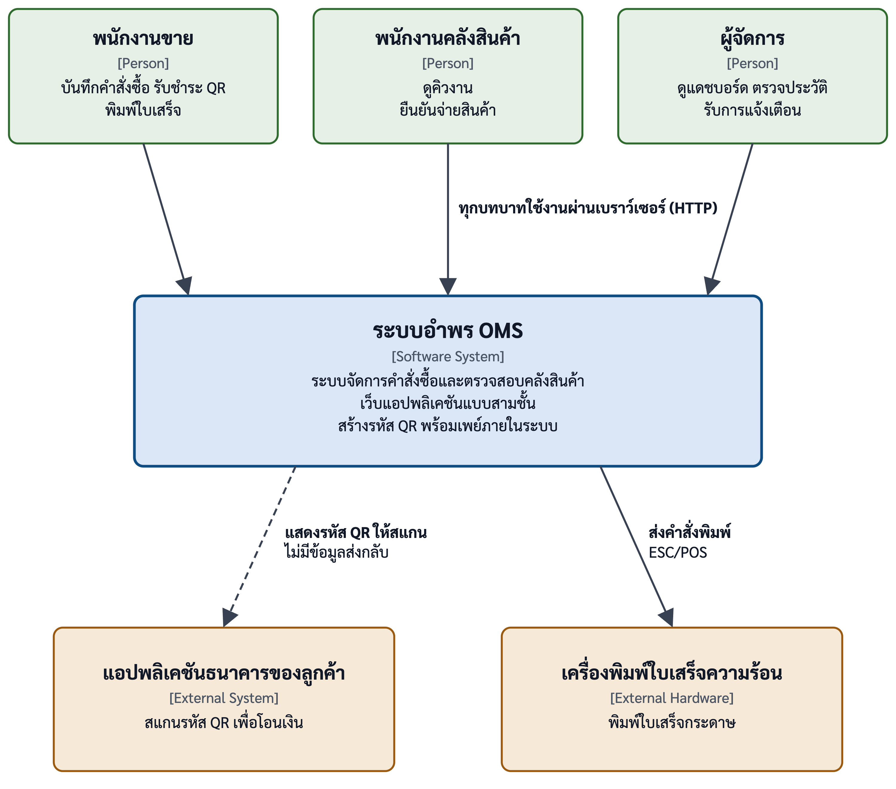
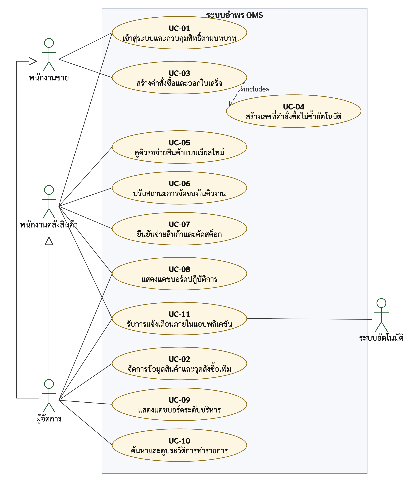
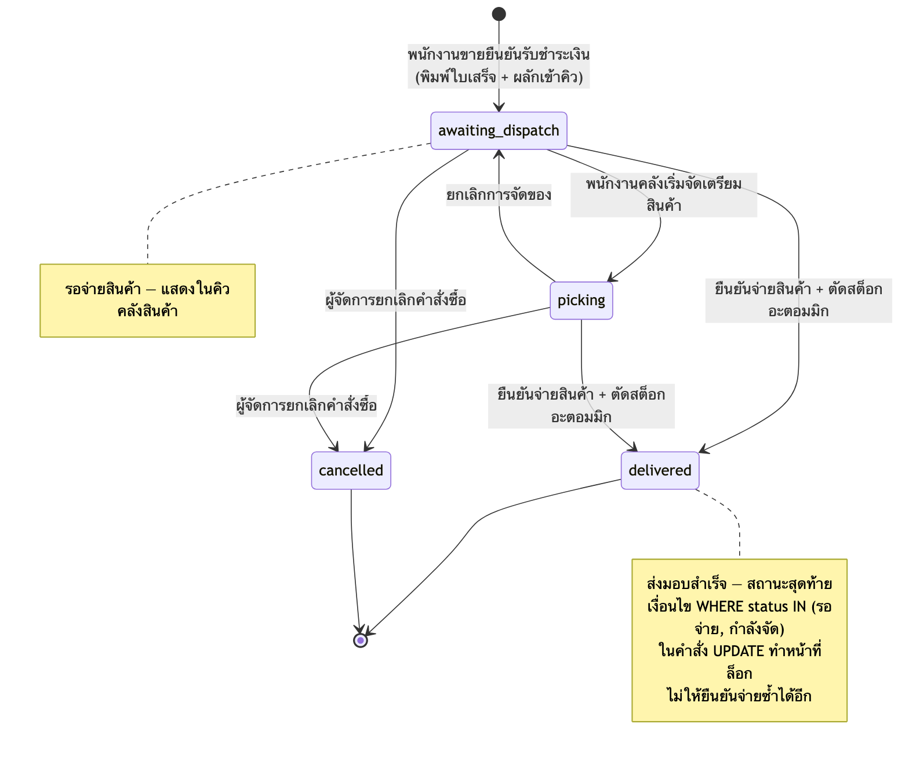
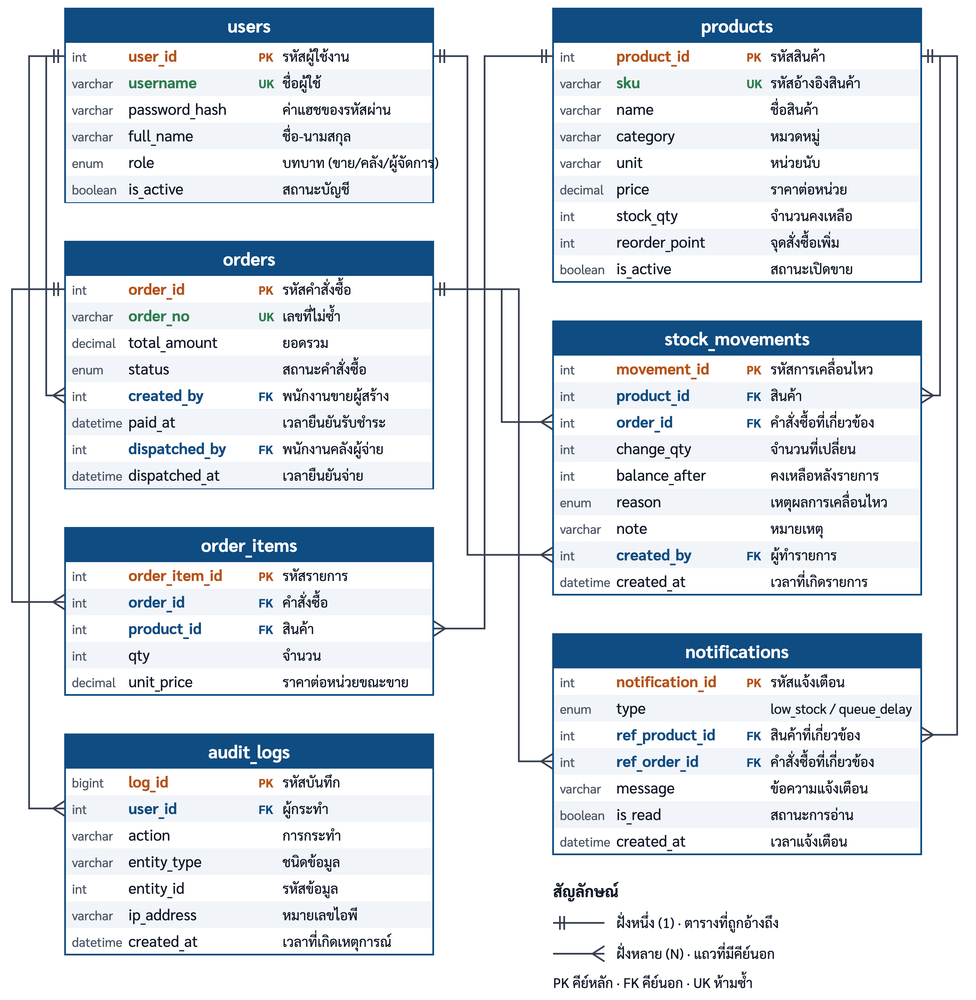

เอกสารข้อกำหนดความต้องการซอฟต์แวร์ (Software Requirements Specification)

อำพร OMS — ระบบจัดการคำสั่งซื้อและตรวจสอบคลังสินค้า ร้านวัสดุก่อสร้างอำพรคอนกรีต

| รายการ | รายละเอียด |
|---------------------|-------------------------------------------------------------------------------|
| เอกสาร | เอกสารข้อกำหนดความต้องการซอฟต์แวร์ ฉบับ 3.0 |
| ฉบับ | 3.0 |
| สถานะ | ฉบับสมบูรณ์ประกอบปริญญานิพนธ์ ภาคผนวก ก |
| กรณีศึกษา | ร้านวัสดุก่อสร้างอำพรคอนกรีต |
| ผู้จัดทำ | นายตรัยรัตน์ วงษ์สิทธิ์ 67543210028-6 · นายพนาวุฒน์ อภิปสันติ 67543210040-1 |
| อาจารย์ที่ปรึกษา | อาจารย์ธนิต เกตุแก้ว |
| วันที่ | 1/10/2569 |

ขอบเขตของเอกสารฉบับนี้ คือกำหนดความต้องการของระบบอำพร OMS พร้อมเกณฑ์และวิธีทวนสอบ ส่วนผลการทดสอบจริงรายงานไว้ในบทที่ 4 ของปริญญานิพนธ์ และเอกสารนี้ไม่รวมข้อมูลภายในของสถานประกอบการ เช่น ยอดขายจริง หมายเลขพร้อมเพย์ของร้าน และรหัสผ่านของผู้ใช้

# 1. บทนำ (Introduction)

## 1.1 วัตถุประสงค์ของเอกสาร (Purpose)

เอกสารนี้กำหนดความต้องการซอฟต์แวร์ของระบบจัดการคำสั่งซื้อและตรวจสอบคลังสินค้า (อำพร OMS) สำหรับร้านวัสดุก่อสร้างอำพรคอนกรีต โดยเล่าผ่านกรณีการใช้งาน UC-01 ถึง UC-11 พร้อมลำดับเหตุการณ์หลัก ทางเลือก และข้อยกเว้น และเกณฑ์การยอมรับ เพื่อให้ผู้พัฒนา ผู้ทดสอบ อาจารย์ที่ปรึกษา และเจ้าของร้านตรวจสอบขอบเขต พฤติกรรม กฎทางธุรกิจ แบบจำลอง และการสอบกลับ ร่วมกันได้จากเอกสารฉบับเดียว ความต้องการทุกข้อสืบกลับไปยังหลักฐานหน้างาน EV-01 ถึง EV-09 ในปริญญานิพนธ์บทที่ 3

ฉบับ 3.0 นี้ปรับปรุงหลังการทดสอบและการติดตั้งที่ร้าน ความต้องการทุกข้อได้รับการทวนสอบแล้ว ผลอยู่ในบทที่ 4 ตารางที่ 4.11 ส่วนประเด็นที่ยังต้องยืนยันหลังการใช้งานจริงระบุไว้ในส่วนที่ 9

## 1.2 ข้อตกลงของเอกสาร (Document Conventions)

| ข้อตกลง | ความหมาย |
|-------------|---------------------------------------------------------------------------------------|
| FR-xx | ความต้องการเชิงหน้าที่ (Functional Requirement) ตามตารางที่ 3.5 ของปริญญานิพนธ์ |
| NFR-xx | ความต้องการนอกเหนือหน้าที่ (Non-functional Requirement) ตามตารางที่ 3.8 |
| BR-xx | กฎทางธุรกิจ (Business Rule) ตามตารางที่ 3.6 |
| US-xx / UC-xx | เรื่องเล่าของผู้ใช้ (User Story) และกรณีการใช้งาน ตามตารางที่ 3.4 และ 3.7 |
| AC-xx | เกณฑ์การยอมรับ (Acceptance Criterion) แบบเงื่อนไขตั้งต้น การกระทำ และผลที่ต้องเกิด ตามตารางที่ 3.11 |
| EV-xx | หลักฐานจากหน้างาน (Evidence) ตามตารางที่ 3.2 |
| M-xx | องค์ประกอบของแบบจำลอง (Model Element) ในส่วนที่ 8 |
| CON-xx | ข้อจำกัด (Constraint) ของโครงงาน |
| ต้อง | ข้อกำหนดที่จำเป็นและตรวจสอบได้ |
| ควร | ข้อกำหนดลำดับรองหรือขึ้นกับนโยบายของร้าน |
| นอกขอบเขต | เก็บไว้เพื่อสอบกลับ แต่ไม่พัฒนาในโครงงานนี้ |
| TBD | ยังรอข้อมูลหรือการทวนสอบ ห้ามถือเป็นข้อกำหนดที่อนุมัติแล้ว |

รหัสทุกชุดเป็นชุดเดียวกับปริญญานิพนธ์ ไม่แปลงรหัส

## 1.3 ผู้อ่านและแนวทางการอ่าน (Intended Audience and Reading Suggestions)

| ผู้อ่าน | อ่านส่วนที่แนะนำ | จุดประสงค์ |
|--------------------|-------------------------|-------------------------------------------------------|
| เจ้าของร้าน | ส่วนที่ 1, 2, 5.5 และ 9 | ยืนยันขอบเขต บทบาทผู้ใช้ กฎทางธุรกิจ และประเด็นที่ยังเปิดอยู่ |
| อาจารย์ที่ปรึกษา | ทุกส่วน โดยเน้นส่วนที่ 4, 10 และ 11 | ตรวจว่าความต้องการสืบกลับถึงหลักฐานได้ และกรณีการใช้งานครอบคลุม FR ครบ |
| ผู้พัฒนา | ส่วนที่ 2 ถึง 6 และ 8 | เข้าใจหน้าที่ ส่วนต่อประสาน สถานะ และข้อจำกัด โดยไม่ตีความเกินหลักฐาน |
| ผู้ทดสอบ | ส่วนที่ 4, 5 และ 10 ถึง 12 | ออกแบบกรณีทดสอบจากลำดับเหตุการณ์และ AC แล้วตรวจความครอบคลุม |

## 1.4 ขอบเขตของผลิตภัณฑ์ (Product Scope)

ร้านวัสดุก่อสร้างอำพรคอนกรีตมีจุดชำระเงินหน้าร้านและจุดจ่ายสินค้าที่คลังอยู่คนละที่ และใช้บิลกระดาษเป็นตัวกลางระหว่างสองจุด ทำให้ยอดสินค้าคงเหลือในบันทึกไม่ตรงกับของจริง มีการนำบิลเก่ามารับสินค้าซ้ำ และคลังไม่ทราบล่วงหน้าว่ามีคำสั่งซื้อใดรออยู่ (EV-01 ถึง EV-09) ระบบอำพร OMS จึงต้องเป็นแหล่งข้อมูลหลักของคำสั่งซื้อและสต็อก ให้หน้าร้านกับคลังเห็นข้อมูลชุดเดียวกันทันที และให้ผู้จัดการติดตามภาพรวมได้โดยไม่ต้องเดินไปดู

| อยู่ในขอบเขต | ไม่อยู่ในขอบเขต |
|--------------------------------------------------|--------------------------------------------------|
| เว็บแอปพลิเคชันแบบเรสปอนซีฟสำหรับสามบทบาท: พนักงานขาย พนักงานคลังสินค้า ผู้จัดการ | แอปพลิเคชันแบบเนทีฟบนโทรศัพท์เคลื่อนที่ |
| เข้าสู่ระบบ ควบคุมสิทธิ์ตามบทบาท และจัดการข้อมูลสินค้ารวมหมวดหมู่และจุดสั่งซื้อเพิ่ม | ระบบบัญชีเต็มรูปแบบ |
| รับชำระด้วยรหัสคิวอาร์พร้อมเพย์ พิมพ์ใบเสร็จผ่านเครื่องพิมพ์ความร้อน และส่งคำสั่งซื้อเข้าคิวคลังทันที | เพย์เมนต์เกตเวย์ (payment gateway) เครื่องรูดบัตร และการตรวจสอบเงินเข้าอัตโนมัติผ่านบริการของธนาคาร (การรับชำระเงินสดเพิ่มหลังการสอบ ดูภาคผนวก ซ) |
| คิวรอจ่ายสินค้าแบบเรียลไทม์ และยืนยันจ่ายสินค้าพร้อมตัดสต็อกแบบอะตอมมิก (atomic) | การเชื่อมต่อระบบอีอาร์พี (ERP) หรือซัพพลายเออร์ภายนอก |
| แดชบอร์ดสองระดับ ประวัติการทำรายการ และการแจ้งเตือนภายในแอป | การแจ้งเตือนผ่านแอปพลิเคชันส่งข้อความ หรืออีเมล และโมดูลปัญญาประดิษฐ์ช่วยวิเคราะห์ (งานในอนาคต) |

ความหมายหลักของระบบ คือ การยืนยันรับชำระเงินเป็นจุดเดียวที่คำสั่งซื้อถูกบันทึก พิมพ์ใบเสร็จ และเข้าคิวคลัง (BR-01) และการจ่ายสินค้ากับการตัดสต็อกเป็นธุรกรรมเดียวกัน สำเร็จทั้งหมดหรือไม่เกิดเลย (BR-02)

## 1.5 เอกสารอ้างอิง (References)

| รหัส | เอกสาร/แหล่งอ้างอิง | การใช้ในเอกสารนี้ |
|-------------|---------------------------------------|-----------------------------------------------------|
| REF-01 | ปริญญานิพนธ์บทที่ 1 บทนำ | ที่มาของปัญหา วัตถุประสงค์เชิงผลิตภัณฑ์ข้อ 1 ถึง 4 และเชิงการเรียนรู้ข้อ 1 ถึง 2 ขอบเขต ข้อจำกัด และข้อสมมติ ในหัวข้อ 1.2 และ 1.3 |
| REF-02 | ปริญญานิพนธ์บทที่ 2 ทฤษฎี เทคโนโลยี และงานที่เกี่ยวข้อง | เหตุผลของการตัดสินใจออกแบบ เช่น ธุรกรรม การล็อกเชิงบวก เครื่องสถานะ และช่องทางค้าง |
| REF-03 | ปริญญานิพนธ์บทที่ 3 การวิเคราะห์และออกแบบระบบ | หลักฐาน EV, ความต้องการ FR/NFR/BR, US/UC/AC, สถาปัตยกรรม แบบจำลอง และแผนการทดสอบ TC-01 ถึง TC-13 |
| REF-04 | ซอร์สโค้ดระบบอำพร OMS โฟลเดอร์ `soml/` ณ วันจัดทำเล่ม | พฤติกรรมจริงที่ใช้ยืนยันลำดับเหตุการณ์ของแต่ละกรณีการใช้งาน และชุดทดสอบอัตโนมัติ |

# 2. รายละเอียดโดยรวม (Overall Description)

## 2.1 มุมมองผลิตภัณฑ์ (Product Perspective)

อำพร OMS เป็นระบบใหม่ที่พัฒนาขึ้นแทนการใช้บิลกระดาษเป็นตัวกลางระหว่างจุดชำระเงินหน้าร้านกับจุดจ่ายสินค้าที่คลัง ระบบเป็นแหล่งข้อมูลหลักของคำสั่งซื้อ ยอดสินค้าคงเหลือ การเคลื่อนไหวสต็อก และประวัติการทำรายการ ตัวเลขที่แสดงทุกจุดต้องมาจากข้อมูลชุดนี้ ไม่มีสมุดหรือบิลคู่ขนาน ผู้ใช้สามบทบาทเข้าถึงระบบผ่านเบราว์เซอร์ และระบบติดต่อกับองค์ประกอบภายนอกสองรายการ คือเครื่องพิมพ์ใบเสร็จความร้อนที่หน้าร้าน (ระบบส่งคำสั่งพิมพ์ออกไป) และแอปพลิเคชันธนาคารของลูกค้า (ระบบแสดงรหัสคิวอาร์ให้สแกน แต่ไม่ได้รับข้อมูลใดกลับ)

ลูกค้าไม่ใช่ผู้ใช้ระบบ เพราะไม่มีบัญชีและไม่กระทำการใดกับระบบโดยตรง การยืนยันว่าเงินเข้าแล้วเป็นการกระทำของพนักงานขายหลังตรวจจากแอปพลิเคชันธนาคารด้วยตนเอง ข้อเท็จจริงนี้กำหนดพฤติกรรมของระบบทั้งหมด และเป็นเหตุผลที่ระบบไม่มีสถานะ "รอชำระเงิน" (ดูส่วนที่ 2.5 CON-03)

{width=14cm}

*รูปที่ 1 แผนภาพบริบทของระบบ (System Context) ตรงกับรูปที่ 3.3 ของปริญญานิพนธ์*

## 2.2 หน้าที่หลักของผลิตภัณฑ์ (Product Functions)

| กลุ่มความสามารถ | หน้าที่หลัก | ความต้องการที่ครอบคลุม |
|--------------------------------------|----------------------------------------------|----------------|
| CAP-01 ยืนยันตัวตนและควบคุมสิทธิ์  | เข้าสู่ระบบ ออกโทเคนที่ระบุบทบาท และตรวจสิทธิ์ทุกคำขอที่เซิร์ฟเวอร์ | FR-01, NFR-01 |
| CAP-02 ข้อมูลสินค้าและจุดสั่งซื้อเพิ่ม  | เพิ่ม แก้ไขสินค้า หมวดหมู่ ราคา จุดสั่งซื้อเพิ่ม และปรับสต็อกด้วยมือพร้อมเหตุผล | FR-02, BR-05 |
| CAP-03 ขายและออกใบเสร็จ  | สร้างคำสั่งซื้อ คำนวณยอด แสดงรหัสคิวอาร์พร้อมเพย์ ยืนยันรับเงิน พิมพ์ใบเสร็จ และผลักเข้าคิวในการกระทำเดียว | FR-03, BR-01, NFR-05 |
| CAP-04 คิวรอจ่ายสินค้าแบบเรียลไทม์  | แสดงคิวที่อัปเดตเองผ่านช่องทางค้าง และปรับสถานะการจัดของตามแผนภาพสถานะ | FR-04, BR-03, NFR-02 |
| CAP-05 จ่ายสินค้าและตัดสต็อกแบบอะตอมมิก  | ยืนยันจ่ายสินค้าและตัดสต็อกในธุรกรรมเดียว ป้องกันการจ่ายซ้ำและยอดติดลบ | FR-05, FR-06, BR-02, NFR-04 |
| CAP-06 ทัศนวิสัยเชิงปฏิบัติการ  | แดชบอร์ดระดับปฏิบัติการและระดับบริหาร คำนวณสดจากฐานข้อมูล | FR-07, BR-04 |
| CAP-07 แจ้งเตือนเชิงรุก  | สร้างการแจ้งเตือนเองเมื่อสินค้าต่ำกว่าจุดสั่งซื้อเพิ่มหรือคิวค้างนาน | FR-08, BR-05 |
| CAP-08 สอบกลับได้  | บันทึกทุกเหตุการณ์สำคัญพร้อมผู้กระทำ เวลา และไอพี และค้นย้อนหลังได้ | FR-09 |

สรุปเรื่องเล่าของผู้ใช้ตามตารางที่ 3.4 ของปริญญานิพนธ์ แสดงในตารางถัดไป

| รหัส | เรื่องเล่าของผู้ใช้ | ความครอบคลุม |
|-------------|---------------------------------------------------------|----------------------------------|
| US-01 | ในฐานะพนักงานขาย ฉันต้องการบันทึกคำสั่งซื้อและออกใบเสร็จจากระบบในขั้นตอนเดียว เพื่อไม่ต้องเขียนบิลด้วยมือและไม่ต้องคำนวณยอดเอง | FR-01, FR-03; UC-01, UC-03, UC-04; AC-03, AC-04 |
| US-02 | ในฐานะพนักงานคลังสินค้า ฉันต้องการเห็นคำสั่งซื้อใหม่ขึ้นบนหน้าจอเองโดยไม่ต้องกดรีเฟรช เพื่อเริ่มจัดของได้ทันทีก่อนลูกค้าเดินมาถึง | FR-04; UC-05, UC-06; AC-06 |
| US-03 | ในฐานะพนักงานคลังสินค้า ฉันต้องการให้ระบบกันไม่ให้จ่ายของซ้ำจากใบเดิม เพื่อไม่ต้องจำเองว่าใบไหนจ่ายไปแล้ว | FR-05, FR-06; UC-07; AC-07, AC-08 |
| US-04 | ในฐานะผู้จัดการ ฉันต้องการเห็นยอดขายและคิวงานระหว่างวันได้ทันที เพื่อไม่ต้องรอสรุปตอนปิดร้าน | FR-07; UC-08, UC-09; AC-09 |
| US-05 | ในฐานะผู้จัดการ ฉันต้องการให้ระบบเตือนเมื่อสินค้าใกล้หมด เพื่อสั่งของได้ทันก่อนของขาดมือ | FR-02, FR-08; UC-02, UC-11; AC-02, AC-10 |
| US-06 | ในฐานะผู้จัดการ ฉันต้องการค้นหาย้อนหลังได้ว่าใครทำรายการใดเมื่อไร เพื่อตรวจสอบได้เมื่อยอดไม่ตรง | FR-09; UC-10; AC-11 |

## 2.3 กลุ่มผู้ใช้และคุณลักษณะ (User Classes and Characteristics)

| ผู้กระทำหรือกลุ่มผู้ใช้ | เป้าหมายและลักษณะ | ขอบเขตอำนาจ |
|----------------|------------------------------------------|------------------------------------------|
| พนักงานขาย  | อยู่ประจำจุดชำระเงินหน้าร้าน ต้องบันทึกการขายและออกใบเสร็จได้ในหน้าจอเดียวขณะลูกค้ายืนรอ ค้นหาสินค้า สร้างคำสั่งซื้อ แสดงรหัสคิวอาร์ยืนยันรับชำระเงิน | ยืนยันจ่ายสินค้า แก้ไขข้อมูลสินค้า ดูแดชบอร์ด ประวัติ และการแจ้งเตือนไม่ได้ |
| พนักงานคลังสินค้า  | เดินอยู่ในคลัง ใช้แท็บเล็ตหรือโทรศัพท์เคลื่อนที่ ต้องรู้ว่ามีคำสั่งซื้อรออยู่โดยไม่ต้องรอลูกค้ามาบอก ดูคิว เปลี่ยนสถานะการจัดของ ยืนยันจ่ายสินค้า ดูแดชบอร์ดปฏิบัติการ อ่านการแจ้งเตือน | สร้างคำสั่งซื้อ แก้ไขสินค้า ยกเลิกคำสั่งซื้อ ทำเครื่องหมายอ่านการแจ้งเตือน ดูประวัติ และดูแดชบอร์ดระดับบริหารไม่ได้ |
| ผู้จัดการ  | เจ้าของหรือผู้ดูแลร้าน ต้องเห็นภาพรวมทันทีที่เปิดดู ทำงานแทนพนักงานได้เมื่อคนไม่พอ ทำได้ทุกอย่างของสองบทบาทแรก รวมทั้งจัดการสินค้า ปรับสต็อก ยกเลิกคำสั่งซื้อ ดูแดชบอร์ดทั้งสองระดับ ค้นประวัติ ทำเครื่องหมายอ่านการแจ้งเตือน | ตั้งสถานะส่งมอบสำเร็จโดยตรงไม่ได้ (ต้องผ่านธุรกรรมตัดสต็อก) และแก้ไขหรือลบประวัติที่บันทึกแล้วไม่ได้ |
| ระบบ  | ทำสิ่งที่ต้องเกิดเองโดยไม่รอผู้ใช้: ออกเลขที่คำสั่งซื้อ (UC-04) เปลี่ยนสถานะตามผลธุรกรรม ผลักเหตุการณ์ไปหน้าจอ ตรวจเงื่อนไขและสร้างการแจ้งเตือน (UC-11) | ตัดสินใจแทนผู้ใช้ไม่ได้ เช่น ยืนยันรับชำระเงินเองหรือยืนยันจ่ายสินค้าเอง |

ไม่มีบทบาทผู้ดูแลระบบแยกต่างหาก สิทธิ์ดังกล่าวรวมอยู่ในผู้จัดการ เนื่องจากขนาดของร้าน และลูกค้าไม่ใช่ผู้กระทำของระบบตามที่อธิบายในส่วนที่ 2.1

## 2.4 สภาพแวดล้อมการทำงาน (Operating Environment)

- ผู้ใช้เข้าถึงระบบผ่านเว็บเบราว์เซอร์โครม (Chrome), เอดจ์ (Edge) หรือ ไฟร์ฟอกซ์ (Firefox) รุ่นล่าสุด (NFR-07) บนคอมพิวเตอร์ที่จุดชำระเงิน และบนแท็บเล็ตหรือสมาร์ตโฟนที่คลัง ซึ่งหน้าจอคิวและยืนยันจ่ายต้องใช้งานได้ที่ความกว้าง 390 พิกเซล (NFR-03)
- ทุกจุดทำงานอยู่บนเครือข่ายภายในร้านเดียวกัน ทั้งสี่หน่วยติดตั้ง ได้แก่ ส่วนติดต่อผู้ใช้ ระบบหลังบ้าน บริการพิมพ์ใบเสร็จ และฐานข้อมูล ทำงานบนคอมพิวเตอร์ระบบปฏิบัติการวินโดวส์ (Windows) ของร้านเครื่องเดียว โดยฐานข้อมูลใช้มายเอสคิวแอล (MySQL) 8.0 ตามรูปที่ 3.6 ของปริญญานิพนธ์
- บริการพิมพ์ใบเสร็จทำงานบนเครื่องคอมพิวเตอร์หน้าร้านที่ต่อกับเครื่องพิมพ์เอปสัน (Epson) TM-T82 ผ่านยูเอสบี (USB) เท่านั้น จึงเป็นหน่วยติดตั้งแยกจากระบบหลังบ้าน (ตารางที่ 3.15)
- ระบบไม่พึ่งพาบริการภายนอกใดในขณะทำงาน รหัสคิวอาร์พร้อมเพย์สร้างภายในระบบเอง

## 2.5 ข้อจำกัดของการออกแบบและการพัฒนา (Design and Implementation Constraints)

| ข้อจำกัด | ผลต่อการออกแบบ/พัฒนา |
|--------------------------------------------------|--------------------------------------------------|
| CON-01 เทคโนโลยีตามตารางที่ 3.15: รีแอ็กต์ (React) และ ไวต์ (Vite), โหนดเจเอส (Node.js) และ เอ็กซ์เพรสเจเอส (Express.js), มายเอสคิวแอล 8.0 อินโนดีบี (InnoDB) และบริการพิมพ์บนโหนดเจเอส | โครงสร้างสามชั้นเชิงตรรกะ สี่หน่วยติดตั้ง ธุรกรรมและการล็อกใช้ความสามารถของอินโนดีบี โดยตรง |
| CON-02 ทีมพัฒนาสองคน ระยะเวลา 6 เดือน | ต้องคุมขอบเขตตามส่วนที่ 1.4 ไม่เพิ่มคุณลักษณะที่ไม่มีหลักฐาน EV รองรับ |
| CON-03 ไม่มีเพย์เมนต์เกตเวย์การยืนยันรับเงินเป็นการกระทำของพนักงานขาย | ระบบไม่มีสถานะรอชำระเงิน คำสั่งซื้อถูกบันทึกครั้งเดียวตอนยืนยันรับชำระ (BR-01) และไม่มีสถานะตะกร้าในฐานข้อมูล |
| CON-04 เครื่องพิมพ์เอปสัน TM-T82 ใช้ชุดคำสั่งอีเอสซีโพส (ESC/POS) รหัสอักขระ มอก. 620 กระดาษ 80 มม. 48 ตัวอักษร | บริการพิมพ์ต้องแปลงข้อความไทยเป็น มอก. 620 และจัดคอลัมน์ใบเสร็จตามความกว้างนี้ การพิมพ์ล้มต้องไม่ทำให้การขายล้ม |
| CON-05 สถานะส่งมอบสำเร็จเกิดได้ทางเดียวคือผ่านธุรกรรมตัดสต็อก (หัวข้อ 3.4.2.2) | เส้นทางปรับสถานะทั่วไปต้องปฏิเสธการตั้งค่านี้ และเงื่อนไขสถานะเดิมต้องอยู่ในคำสั่งปรับปรุงข้อมูลเดียวกัน (ล็อกเชิงบวก) |
| CON-06 หนึ่งหน้าจอทำงานเดียว และการกระทำที่ย้อนกลับไม่ได้ต้องยืนยันซ้ำ (หัวข้อ 3.4.3.1) | หน้าจอเก้าหน้าตามตารางที่ 3.18 ไม่รวมงานหลายอย่างในหน้าเดียว ปุ่มยืนยันจ่ายสินค้าต้องกดสองครั้ง |
| CON-07 ค่าลับของร้าน (หมายเลขพร้อมเพย์ รหัสผ่านฐานข้อมูล กุญแจลงนามโทเคน) ต้องไม่อยู่ในที่เก็บซอร์สโค้ด | เก็บในไฟล์ตั้งค่าที่ไม่ถูกส่งเข้าที่เก็บโค้ด ระบบปฏิเสธการเริ่มทำงานถ้ากุญแจลงนามโทเคนยังเป็นค่าตัวอย่าง |

## 2.6 เอกสารสำหรับผู้ใช้ (User Documentation)

- คู่มือพนักงานขาย: ขั้นตอนขาย แสดงรหัสคิวอาร์ตรวจเงินเข้าจากแอปพลิเคชันธนาคารก่อนกดยืนยัน และสิ่งที่ต้องทำเมื่อใบเสร็จไม่พิมพ์
- คู่มือพนักงานคลังสินค้า: อ่านคิว เปลี่ยนสถานะการจัดของ ยืนยันจ่ายสินค้า และความหมายของข้อความ "ถูกจ่ายไปแล้ว" และ "สต็อกไม่พอ"
- คู่มือผู้จัดการ: จัดการสินค้าและหมวดหมู่ ตั้งจุดสั่งซื้อเพิ่ม ปรับสต็อกพร้อมเหตุผล อ่านแดชบอร์ด การแจ้งเตือน และค้นประวัติ
- คู่มือติดตั้งระบบบนเครื่องใหม่ สำหรับใช้ทวนสอบ NFR-09

คู่มือผู้ใช้ของทั้งสามบทบาทและคู่มือการติดตั้งจัดทำแล้ว อยู่ในภาคผนวก จ ของปริญญานิพนธ์

## 2.7 ข้อสมมติและการพึ่งพา (Assumptions and Dependencies)

| ประเภท | รายการ | สถานะ/ผลกระทบ |
|-------------|----------------------------------------------|----------------------------------------------|
| การพึ่งพา | เครื่องพิมพ์เอปสัน TM-T82 ของร้านและสายยูเอสบี พร้อมใช้ที่เครื่องหน้าร้าน | จำเป็นต่อ FR-03 และ NFR-05 ทดสอบพิมพ์ภาษาไทยกับเครื่องจริงแล้วตาม TC-12 |
| การพึ่งพา | หมายเลขพร้อมเพย์ของร้านถูกตั้งค่าในระบบ | หากไม่ตั้ง ระบบปฏิเสธการสร้างรหัสคิวอาร์ และขายไม่ได้ (ข้อยกเว้นของ UC-03) |
| การพึ่งพา | เครือข่ายภายในร้านครอบคลุมถึงคลังและเสถียร | หากสัญญาณไม่ถึง NFR-02 ไม่ผ่านแม้ระบบถูกต้อง ต้องตรวจก่อนติดตั้ง |
| การพึ่งพา | ยอดสต็อกตั้งต้นนำเข้าจากไฟล์สต็อกของร้าน (28 ก.ค. 2569) | หากยอดตั้งต้นผิด ยอดในระบบจะคลาดเคลื่อนตั้งแต่เริ่ม ต้องนับของจริงเทียบก่อนใช้งาน |
| ข้อสมมติ | พนักงานขายตรวจการแจ้งเตือนเงินเข้าจากแอปพลิเคชันธนาคารก่อนกดยืนยันรับชำระเงิน | ระบบไม่รู้ผลการโอนเอง หากละเลย จะมีคำสั่งซื้อที่ยังไม่ได้รับเงินจริง ต้องอบรมก่อนใช้งาน |
| ข้อสมมติ | พนักงานคลังจ่ายสินค้าผ่านระบบทุกครั้ง ไม่จ่ายออกโดยไม่บันทึก | หากละเลย BR-02 ไม่เป็นจริง ต้องอบรมก่อนใช้งาน |
| ข้อสมมติ | เครื่อง TM-T82 รองรับตารางรหัสอักขระไทยหมายเลข 21 | หากไม่รองรับ ต้องเปลี่ยนค่าในการตั้งค่าของบริการพิมพ์ ไม่ต้องแก้โค้ด |
| นโยบายที่ยังเปิด | เกณฑ์คิวค้างนานผิดปกติ 30 นาที (ตั้งค่าได้) | ยังไม่ได้ยืนยันกับเจ้าของร้าน (TBD-03) |

# 3. ความต้องการด้านส่วนต่อประสานภายนอก (External Interface Requirements)

## 3.1 ส่วนต่อประสานผู้ใช้ (User Interfaces)

ส่วนนี้กำหนดลักษณะเชิงตรรกะของหน้าจอเพื่อรองรับความต้องการ โดยอ้างหน้าจอเก้าหน้าตามตารางที่ 3.18 และองค์ประกอบตามตารางที่ 3.24 ของปริญญานิพนธ์ ไม่ล็อกโครงร่างหน้าจอ หรือไลบรารีส่วนติดต่อผู้ใช้ หลักการที่ใช้กับทุกหน้าจอมีสามข้อตามหัวข้อ 3.4.3.1 คือ หนึ่งหน้าจอทำงานเดียว การกระทำที่ย้อนกลับไม่ได้ต้องยืนยันซ้ำ และหน้าจอที่ใช้ในคลังต้องใช้ได้บนอุปกรณ์เคลื่อนที่

| หน้าจอเชิงตรรกะ | ข้อมูลและการกระทำที่ต้องรองรับ | บทบาท | การสอบกลับ |
|-------------|-----------------------------------------------|----------------|-----------------------|
| เข้าสู่ระบบ | ชื่อผู้ใช้ รหัสผ่าน ข้อความผิดพลาดแบบเดียวกันทุกกรณี และพาไปหน้าแรกตามบทบาท | ทุกคน | FR-01; UC-01; AC-01, AC-12 |
| ขายหน้าร้าน | ปุ่มเลือกหมวดหมู่ ช่องค้นหาสินค้า ตารางรายการที่เลือกพร้อมจำนวน ยอดรวมที่คำนวณจากเซิร์ฟเวอร์ ปุ่มแสดงรหัสคิวอาร์ และปุ่มยืนยันรับชำระเงิน คำเตือนเมื่อพิมพ์ใบเสร็จไม่สำเร็จ | พนักงานขาย ผู้จัดการ | FR-03; UC-03, UC-04; AC-03, AC-04, AC-05 |
| คิวรอจ่ายสินค้า | รายการคำสั่งซื้อเรียงตามเวลาชำระ สถานะ เวลารอคอย อัปเดตเองเมื่อมีเหตุการณ์ ปุ่มเริ่มจัดของ / ยกเลิกการจัด | พนักงานคลัง ผู้จัดการ | FR-04; UC-05, UC-06; AC-06 |
| ยืนยันจ่ายสินค้า | รายการสินค้าที่ต้องจัดพร้อมจำนวน ปุ่มยืนยันที่ต้องกดสองครั้ง ข้อความ "ถูกจ่ายไปแล้ว" หรือ "สต็อกไม่พอ" เมื่อถูกปฏิเสธ | พนักงานคลัง ผู้จัดการ | FR-05, FR-06; UC-07; AC-07, AC-08 |
| แดชบอร์ดปฏิบัติการ | กล่องต้องดูแลวันนี้ (คิวที่รอเกินเกณฑ์ สินค้าที่ต่ำกว่าจุดสั่งซื้อเพิ่ม การแจ้งเตือนที่ยังไม่อ่าน พร้อมลิงก์ไปหน้าที่เกี่ยวข้อง) ยอดขายวันนี้ จำนวนคิวค้าง และรายการสินค้าที่ต่ำกว่าจุดสั่งซื้อเพิ่ม | ผู้จัดการ พนักงานคลัง | FR-07; UC-08; AC-09 |
| แดชบอร์ดระดับบริหาร | แนวโน้มยอดขายรายวันย้อนหลัง และสินค้าขายดี | ผู้จัดการ | FR-07; UC-09; ทวนสอบร่วมกับ TC-08 |
| จัดการข้อมูลสินค้า | ตารางสินค้ากรองตามหมวดหมู่และค้นหา เพิ่มสินค้า แก้ไขหมวดหมู่ ราคา จุดสั่งซื้อเพิ่ม เปิด/ปิดขาย และปรับสต็อกด้วยมือพร้อมช่องเหตุผล | ผู้จัดการ | FR-02; UC-02; AC-02 |
| การแจ้งเตือน | รายการแจ้งเตือนที่ยังไม่อ่านขึ้นก่อน ชนิด ข้อความ เวลา ปุ่มทำเครื่องหมายอ่านแล้ว (เฉพาะผู้จัดการ) และจำนวนที่ยังไม่อ่านแสดงบนเมนูของทุกหน้าจอ | ผู้จัดการ พนักงานคลัง (อ่าน) | FR-08; UC-11; AC-10 |
| ประวัติการทำรายการ | ตัวกรองช่วงวันที่และประเภทการกระทำ ผลค้นหาแสดงผู้กระทำ การกระทำ ข้อมูลที่ถูกกระทำ (ชื่ออ่านได้) ไอพี และเวลา | ผู้จัดการ | FR-09; UC-10; AC-11 |

ข้อกำหนดด้านถ้อยคำบนหน้าจอ คือ ปุ่มบนหน้าขายต้องใช้คำว่า "ยืนยันรับชำระเงิน" ไม่ใช่ "ชำระเงิน" เพราะระบบไม่ได้รับเงินเอง พนักงานเป็นผู้ยืนยันว่าเห็นเงินเข้าแล้ว และเมื่อเปิดคำสั่งซื้อที่ส่งมอบสำเร็จแล้ว หน้าจอต้องแจ้งว่าถูกจ่ายไปแล้ว ให้ผู้ใช้เข้าใจว่าเป็นสถานะที่ย้อนกลับไม่ได้

โหมดการแสดงผล คือ ทุกหน้าจอมีปุ่มสลับโหมดสว่างและโหมดมืดตามหัวข้อ 3.4.3.1 เปลี่ยนเฉพาะสีที่แสดงผล ไม่กระทบข้อมูลหรือสิทธิ์ และจดจำไว้ในเบราว์เซอร์ของแต่ละเครื่อง

## 3.2 ส่วนต่อประสานฮาร์ดแวร์ (Hardware Interfaces)

| อุปกรณ์ | การเชื่อมต่อ | ข้อกำหนด | การสอบกลับ |
|--------------------|--------------------------------|--------------------------------|---------------|
| เครื่องพิมพ์ใบเสร็จความร้อนเอปสัน TM-T82 (ของร้าน) | ยูเอสบีเข้ากับเครื่องคอมพิวเตอร์หน้าร้าน บนวินโดวส์ส่งไบต์ตรงไปยังเครื่องพิมพ์ที่แชร์ชื่อ `AmpornOMS-Receipt` บนแมคโอเอส (macOS) และ ลินุกซ์ (Linux) ส่งผ่านคิวพิมพ์ของระบบด้วย `lp -o raw` | ชุดคำสั่งอีเอสซีโพส · ตารางรหัสอักขระไทยหมายเลข 21 (มอก. 620) · กระดาษ 80 มม. 48 ตัวอักษรต่อบรรทัด · เครื่องพิมพ์ตอบเพียงผลรับงาน ไม่รายงานกระดาษหมด | FR-03; NFR-05; CON-04; AC-05, AC-14 |

อุปกรณ์อื่นทั้งหมด (คอมพิวเตอร์ แท็บเล็ต สมาร์ตโฟน) เป็นอุปกรณ์มาตรฐานที่ใช้เว็บเบราว์เซอร์ ไม่มีข้อกำหนดเฉพาะนอกเหนือจากหัวข้อ ก.2.4

## 3.3 ส่วนต่อประสานซอฟต์แวร์ (Software Interfaces)

| ส่วนต่อประสานภายนอก | ข้อมูลเข้าสู่ระบบ | ข้อมูลออกจากระบบ | ข้อจำกัดหรือประเด็นที่ยังเปิด |
|----------------------|------------------|------------------------------|------------------------------|
| แอปพลิเคชันธนาคารของลูกค้า (ผ่านรหัสคิวอาร์พร้อมเพย์) | ไม่มี ระบบไม่ได้รับข้อมูลใดกลับ | ข้อความรหัสคิวอาร์ ตามรูปแบบที่แอปพลิเคชันธนาคารทุกแอปอ่านได้ ระบุหมายเลขพร้อมเพย์ของร้านและยอดเงิน ใช้ครั้งเดียว | หมายเลขพร้อมเพย์เก็บในการตั้งค่า ไม่อยู่ในซอร์สโค้ด หากไม่ตั้ง ระบบปฏิเสธการสร้างรหัส · ระบบไม่รู้ผลการโอน (ส่วนที่ 2.7) |
| บริการพิมพ์ใบเสร็จกับระบบหลังบ้าน | ผลรับงานพิมพ์ (สำเร็จ / ล้มเหลวพร้อมสาเหตุ) | ข้อมูลใบเสร็จ: เลขที่ วันเวลา ชื่อพนักงาน รายการ จำนวน ราคา ยอดรวม | บริการพิมพ์ล้มหรือปิดอยู่ต้องไม่ทำให้การขายล้ม หลังบ้านรอผลไม่เกินเวลาที่กำหนดแล้วรายงานคำเตือน (ข้อยกเว้นของ UC-03) |
| ระบบจัดการฐานข้อมูลมายเอสคิวแอล 8.0 อินโนดีบี | ผลของคำสั่งและจำนวนแถวที่ถูกแก้ | คำสั่งอ่าน/เขียนภายในธุรกรรม | ใช้ธุรกรรม การล็อกแถว และข้อบังคับของตาราง ยอดคงเหลือไม่ติดลบ · เขตเวลา +07:00 |

## 3.4 ส่วนต่อประสานการสื่อสาร (Communications Interfaces)

- คำขอและคำตอบผ่านเอชทีทีพี (HTTP) ในรูปแบบ เจสัน (JSON) 19 เส้นทางบริการตามตารางที่ 3.25 (ไม่นับเส้นทางตรวจสถานะการทำงาน `/api/health`) ทุกเส้นทางยกเว้นการเข้าสู่ระบบต้องแนบโทเคนในส่วนหัว ระบุสิทธิ์ และถูกตรวจสิทธิ์ตามบทบาทที่เซิร์ฟเวอร์ก่อนประมวลผล (NFR-01) เส้นทางและบทบาททั้งหมดประกาศในไฟล์เดียว
- ช่องทางค้าง ช่องทางหลักคือ เว็บซ็อกเก็ต (WebSocket) ที่ `/ws?token=` ช่องทางสำรองคือ เหตุการณ์ที่ส่งจากเซิร์ฟเวอร์ (Server-Sent Events) ที่ `/api/events` หน้าจอเลือกช่องทางสำรองเองเมื่อช่องทางหลักเปิดไม่ได้ เหตุการณ์ที่ผลักมีสี่ชนิดคือ `order.created`, `order.status`, `order.dispatched` และ `notification.created` ทุกเหตุการณ์ผลักหลังธุรกรรมยืนยันแล้ว เท่านั้น เพื่อไม่ให้หน้าจอเห็นข้อมูลที่อาจถูกยกเลิก (NFR-02)
- การเข้ารหัสช่องทาง — การเข้าถึงทุกเส้นทางควรผ่านเอชทีทีพีเอส (HTTPS) ปัจจุบันระบบที่ติดตั้งที่ร้านยังทำงานบนเอชทีทีพี ในเครือข่ายของร้าน (TBD-04)
- ระบบหลังบ้านไปยังบริการพิมพ์ คำขอพิมพ์ส่งภายในเครือข่ายร้านไปยังบริการพิมพ์บนเครื่องหน้าร้าน ระบบหลังบ้านรอผลไม่เกินเวลาที่กำหนด และไม่ส่งซ้ำอัตโนมัติ เพื่อไม่ให้พิมพ์ใบเสร็จซ้ำ

# 4. คุณลักษณะของระบบ (System Features)

{height=19cm}

*รูปที่ 2 แผนภาพกรณีการใช้งาน (Use Case Diagram) ของระบบอำพร OMS ตรงกับรูปที่ 3.2 ของปริญญานิพนธ์*

ส่วนนี้จัดหนึ่งหัวข้อต่อหนึ่งกรณีการใช้งานตามลำดับรหัสในตารางที่ 3.7 ของปริญญานิพนธ์ (ส่วนที่ 4.1 คือ UC-01 ถึงส่วนที่ 4.11 คือ UC-11) และคงรหัส FR/BR/AC เดิมทุกตัว กรณีการใช้งานที่ระบบอัตโนมัติเป็นผู้เริ่ม (UC-04 และการสร้างการแจ้งเตือนใน UC-11) เขียนในรูปแบบสิ่งเร้า การตอบสนอง และสถานะผลลัพธ์ แทนลำดับเหตุการณ์ของผู้ใช้ ลำดับเหตุการณ์ทุกข้อทวนสอบกับพฤติกรรมจริงของระบบ (REF-04)

## 4.1 เข้าสู่ระบบและควบคุมสิทธิ์ตามบทบาท — UC-01

| ระดับความสำคัญ | ที่มาและความครอบคลุม |
|----------------|------------------------------------------------------------------------------------|
| สูง ต้องมี | US-01 ถึง US-06 (ทุกเรื่องต้องผ่านกรณีนี้ก่อน); FR-01; NFR-01; AC-01, AC-12 |

| หัวข้อ | รายละเอียด |
|-----------------|-----------------------------------------------------------------------------------|
| เป้าหมาย | ยืนยันตัวตนผู้ใช้ แล้วให้ผู้ใช้เห็นและทำได้เฉพาะสิ่งที่บทบาทของตนมีสิทธิ์ ทั้งที่หน้าจอและที่เซิร์ฟเวอร์ |
| ผู้กระทำหลัก | พนักงานขาย, พนักงานคลังสินค้า, ผู้จัดการ |
| ผู้กระทำร่วม | ไม่มี |
| เหตุเริ่มต้น | ผู้ใช้เปิดระบบเพื่อเริ่มทำงาน หรือโทเคนเดิมหมดอายุ |

### เงื่อนไขก่อน
- ผู้ใช้มีบัญชีที่สร้างไว้ตอนติดตั้งระบบแล้ว และสถานะบัญชีเป็นเปิดใช้งาน

### เงื่อนไขหลังสำเร็จ
- ผู้ใช้ได้รับโทเคนที่ระบุบทบาท อายุ 8 ชั่วโมง
- ผู้ใช้ถูกพาไปหน้าแรกของบทบาทตน (พนักงานขายไปหน้าขายหน้าร้าน พนักงานคลังไปหน้าคิวรอจ่ายสินค้า ผู้จัดการไปหน้าแดชบอร์ดปฏิบัติการ) และเห็นเฉพาะเมนูของบทบาทนั้น
- ระบบบันทึกเหตุการณ์ `LOGIN` ลงประวัติการทำรายการพร้อมหมายเลขไอพี

### ลำดับเหตุการณ์หลัก
1. ผู้ใช้กรอกชื่อผู้ใช้และรหัสผ่าน
2. ระบบเปรียบเทียบรหัสผ่านกับค่าแฮชที่จัดเก็บไว้ในฐานข้อมูล
3. ระบบตรวจว่าบัญชียังเปิดใช้งานอยู่
4. ระบบออกโทเคนที่ระบุบทบาทของผู้ใช้ และบันทึก `LOGIN` ลงประวัติ
5. หน้าจอเก็บโทเคนไว้และพาผู้ใช้ไปหน้าแรกของบทบาท
6. ทุกคำขอหลังจากนี้แนบโทเคน เซิร์ฟเวอร์ตรวจว่าเป็นใคร แล้วตรวจว่าบทบาทนั้นมีสิทธิ์ในเส้นทางที่เรียกหรือไม่ ก่อนประมวลผลทุกครั้ง

### ลำดับเหตุการณ์ทางเลือก

| รหัส | เงื่อนไข | การดำเนินการ |
|-------------|--------------------------|----------------------------------------------------------------|
| A1 | ชื่อผู้ใช้หรือรหัสผ่านไม่ถูกต้อง | แจ้งข้อความเดียวกันทุกกรณีโดยไม่ระบุว่าผิดที่ส่วนใด ไม่บันทึกลงประวัติ (บันทึกเฉพาะการเข้าสำเร็จ) |
| A2 | บัญชีถูกปิดใช้งาน | ปฏิเสธด้วยข้อความเดียวกับ A1 เพื่อไม่เปิดเผยว่าบัญชีนี้มีอยู่ การเปิดบัญชีอีกครั้งทำได้ที่ฐานข้อมูลโดยผู้ดูแลการติดตั้ง เนื่องจากระบบไม่มีหน้าจอจัดการบัญชี |

### ลำดับเหตุการณ์ข้อยกเว้น

| รหัส | ปัญหา | การตอบสนองของระบบ |
|-------------|-----------------------------------------------|-----------------------------------------------|
| E1 | โทเคนหมดอายุหรือไม่ถูกต้องระหว่างใช้งาน | ปฏิเสธคำขอด้วยรหัส 401 และหน้าจอพาผู้ใช้กลับไปหน้าเข้าสู่ระบบ |
| E2 | ผู้ใช้เรียกเส้นทางที่บทบาทตนไม่มีสิทธิ์ (เช่น พนักงานขายเรียกเส้นทางของผู้จัดการโดยตรง) | ปฏิเสธด้วยรหัส 403 โดยไม่เปิดเผยข้อมูลของส่วนนั้น ไม่บันทึกลงประวัติ เพราะประวัติบันทึกสิ่งที่เกิดขึ้นกับข้อมูล ไม่ใช่คำขอที่ถูกกัน |

| รหัส | ความต้องการ | ระดับความสำคัญ | การทวนสอบ |
|-------------|-------------------------------------------------------------------|-------------|-------------|
| FR-01 | ระบบต้องมีการยืนยันตัวตนและควบคุมสิทธิ์ตามบทบาทสามบทบาท คือพนักงานขาย พนักงานคลังสินค้า และผู้จัดการ โดยตรวจสิทธิ์ทุกคำขอที่ฝั่งเซิร์ฟเวอร์ | ต้องมี | AC-01, AC-12 |

## 4.2 จัดการข้อมูลสินค้าและจุดสั่งซื้อเพิ่ม — UC-02

| ระดับความสำคัญ | ที่มาและความครอบคลุม |
|------------------------------|----------------------------------------------------------------------|
| สูง ต้องมี | US-05; FR-02; BR-05; AC-02 |

| หัวข้อ | รายละเอียด |
|-----------------|-----------------------------------------------------------------------------------|
| เป้าหมาย | ให้ผู้จัดการเพิ่มและแก้ไขข้อมูลสินค้า (รหัส ชื่อ หมวดหมู่ หน่วยนับ ราคา) ตั้งค่าจุดสั่งซื้อเพิ่ม เปิด/ปิดขาย และปรับยอดคงเหลือด้วยมือเมื่อรับของเข้าหรือแก้ยอดหลังตรวจนับ |
| ผู้กระทำหลัก | ผู้จัดการ |
| ผู้กระทำร่วม | UC-11 (ตรวจเงื่อนไขแจ้งเตือนหลังการปรับยอดคงเหลือ) |
| เหตุเริ่มต้น | ผู้จัดการต้องการเพิ่มสินค้าใหม่ ปรับราคา ตั้งจุดสั่งซื้อเพิ่ม หรือรับสินค้าเข้าคลัง |

### เงื่อนไขก่อน
- ผู้จัดการเข้าสู่ระบบสำเร็จตาม UC-01

### เงื่อนไขหลังสำเร็จ
- ค่าที่บันทึกในฐานข้อมูลตรงกับที่กรอกทุกประการ
- ประวัติการทำรายการบันทึกว่าผู้ใดแก้ไขสินค้ารายการใดเมื่อใด ด้วยรหัสการกระทำ `CREATE_PRODUCT` `UPDATE_PRODUCT` หรือ `ADJUST_STOCK`
- การปรับยอดคงเหลือทุกครั้งมีบันทึกการเคลื่อนไหวสต็อกพร้อมยอดหลังเปลี่ยนและสาเหตุ

### ลำดับเหตุการณ์หลัก
1. ผู้จัดการเปิดหน้าจัดการข้อมูลสินค้า กรองตามหมวดหมู่หรือค้นหา
2. ผู้จัดการเลือกสินค้าที่ต้องการแก้ไข หรือกดเพิ่มสินค้าใหม่
3. ผู้จัดการแก้ไขข้อมูลแล้วบันทึก ในกรณีปรับยอดคงเหลือ ระบบล็อกแถวสินค้านั้น ไว้จนจบธุรกรรม เพื่อไม่ให้ชนกับการจ่ายสินค้าที่เกิดพร้อมกัน
4. ระบบบันทึกค่าใหม่ในธุรกรรมเดียวกับการบันทึกประวัติการทำรายการ

### ลำดับเหตุการณ์ทางเลือก

| รหัส | เงื่อนไข | การดำเนินการ |
|-------------|--------------------------|-----------------------------------------------------------------|
| A1 | ผู้จัดการปรับยอดคงเหลือด้วยมือ | บันทึกการเคลื่อนไหวสต็อกพร้อมยอดหลังเปลี่ยนและสาเหตุ (รับสินค้าเข้าคลัง หรือปรับตามการนับจริงซึ่งต้องระบุหมายเหตุ) ในธุรกรรมเดียวกับการอัปเดตยอด แล้วตรวจจุดสั่งซื้อเพิ่มหลังธุรกรรมสำเร็จตาม BR-05 |
| A2 | ผู้จัดการปิดขายสินค้า | ตั้งสถานะปิดขายแทนการลบ เพราะรายการในคำสั่งซื้อเก่ายังอ้างถึงสินค้านั้น สินค้าหายจากหน้าขายแต่ยังอยู่ในประวัติ |

### ลำดับเหตุการณ์ข้อยกเว้น

| รหัส | ปัญหา | การตอบสนองของระบบ |
|-------------|------------------------------------|--------------------------------------------------------|
| E1 | รหัสสินค้าซ้ำกับที่มีอยู่แล้ว | ปฏิเสธด้วยรหัส 409 โดยฐานข้อมูลเป็นผู้ตรวจสอบขั้นสุดท้าย |
| E2 | ปรับยอดแล้วจะทำให้คงเหลือติดลบ | ปฏิเสธด้วยรหัส 409 และไม่เปลี่ยนแปลงยอดเดิม |
| E3 | ราคาหรือจำนวนที่กรอกเป็นค่าติดลบหรือไม่ใช่ตัวเลข | ปฏิเสธด้วยรหัส 400 พร้อมระบุฟิลด์ที่ผิด |
| E4 | ปรับตามการนับจริงโดยไม่ระบุเหตุผล | ปฏิเสธด้วยรหัส 400 เพราะการเคลื่อนไหวที่ไม่มีคำสั่งซื้อรองรับต้องอธิบายได้ |

| รหัส | ความต้องการ | ระดับความสำคัญ | การทวนสอบ |
|-------------|--------------------------------------------------------------------|-------------|-------------|
| FR-02 | ระบบต้องรองรับการจัดการข้อมูลสินค้าหลัก ได้แก่ รหัส ชื่อ หมวดหมู่ หน่วยนับ ราคา จุดสั่งซื้อเพิ่ม และการปรับยอดคงเหลือด้วยมือพร้อมเหตุผล | ต้องมี | AC-02 |
| BR-05 | ต้องแจ้งเตือนเชิงรุก ระบบตรวจเงื่อนไขเองหลังทุกครั้งที่สต็อกเปลี่ยน | บังคับ | AC-10 |

## 4.3 สร้างคำสั่งซื้อและออกใบเสร็จ — UC-03

กรณีนี้แทนที่การบันทึกการขายด้วยบิลกระดาษที่ไม่มีระบบยืนยัน จึงเป็นจุดที่ตอบวัตถุประสงค์ข้อ 1 โดยตรง และเป็นจุดเดียวที่คำสั่งซื้อถูกบันทึก (BR-01)

| ระดับความสำคัญ | ที่มาและความครอบคลุม |
|-----------------------|-----------------------------------------------------------------------------|
| สูง ต้องมี | US-01; FR-03; BR-01; NFR-05; AC-03, AC-05 |

| หัวข้อ | รายละเอียด |
|-----------------|-----------------------------------------------------------------------------------|
| เป้าหมาย | บันทึกรายการสินค้าที่ลูกค้าซื้อ คำนวณยอดรวมจากราคาในฐานข้อมูล แสดงรหัสคิวอาร์พร้อมเพย์ตามยอด และเมื่อยืนยันรับชำระแล้ว บันทึกคำสั่งซื้อ พิมพ์ใบเสร็จ และผลักเข้าคิวคลัง ในการกระทำเดียว |
| ผู้กระทำหลัก | พนักงานขาย (ผู้จัดการทำแทนได้) |
| ผู้กระทำร่วม | UC-04 (ออกเลขที่คำสั่งซื้อ), บริการพิมพ์ใบเสร็จ, หน้าจอคิวคลังสินค้า |
| เหตุเริ่มต้น | ลูกค้าเลือกสินค้าที่หน้าร้านและต้องการชำระเงิน |

### เงื่อนไขก่อน
- พนักงานขายเข้าสู่ระบบสำเร็จและอยู่ที่หน้าจอขายหน้าร้าน
- ระบบตั้งค่าหมายเลขพร้อมเพย์ของร้านไว้แล้ว

### เงื่อนไขหลังสำเร็จ
- คำสั่งซื้อถูกบันทึกด้วยสถานะรอจ่ายสินค้า พร้อมเวลารับชำระเงินและผู้สร้าง
- เลขที่คำสั่งซื้อไม่ซ้ำกับคำสั่งซื้อใดในระบบ และรายการสินค้าเก็บราคาต่อหน่วย ณ เวลาที่ขาย
- หน้าจอคิวคลังสินค้าแสดงคำสั่งซื้อใหม่โดยไม่ต้องกดรีเฟรช
- มีบันทึกเหตุการณ์ `CREATE_ORDER` ในประวัติการทำรายการ

### ลำดับเหตุการณ์หลัก
1. พนักงานเลือกหมวดหมู่หรือค้นหา แล้วแตะสินค้าและระบุจำนวน
2. ระบบดึงราคาปัจจุบันจากฐานข้อมูลมาคำนวณยอดรวม ไม่รับราคาจากหน้าจอ
3. ระบบสร้างและแสดงรหัสคิวอาร์พร้อมเพย์ตามยอดชำระ
4. ลูกค้าสแกนและโอนเงินผ่านแอปพลิเคชันธนาคาร
5. พนักงานตรวจการแจ้งเตือนเงินเข้าจากแอปพลิเคชันธนาคารแล้วกด "ยืนยันรับชำระเงิน"
6. ระบบเรียก UC-04 เพื่อออกเลขที่คำสั่งซื้อ แล้วบันทึกคำสั่งซื้อ รายการสินค้า และประวัติ ภายในธุรกรรมเดียว
7. หลังธุรกรรมยืนยันแล้ว ระบบสั่งพิมพ์ใบเสร็จและผลักเหตุการณ์ `order.created` ไปยังหน้าจอคิวคลังสินค้า

### ลำดับเหตุการณ์ทางเลือก

| รหัส | เงื่อนไข | การดำเนินการ |
|-------------|------------------------------------|-------------------------------------------------------|
| A1 | ลูกค้าเปลี่ยนใจก่อนชำระเงิน | ไม่มีข้อมูลใดถูกเขียนลงฐานข้อมูล เพราะระบบเขียนแถวเมื่อรับชำระแล้วเท่านั้น ไม่มีสถานะตะกร้า |
| A2 | พนักงานส่งรายการสินค้าเดียวกันซ้ำ | ระบบรวมให้เหลือแถวเดียวโดยบวกจำนวนเข้าด้วยกัน |
| A3 | ราคาสินค้าถูกผู้จัดการแก้ไขระหว่างที่รหัสคิวอาร์แสดงอยู่ | เมื่อกดยืนยัน ระบบคำนวณยอดใหม่จากราคาปัจจุบัน หากต่างจากยอดที่แสดงในรหัสคิวอาร์ ระบบปฏิเสธด้วยรหัส 409 และให้แสดงรหัสคิวอาร์ใหม่ (แก้ไขหลังการสอบตาม K-3 ในภาคผนวก ซ) |

### ลำดับเหตุการณ์ข้อยกเว้น

| รหัส | ปัญหา | การตอบสนองของระบบ |
|-------------|--------------------------------|-----------------------------------------------------------|
| E1 | บริการพิมพ์ใบเสร็จขัดข้องหรือปิดอยู่ | คำสั่งซื้อยังถูกบันทึกและเข้าคิวตามปกติ พร้อมคำเตือนบนหน้าจอว่าพิมพ์ไม่สำเร็จ ระบบยังไม่มีปุ่มพิมพ์ซ้ำ พนักงานจึงเขียนเลขที่คำสั่งซื้อให้ลูกค้า |
| E2 | สินค้าที่เลือกถูกปิดการขายไปแล้ว | ปฏิเสธด้วยรหัส 400 พร้อมระบุชื่อสินค้ารายการนั้น |
| E3 | ยังไม่ได้ตั้งค่าหมายเลขพร้อมเพย์ของร้าน | ปฏิเสธการคำนวณยอดและสร้างรหัสคิวอาร์ด้วยรหัส 503 พร้อมชี้ว่าต้องตั้งค่าที่ใด |

| รหัส | ความต้องการ | ระดับความสำคัญ | การทวนสอบ |
|-------------|----------------------------------------------------------------|-------------|-----------------|
| FR-03 | ระบบต้องสร้างคำสั่งซื้อ คำนวณยอด แสดงรหัสคิวอาร์พร้อมเพย์ ยืนยันรับเงิน สั่งพิมพ์ใบเสร็จ และส่งเข้าคิวเรียลไทม์ทันที | ต้องมี | AC-03, AC-04, AC-05 |
| BR-01 | การออกใบเสร็จกระดาษและการส่งคำสั่งซื้อเข้าคิวคลังต้องเกิดจากการกระทำเดียวกัน | บังคับ | AC-05 |

## 4.4 สร้างเลขที่คำสั่งซื้อไม่ซ้ำอัตโนมัติ — UC-04

| ระดับความสำคัญ | ที่มาและความครอบคลุม |
|------------------------------|----------------------------------------------------------------------|
| สูง ต้องมี | US-01; FR-03; NFR-04; AC-04 |

ระบบต้องออกเลขที่คำสั่งซื้อรูปแบบ `ORD-YYYYMMDD-NNNN` โดยเลขลำดับสี่หลักท้าย นับต่อเนื่องภายในวัน เลขที่ออกภายในธุรกรรมของ UC-03 เท่านั้น ไม่มีเส้นทางบริการให้ผู้ใช้เรียก และต้องไม่ซ้ำแม้หลายเครื่องยืนยันรับชำระในเวลาเดียวกัน (EV-06 ระบุว่าบิลกระดาษเคยถูกใช้รับของซ้ำ เลขที่ที่ไม่ซ้ำจึงเป็นฐานของการกันซ้ำใน UC-07)

| สิ่งเร้าหรือเงื่อนไข | การตอบสนองของระบบ | สถานะผลลัพธ์ |
|----------------------------------|-----------------------------------------------|-------------------|
| UC-03 ขั้นที่ 6 เริ่มธุรกรรม | อ่านเลขล่าสุดของวันด้วยการล็อกแถว เครื่องที่มาพร้อมกันต้องรอคิว แล้วบวกหนึ่ง | ได้เลขถัดไปของวัน |
| เป็นคำสั่งซื้อใบแรกของวัน | ยังไม่มีแถวของวันให้ล็อก ระบบเริ่มที่ 0001 | เริ่มนับใหม่ประจำวัน |
| สองเครื่องได้เลขเดียวกัน (กรณีขอบ) | ฐานข้อมูลปฏิเสธด้วยข้อจำกัดเลขที่ไม่ซ้ำ ระบบยกเลิกธุรกรรมแล้วลองใหม่ทั้งธุรกรรมโดยอัตโนมัติ | เลขที่ไม่ซ้ำเสมอ ผู้ใช้ไม่รับรู้ |
| ธุรกรรมชนกัน (เดดล็อก (deadlock) หรือรอล็อกนาน) ขณะยังไม่มีเลขของวัน | ลองใหม่โดยรอแบบทวีคูณร่วมกับการสุ่มเวลาเล็กน้อย | สำเร็จในรอบถัดไป |

| รหัส | ความต้องการ | ระดับความสำคัญ | การทวนสอบ |
|------------------|---------------------------------------------|-------------|-----------------------------|
| FR-03 (ส่วนเลขที่คำสั่งซื้อ) | เลขที่คำสั่งซื้อต้องไม่ซ้ำกันทุกรายการ แม้สร้างพร้อมกันจากหลายเครื่อง | ต้องมี | AC-04 (สร้าง 20 รายการพร้อมกันจากสองบัญชี) |

## 4.5 ดูคิวรอจ่ายสินค้าแบบเรียลไทม์ — UC-05

กรณีนี้ตอบวัตถุประสงค์ข้อ 2 โดยตรง คลังต้องรู้ว่ามีคำสั่งซื้อรออยู่ก่อนลูกค้าเดินไปถึง (BR-03) จึงต้องผลักข้อมูลจากฝั่งเซิร์ฟเวอร์ ไม่ใช่ให้หน้าจอถามซ้ำเป็นระยะ

| ระดับความสำคัญ | ที่มาและความครอบคลุม |
|-----------------------|-----------------------------------------------------------------------------|
| สูง ต้องมี | US-02; FR-04; BR-03; NFR-02, NFR-03; AC-06 |

| หัวข้อ | รายละเอียด |
|-----------------|-----------------------------------------------------------------------------------|
| เป้าหมาย | ให้พนักงานคลังสินค้าเห็นคำสั่งซื้อที่รอจ่ายทันทีที่ลูกค้าชำระเงิน โดยไม่ต้องกดรีเฟรชและไม่ต้องรอลูกค้าเดินมาบอก |
| ผู้กระทำหลัก | พนักงานคลังสินค้า (ผู้จัดการดูได้) |
| ผู้กระทำร่วม | UC-03 ซึ่งเป็นต้นทางของเหตุการณ์คำสั่งซื้อใหม่ |
| เหตุเริ่มต้น | พนักงานเปิดหน้าจอคิว หรือเซิร์ฟเวอร์ผลักเหตุการณ์ใหม่มา |

### เงื่อนไขก่อน
- พนักงานคลังสินค้าเข้าสู่ระบบและเปิดหน้าจอคิวค้างไว้

### เงื่อนไขหลังสำเร็จ
- คำสั่งซื้อใหม่ปรากฏบนหน้าจอคิวภายใน 3 วินาที (NFR-02) เรียงตามเวลารับชำระจากเก่าไปใหม่ พร้อมสถานะและเวลารอคอยของแต่ละรายการ
- การเปลี่ยนสถานะหรือการจ่ายสินค้าจากเครื่องใดก็ตาม สะท้อนบนหน้าจอคิวทุกเครื่องที่เปิดอยู่

### ลำดับเหตุการณ์หลัก
1. พนักงานเปิดหน้าจอคิว หน้าจอโหลดรายการคิวปัจจุบันด้วยคำขอครั้งแรก
2. หน้าจอเปิดช่องทางค้างกับเซิร์ฟเวอร์ (เว็บซ็อกเก็ต) แล้วรอเหตุการณ์
3. เมื่อ UC-03 บันทึกคำสั่งซื้อสำเร็จ เซิร์ฟเวอร์ผลักเหตุการณ์ `order.created` หลังธุรกรรมยืนยันแล้ว
4. หน้าจอดึงรายการคิวใหม่และแสดงผล
5. เมื่อมีเหตุการณ์ `order.status` หรือ `order.dispatched` หน้าจอทุกเครื่องอัปเดตพร้อมกัน

### ลำดับเหตุการณ์ทางเลือก

| รหัส | เงื่อนไข | การดำเนินการ |
|-------------|-----------------------------|-------------------------------------------------------------|
| A1 | เปิดช่องทางเว็บซ็อกเก็ตไม่สำเร็จ | หน้าจอสลับไปใช้เหตุการณ์ที่ส่งจากเซิร์ฟเวอร์เอง โดยได้รับเหตุการณ์ชุดเดียวกัน |
| A2 | ใช้งานบนสมาร์ตโฟนหรือแท็บเล็ตในคลัง | หน้าจอจัดวางแบบคอลัมน์เดียวที่ความกว้าง 390 พิกเซล ปุ่มสูงไม่น้อยกว่า 44 พิกเซล ไม่มีการเลื่อนแนวนอน (NFR-03) |

### ลำดับเหตุการณ์ข้อยกเว้น

| รหัส | ปัญหา | การตอบสนองของระบบ |
|-------------|---------------------------|----------------------------------------------------------------|
| E1 | ช่องทางค้างหลุดเพราะเครือข่ายสะดุด | หน้าจอเชื่อมต่อใหม่เองและโหลดรายการคิวซ้ำ ไม่มีรายการหาย เพราะคิวอ่านจากฐานข้อมูล ไม่ได้ประกอบจากเหตุการณ์ที่อาจพลาดไป |

| รหัส | ความต้องการ | ระดับความสำคัญ | การทวนสอบ |
|-------------|---------------------------------------------------------------------|-------------|-------------|
| FR-04 | ระบบต้องแสดงหน้าจอคิวรอจ่ายสินค้าที่อัปเดตแบบเรียลไทม์ เรียงตามเวลาชำระเงิน | ต้องมี | AC-06 |
| BR-03 | ต้องลดระยะเวลารอคอยของลูกค้า คลังต้องรู้คำสั่งซื้อก่อนลูกค้าเดินไปถึง | บังคับ | AC-06 |

## 4.6 ปรับสถานะการจัดของในคิวงาน — UC-06

| ระดับความสำคัญ | ที่มาและความครอบคลุม |
|--------------------------------------|--------------------------------------------------------------|
| ปานกลาง ต้องมี | US-02; FR-04; AC-06 |

| หัวข้อ | รายละเอียด |
|-----------------|-----------------------------------------------------------------------------------|
| เป้าหมาย | บอกเพื่อนร่วมงานว่าคำสั่งซื้อใบใดมีคนรับไปจัดแล้ว เพื่อไม่ให้สองคนหยิบใบเดียวกัน และถอยกลับได้เมื่อหยิบผิด |
| ผู้กระทำหลัก | พนักงานคลังสินค้า |
| ผู้กระทำร่วม | ผู้จัดการ (ผู้เดียวที่ยกเลิกคำสั่งซื้อได้) |
| เหตุเริ่มต้น | พนักงานกด "เริ่มจัดของ" หรือ "ยกเลิกการจัด" หรือผู้จัดการกด "ยกเลิกคำสั่งซื้อ" |

### เงื่อนไขก่อน
- คำสั่งซื้ออยู่ในสถานะรอจ่ายสินค้าหรือกำลังจัดของ

### เงื่อนไขหลังสำเร็จ
- สถานะคำสั่งซื้อเปลี่ยนตามลูกศรที่ตารางที่ 3.23 อนุญาต และหน้าจอคิวทุกเครื่องเห็นการเปลี่ยน
- มีบันทึก `UPDATE_STATUS` (หรือ `CANCEL_ORDER`) ในประวัติการทำรายการ

### ลำดับเหตุการณ์หลัก
1. พนักงานกด "เริ่มจัดของ" ที่รายการในคิว
2. ระบบตรวจว่าบทบาทของผู้ใช้ตั้งสถานะเป้าหมายนี้ได้
3. ระบบตรวจว่ามีลูกศรจากสถานะปัจจุบันไปสถานะเป้าหมายในแผนภาพสถานะ
4. ระบบเปลี่ยนสถานะและบันทึกประวัติภายในธุรกรรมเดียว
5. หลังธุรกรรมยืนยันแล้ว ระบบผลักเหตุการณ์ `order.status` ไปทุกหน้าจอ

### ลำดับเหตุการณ์ทางเลือก

| รหัส | เงื่อนไข | การดำเนินการ |
|-------------|---------------------------------------------|-----------------------------------------------|
| A1 | พนักงานหยิบผิดใบหรือต้องวางงานกลับ | กด "ยกเลิกการจัด" สถานะกลับเป็นรอจ่ายสินค้า สต็อกไม่ถูกแตะ |
| A2 | ผู้จัดการยกเลิกคำสั่งซื้อที่ยังไม่ได้จ่าย (รอจ่ายสินค้าหรือกำลังจัดของ) | สถานะเป็นยกเลิก รายการหายจากคิว สต็อกไม่ถูกแตะ เป็นสถานะปลายทาง |

### ลำดับเหตุการณ์ข้อยกเว้น

| รหัส | ปัญหา | การตอบสนองของระบบ |
|-------------|----------------------------------------|----------------------------------------------------|
| E1 | พยายามตั้งสถานะส่งมอบสำเร็จผ่านเส้นทางนี้ | ปฏิเสธด้วยรหัส 400 เส้นทางปรับสถานะทั่วไปไม่รู้จักสถานะนี้ เพราะต้องเกิดผ่านธุรกรรมตัดสต็อกเท่านั้น (CON-05) |
| E2 | พนักงานคลังพยายามยกเลิกคำสั่งซื้อ | ปฏิเสธด้วยรหัส 403 สิทธิ์นี้เป็นของผู้จัดการเท่านั้น |
| E3 | สถานะถูกผู้ใช้อื่นเปลี่ยนไปก่อนแล้ว เช่น อีกเครื่องจ่ายสินค้าไปแล้ว | ปฏิเสธด้วยรหัส 409 พร้อมแจ้งสถานะปัจจุบัน |
| E4 | ไม่พบคำสั่งซื้อที่ระบุ | ปฏิเสธด้วยรหัส 404 |

| รหัส | ความต้องการ | ระดับความสำคัญ | การทวนสอบ |
|----------------|----------------------------------------------------------------|-------------|-------------|
| FR-04 (ส่วนปรับสถานะ) | ระบบต้องให้ปรับสถานะการจัดของได้เฉพาะตามที่แผนภาพสถานะอนุญาต และตามสิทธิ์ของบทบาท | ต้องมี | AC-06 |

## 4.7 ยืนยันจ่ายสินค้าและตัดสต็อก — UC-07

กรณีนี้เป็นความสามารถที่สำคัญที่สุดของระบบ และตอบวัตถุประสงค์ข้อ 3 โดยตรง ตัวเลขในระบบต้องตรงกับของจริง (BR-02) และบิลเดิมต้องใช้รับของซ้ำไม่ได้ (EV-06)

| ระดับความสำคัญ | ที่มาและความครอบคลุม |
|-------------------------|---------------------------------------------------------------------------|
| สูงสุด ต้องมี | US-03; FR-05, FR-06; BR-02; NFR-04; AC-07, AC-08 |

| หัวข้อ | รายละเอียด |
|-----------------|-----------------------------------------------------------------------------------|
| เป้าหมาย | ให้พนักงานคลังสินค้าตรวจของแล้วยืนยันจ่าย โดยระบบตัดสต็อกในธุรกรรมเดียวกัน และรับประกันว่าคำสั่งซื้อหนึ่งรายการถูกจ่ายออกได้เพียงครั้งเดียว |
| ผู้กระทำหลัก | พนักงานคลังสินค้า (ผู้จัดการทำแทนได้) |
| ผู้กระทำร่วม | UC-11 (ตรวจเงื่อนไขแจ้งเตือนหลังธุรกรรมสำเร็จ) |
| เหตุเริ่มต้น | พนักงานเลือกคำสั่งซื้อจากคิวและจัดของครบแล้ว |

### เงื่อนไขก่อน
- คำสั่งซื้ออยู่ในสถานะรอจ่ายสินค้าหรือกำลังจัดของ

### เงื่อนไขหลังสำเร็จ
- สถานะคำสั่งซื้อเป็นส่งมอบสำเร็จ พร้อมบันทึกผู้จ่ายและเวลาที่จ่าย
- ยอดคงเหลือของสินค้าทุกรายการลดลงตามจำนวนในคำสั่งซื้อพอดี
- มีบันทึกการเคลื่อนไหวสต็อกหนึ่งแถวต่อสินค้าหนึ่งรายการ พร้อมยอดคงเหลือหลังเปลี่ยน
- คำสั่งซื้อหายจากคิวของทุกหน้าจอ และมีบันทึก `CONFIRM_DISPATCH` ในประวัติการทำรายการ

### ลำดับเหตุการณ์หลัก
1. พนักงานเปิดรายการจากคิว ระบบแสดงสินค้า จำนวนที่ต้องจัด และยอดคงเหลือปัจจุบันในคลัง
2. พนักงานตรวจของตามรายการ
3. พนักงานกดยืนยัน ระบบถามยืนยันซ้ำอีกครั้ง เพราะการจ่ายย้อนกลับไม่ได้ (หัวข้อ 3.4.3.1 ข้อสาม)
4. ระบบเริ่มธุรกรรม แล้วเปลี่ยนสถานะคำสั่งซื้อโดยมีเงื่อนไขสถานะเดิม (รอจ่ายสินค้าหรือกำลังจัดของ) อยู่ในคำสั่งปรับปรุงข้อมูลเดียวกัน
5. ระบบล็อกแถวสินค้าที่เกี่ยวข้องเรียงตามรหัสสินค้า แล้วหักยอดคงเหลือทีละรายการโดยมีเงื่อนไขว่ายอดต้องเพียงพออยู่ในคำสั่งเดียวกัน
6. ระบบบันทึกการเคลื่อนไหวสต็อกและประวัติการทำรายการ แล้วยืนยันธุรกรรม
7. หลังธุรกรรมสำเร็จ ระบบผลัก `order.dispatched` ให้คำสั่งซื้อหายจากคิวทุกหน้าจอ และตรวจว่าสินค้าใดต่ำกว่าจุดสั่งซื้อเพิ่ม (BR-05)

### ลำดับเหตุการณ์ทางเลือก

| รหัส | เงื่อนไข | การดำเนินการ |
|-------------|----------------------------------------|----------------------------------------------------|
| A1 | คำสั่งซื้ออยู่ในสถานะกำลังจัดของ | ยืนยันจ่ายได้ตามปกติ ตามลูกศรที่แผนภาพสถานะอนุญาต |
| A2 | หลังหักแล้วสินค้าต่ำกว่าจุดสั่งซื้อเพิ่ม | UC-11 สร้างการแจ้งเตือนสินค้าใกล้หมดและผลักไปยังผู้จัดการทันที โดยไม่สร้างซ้ำถ้าใบเดิมยังไม่ได้อ่าน |
| A3 | ยอดคงเหลือปัจจุบันน้อยกว่าจำนวนที่ต้องจ่ายตั้งแต่ก่อนกดยืนยัน | หน้าจอเน้นรายการนั้นและแสดงข้อความ "สต็อกไม่พอ … แจ้งผู้จัดการปรับสต็อกก่อน" และไม่แสดงปุ่มยืนยันจ่าย หากมีคำขอยืนยันส่งมาถึงระบบหลังบ้าน คำขอนั้นจะถูกปฏิเสธตาม E2 |

### ลำดับเหตุการณ์ข้อยกเว้น

| รหัส | ปัญหา | การตอบสนองของระบบ |
|-------------|----------------------------------|----------------------------------------------------------|
| E1 | คำสั่งซื้อถูกจ่ายไปแล้วโดยเครื่องอื่น | จำนวนแถวที่ถูกแก้ไขในขั้นที่ 4 เป็นศูนย์ ระบบยกเลิกธุรกรรม แล้วตอบรหัส 409 พร้อมข้อความว่าคำสั่งซื้อนั้นถูกจ่ายหรือยกเลิกไปแล้ว หน้าจอแสดง "คำสั่งซื้อนี้ถูกจ่ายไปแล้ว ไม่สามารถจ่ายซ้ำได้" ไม่หักสต็อกเพิ่ม |
| E2 | สต็อกไม่เพียงพอสำหรับสินค้ารายการใดรายการหนึ่ง | ยกเลิกธุรกรรมทั้งหมดด้วยรหัส 409 สินค้ารายการที่หักไปแล้วในธุรกรรมย้อนกลับสู่ค่าเดิม สถานะคำสั่งซื้อไม่เปลี่ยน ไม่มีบันทึกการเคลื่อนไหว |
| E3 | ไม่พบคำสั่งซื้อที่ระบุ | ปฏิเสธด้วยรหัส 404 |

| รหัส | ความต้องการ | ระดับความสำคัญ | การทวนสอบ |
|-------------|-------------------------------------------------------------------|-------------|-------------|
| FR-05 | ระบบต้องรับคำขอยืนยันจ่ายสินค้าจากหน้าจอคลังสินค้า โดยต้องยืนยันสองครั้ง และควบคุมลำดับการทำงานของธุรกรรม | ต้องมี | AC-07 |
| FR-06 | ระบบต้องดำเนินธุรกรรมตัดสต็อกแบบอะตอมมิก ป้องกันการจ่ายซ้ำ และไม่ให้ยอดคงเหลือติดลบ | ต้องมี | AC-07, AC-08 |
| BR-02 | ตัวเลขสินค้าคงเหลือในระบบต้องตรงกับจำนวนสินค้าจริงในคลัง | บังคับ | AC-07, AC-08 |

กลไกป้องกันการจ่ายซ้ำมีสองชั้น ชั้นที่หนึ่ง เงื่อนไขสถานะอยู่ในคำสั่งปรับปรุงข้อมูลเดียวกัน ไม่ได้แยกเป็นการอ่านมาตรวจในโปรแกรมแล้วค่อยเขียน เพราะระหว่างสองขั้นตอนนั้นคำขออื่นแทรกเข้ามาได้ (การล็อกเชิงบวก หัวข้อ 2.1.3) ชั้นที่สอง การล็อกแถวสินค้าตามลำดับรหัสทำให้คำขอที่เข้ามาพร้อมกันต้องรอคิวกันตามลำดับ จึงไม่เกิดสภาวะแข่งขันและไม่เกิดการรอกันเป็นวงจร

## 4.8 แสดงแดชบอร์ดปฏิบัติการ — UC-08

กรณีนี้ทำให้ผู้บริหารเห็นสถานการณ์ระหว่างวันแทนการรอสรุปตอนท้ายวัน จึงตอบวัตถุประสงค์ข้อ 4 โดยตรง

| ระดับความสำคัญ | ที่มาและความครอบคลุม |
|---------------------------------|-------------------------------------------------------------------|
| ปานกลาง ต้องมี | US-04; FR-07; BR-04; AC-09 |

| หัวข้อ | รายละเอียด |
|-----------------|-----------------------------------------------------------------------------------|
| เป้าหมาย | ให้ผู้จัดการเห็นยอดขายวันนี้ คิวงาน และรายการสินค้าที่ต่ำกว่าจุดสั่งซื้อเพิ่มได้ทันทีที่เปิดหน้าจอ และให้พนักงานคลังเห็นภาพรวมคิวเพื่อวางแผนจัดของ |
| ผู้กระทำหลัก | ผู้จัดการ |
| ผู้กระทำร่วม | พนักงานคลังสินค้า (เข้าถึงแดชบอร์ดระดับนี้ได้) |
| เหตุเริ่มต้น | ผู้ใช้เปิดหน้าแดชบอร์ดปฏิบัติการ |

### เงื่อนไขก่อน
- ผู้ใช้เข้าสู่ระบบด้วยบทบาทผู้จัดการหรือพนักงานคลังสินค้า

### เงื่อนไขหลังสำเร็จ
- ตัวเลขที่แสดงตรงกับผลรวมที่คำนวณจากฐานข้อมูลในขณะนั้น

### ลำดับเหตุการณ์หลัก
1. ผู้ใช้เปิดแดชบอร์ดปฏิบัติการ
2. ระบบคำนวณตัวชี้วัดจากฐานข้อมูลโดยตรง ณ เวลาที่เรียก ไม่ใช้ค่าสรุปที่เก็บไว้ล่วงหน้า (BR-04)
3. ระบบแสดงกล่องต้องดูแลวันนี้ไว้บนสุด รวมเรื่องที่ต้องจัดการสามชนิด คือ คำสั่งซื้อที่รอเกินเกณฑ์ สินค้าที่ต่ำกว่าจุดสั่งซื้อเพิ่ม และการแจ้งเตือนที่ยังไม่อ่าน แต่ละเรื่องมีลิงก์ไปหน้าที่ใช้จัดการ ถ้าไม่มีเรื่องใดค้างจะแสดงว่าไม่มีเรื่องต้องดูแล
4. ระบบแสดงยอดขายวันนี้ (ยอดเงินและจำนวนคำสั่งซื้อ) จำนวนคิวรอจ่ายพร้อมเวลารอนานสุด และรายการสินค้าที่ต่ำกว่าจุดสั่งซื้อเพิ่ม เรียงตามที่ขาดมากที่สุดก่อน
5. แดชบอร์ดโหลดข้อมูลใหม่เองเมื่อได้รับเหตุการณ์จากช่องทางค้าง และทุก 60 วินาที

### ลำดับเหตุการณ์ทางเลือก

| รหัส | เงื่อนไข | การดำเนินการ |
|-------------|-----------------------------------|-----------------------------------------------------|
| A1 | พนักงานคลังเปิดแดชบอร์ดปฏิบัติการ | เห็นตัวชี้วัดชุดเดียวกับผู้จัดการ เพื่อวางแผนจัดของ เรื่องสินค้าที่ต่ำกว่าจุดสั่งซื้อเพิ่มในกล่องต้องดูแลวันนี้แสดงโดยไม่มีลิงก์ เพราะหน้าจัดการข้อมูลสินค้าเป็นของผู้จัดการ |

### ลำดับเหตุการณ์ข้อยกเว้น

| รหัส | ปัญหา | การตอบสนองของระบบ |
|-------------|-----------------------|------------------------------------------------------------------|
| E1 | ยังไม่มีคำสั่งซื้อในวันนี้ | แสดงยอดศูนย์และข้อความว่ายังไม่มีข้อมูล ไม่แสดงตารางว่างเปล่าโดยไม่อธิบาย |

| รหัส | ความต้องการ | ระดับความสำคัญ | การทวนสอบ |
|----------------|----------------------------------------------------------------|-------------|-------------|
| FR-07 (ระดับปฏิบัติการ) | ระบบต้องแสดงแดชบอร์ดปฏิบัติการที่รวบรวมยอดขายวันนี้ สถานะคิวงาน และระดับสต็อก | ต้องมี | AC-09 |
| BR-04 | ผู้บริหารต้องติดตามยอดขายและคิวงานได้ตลอดเวลา ตัวชี้วัดคำนวณสดจากฐานข้อมูล | บังคับ | AC-09 |

## 4.9 แสดงแดชบอร์ดระดับบริหาร — UC-09

| ระดับความสำคัญ | ที่มาและความครอบคลุม |
|---------------------------------|-------------------------------------------------------------------|
| ปานกลาง ต้องมี | US-04; FR-07; BR-04; ทวนสอบร่วมกับ TC-08 |

| หัวข้อ | รายละเอียด |
|------------------|----------------------------------------------------------------------------------|
| เป้าหมาย | ให้ผู้จัดการเห็นแนวโน้มยอดขายย้อนหลังและสินค้าขายดี เพื่อตัดสินใจสั่งซื้อจากข้อมูลจริงแทนสัญชาตญาณ |
| ผู้กระทำหลัก | ผู้จัดการ |
| ผู้กระทำร่วม | ไม่มี |
| เหตุเริ่มต้น | ผู้จัดการเปิดหน้าแดชบอร์ดระดับบริหาร |

### เงื่อนไขก่อน
- ผู้ใช้เข้าสู่ระบบด้วยบทบาทผู้จัดการ

### เงื่อนไขหลังสำเร็จ
- ตัวเลขที่แสดงตรงกับผลรวมที่คำนวณจากฐานข้อมูลในช่วงเวลาที่เลือก

### ลำดับเหตุการณ์หลัก
1. ผู้จัดการเปิดแดชบอร์ดระดับบริหาร ระบบใช้ช่วง 30 วันเป็นค่าเริ่มต้น
2. ระบบคำนวณจากฐานข้อมูลโดยตรง แล้วแสดงแนวโน้มยอดขายรายวันเป็นกราฟแท่ง และสินค้าขายดี 10 อันดับตามยอดเงิน
3. ผู้จัดการเลือกช่วงเวลา 7, 30 หรือ 90 วัน ระบบคำนวณใหม่

### ลำดับเหตุการณ์ทางเลือก

| รหัส | เงื่อนไข | การดำเนินการ |
|-------------|-----------------------------------------------|-------------------------------------------|
| A1 | ผู้จัดการต้องการดูรายการที่ต่ำกว่าจุดสั่งซื้อเพิ่มประกอบ | เปิดแดชบอร์ดปฏิบัติการ (UC-08) ซึ่งแสดงรายการนั้น |

### ลำดับเหตุการณ์ข้อยกเว้น

| รหัส | ปัญหา | การตอบสนองของระบบ |
|-------------|-------------------------------------------|--------------------------------------------|
| E1 | พนักงานคลังพยายามเปิดแดชบอร์ดระดับบริหาร | ปฏิเสธด้วยรหัส 403 และไม่แสดงเมนู |
| E2 | ยังไม่มีข้อมูลในช่วงเวลาที่เลือก | แสดงข้อความว่ายังไม่มียอดขายในช่วงนี้ |

| รหัส | ความต้องการ | ระดับความสำคัญ | การทวนสอบ |
|---------------|----------------------------------------------------------------|-------------|-------------|
| FR-07 (ระดับบริหาร) | ระบบต้องแสดงแดชบอร์ดระดับบริหารที่รวบรวมแนวโน้มยอดขายและสินค้าขายดีตามช่วงเวลา | ต้องมี | ทวนสอบร่วมกับ TC-08 |

## 4.10 ค้นหาและดูประวัติการทำรายการ — UC-10

| ระดับความสำคัญ | ที่มาและความครอบคลุม |
|--------------------------------------|--------------------------------------------------------------|
| ปานกลาง ต้องมี | US-06; FR-09; AC-11 |

| หัวข้อ | รายละเอียด |
|-----------------|-----------------------------------------------------------------------------------|
| เป้าหมาย | ให้ผู้จัดการตรวจสอบย้อนหลังได้ว่าใครทำอะไร เมื่อใด จากเครื่องไหน และกับข้อมูลรายการใด |
| ผู้กระทำหลัก | ผู้จัดการ |
| ผู้กระทำร่วม | โมดูลที่บันทึกประวัติทั้งหกโมดูลตามรูปที่ 3.5 ของปริญญานิพนธ์ |
| เหตุเริ่มต้น | ผู้จัดการต้องการตรวจสอบเหตุการณ์ย้อนหลัง เช่น เมื่อยอดสต็อกไม่ตรง |

### เงื่อนไขก่อน
- ผู้จัดการเข้าสู่ระบบสำเร็จ

### เงื่อนไขหลังสำเร็จ
- ผลลัพธ์ตรงตามเงื่อนไขที่กรองทุกแถว และไม่มีแถวใดถูกแก้ไขหรือลบจากการดู

### ลำดับเหตุการณ์หลัก
1. ผู้จัดการเปิดหน้าประวัติการทำรายการ ระบบแสดงรายการของวันนี้เป็นค่าเริ่มต้น
2. ผู้จัดการกรองตามช่วงวันที่และประเภทการกระทำ (กรองตามผู้กระทำได้ผ่านเส้นทางบริการ)
3. ระบบแสดงผลเรียงจากใหม่ไปเก่า พร้อมชื่อผู้กระทำ การกระทำ ข้อมูลที่ถูกกระทำในรูปที่อ่านออก (เลขที่คำสั่งซื้อพร้อมสรุปรายการสินค้า หรือรหัสและชื่อสินค้า) หมายเลขไอพี และเวลา

### ลำดับเหตุการณ์ทางเลือก

| รหัส | เงื่อนไข | การดำเนินการ |
|-------------|---------------------------------------------|-------------------------------------------|
| A1 | เหตุการณ์ที่ระบบทำเอง เช่น การสร้างการแจ้งเตือน | แสดงผู้กระทำเป็น "ระบบ" ไม่ผูกกับผู้ใช้คนใด |

### ลำดับเหตุการณ์ข้อยกเว้น

| รหัส | ปัญหา | การตอบสนองของระบบ |
|-------------|-----------------------------------------------|----------------------------------------|
| E1 | บทบาทอื่นพยายามเปิดหน้านี้ | ปฏิเสธด้วยรหัส 403 และไม่แสดงเมนู |
| E2 | ระบุประเภทการกระทำที่ไม่มีในรายการที่กำหนด | ปฏิเสธด้วยรหัส 400 |

| รหัส | ความต้องการ | ระดับความสำคัญ | การทวนสอบ |
|-------------|--------------------------------------------------------------------|-------------|-------------|
| FR-09 | ระบบต้องบันทึกทุกเหตุการณ์สำคัญพร้อมผู้กระทำ เวลา ข้อมูลที่ถูกกระทำ และหมายเลขไอพี ทันทีที่งานเกิด โดยงานที่เปลี่ยนข้อมูลหลายตารางบันทึกในธุรกรรมเดียวกับงานนั้น และให้ค้นหาย้อนหลังได้ | ต้องมี | AC-11 |

หมายเหตุ: ประวัติเป็นบันทึกแบบเพิ่มอย่างเดียว (หัวข้อ 2.1.5 ของปริญญานิพนธ์) ระบบไม่มีเส้นทางบริการสำหรับแก้ไขหรือลบ และหน้าจอแสดงผลการค้นหาสูงสุด 300 แถวต่อครั้ง (เส้นทางบริการจำกัดไว้ไม่เกิน 500 แถว)

## 4.11 รับการแจ้งเตือนภายในแอปพลิเคชัน — UC-11

| ระดับความสำคัญ | ที่มาและความครอบคลุม |
|-----------------------------|-----------------------------------------------------------------------|
| ปานกลาง ต้องมี | US-05; FR-08; BR-05; AC-10, AC-13 |

ผู้กระทำหลักของกรณีนี้คือระบบอัตโนมัติ ผู้จัดการและพนักงานคลังเป็นผู้รับ ระบบต้องตรวจเงื่อนไขเองหลังทุกครั้งที่สต็อกเปลี่ยน (BR-05) และตามรอบเวลาสำหรับคิวค้าง ไม่รอให้คนมาเปิดดู การแจ้งเตือนเป็นผลของเงื่อนไขที่ตรวจพบ ไม่ใช่สิ่งที่ผู้ใช้สร้างได้เอง

| สิ่งเร้าหรือเงื่อนไข | การตอบสนองของระบบ | สถานะผลลัพธ์ |
|----------------------------------|----------------------------------|--------------------------------|
| UC-07 หรือ UC-02 เปลี่ยนยอดคงเหลือสำเร็จ (หลังธุรกรรมยืนยันแล้ว) | ตรวจสินค้าที่ถูกแตะ ถ้าตั้งจุดสั่งซื้อเพิ่มไว้ (มากกว่าศูนย์) และยอดคงเหลือต่ำกว่าจุดนั้น สร้างการแจ้งเตือนสินค้าใกล้หมด ระบุชื่อสินค้า ยอดคงเหลือ และจุดสั่งซื้อเพิ่ม | มีการแจ้งเตือนใหม่ บันทึก `CREATE_NOTIFICATION` โดยระบบ และผลัก `notification.created` ไปหน้าจอที่เปิดอยู่ |
| สินค้ารายการเดิมมีการแจ้งเตือนที่ยังไม่ได้อ่านอยู่แล้ว | ไม่สร้างซ้ำ เพื่อไม่ให้ผู้จัดการได้รับข้อความเดิมทุกครั้งที่จ่ายสินค้ารายการนั้น | ไม่เปลี่ยน |
| ผู้จัดการทำเครื่องหมายอ่านแล้ว แต่สินค้ายังต่ำกว่าเกณฑ์ และมีการจ่ายสินค้านั้นครั้งถัดไป | สร้างการแจ้งเตือนใหม่ได้ | มีการแจ้งเตือนใบใหม่ |
| ตัวจับเวลาทุก 60 วินาที พบคำสั่งซื้อที่รอจ่ายเกินเกณฑ์ (30 นาที ตั้งค่าได้) | สร้างการแจ้งเตือนคิวงานค้างนานผิดปกติ ระบุเลขที่คำสั่งซื้อและระยะเวลาที่รอ ไม่ซ้ำถ้าใบเดิมยังไม่อ่าน | มีการแจ้งเตือน (AC-13) |
| การสร้างการแจ้งเตือนล้มเหลว | ไม่กระทบธุรกรรมที่ยืนยันไปแล้ว เพราะการตรวจทำนอกธุรกรรม | ข้อมูลหลักถูกต้อง การแจ้งเตือนอาจขาดหนึ่งรอบ |

ฝั่งผู้รับ ผู้จัดการหรือพนักงานคลังเปิดหน้าการแจ้งเตือน ระบบแสดงรายการที่ยังไม่อ่านขึ้นก่อน พร้อมชนิด ข้อความ และเวลา ผู้จัดการกด "อ่านแล้ว" เมื่อรับทราบ ระบบบันทึก `READ_NOTIFICATION` ลงประวัติ พนักงานคลังอ่านได้แต่ทำเครื่องหมายไม่ได้ (ถูกปฏิเสธด้วยรหัส 403) จำนวนการแจ้งเตือนที่ยังไม่อ่านแสดงเป็นตัวเลขบนเมนูการแจ้งเตือนของทุกหน้าจอ และปรับเองเมื่อได้รับเหตุการณ์ `notification.created` หรือเมื่อผู้จัดการกดอ่านแล้ว

| รหัส | ความต้องการ | ระดับความสำคัญ | การทวนสอบ |
|-------------|--------------------------------------------------------------------|-------------|-------------|
| FR-08 | ระบบต้องตรวจระดับสต็อกเทียบจุดสั่งซื้อเพิ่มและเวลารอในคิว แล้วสร้างการแจ้งเตือนภายในแอปพลิเคชันเอง | ต้องมี | AC-10, AC-13 |
| BR-05 | ต้องแจ้งเตือนเชิงรุกเพื่อลดความเสี่ยงสินค้าขาดมือ | บังคับ | AC-10 |

# 5. ความต้องการนอกเหนือหน้าที่อื่น (Other Nonfunctional Requirements)

## 5.1 ความต้องการด้านประสิทธิภาพ (Performance Requirements)

| รหัส | เกณฑ์ที่กำหนด | การทวนสอบ |
|-------------|---------------------------------------------|------------------------------------------------|
| NFR-02 | ข้อมูลคำสั่งซื้อใหม่ต้องแสดงบนหน้าจอคิวภายใน 3 วินาที | จับเวลาตั้งแต่ยืนยันรับชำระจนคำสั่งซื้อปรากฏบนหน้าจอคิว วัดซ้ำหลายครั้งแล้วเทียบกับเกณฑ์ (TC-05) |
| NFR-05 | เครื่องพิมพ์ใบเสร็จต้องพิมพ์สำเร็จภายใน 5 วินาทีหลังยืนยันรับชำระ | จับเวลากับเครื่องพิมพ์เอปสัน TM-T82 จริงที่สถานประกอบการ (TC-12) |
| NFR-06 | ต้องรองรับผู้ใช้งานพร้อมกันไม่น้อยกว่า 10 เซสชันในช่วงเวลาเร่งด่วน | จำลองการใช้งานพร้อมกัน 10 เซสชันจากทั้งสามบทบาท แล้วตรวจว่าไม่มีคำขอใดล้มเหลว (TC-13) |

เกณฑ์เวลาข้างต้นมาจากลักษณะการทำงานหน้างาน คือลูกค้าเดินจากจุดชำระเงินไปยังจุดรับของใช้เวลาราวครึ่งนาทีถึงหนึ่งนาที ข้อมูลจึงต้องถึงหน้าจอคลังก่อนหน้านั้นมาก และจำนวน 10 เซสชันเป็นเป้าหมายการทดสอบที่คณะผู้จัดทำกำหนด มิได้คำนวณจากจำนวนพนักงาน ส่วนค่าที่วัดได้จริงอยู่ในบทที่ 4 ตารางที่ 4.9 ของปริญญานิพนธ์

## 5.2 ความต้องการด้านความปลอดภัยของข้อมูลทางธุรกิจ (Safety Requirements)

ระบบไม่ควบคุมอุปกรณ์ที่ก่ออันตรายทางกายภาพ ประเด็นด้านความปลอดภัยจึงอยู่ที่ความถูกต้องของข้อมูลซึ่งกระทบการดำเนินธุรกิจ

| ประเด็น | มาตรการ |
|---------------------|-------------------------------------------------------------------------------|
| ยอดสต็อกติดลบ | ฐานข้อมูลบังคับเงื่อนไขว่ายอดคงเหลือต้องไม่ติดลบ และการหักสต็อกทุกครั้งมีเงื่อนไขว่ายอดต้องเพียงพออยู่ในคำสั่งเดียวกัน |
| การจ่ายสินค้าซ้ำ | สถานะคำสั่งซื้อทำหน้าที่เป็นล็อกในระดับฐานข้อมูล คำขอยืนยันจ่ายที่เข้ามาพร้อมกันจึงสำเร็จได้เพียงคำขอเดียวต่อคำสั่งซื้อหนึ่งรายการ |
| ข้อมูลค้างครึ่งทาง | ทุกการเปลี่ยนแปลงที่เกี่ยวข้องกันอยู่ในธุรกรรมเดียว หากล้มเหลวจะย้อนกลับทั้งหมด |
| การกดยืนยันพลาด | ปุ่มที่มีผลถาวรต้องยืนยันซ้ำ (หัวข้อ 3.4.3.1 ข้อสาม) และหน้าจอเน้นรายการที่สต็อกไม่พอไว้ก่อนกด |

## 5.3 ความต้องการด้านความมั่นคงปลอดภัย (Security Requirements)

| รหัส | ข้อกำหนด | การทวนสอบ |
|-------------|---------------------------------------------|---------------------------------------------|
| NFR-01 | ข้อมูลและเมนูต้องจำกัดการเข้าถึงตามบทบาทอย่างเข้มงวด ทุกคำขอต้องแนบโทเคนและถูกตรวจสิทธิ์ที่เซิร์ฟเวอร์ก่อนประมวลผล | เรียกทุกเส้นทางโดยไม่แนบโทเคน แนบโทเคนปลอม และเรียกด้วยบทบาทที่ไม่มีสิทธิ์ (TC-01) |
| NFR-01 | รหัสผ่านต้องเก็บเป็นค่าที่ผ่านการแฮช ไม่เก็บรหัสผ่านจริง | ตรวจค่าที่จัดเก็บในฐานข้อมูล |
| NFR-01 | ข้อความเมื่อเข้าสู่ระบบไม่สำเร็จต้องเหมือนกันทุกกรณี ไม่ระบุว่าผิดที่ชื่อผู้ใช้หรือรหัสผ่าน | เทียบข้อความกรณีรหัสผ่านผิดกับกรณีไม่มีบัญชีนั้น |
| CON-07 | หมายเลขพร้อมเพย์จริง รหัสผ่านฐานข้อมูล และกุญแจลงนามโทเคนต้องไม่ถูกเก็บลงที่เก็บโค้ด | ตรวจไฟล์ในที่เก็บโค้ดและอ่านรหัสคิวอาร์ในภาพประกอบทุกภาพ |
| NFR-01 (การติดตั้ง) | เมื่อติดตั้งใช้งานจริง ต้องเข้าถึงผ่านเอชทีทีพีเอส | เรียกระบบผ่านเอชทีทีพีแล้วตรวจว่าถูกส่งต่อไปยังเอชทีทีพีเอส — TBD ยังไม่ติดตั้ง (ส่วนที่ 9) |

## 5.4 คุณลักษณะคุณภาพของซอฟต์แวร์ (Software Quality Attributes)

| รหัส | คุณลักษณะคุณภาพ | เกณฑ์ | การทวนสอบ |
|-------------|-----------------|---------------------------------------|---------------------------------------|
| NFR-03 | ความสามารถในการใช้งาน | หน้าจอคิวและยืนยันจ่ายต้องใช้งานได้บนแท็บเล็ตและสมาร์ตโฟน ที่ความกว้าง 390 พิกเซล ปุ่มสูงไม่น้อยกว่า 44 พิกเซล | เปิดทุกหน้าจอที่ความกว้างของอุปกรณ์เคลื่อนที่แล้วตรวจว่าใช้งานครบทุกปุ่ม |
| NFR-04 | ความเหมาะสมเชิงหน้าที่ ด้านความถูกต้อง | ฐานข้อมูลต้องให้ผลถูกต้องเมื่อมีธุรกรรมพร้อมกัน ไม่เกิดสภาวะแข่งขัน | ยิงคำขอยืนยันจ่ายพร้อมกันหลายคำขอต่อคำสั่งซื้อเดียว แล้วตรวจยอดสต็อกและบันทึกการเคลื่อนไหว (TC-06) |
| NFR-07 | ความสามารถในการเคลื่อนย้าย ด้านการปรับตัว | ทำงานถูกต้องบนโครม, เอดจ์ และ ไฟร์ฟอกซ์รุ่นล่าสุด | เปิดทุกหน้าจอบนเบราว์เซอร์ที่กำหนดและตรวจข้อผิดพลาดในคอนโซล |
| NFR-08 | ความสามารถในการบำรุงรักษา ด้านความเป็นโมดูล | แยกชั้นตามสถาปัตยกรรมสามชั้น หนึ่งโมดูลในตารางที่ 3.16 เท่ากับหนึ่งโฟลเดอร์ และเส้นทางบริการประกาศในไฟล์เดียว | ตรวจโครงสร้างซอร์สโค้ดเทียบกับแผนภาพส่วนประกอบ |
| NFR-09 | ความสามารถในการเคลื่อนย้าย ด้านการติดตั้ง | ติดตั้งซ้ำบนเครื่องใหม่ได้ด้วยเอกสารเพียงอย่างเดียว | ให้ผู้ที่ไม่ได้ร่วมพัฒนาติดตั้งตามคู่มือโดยไม่แก้ซอร์สโค้ด |

## 5.5 กฎทางธุรกิจ (Business Rules)

| รหัส | กฎทางธุรกิจ | ผลต่อการออกแบบระบบ |
|-------------|-----------------------------------------------|-----------------------------------------------|
| BR-01 | การออกใบเสร็จกระดาษและการส่งคำสั่งซื้อเข้าคิวคลังต้องเกิดจากการกระทำเดียวกัน | การยืนยันรับชำระเป็นจุดเดียวที่ทั้งพิมพ์ใบเสร็จและผลักเข้าคิว (UC-03) |
| BR-02 | ตัวเลขสินค้าคงเหลือในระบบต้องตรงกับจำนวนสินค้าจริงในคลัง | การจ่ายสินค้าและการตัดสต็อกต้องเป็นธุรกรรมเดียวกัน และเจ้าของงานคือพนักงานคลังเท่านั้น (UC-07) |
| BR-03 | ต้องลดระยะเวลารอคอยของลูกค้า | คลังต้องรู้คำสั่งซื้อก่อนลูกค้าเดินไปถึง จึงต้องผลักข้อมูลจากฝั่งเซิร์ฟเวอร์ (UC-05) |
| BR-04 | ผู้บริหารต้องติดตามยอดขายและคิวงานได้ตลอดเวลา | ตัวชี้วัดต้องคำนวณสดจากฐานข้อมูล ไม่ใช้ค่าสรุปที่เก็บไว้ล่วงหน้า (UC-08, UC-09) |
| BR-05 | ต้องแจ้งเตือนเชิงรุกเพื่อลดความเสี่ยงสินค้าขาดมือ | ระบบต้องตรวจเงื่อนไขเองหลังทุกครั้งที่สต็อกเปลี่ยน ไม่รอให้คนมาเปิดดู (UC-02, UC-07, UC-11) |

# 6. ความต้องการอื่น (Other Requirements)

## 6.1 ความต้องการด้านข้อมูลและประวัติการทำรายการ (Data and Audit Requirements)

- ข้อมูลของระบบมีเจ็ดกลุ่ม ได้แก่ ผู้ใช้งาน สินค้า (รวมหมวดหมู่และจุดสั่งซื้อเพิ่ม) คำสั่งซื้อ รายการสินค้าในคำสั่งซื้อ การเคลื่อนไหวสต็อก การแจ้งเตือน และประวัติการทำรายการ ตามตารางที่ 3.22 ของปริญญานิพนธ์ จัดเก็บด้วยอินโนดีบีทุกตารางเพื่อให้ได้คุณสมบัติเอซิด และการล็อกระดับแถว
- คำสั่งซื้อทุกรายการต้องมีเวลารับชำระเงิน ห้ามว่าง เพราะระบบไม่มีสถานะรอชำระเงินและไม่มีตะกร้า (CON-03)
- รายการสินค้าในคำสั่งซื้อต้องเก็บราคาต่อหน่วย ณ เวลาที่ขาย แยกจากราคาปัจจุบันของสินค้า เพื่อให้ใบเสร็จย้อนหลังยังถูกต้องแม้ราคาจะเปลี่ยน
- ทุกการเปลี่ยนแปลงยอดคงเหลือ ไม่ว่าจะเกิดจากการขายหรือการปรับด้วยมือ ต้องมีบันทึกการเคลื่อนไหวสต็อกพร้อมยอดคงเหลือหลังเปลี่ยนและสาเหตุ (จ่ายตามคำสั่งซื้อ รับสินค้าเข้า หรือปรับตามการนับจริง)
- ประวัติการทำรายการต้องบันทึกผู้กระทำ การกระทำ ชนิดและรหัสของข้อมูลที่ถูกกระทำ หมายเลขไอพี และเวลา ทันทีที่งานเกิด งานที่เปลี่ยนข้อมูลหลายตารางบันทึกในธุรกรรมเดียวกับงานนั้น เป็นบันทึกแบบเพิ่มอย่างเดียว ไม่มีการแก้หรือลบ
- บัญชีผู้ใช้และสินค้าใช้การปิดใช้งานแทนการลบ เพราะคำสั่งซื้อ การเคลื่อนไหว และประวัติที่บันทึกแล้วยังอ้างถึงรายการเหล่านั้น
- ระยะเวลาเก็บรักษาและนโยบายการลบประวัติเมื่อสะสมมากขึ้นยังไม่ได้ตกลงกับเจ้าของร้าน — TBD-05 (ส่วนที่ 9)

ข้อความเหล่านี้เป็นข้อกำหนดข้อมูลเชิงตรรกะ ไม่ใช่โครงสร้างตาราง ซึ่งอยู่ในปริญญานิพนธ์บทที่ 3 หัวข้อ 3.4.1

## 6.2 ภาษาและคำศัพท์ (Language and Terminology)

- "ยืนยันรับชำระเงิน" ไม่ใช่ "ชำระเงิน" — ระบบไม่ได้รับเงินเอง พนักงานเป็นผู้ยืนยันว่าเห็นเงินเข้าแล้ว ทุกหน้าจอ ข้อความ และเอกสารต้องใช้คำนี้ให้ตรงกัน
- "ส่งมอบสำเร็จ" ใช้เฉพาะเมื่อธุรกรรมตัดสต็อกสำเร็จเท่านั้น ไม่ใช้เป็นคำทั่วไปแทน "จ่ายของแล้ว" เพราะสถานะนี้เป็นหลักฐานว่าสต็อกถูกหักแล้วจริง
- "รับสินค้าเข้า" กับ "ปรับตามการนับจริง" เป็นสาเหตุการเคลื่อนไหวสต็อกคนละชนิด ต้องไม่ใช้ปนกัน อย่างหลังต้องมีหมายเหตุเสมอ
- ชื่อสถานะคำสั่งซื้อทั้งสี่ (รอจ่ายสินค้า กำลังจัดของ ส่งมอบสำเร็จ ยกเลิก) ใช้ตามตารางที่ 3.23 ทุกที่ ทั้งหน้าจอ ประวัติ และเอกสาร
- ส่วนต่อประสานผู้ใช้ ข้อความแจ้งเตือน และใบเสร็จใช้ภาษาไทยทั้งหมด จำนวนเงินแสดงเป็นบาททศนิยมสองตำแหน่ง วันที่บนใบเสร็จแสดงตามปฏิทินไทย (พ.ศ.) ข้อความบนใบเสร็จส่งไปยังเครื่องพิมพ์ด้วยรหัส มอก. 620 และหลีกเลี่ยงอักขระที่อยู่นอกชุดรหัสนั้น

## 6.3 ขอบเขตของฉบับและการเปลี่ยนแปลง (Release and Change Boundary)

เอกสารฉบับนี้สะท้อนปริญญานิพนธ์และระบบ ณ วันจัดทำเล่มตาม REF-04 ประเด็นที่ยังต้องยืนยันหลังใช้งานจริงและความสามารถที่อยู่นอกขอบเขตรวบรวมไว้ในส่วนที่ 9 การเปลี่ยนแปลงขอบเขตหรือความต้องการหลังจากนี้ต้องผ่านการทบทวนร่วมกับอาจารย์ที่ปรึกษาและเจ้าของสถานประกอบการ แก้ไขที่ปริญญานิพนธ์บทที่ 3 ก่อน แล้วปรับเอกสารนี้และการสอบกลับในส่วนที่ 11 ให้ตรงกัน ไม่เพิ่มความสามารถใดในระบบโดยไม่มีหลักฐานหน้างานรองรับ

# 7. อภิธานศัพท์ (Glossary)

| คำศัพท์ | ความหมายในบริบทของระบบนี้ |
|-----------------------------------|-----------------------------------------------------------------|
| คำสั่งซื้อ (Order) | รายการขายหนึ่งครั้งที่รับชำระเงินแล้ว มีเลขที่ไม่ซ้ำและมีรายการสินค้าอย่างน้อยหนึ่งรายการ ไม่มีสถานะตะกร้าหรือรอชำระ |
| คิวรอจ่ายสินค้า (Dispatch Queue) | รายการคำสั่งซื้อที่ชำระเงินแล้วแต่ยังไม่ได้จ่ายสินค้าออกจากคลัง เรียงตามเวลาชำระ |
| การจ่ายสินค้า (Dispatch) | การที่พนักงานคลังยืนยันว่าจ่ายสินค้าตามคำสั่งซื้อออกไปแล้ว ซึ่งตัดสต็อกไปพร้อมกันในธุรกรรมเดียว |
| ตัดสต็อกแบบอะตอมมิก (Atomic Stock Deduction) | การหักยอดคงเหลือที่เกิดขึ้นครบทุกรายการหรือไม่เกิดเลย ไม่มีสภาพครึ่งทาง |
| จุดสั่งซื้อเพิ่ม (Reorder Point) | ยอดคงเหลือที่เมื่อต่ำกว่าค่านี้ ระบบจะแจ้งเตือนให้สั่งซื้อสินค้าเพิ่ม ค่า 0 หมายถึงยังไม่ตั้งและไม่แจ้งเตือน |
| หมวดหมู่สินค้า (Category) | กลุ่มสินค้าตามที่ร้านจัดสต็อกจริง เช่น สี ประปา ไฟฟ้า เหล็ก ใช้กรองบนหน้าขายและหน้าจัดการสินค้า |
| ธุรกรรม (Transaction) | ชุดคำสั่งฐานข้อมูลที่ถือเป็นหน่วยเดียว สำเร็จทั้งหมดหรือย้อนกลับทั้งหมด |
| ล็อกเชิงบวก (Optimistic Locking) | การใส่เงื่อนไขสถานะเดิมไว้ในคำสั่งปรับปรุงข้อมูล ถ้าสถานะถูกเปลี่ยนไปก่อนแล้วจะไม่มีแถวใดถูกแก้ไข |
| ประวัติการทำรายการ (Audit Log) | บันทึกว่าใครทำอะไรกับข้อมูลใดเมื่อใดจากเครื่องไหน เพิ่มอย่างเดียว ใช้ตรวจสอบย้อนหลัง |
| การเคลื่อนไหวสต็อก (Stock Movement) | บันทึกการเปลี่ยนแปลงยอดคงเหลือหนึ่งครั้ง พร้อมยอดหลังเปลี่ยนและสาเหตุ |
| ช่องทางค้าง (Persistent Connection) | ช่องทางที่เปิดค้างไว้เพื่อให้เซิร์ฟเวอร์ผลักข้อมูลมาหาหน้าจอได้เองโดยหน้าจอไม่ต้องถาม |
| เว็บซ็อกเก็ต | ช่องทางค้างแบบสองทาง ใช้เป็นช่องทางหลักของระบบ |
| SSE (เหตุการณ์ที่ส่งจากเซิร์ฟเวอร์) | ช่องทางค้างแบบทางเดียวจากเซิร์ฟเวอร์ไปหน้าจอ ใช้เป็นช่องทางสำรองเมื่อเว็บซ็อกเก็ตเปิดไม่ได้ |
| พร้อมเพย์ (PromptPay) | บริการโอนเงินผ่านรหัสคิวอาร์ที่แอปพลิเคชันธนาคารทุกแอปอ่านได้ ระบบสร้างรหัสเองจากหมายเลขร้านและยอดเงิน โดยไม่ต่อกับธนาคาร |
| อีเอสซีโพส | ชุดคำสั่งสำหรับสั่งงานเครื่องพิมพ์ใบเสร็จความร้อน |
| มอก. 620 | รหัสอักขระไทยที่เครื่องพิมพ์ใบเสร็จเข้าใจ ต้องแปลงจากข้อความก่อนส่ง |
| RBAC (Role-Based Access Control) | การควบคุมสิทธิ์การเข้าถึงตามบทบาทของผู้ใช้ ตรวจที่เซิร์ฟเวอร์ทุกคำขอ |
| เอซิด | คุณสมบัติสี่ประการของธุรกรรมฐานข้อมูล คือความเป็นหน่วยเดียว ความสอดคล้อง การแยกจากกัน และความคงทน (หัวข้อ 2.1.2) |
| ระบบ ในฐานะผู้กระทำ | พฤติกรรมที่เกิดเองโดยไม่มีผู้ใช้กด เช่น ออกเลขที่ ผลักเหตุการณ์ สร้างการแจ้งเตือน ประวัติบันทึกผู้กระทำเป็น "ระบบ" |

# 8. แบบจำลองเชิงวิเคราะห์ (Analysis Models)

## 8.1 แบบจำลองวงจรชีวิตของคำสั่งซื้อ (Order Lifecycle Model)

แบบจำลองนี้เป็นหัวใจของระบบ เพราะสถานะของคำสั่งซื้อทำหน้าที่สองอย่างพร้อมกัน คือบอกว่างานอยู่ขั้นใด และเป็นกลไกล็อกที่ทำให้การจ่ายสินค้าเกิดขึ้นได้เพียงครั้งเดียว สถานะเป็นผลของการกระทำที่บันทึกสำเร็จแล้ว ไม่ใช่ค่าที่ผู้ใช้กำหนดได้โดยตรง ตารางต่อไปนี้สรุปว่าสิ่งเร้าใดทำให้สถานะเปลี่ยนอย่างไร

{width=13cm}

*รูปที่ 3 แบบจำลองวงจรชีวิตของคำสั่งซื้อ (Order Lifecycle Model) ตรงกับรูปที่ 3.11 ของปริญญานิพนธ์*

| สิ่งเร้าหรือเงื่อนไข | การตอบสนองของระบบ | สถานะผลลัพธ์ |
|--------------------------------------|----------------------------------------------|----------------|
| ลูกค้ายังไม่ชำระเงิน | ไม่เขียนข้อมูลใดลงฐานข้อมูล | ยังไม่มีคำสั่งซื้อในระบบ |
| พนักงานขายยืนยันรับชำระเงิน (UC-03, UC-04) | ออกเลขที่ไม่ซ้ำ บันทึกคำสั่งซื้อ สั่งพิมพ์ใบเสร็จ และผลักเข้าคิวคลัง | รอจ่ายสินค้า |
| พนักงานคลังกดเริ่มจัดของ (UC-06) | เปลี่ยนสถานะและแจ้งไปยังหน้าจออื่นที่เปิดค้างอยู่ | กำลังจัดของ |
| พนักงานคลังยกเลิกการจัดของ (UC-06) | เปลี่ยนสถานะกลับ สต็อกไม่ถูกแตะ | รอจ่ายสินค้า |
| พนักงานคลังยืนยันจ่ายสินค้าสำเร็จ (UC-07) | หักยอดคงเหลือ บันทึกการเคลื่อนไหวสต็อก และนำออกจากคิว ทั้งหมดในธุรกรรมเดียว | ส่งมอบสำเร็จ |
| เครื่องที่สองยืนยันจ่ายรายการเดิมพร้อมกัน (UC-07 E1) | ปฏิเสธด้วยรหัส 409 พร้อมข้อความว่าถูกจ่ายไปแล้ว ไม่หักสต็อกเพิ่ม | ส่งมอบสำเร็จ (ไม่เปลี่ยน) |
| สินค้ารายการใดรายการหนึ่งมีไม่พอระหว่างธุรกรรม (UC-07 E2) | ย้อนกลับทั้งธุรกรรม ไม่หักสต็อกรายการใดเลย | สถานะเดิม (ไม่เปลี่ยน) |
| ผู้จัดการยกเลิกคำสั่งซื้อที่ยังไม่ได้จ่าย (UC-06 A2) | เปลี่ยนสถานะและนำออกจากคิว พร้อมบันทึกผู้กระทำและเวลา | ยกเลิก |
| ตั้งสถานะส่งมอบสำเร็จผ่านเส้นทางปรับสถานะทั่วไป (UC-06 E1) | ปฏิเสธด้วยรหัส 400 | สถานะเดิม (ไม่เปลี่ยน) |

กฎของสถานะที่เป็นผลลัพธ์ คือ สถานะส่งมอบสำเร็จเกิดขึ้นได้ทางเดียวเท่านั้น คือผ่านธุรกรรมตัดสต็อกที่สำเร็จ ระบบต้องปฏิเสธการตั้งค่าสถานะนี้โดยตรง เพราะถ้าอนุญาต สถานะจะไม่ใช่หลักฐานอีกต่อไปว่าสต็อกถูกหักแล้วจริง

## 8.2 แบบจำลองข้อมูลเชิงแนวคิด (Conceptual Domain Model)

*รูปที่ 4 แบบจำลองข้อมูลเชิงแนวคิด (Conceptual Domain Model) ตรงกับรูปที่ 3.7 ของปริญญานิพนธ์*

แผนภาพนี้แสดงความสัมพันธ์เชิงตรรกะระหว่างข้อมูล มิใช่ข้อกำหนดของโครงสร้างตารางในฐานข้อมูล ประเด็นที่ต้องสังเกตคือรายการสินค้าในคำสั่งซื้อเก็บราคาต่อหน่วย ณ เวลาที่ขายไว้แยกจากราคาปัจจุบันของสินค้า และการเคลื่อนไหวสต็อกกับประวัติการทำรายการเป็นบันทึกแบบเพิ่มอย่างเดียวที่อ้างถึงผู้ใช้ สินค้า และคำสั่งซื้อ จึงใช้การปิดใช้งานแทนการลบ

## 8.3 องค์ประกอบของแบบจำลองและการสอบกลับ (Model Elements and Traceability)

| รหัส | องค์ประกอบของแบบจำลอง | ความหมาย | ครอบคลุมความต้องการ | ปรากฏใน |
|-------------|-----------------|----------------------------------------------|-------------|-------------------|
| M-01 | ผู้ใช้และบทบาท | ผู้ใช้งานและบทบาทสามบทบาท เป็นตัวกำหนดสิทธิ์ทุกอย่างในระบบ | FR-01; NFR-01 | UC-01; AC-01, AC-12 |
| M-02 | ข้อมูลหลักของสินค้า | ข้อมูลสินค้า หมวดหมู่ ราคา หน่วยนับ ยอดคงเหลือ และจุดสั่งซื้อเพิ่ม | FR-02 | UC-02; AC-02 |
| M-03 | กลุ่มข้อมูลคำสั่งซื้อ | คำสั่งซื้อหนึ่งรายการพร้อมรายการสินค้าย่อย ราคาต่อหน่วย ณ เวลาขาย และยอดรวม | FR-03 | UC-03, UC-04; AC-03, AC-04 |
| M-04 | เครื่องสถานะของคำสั่งซื้อ | สถานะสี่ค่าและเส้นทางการเปลี่ยนสถานะที่อนุญาต เป็นกลไกควบคุมการจ่ายซ้ำ | FR-04, FR-05, FR-06 | UC-06, UC-07; AC-07 |
| M-05 | การตัดสต็อกแบบอะตอมมิก | ธุรกรรมที่เปลี่ยนสถานะและหักยอดคงเหลือพร้อมกัน โดยมีล็อกสองชั้น | FR-06; NFR-04 | UC-07; AC-07, AC-08 |
| M-06 | บัญชีการเคลื่อนไหวสต็อก | บันทึกการเปลี่ยนแปลงยอดคงเหลือทุกครั้งพร้อมยอดหลังเปลี่ยนและสาเหตุ | FR-06; BR-02 | UC-02, UC-07; AC-08 |
| M-07 | ช่องทางเหตุการณ์แบบเรียลไทม์ | ช่องทางที่เซิร์ฟเวอร์ผลักเหตุการณ์ออกไปยังหน้าจอที่เปิดค้างอยู่ | FR-04; NFR-02 | UC-05; AC-06 |
| M-08 | บันทึกประวัติและการแจ้งเตือน | บันทึกประวัติการทำรายการและการแจ้งเตือนที่ระบบสร้างเอง | FR-08, FR-09 | UC-10, UC-11; AC-10, AC-11, AC-13 |

## 8.4 ความหมายของสถานะ (State Semantics)

| ระดับ | สถานะ | ความหมาย / กฎ |
|-------------|------------------------|----------------------------------------------------------------|
| คำสั่งซื้อ | รอจ่ายสินค้า (`awaiting_dispatch`) | สถานะแรกเมื่อรับชำระเงินแล้ว ปรากฏในคิวคลังสินค้า |
| คำสั่งซื้อ | กำลังจัดของ (`picking`) | พนักงานคลังกำลังหยิบของ ยังคงอยู่ในคิว และกลับเป็นรอจ่ายได้ |
| คำสั่งซื้อ | ส่งมอบสำเร็จ (`delivered`) | สถานะสุดท้าย เข้าถึงได้เฉพาะผ่านธุรกรรมตัดสต็อกเท่านั้น และย้อนกลับไม่ได้ |
| คำสั่งซื้อ | ยกเลิก (`cancelled`) | สถานะสุดท้าย เปลี่ยนได้เฉพาะผู้จัดการ จากสถานะรอจ่ายสินค้าหรือกำลังจัดของ (ตารางที่ 3.23) |
| การแจ้งเตือน | ยังไม่อ่าน | ใช้เป็นเงื่อนไขไม่ให้แจ้งเตือนสินค้าหรือคำสั่งซื้อรายการเดิมซ้ำ |
| การแจ้งเตือน | อ่านแล้ว | เปิดทางให้แจ้งเตือนรายการเดิมได้อีกครั้งเมื่อเงื่อนไขเกิดซ้ำ |

แบบจำลองการออกแบบอื่นของโครงงาน ได้แก่ แผนภาพคอนเทนเนอร์ แผนภาพส่วนประกอบ แผนภาพลำดับ และแผนภาพกิจกรรม อยู่ในปริญญานิพนธ์บทที่ 3 รูปที่ 3.4 3.5 และ 3.8 ถึง 3.10 ไม่นำมาไว้ในเอกสารนี้ เพราะเป็นการออกแบบ ไม่ใช่ความต้องการ

# 9. ประเด็นที่ยังต้องยืนยัน (To Be Determined List)

รายการต่อไปนี้คือประเด็นที่ยังต้องยืนยัน ใช้รหัส TBD กำกับ

| รหัส | รายละเอียด | ผู้รับผิดชอบและหลักฐานที่จะปิดประเด็น | สถานะ |
|-------------|----------------------------------------|----------------------------------------|---------------|
| TBD-01 | เครื่องเอปสัน TM-T82 ของร้านพิมพ์ภาษาไทยด้วยตารางรหัส 21 ถูกต้องหรือไม่ และใช้เวลาเท่าใด | ผู้จัดทำ ปิดแล้วด้วย TC-12 พิมพ์ภาษาไทยถูกต้อง ใช้เวลาประมาณ 2.3 วินาที | ปิดแล้ว |
| TBD-02 | ยอดสต็อกในระบบตรงกับของจริงในคลังหลังใช้งานจริงหรือไม่ | ผู้จัดทำ + เจ้าของร้าน — จ่าย 20 คำสั่งซื้อจริงแล้วนับสินค้าเทียบ ตารางเทียบยอด | ยังเปิด ทำหลังใช้งานจริง |
| TBD-03 | เกณฑ์เวลาที่ถือว่าคิวงานค้างนานผิดปกติ ปัจจุบันตั้งไว้ 30 นาที ตั้งค่าได้โดยไม่แก้โค้ด | เจ้าของร้าน ยืนยันจากรูปแบบการทำงานจริง | ยังเปิด |
| TBD-04 | เอชทีทีพีเอสยังไม่ติดตั้ง ระบบที่ร้านทำงานบนเอชทีทีพีในเครือข่ายของร้าน | ผู้จัดทำ สร้างใบรับรองสำหรับเครือข่ายภายใน ตั้งค่าส่งต่อไปยังเอชทีทีพีเอสแล้วทดสอบ | ยังเปิด เสนอไว้ในหัวข้อ 5.4.1.5 ของปริญญานิพนธ์ |
| TBD-05 | นโยบายการเก็บรักษาและลบข้อมูลประวัติการทำรายการเมื่อสะสมมากขึ้น (ส่วนที่ 6.1) | เจ้าของร้านและผู้จัดทำตกลงร่วมกันเป็นลายลักษณ์อักษร | ยังเปิด ไม่กระทบการใช้งานช่วงแรก |
| TBD-06 | เครือข่ายในร้านถึงคลังเสถียรพอให้ NFR-02 ผ่านหรือไม่ (ผ่านแล้วในห้องทดสอบ) | ผู้จัดทำ — วัด TC-05 บนเครือข่ายจริงของร้านหลายรอบ | ยังเปิด เสนอไว้ในหัวข้อ 5.4.2.4 ของปริญญานิพนธ์ |
| TBD-07 | คู่มือผู้ใช้และคู่มือติดตั้งตามส่วนที่ 2.6 | ผู้จัดทำ ปิดแล้ว คู่มือทั้งสองอยู่ในภาคผนวก จ ผู้จัดการร้านติดตั้งตามคู่มือได้เองในเวลาประมาณ 5 นาที | ปิดแล้ว |

## 9.1 ความสามารถที่อยู่นอกขอบเขตของโครงงาน

| ความสามารถ | เหตุผลที่ไม่ทำในโครงงานนี้ | ที่มา |
|---------------------------------|----------------------------------------------|---------------------|
| ตรวจสอบสถานะการชำระเงินอัตโนมัติผ่านบริการของธนาคาร | ต้องใช้บริการเชื่อมต่อของธนาคารที่เจ้าของบัญชีต้องสมัครใช้บริการ การยืนยันรับเงินจึงเป็นการกระทำของพนักงานขาย (ส่วนที่ 2.7) | ขอบเขตในหัวข้อ 1.3.1 |
| รับชำระเงินสด | ไม่อยู่ในระบบที่นำเสนอวันสอบ ภายหลังการสอบได้เพิ่มการรับเงินสดตามภาคผนวก ซ | ขอบเขตในหัวข้อ 1.3.1 และการตัดสินใจของทีม 16 ก.ย. 2569 |
| แจ้งเตือนผ่านบริการภายนอก เช่น แอปพลิเคชันส่งข้อความ หรืออีเมล | เพิ่มการพึ่งพาบริการภายนอกที่อยู่นอกการควบคุม และไม่จำเป็นเมื่อผู้ใช้เปิดหน้าจอระบบอยู่แล้วขณะทำงาน | ขอบเขตในหัวข้อ 1.3.1 |
| เชื่อมต่อระบบอีอาร์พี หรือสั่งซื้อจากซัพพลายเออร์อัตโนมัติ | ร้านยังไม่มีระบบดังกล่าว และการสั่งซื้อยังเป็นการตัดสินใจของเจ้าของร้าน | ขอบเขตในหัวข้อ 1.3.1 |
| โมดูลช่วยพยากรณ์ความต้องการสินค้า  | ต้องใช้ข้อมูลย้อนหลังที่ระบบยังไม่ได้สะสมมากพอ จึงกำหนดเป็นงานในอนาคต | ขอบเขตในหัวข้อ 1.3.1 |
| แอปพลิเคชันแบบเนทีฟบนโทรศัพท์เคลื่อนที่ | เว็บแบบเรสปอนซีฟครอบคลุมการใช้งานบนโทรศัพท์เคลื่อนที่ที่คลังแล้ว (NFR-03) | ขอบเขตในหัวข้อ 1.3.1 |

การควบคุมขอบเขต คือ ความสามารถเหล่านี้ไม่มีเส้นทางใดในระบบรองรับ และไม่มีกรณีทดสอบใดครอบคลุม การเก็บไว้ในเอกสารมีจุดประสงค์เพื่อรักษาการสอบกลับจากขอบเขตที่กำหนดไว้เท่านั้น มิใช่การรับปากว่าจะพัฒนา

# 10. เกณฑ์การยอมรับ (Acceptance Criteria)

เกณฑ์การยอมรับ AC-01 ถึง AC-15 ใช้รหัสเดียวกับตารางที่ 3.11 ของปริญญานิพนธ์ และส่วนนี้ขยายรายละเอียดของแต่ละข้อเพิ่มเติม

| รหัส | เงื่อนไขตั้งต้น | การกระทำ | ผลที่ต้องเกิด | ความครอบคลุม |
|-------------|-----------------------|--------------------------------|---------------------------------|-------------|
| AC-01 | มีบัญชีผู้ใช้บทบาทพนักงานขาย | เรียกเส้นทางของผู้จัดการโดยตรง ทั้งแบบไม่แนบโทเคน แนบโทเคนปลอม และแนบโทเคนบทบาทพนักงานขาย | ระบบปฏิเสธคำขอที่ฝั่งเซิร์ฟเวอร์ทุกกรณี (401 หรือ 403) และเมนูของส่วนนั้นไม่ปรากฏ | FR-01; NFR-01 |
| AC-02 | เข้าสู่ระบบด้วยบทบาทผู้จัดการ | แก้ไขจุดสั่งซื้อเพิ่มของสินค้าหนึ่งรายการ | ค่าที่บันทึกในฐานข้อมูลตรงกับที่กรอก และมีบันทึกในประวัติการทำรายการ | FR-02 |
| AC-03 | มีสินค้าในระบบและสต็อกเพียงพอ | สร้างคำสั่งซื้อหลายรายการและยืนยันรับชำระ | ยอดรวมตรงกับการคำนวณด้วยมือรหัสคิวอาร์ระบุยอดเดียวกัน และมีคำสั่งซื้อสถานะรอจ่ายสินค้าพร้อมเลขที่ไม่ซ้ำ | FR-03 |
| AC-04 | มีคำสั่งซื้อในระบบอยู่แล้วจำนวนหนึ่ง | สร้างคำสั่งซื้อต่อเนื่องและพร้อมกันหลายรายการจากหลายเครื่อง | เลขที่คำสั่งซื้อไม่ซ้ำกันทุกรายการ | FR-03 |
| AC-05 | บริการพิมพ์ใบเสร็จขัดข้องหรือปิดอยู่ | พนักงานขายกดยืนยันรับชำระเงิน | คำสั่งซื้อยังถูกบันทึกและเข้าคิวคลังตามปกติ พร้อมแจ้งบนหน้าจอว่าพิมพ์ไม่สำเร็จ | FR-03; BR-01 |
| AC-06 | หน้าจอคิวเปิดค้างอยู่ | พนักงานขายยืนยันรับชำระคำสั่งซื้อใหม่ | รายการปรากฏบนหน้าจอคิวภายใน 3 วินาทีโดยไม่กดรีเฟรช | FR-04; NFR-02 |
| AC-07 | มีคำสั่งซื้อหนึ่งใบในสถานะรอจ่ายสินค้า | ส่งคำขอยืนยันจ่ายพร้อมกันสองคำขอ | สำเร็จเพียงคำขอเดียว อีกคำขอถูกปฏิเสธด้วยข้อความว่าคำสั่งซื้อถูกจ่ายไปแล้ว และสต็อกถูกหักเพียงครั้งเดียว | FR-05, FR-06; NFR-04 |
| AC-08 | สต็อกสินค้าน้อยกว่าจำนวนที่สั่ง | ยืนยันจ่ายสินค้า | ธุรกรรมถูกยกเลิกทั้งหมด สถานะและยอดสต็อกของทุกรายการไม่เปลี่ยน และไม่มีบันทึกการเคลื่อนไหว | FR-06 |
| AC-09 | มีคำสั่งซื้อที่ชำระเงินแล้วในระบบ | เปิดแดชบอร์ดปฏิบัติการ | ตัวเลขบนแดชบอร์ดตรงกับผลรวมที่คำนวณจากฐานข้อมูลโดยตรง | FR-07 |
| AC-10 | ตั้งจุดสั่งซื้อเพิ่มของสินค้าไว้ | จ่ายสินค้าจนยอดต่ำกว่าจุดสั่งซื้อเพิ่ม | ระบบสร้างการแจ้งเตือนโดยไม่ต้องรอให้ผู้ใช้เปิดดู และไม่แจ้งซ้ำขณะที่ใบเดิมยังไม่ถูกอ่าน | FR-08; BR-05 |
| AC-11 | มีการทำรายการเกิดขึ้นแล้ว | ค้นหาประวัติตามช่วงเวลาและประเภทการกระทำ | ระบบแสดงผู้กระทำ เวลา และข้อมูลที่ถูกกระทำ ตรงตามเงื่อนไขทุกแถว | FR-09 |
| AC-12 | ผู้ใช้มีบัญชีที่เปิดใช้งานอยู่ | ผู้ใช้เข้าสู่ระบบด้วยชื่อผู้ใช้และรหัสผ่านที่ถูกต้อง | ได้รับโทเคนที่ระบุบทบาท ถูกพาไปหน้าแรกของบทบาทนั้น และเห็นเฉพาะเมนูของตน ส่วนการเข้าไม่สำเร็จทุกกรณีได้ข้อความเดียวกัน | FR-01; NFR-01 |
| AC-13 | มีคำสั่งซื้อค้างอยู่ในคิวรอจ่ายสินค้า | เวลารอเกินเกณฑ์ที่กำหนดไว้ โดยไม่มีใครเปิดหน้าจอ | ระบบสร้างการแจ้งเตือนประเภทคิวงานค้างนานผิดปกติที่ระบุเลขที่คำสั่งซื้อและระยะเวลาที่รอ | FR-08 |
| AC-14 | เครื่องพิมพ์ใบเสร็จเชื่อมต่อและพร้อมทำงาน | พนักงานขายยืนยันรับชำระเงิน | ใบเสร็จพิมพ์เสร็จภายใน 5 วินาทีนับจากเวลาที่กดยืนยัน | NFR-05 |
| AC-15 | มีผู้ใช้งานเข้าสู่ระบบพร้อมกัน 10 เซสชันจากทั้งสามบทบาท | ทุกเซสชันเรียกใช้งานระบบพร้อมกันอย่างต่อเนื่อง | ไม่มีคำขอใดล้มเหลว และทุกคำขอได้รับผลลัพธ์ที่ถูกต้อง | NFR-06 |

## 10.1 สถานการณ์เชิงลบและค่าขอบเขต (Negative and Boundary Scenarios)

| สถานการณ์ | ผลที่คาดหวัง |
|---|---|
| พนักงานคลังสองคนกดยืนยันจ่ายคำสั่งซื้อเดียวกันในเสี้ยววินาทีเดียวกัน | สต็อกถูกหักครั้งเดียว และมีบันทึกการเคลื่อนไหวหนึ่งแถวต่อสินค้าหนึ่งรายการ |
| คำสั่งซื้อมีสินค้าสองรายการ รายการแรกมีของพอ รายการที่สองไม่พอ | ยอดของรายการแรกที่หักไปแล้วในธุรกรรมต้องย้อนกลับด้วย ไม่มีการหักค้างบางส่วน |
| ผู้ใช้ส่งราคาสินค้ามาพร้อมคำขอเพื่อกำหนดราคาเอง | ระบบใช้ราคาจากฐานข้อมูลเสมอ ค่าที่ส่งมาถูกละเลย |
| ผู้จัดการปรับยอดคงเหลือเป็นค่าที่จะทำให้ติดลบ | ปฏิเสธและยอดเดิมไม่เปลี่ยน |
| พยายามเปลี่ยนสถานะคำสั่งซื้อเป็นส่งมอบสำเร็จโดยไม่ผ่านธุรกรรมตัดสต็อก | ปฏิเสธด้วยรหัส 400 |
| ข้อความบนใบเสร็จมีอักขระนอกชุดรหัส มอก. 620 | แทนด้วยช่องว่าง ไม่ส่งไบต์แปลกปลอมที่เครื่องพิมพ์อาจตีความเป็นคำสั่งควบคุม |
| เปิดหน้าจอคิวบนความกว้าง 390 พิกเซล | รายการแสดงเป็นการ์ดแตะได้ทั้งใบ ปุ่มสูงไม่น้อยกว่า 44 พิกเซล ไม่เกิดการเลื่อนแนวนอนของทั้งหน้า |
| คำสั่งซื้อแรกของวันถูกสร้างพร้อมกันจากหลายเครื่อง | ระบบตรวจพบการล็อกชนกัน (เดดล็อก) แล้วขอเลขใหม่อัตโนมัติ ทุกคำขอสำเร็จและเลขไม่ซ้ำ |

# 11. การสอบกลับตลอดสาย (End-to-End Traceability)

## 11.1 จากหลักฐานถึงความต้องการ พฤติกรรม และแบบจำลอง

ตารางนี้ไล่จากหลักฐานที่พบหน้างาน ซึ่งรายละเอียดของแต่ละรหัสอยู่ในตารางที่ 3.2 ของปริญญานิพนธ์ ผ่านความต้องการที่กำหนดขึ้นจากหลักฐานนั้น ไปจนถึงพฤติกรรมที่ผู้ใช้เห็นและแบบจำลองที่รองรับ ทุกความต้องการในเอกสารนี้จึงย้อนกลับไปหาปัญหาจริงได้เสมอ

| หลักฐาน | ความต้องการ | พฤติกรรมและเกณฑ์การยอมรับ | แบบจำลอง |
|---------------------------------------------------|--------------|----------------------------|-------------|
| EV-01 | FR-03; BR-01 | US-01; UC-03, UC-04; AC-03, AC-04, AC-05 | M-03 |
| EV-02 | FR-01, FR-09 | US-06; UC-01, UC-10; AC-01, AC-11, AC-12 | M-01, M-08 |
| EV-03 | FR-04; BR-03; NFR-02 | US-02; UC-05; AC-06 | M-07 |
| EV-04 | FR-04; BR-03 | US-02; UC-05, UC-06; AC-06 | M-04, M-07 |
| EV-05 | FR-05 | US-03; UC-07; AC-07 | M-04, M-05 |
| EV-06 | FR-06; BR-02; NFR-04 | US-03; UC-07; AC-07 | M-04, M-05 |
| EV-07 | FR-06; BR-02 | US-03; UC-07; AC-08 | M-05, M-06 |
| EV-08 | FR-07; BR-04 | US-04; UC-08, UC-09; AC-09 | M-03, M-06 |
| EV-09 | FR-02, FR-08; BR-05 | US-05; UC-02, UC-11; AC-02, AC-10, AC-13 | M-02, M-08 |

## 11.2 จากเรื่องเล่าของผู้ใช้ถึงกรณีการใช้งาน เกณฑ์การยอมรับ ความต้องการ และแบบจำลอง

| เรื่องเล่าของผู้ใช้ | กรณีการใช้งาน | เกณฑ์การยอมรับ | ความต้องการและกฎ | แบบจำลอง |
|------------------------------------------------------------|-------------|--------------|------------------|-------------|
| US-01 ในฐานะพนักงานขาย ฉันต้องการบันทึกคำสั่งซื้อและออกใบเสร็จจากระบบในขั้นตอนเดียว เพื่อไม่ต้องเขียนบิลด้วยมือและไม่ต้องคำนวณยอดเอง | UC-01, UC-03, UC-04 | AC-03, AC-04, AC-05, AC-12 | FR-01, FR-03; BR-01 | M-01, M-03 |
| US-02 ในฐานะพนักงานคลังสินค้า ฉันต้องการเห็นคำสั่งซื้อใหม่ขึ้นบนหน้าจอเองโดยไม่ต้องกดรีเฟรช เพื่อเริ่มจัดของได้ทันทีก่อนลูกค้าเดินมาถึง | UC-05, UC-06 | AC-06 | FR-04; BR-03; NFR-02, NFR-03 | M-04, M-07 |
| US-03 ในฐานะพนักงานคลังสินค้า ฉันต้องการให้ระบบกันไม่ให้จ่ายของซ้ำจากใบเดิม เพื่อไม่ต้องจำเองว่าใบไหนจ่ายไปแล้ว | UC-07 | AC-07, AC-08 | FR-05, FR-06; BR-02; NFR-04 | M-04, M-05, M-06 |
| US-04 ในฐานะผู้จัดการ ฉันต้องการเห็นยอดขายและคิวงานระหว่างวันได้ทันที เพื่อไม่ต้องรอสรุปตอนปิดร้าน | UC-08, UC-09 | AC-09 | FR-07; BR-04 | M-03, M-06 |
| US-05 ในฐานะผู้จัดการ ฉันต้องการให้ระบบเตือนเมื่อสินค้าใกล้หมด เพื่อสั่งของได้ทันก่อนของขาดมือ | UC-02, UC-11 | AC-02, AC-10, AC-13 | FR-02, FR-08; BR-05 | M-02, M-08 |
| US-06 ในฐานะผู้จัดการ ฉันต้องการค้นหาย้อนหลังได้ว่าใครทำรายการใดเมื่อไร เพื่อตรวจสอบได้เมื่อยอดไม่ตรง | UC-10 | AC-11 | FR-09 | M-08 |

## 11.3 ตัวอย่างการสอบกลับตลอดสาย (End-to-End Example)

ตัวอย่างนี้เดินตามคำสั่งซื้อจริงหนึ่งรายการตั้งแต่ต้นจนจบ เพื่อแสดงว่าความต้องการ กรณีการใช้งาน เกณฑ์การยอมรับ และกรณีทดสอบเชื่อมโยงกันอย่างไรในทางปฏิบัติ

| ขั้นที่ | สถานการณ์ | การสอบกลับ |
|-------------|-----------------------------------------------------------|--------------------------------|
| 1 | ลูกค้าซื้อสีรองพื้น 10 แกลลอนและเหล็กเส้น 4 เส้น พนักงานขายเลือกหมวด "สี" แล้วแตะสินค้า ระบุจำนวน ระบบคำนวณยอดรวมจากราคาในฐานข้อมูล | UC-03; FR-02, FR-03; AC-03 |
| 2 | ระบบสร้างรหัสคิวอาร์พร้อมเพย์ตามยอดที่คำนวณได้ ลูกค้าสแกนจ่าย พนักงานตรวจการแจ้งเตือนเงินเข้าแล้วกดยืนยันรับชำระเงิน | UC-03; CON-03; ข้อสมมติในส่วนที่ 2.7 |
| 3 | ระบบออกเลขที่คำสั่งซื้อที่ไม่ซ้ำ บันทึกคำสั่งซื้อพร้อมรายการสินค้าในธุรกรรมเดียว สั่งพิมพ์ใบเสร็จ และผลักเหตุการณ์ออกไป | UC-04; FR-03; BR-01; AC-04 |
| 4 | หน้าจอคิวที่คลังสินค้าแสดงคำสั่งซื้อใหม่เองภายในเกณฑ์เวลา โดยพนักงานไม่ต้องกดรีเฟรช พนักงานกดเริ่มจัดของ | UC-05, UC-06; FR-04; NFR-02; AC-06 |
| 5 | พนักงานคลังตรวจของแล้วกดยืนยันจ่ายสองครั้ง ระบบเปลี่ยนสถานะ หักสต็อก และบันทึกการเคลื่อนไหวในธุรกรรมเดียว | UC-07; FR-05, FR-06; NFR-04; AC-07 |
| 6 | พนักงานอีกคนกดยืนยันจ่ายรายการเดิมพร้อมกัน ระบบปฏิเสธด้วยข้อความว่าคำสั่งซื้อถูกจ่ายไปแล้ว และสต็อกไม่ถูกหักซ้ำ | UC-07 E1; BR-02; NFR-04; AC-07 |
| 7 | ยอดคงเหลือของสีรองพื้นต่ำกว่าจุดสั่งซื้อเพิ่ม ระบบสร้างการแจ้งเตือนสินค้าใกล้หมดและแสดงบนหน้าจอผู้จัดการทันที | UC-11; FR-08; BR-05; AC-10 |
| 8 | ผู้จัดการเปิดแดชบอร์ดเห็นยอดขายและคิวงานที่คำนวณสดจากฐานข้อมูล และค้นหาประวัติย้อนหลังของคำสั่งซื้อรายการนี้ได้ครบทุกเหตุการณ์ (สร้าง เปลี่ยนสถานะ จ่าย) | UC-08, UC-10; FR-07, FR-09; AC-09, AC-11 |

# 12. บันทึกการตรวจความครบถ้วนและคุณภาพ (Completeness and QA Record)

| รายการตรวจ | ผล | หลักฐาน |
|-------------------------------------|-------------|-------------------------------------------------------|
| โครงสร้างตามเทมเพลตของรายวิชา ส่วน 1–6 และส่วนที่ 7 ถึง 12 | ผ่าน | คงลำดับหัวข้อ หัวข้อย่อย และรูปแบบตารางตามเอกสารต้นแบบทุกส่วน โดยไม่ใส่กรอบสีและตราสัญลักษณ์ของชั้นเรียน |
| มีครบตั้งแต่ FR-01 ถึง FR-09 | ผ่าน | ส่วนที่ 4 ทุกหัวข้อย่อย และส่วนที่ 2.2 |
| มีครบตั้งแต่ NFR-01 ถึง NFR-09 | ผ่าน | ส่วนที่ 5.1, 5.3, 5.4 |
| มีครบตั้งแต่ BR-01 ถึง BR-05 | ผ่าน | ส่วนที่ 5.5 และในตาราง FR ของกรณีการใช้งานที่เกี่ยวข้อง |
| มีครบตั้งแต่ CON-01 ถึง CON-07 | ผ่าน | ส่วนที่ 2.5 |
| มีครบตั้งแต่ US-01 ถึง US-06 ถ้อยคำตรงตารางที่ 3.4 | ผ่าน | ส่วนที่ 2.2 และส่วนที่ 11.2 |
| UC-01 ถึง UC-11 พร้อมลำดับเหตุการณ์ครบ | ผ่าน | ส่วนที่ 4 หนึ่งหัวข้อต่อหนึ่งกรณี (ส่วนที่ 4.1 ถึง 4.11) พร้อมเงื่อนไขก่อน เงื่อนไขหลังสำเร็จ และลำดับเหตุการณ์หลัก ทางเลือก และข้อยกเว้นทุกหัวข้อ |
| พฤติกรรมที่ระบบทำเองถูกแยกออกจากกรณีการใช้งานของผู้ใช้ | ผ่าน | ส่วนที่ 4.4 และ 4.11 เขียนแบบสิ่งเร้า การตอบสนอง และสถานะผลลัพธ์ และส่วนที่ 8.1 สรุปวงจรชีวิตทั้งหมด |
| ความสามารถนอกขอบเขตถูกระบุอย่างเปิดเผย | ผ่าน | ส่วนที่ 9 ระบุเหตุผลรายข้อ และยืนยันว่าไม่มีเส้นทางใดในระบบรองรับ |
| แผนภาพประกอบครบ | ผ่าน | รูปที่ ก.1 ถึง ก.4 คือแผนภาพบริบท แผนภาพกรณีการใช้งาน วงจรชีวิตคำสั่งซื้อ และแบบจำลองข้อมูล ทุกรูปอ้างเลขรูปในปริญญานิพนธ์ |
| ขอบเขตอำนาจของแต่ละบทบาทถูกระบุชัด | ผ่าน | ส่วนที่ 2.3 ระบุสิ่งที่ทำได้และสิ่งที่ห้ามทำของทุกบทบาทรวมทั้งระบบ |
| AC-01 ถึง AC-15 ปรากฏครบ | ผ่าน | ส่วนที่ 10 ใช้รหัสเดียวกับตารางที่ 3.11 ของปริญญานิพนธ์ และขยายรายละเอียดเพิ่ม |
| M-01 ถึง M-08 ปรากฏครบ | ผ่าน | ส่วนที่ 8.3 |
| EV-01 ถึง EV-09 สอบกลับได้ถึงความต้องการ | ผ่าน | ส่วนที่ 11.1 |
| รหัสความต้องการตรงกับปริญญานิพนธ์บทที่ 3 | ผ่าน | ใช้หมายเลข EV, FR, NFR, BR, US, UC, AC ชุดเดียวกันโดยไม่แปลงรหัส (ทวนสอบ 1 ต.ค. 2569) |
| เนื้อหาตรงกับระบบที่พัฒนาเสร็จ | ผ่าน | ทุกลำดับเหตุการณ์ในส่วนที่ 3–4 ทวนสอบกับซอร์สโค้ดตาม REF-04 รหัสตอบกลับ (400/401/403/404/409/503) ตรงกับที่ระบบส่งจริง ทดสอบระดับหน่วยและการรวมส่วน 134 ข้อผ่าน และทดสอบกับเครื่องพิมพ์และเครื่องของร้านจริงแล้ว |
| ไม่มีข้อมูลภายในของสถานประกอบการปรากฏในเอกสาร | ผ่าน | ไม่มีหมายเลขพร้อมเพย์จริง รหัสผ่านจริง หรือยอดขายจริงของร้าน |
| ประเด็นที่ยังไม่ปิดถูกระบุอย่างเปิดเผย | ผ่าน | ส่วนที่ 9 ระบุผู้รับผิดชอบและหลักฐานที่จะปิดประเด็น |

ผลการตรวจด้านเนื้อหาผ่านทุกรายการ ประเด็นที่ยังเปิดในส่วนที่ 9 เป็นเรื่องที่ต้องยืนยันหลังร้านใช้งานจริง ไม่กระทบความครบถ้วนของข้อกำหนด

*จบเอกสารข้อกำหนดความต้องการซอฟต์แวร์ ระบบอำพร OMS*
