เอกสารกรณีทดสอบ

ระบบจัดการคำสั่งซื้อและตรวจสอบคลังสินค้า ร้านวัสดุก่อสร้างอำพรคอนกรีต (อำพร OMS)

นายตรัยรัตน์ วงษ์สิทธิ์ 67543210028-6 · นายพนาวุฒน์ อภิปสันติ 67543210040-1 · 30/09/2569

| รายการ | รายละเอียด |
|------------------------------|----------------------------------------------------------------------|
| วัตถุประสงค์ของเอกสาร | รวบรวมกรณีทดสอบ TC-01 ถึง TC-13 ไว้ที่เดียว แต่ละข้อบอกว่าทดสอบอะไร ทำอย่างไร คาดหวังอะไร ได้ผลจริงเท่าใด และหลักฐานอยู่ที่ไหน |
| ที่มาของกรณีทดสอบ | ตารางที่ 3.23 ในบทที่ 3 (ออกแบบ) และตารางที่ 4.5 ในบทที่ 4 (ผลการทดสอบ) เอกสารนี้ไม่เพิ่มหรือเปลี่ยนรหัสใด |
| เกณฑ์ตัดสินผ่าน | เกณฑ์การยอมรับ AC-01 ถึง AC-15 ในตารางที่ 3.11 |
| ผลรวม | ผ่านครบ 13 ข้อจาก 13 ข้อ |

# 1. สรุปกรณีทดสอบ

| รหัส | สิ่งที่ทดสอบ | ความต้องการที่ทวนสอบ | ระดับการทดสอบ | สถานะ |
|:---:|---|---|---|:---:|
| TC-01 | การควบคุมสิทธิ์ตามบทบาท | FR-01, NFR-01, AC-01 | การรวมส่วน และระบบ | ผ่าน |
| TC-02 | การตั้งจุดสั่งซื้อเพิ่ม | FR-02, AC-02 | การรวมส่วน และระบบ | ผ่าน |
| TC-03 | ความถูกต้องของยอดและรหัสคิวอาร์ | FR-03, AC-03 | หน่วย การรวมส่วน และระบบ | ผ่าน |
| TC-04 | ความไม่ซ้ำของเลขที่คำสั่งซื้อ | FR-03, AC-04 | สคริปต์วัดผล และระบบ | ผ่าน |
| TC-05 | ความหน่วงของคิวเรียลไทม์ | FR-04, NFR-02, AC-06 | สคริปต์วัดผล และระบบ | ผ่าน |
| TC-06 | การป้องกันการจ่ายซ้ำ | FR-05, FR-06, NFR-04, AC-07 | การรวมส่วน และระบบ | ผ่าน |
| TC-07 | การป้องกันสต็อกไม่พอ | FR-06, AC-08 | การรวมส่วน และระบบ | ผ่าน |
| TC-08 | ความถูกต้องของแดชบอร์ด | FR-07, AC-09 | การรวมส่วน และระบบ | ผ่าน |
| TC-09 | การแจ้งเตือนสินค้าใกล้หมด | FR-08, AC-10 | การรวมส่วน และระบบ | ผ่าน |
| TC-10 | การแจ้งเตือนคิวค้าง | FR-08, AC-13 | การรวมส่วน | ผ่าน |
| TC-11 | ความครบถ้วนของประวัติการทำรายการ | FR-09, AC-11 | การรวมส่วน และระบบ | ผ่าน |
| TC-12 | การพิมพ์ใบเสร็จภาษาไทย | NFR-05, AC-14 | ทดสอบด้วยมือกับเครื่องพิมพ์จริง | ผ่าน |
| TC-13 | การรองรับผู้ใช้พร้อมกัน | NFR-06, AC-15 | สคริปต์วัดผล | ผ่าน |

# 2. สภาพแวดล้อมที่ใช้ทดสอบ

| รายการ | รายละเอียด |
|---|---|
| เครื่องที่ใช้ทดสอบ | เครื่องคอมพิวเตอร์แมคเครื่องเดียว ติดตั้งครบทั้งสี่หน่วย ได้แก่ ส่วนติดต่อผู้ใช้ ระบบหลังบ้าน บริการพิมพ์ และฐานข้อมูล |
| ฐานข้อมูลทดสอบ | `soml_new_test` แยกจากฐานข้อมูลใช้งาน สร้างใหม่จากไฟล์โครงสร้างและข้อมูลตั้งต้นทุกครั้งก่อนรัน |
| ข้อมูลตั้งต้น | สินค้าจริงของร้าน 783 รายการ และผู้ใช้ 4 บัญชี จากสามบทบาท |
| เครื่องมือ | เจสต์ (Jest) และ ซูเปอร์เทสต์ (Supertest) สำหรับระดับหน่วยและการรวมส่วน · เพลย์ไรต์ (Playwright) สำหรับระดับระบบ · สคริปต์วัดผลในโฟลเดอร์ `evidence` |
| เบราว์เซอร์ | โครเมียม (Chromium) 153 และ ไฟร์ฟอกซ์ (Firefox) 155 ผ่านครบ 13 ข้อ · เอดจ์ (Edge) 154.0.4258.37 ทวนสอบด้วยวิธีสาธิตบน วินโดวส์ (Windows) |
| เครื่องพิมพ์ (TC-12) | เครื่องพิมพ์ความร้อน เอปสัน (Epson) TM-T82 ต่อผ่านพอร์ต ยูเอสบี (USB) กับเครื่องพีซีวินโดวส์ |

การทดสอบทั้งหมดรันซ้ำได้จากโฟลเดอร์ `soml` ด้วยคำสั่งต่อไปนี้

| คำสั่ง | ได้ผลอะไร |
|---|---|
| `npm run db:reset:test` | สร้างฐานข้อมูลทดสอบใหม่ |
| `npm test` | ระดับหน่วยและการรวมส่วน 134 ข้อในรุ่นวันสอบ (167 ข้อหลังแก้ไข ตามตารางที่ ซ.3) |
| `npx playwright test tests/system/acceptance.spec.js` | ระดับระบบ 13 ข้อตามเกณฑ์การยอมรับ (ต้องเปิดระบบค้างไว้ในอีกหน้าต่าง) |
| `npm run evidence` | วัด TC-05 และ TC-13 ใหม่ แล้วเขียนผลลงโฟลเดอร์ `evidence` |

# 3. รายละเอียดกรณีทดสอบ

## TC-01 การควบคุมสิทธิ์ตามบทบาท

| หัวข้อ | รายละเอียด |
|---|---|
| ทวนสอบ | FR-01, NFR-01, AC-01 |
| เงื่อนไขก่อนทดสอบ | มีบัญชีพนักงานขาย พนักงานคลังสินค้า และผู้จัดการ |
| ขั้นตอน | 1) เข้าสู่ระบบด้วยบัญชีพนักงานขาย 2) เรียกเส้นทางของผู้จัดการโดยไม่แนบโทเคน 3) เรียกซ้ำโดยแนบโทเคนปลอม 4) เรียกซ้ำโดยแนบโทเคนของพนักงานขาย 5) ตรวจเมนูบนหน้าจอพนักงานขาย |
| ผลที่คาดหวัง | ถูกปฏิเสธทุกกรณีที่ฝั่งเซิร์ฟเวอร์ และเมนูของผู้จัดการไม่ปรากฏ |
| ผลจริง | ถูกปฏิเสธครบทุกกรณีด้วยรหัส 401 (ไม่มีหรือโทเคนปลอม) และ 403 (บทบาทไม่มีสิทธิ์) เมนูแสดงเฉพาะของบทบาทตนเอง |
| สถานะ | ผ่าน |
| หลักฐาน | `backend/tests/integration/auth-middleware.test.js` · `auth.test.js` · ระดับระบบข้อ AC-01 และ AC-12 ใน `evidence/system-test-result.json` |

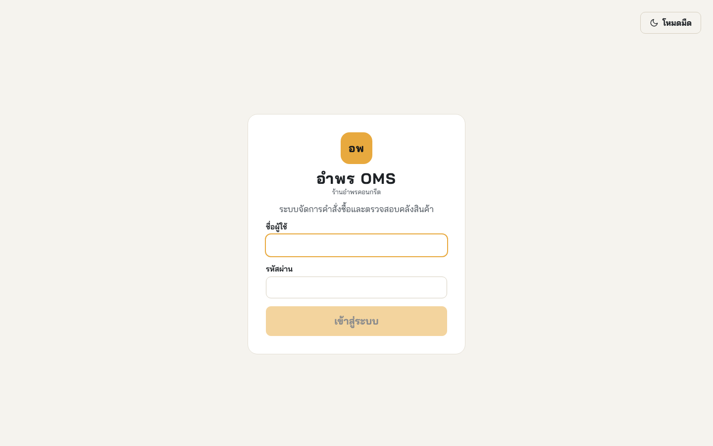{width=12cm}

**รูปที่ 1** หน้าจอเข้าสู่ระบบ จุดเริ่มต้นของ TC-01

## TC-02 การตั้งจุดสั่งซื้อเพิ่ม

| หัวข้อ | รายละเอียด |
|---|---|
| ทวนสอบ | FR-02, AC-02 |
| เงื่อนไขก่อนทดสอบ | เข้าสู่ระบบด้วยบัญชีผู้จัดการ |
| ขั้นตอน | 1) เปิดหน้าจอจัดการข้อมูลสินค้า 2) แก้จุดสั่งซื้อเพิ่มของสินค้าหนึ่งรายการแล้วบันทึก 3) เทียบค่าในฐานข้อมูล 4) เปิดประวัติการทำรายการ |
| ผลที่คาดหวัง | ค่าที่บันทึกตรงกับที่กรอก และมีบันทึกในประวัติการทำรายการ |
| ผลจริง | ค่าในฐานข้อมูลตรงกับที่กรอกทุกครั้ง และมีบันทึกการแก้ไขพร้อมผู้กระทำและเวลา |
| สถานะ | ผ่าน |
| หลักฐาน | `backend/tests/integration/product.test.js` · ระดับระบบข้อ AC-02 |

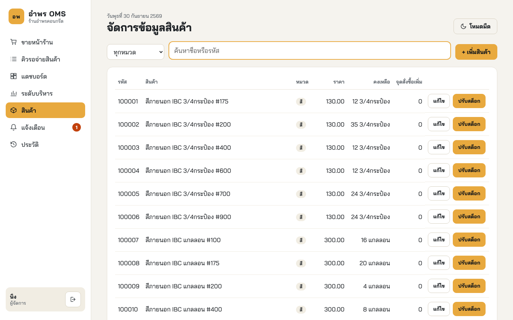{width=15cm}

**รูปที่ 2** หน้าจอจัดการข้อมูลสินค้าที่ใช้แก้จุดสั่งซื้อเพิ่ม

## TC-03 ความถูกต้องของยอดและรหัสคิวอาร์ (QR Code)

| หัวข้อ | รายละเอียด |
|---|---|
| ทวนสอบ | FR-03, AC-03 |
| เงื่อนไขก่อนทดสอบ | เข้าสู่ระบบด้วยบัญชีพนักงานขาย |
| ขั้นตอน | 1) เลือกสินค้าลงตะกร้าสามรายการ 2) คำนวณยอดรวมด้วยมือ 3) กดแสดงรหัสคิวอาร์ 4) เทียบยอดบนหน้าจอและยอดที่อยู่ในรหัสคิวอาร์ |
| ผลที่คาดหวัง | ยอดรวมถูกต้อง และรหัสคิวอาร์ ระบุยอดตรงกัน |
| ผลจริง | ยอดรวมตรงกับการคำนวณด้วยมือ และยอดคู่กับรหัสคิวอาร์ ตรงกับยอดในตะกร้าทุกครั้ง |
| สถานะ | ผ่าน |
| หลักฐาน | `backend/tests/unit/promptpay.test.js` · `order.test.js` · ระดับระบบข้อ AC-03 |

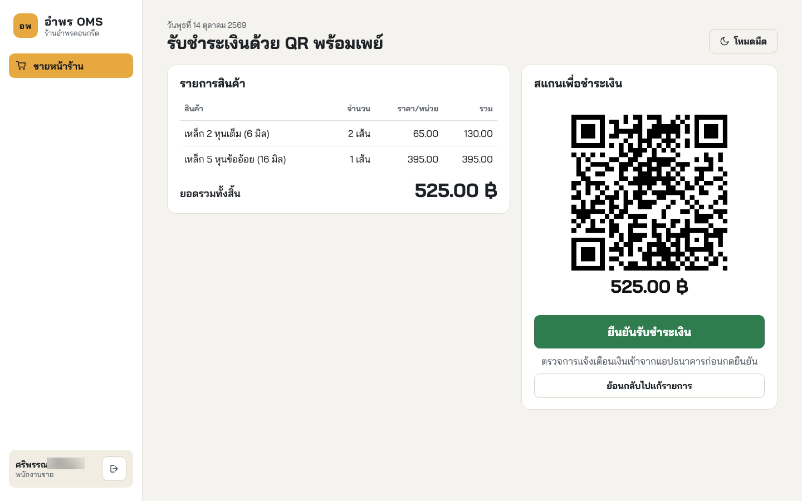{width=15cm}

**รูปที่ 3** หน้าจอขายหน้าร้านขณะแสดงรหัสคิวอาร์ (QR Code) พร้อมยอดเงิน

## TC-04 ความไม่ซ้ำของเลขที่คำสั่งซื้อ

| หัวข้อ | รายละเอียด |
|---|---|
| ทวนสอบ | FR-03, AC-04 |
| เงื่อนไขก่อนทดสอบ | ฐานข้อมูลทดสอบที่มีคำสั่งซื้อเดิมอยู่แล้ว |
| ขั้นตอน | 1) สร้างคำสั่งซื้อต่อเนื่อง 100 รายการ 2) สร้างพร้อมกัน 20 รายการจากสองบัญชี 3) ตรวจเลขที่ทั้งหมดในฐานข้อมูล |
| ผลที่คาดหวัง | ไม่มีเลขที่ซ้ำกันแม้แต่รายการเดียว |
| ผลจริง | ได้เลขที่ไม่ซ้ำกันทั้ง 120 รายการ และฐานข้อมูลมีคำสั่งซื้อ 183 รายการ เลขที่ไม่ซ้ำกัน 183 รายการ |
| สถานะ | ผ่าน |
| หลักฐาน | `evidence/tc04.json` (สคริปต์ `evidence/measure-tc04.js`) · ระดับระบบข้อ AC-04 |

## TC-05 ความหน่วงของคิวเรียลไทม์

| หัวข้อ | รายละเอียด |
|---|---|
| ทวนสอบ | FR-04, NFR-02, AC-06 |
| เงื่อนไขก่อนทดสอบ | เปิดหน้าจอคิวรอจ่ายสินค้าค้างไว้ |
| ขั้นตอน | 1) ยืนยันรับชำระเงินหนึ่งคำสั่งซื้อพร้อมเริ่มจับเวลา 2) หยุดเวลาเมื่อคำสั่งซื้อไปถึงหน้าจอคิว 3) ทำซ้ำ 20 รอบผ่านช่องทางหลัก และ 20 รอบผ่านช่องทางสำรอง |
| ผลที่คาดหวัง | ไม่เกิน 3 วินาทีทุกครั้ง โดยไม่ต้องกดรีเฟรช |
| ผลจริง | ช่องทางหลักสูงสุด 80 มิลลิวินาที ช่องทางสำรองสูงสุด 43 มิลลิวินาที |
| สถานะ | ผ่าน |
| หลักฐาน | `evidence/tc05-ws.json` · `evidence/tc05-sse.json` · ระดับระบบข้อ "คำสั่งซื้อใหม่ปรากฏบนหน้าจอคิวเองภายใน 3 วินาที" |
| ข้อสังเกต | วัดบนเครื่องเดียวกัน ค่าจึงยังไม่รวมความหน่วงของเครือข่ายไร้สายในร้าน |

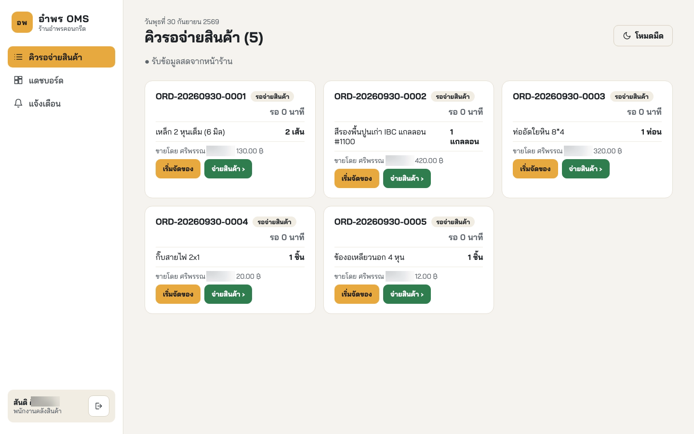{width=15cm}

**รูปที่ 4** หน้าจอคิวรอจ่ายสินค้าที่รับคำสั่งซื้อใหม่เองโดยไม่ต้องรีเฟรช

## TC-06 การป้องกันการจ่ายซ้ำ

| หัวข้อ | รายละเอียด |
|---|---|
| ทวนสอบ | FR-05, FR-06, NFR-04, AC-07 |
| เงื่อนไขก่อนทดสอบ | มีคำสั่งซื้อสถานะรอจ่ายสินค้าหนึ่งใบ |
| ขั้นตอน | 1) ส่งคำขอยืนยันจ่ายคำสั่งซื้อเดียวกันพร้อมกันสองคำขอ 2) เรียกบริการตัดสต็อกพร้อมกัน 10 ธุรกรรม 3) ตรวจยอดสต็อกและสถานะคำสั่งซื้อ |
| ผลที่คาดหวัง | สำเร็จเพียงคำขอเดียว อีกคำขอถูกปฏิเสธ และสต็อกถูกหักครั้งเดียว |
| ผลจริง | สำเร็จเพียงคำขอเดียว และสต็อกถูกหักครั้งเดียวแม้เรียกพร้อมกัน 10 ธุรกรรม |
| สถานะ | ผ่าน |
| หลักฐาน | `backend/tests/integration/dispatch.test.js` · ระดับระบบข้อ AC-07 |

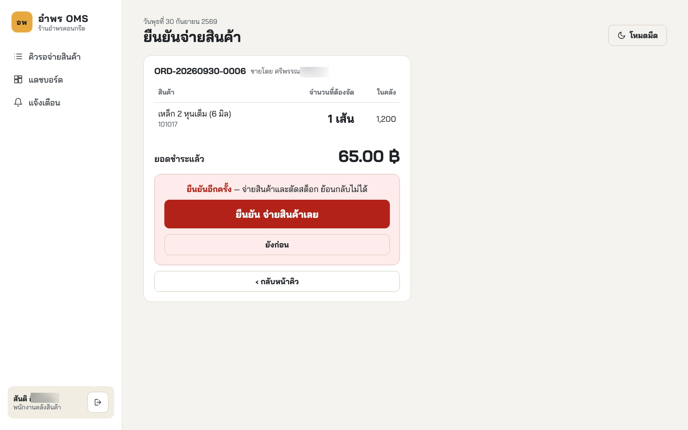{width=15cm}

**รูปที่ 5** หน้าจอยืนยันจ่ายสินค้า จุดที่ TC-06 กดพร้อมกันสองเครื่อง

## TC-07 การป้องกันสต็อกไม่พอ

| หัวข้อ | รายละเอียด |
|---|---|
| ทวนสอบ | FR-06, AC-08 |
| เงื่อนไขก่อนทดสอบ | มีคำสั่งซื้อที่จำนวนสินค้าเกินยอดคงเหลือในคลัง |
| ขั้นตอน | 1) ส่งคำขอยืนยันจ่ายคำสั่งซื้อนั้นไปยังเส้นทางบริการโดยตรง เนื่องจากหน้าจอไม่แสดงปุ่มจ่ายเมื่อสต็อกไม่พอ 2) ตรวจสต็อกของทุกรายการในคำสั่งซื้อ 3) ตรวจสถานะคำสั่งซื้อและบันทึกการเคลื่อนไหว |
| ผลที่คาดหวัง | ธุรกรรมถูกยกเลิกทั้งหมด สต็อกและสถานะไม่เปลี่ยน |
| ผลจริง | ธุรกรรมถูกยกเลิกทั้งหมด รายการที่หักไปแล้วย้อนกลับสู่ค่าเดิม สถานะไม่เปลี่ยน และไม่มีบันทึกการเคลื่อนไหว |
| สถานะ | ผ่าน |
| หลักฐาน | `backend/tests/integration/dispatch.test.js` · ระดับระบบข้อ AC-08 |

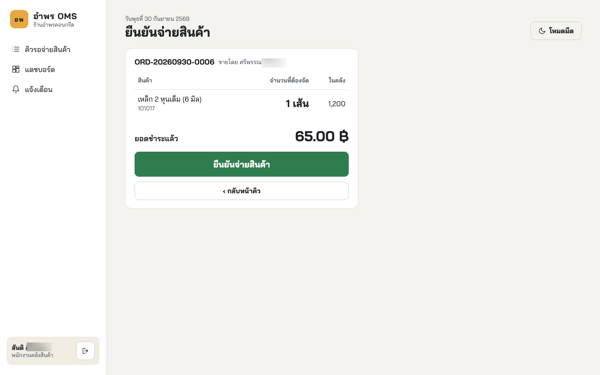{width=15cm}

**รูปที่ 6** หน้าจอจ่ายสินค้าที่แสดงยอดคงเหลือเทียบกับจำนวนที่ต้องจ่าย

## TC-08 ความถูกต้องของแดชบอร์ด

| หัวข้อ | รายละเอียด |
|---|---|
| ทวนสอบ | FR-07, AC-09 |
| เงื่อนไขก่อนทดสอบ | มีคำสั่งซื้อและการจ่ายสินค้าในฐานข้อมูลทดสอบ |
| ขั้นตอน | 1) เปิดแดชบอร์ด 2) คำนวณตัวชี้วัดเดียวกันจากฐานข้อมูลโดยตรงในเวลาเดียวกัน 3) เทียบทีละตัว |
| ผลที่คาดหวัง | ตรงกันทุกตัวชี้วัด |
| ผลจริง | ตัวเลขทุกตัวชี้วัดตรงกับผลรวมที่คำนวณจากฐานข้อมูล |
| สถานะ | ผ่าน |
| หลักฐาน | `backend/tests/integration/alert-dashboard.test.js` · ระดับระบบข้อ AC-09 |

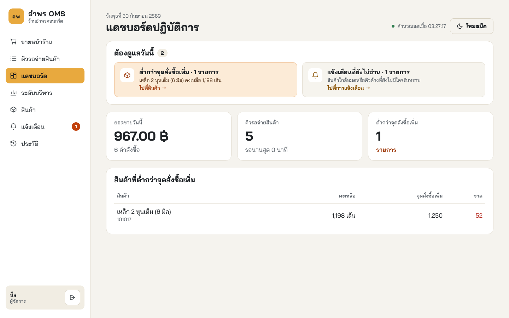{width=15cm}

**รูปที่ 7** แดชบอร์ดปฏิบัติการที่นำตัวเลขไปเทียบกับฐานข้อมูล

## TC-09 การแจ้งเตือนสินค้าใกล้หมด

| หัวข้อ | รายละเอียด |
|---|---|
| ทวนสอบ | FR-08, AC-10 |
| เงื่อนไขก่อนทดสอบ | สินค้าหนึ่งรายการตั้งจุดสั่งซื้อเพิ่มไว้แล้ว |
| ขั้นตอน | 1) จ่ายสินค้าจนยอดต่ำกว่าจุดสั่งซื้อเพิ่ม 2) ตรวจรายการแจ้งเตือน 3) จ่ายซ้ำอีกครั้งขณะที่ยังไม่อ่านการแจ้งเตือน |
| ผลที่คาดหวัง | ระบบสร้างการแจ้งเตือนเองและแสดงทันที โดยไม่แจ้งซ้ำขณะที่ยังไม่อ่าน |
| ผลจริง | สร้างการแจ้งเตือนเองโดยไม่ต้องเปิดหน้าจอ และไม่สร้างซ้ำขณะที่ใบเดิมยังไม่ถูกอ่าน |
| สถานะ | ผ่าน |
| หลักฐาน | `backend/tests/integration/alert-dashboard.test.js` · ระดับระบบข้อ AC-10 |

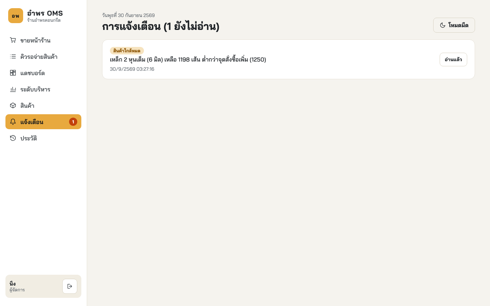{width=15cm}

**รูปที่ 8** หน้าจอการแจ้งเตือน ใช้ตรวจผลของ TC-09 และ TC-10

## TC-10 การแจ้งเตือนคิวค้าง

| หัวข้อ | รายละเอียด |
|---|---|
| ทวนสอบ | FR-08, AC-13 |
| เงื่อนไขก่อนทดสอบ | ตั้งเกณฑ์เวลาคิวค้างไว้ใน `.env` (ค่าเริ่มต้น 30 นาที) |
| ขั้นตอน | 1) สร้างคำสั่งซื้อแล้วปล่อยค้างในคิวเกินเกณฑ์ 2) ตรวจรายการแจ้งเตือน |
| ผลที่คาดหวัง | ระบบสร้างการแจ้งเตือนคิวค้างนานผิดปกติ |
| ผลจริง | มีการแจ้งเตือนที่ระบุเลขที่คำสั่งซื้อและระยะเวลาที่รอ ส่วนใบที่ยังไม่เกินเกณฑ์ไม่ถูกแจ้ง |
| สถานะ | ผ่าน |
| หลักฐาน | `backend/tests/integration/alert-dashboard.test.js` ข้อ "คำสั่งซื้อที่รอเกินเกณฑ์ถูกแจ้งเตือน" |

## TC-11 ความครบถ้วนของประวัติการทำรายการ

| หัวข้อ | รายละเอียด |
|---|---|
| ทวนสอบ | FR-09, AC-11 |
| เงื่อนไขก่อนทดสอบ | มีการทำรายการหลายประเภทในฐานข้อมูลทดสอบ |
| ขั้นตอน | 1) เปิดหน้าจอประวัติการทำรายการ 2) กรองตามช่วงวันที่ 3) กรองตามประเภทการกระทำ 4) ตรวจทุกแถวที่ได้ |
| ผลที่คาดหวัง | ผลลัพธ์ตรงตามเงื่อนไข และมีผู้กระทำ เวลา และข้อมูลที่ถูกกระทำครบ |
| ผลจริง | ทุกแถวตรงตามเงื่อนไข และมีผู้กระทำ เวลา ข้อมูลที่ถูกกระทำ และหมายเลขไอพีครบ |
| สถานะ | ผ่าน |
| หลักฐาน | `backend/tests/integration/audit-log.test.js` · ระดับระบบข้อ AC-11 |

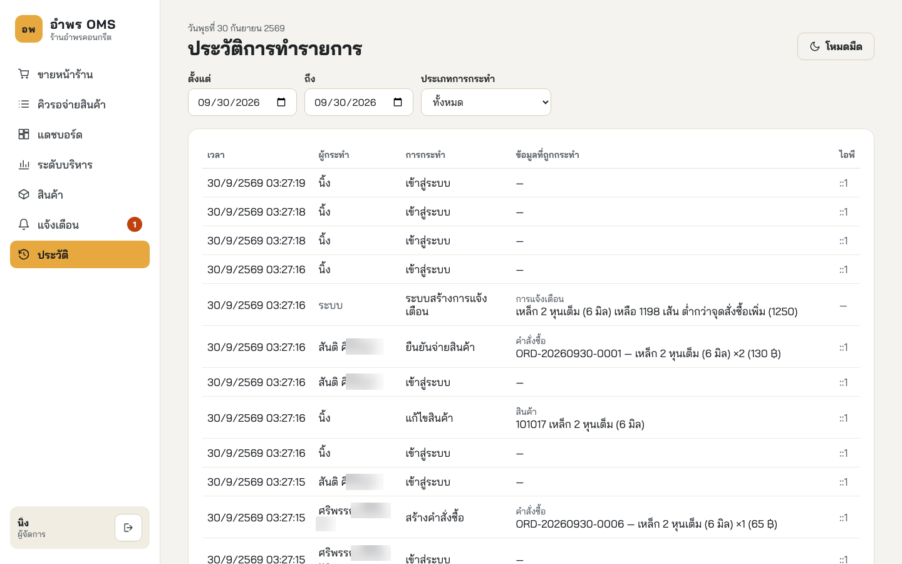{width=15cm}

**รูปที่ 9** หน้าจอประวัติการทำรายการพร้อมตัวกรอง

## TC-12 การพิมพ์ใบเสร็จภาษาไทย

| หัวข้อ | รายละเอียด |
|---|---|
| ทวนสอบ | NFR-05, AC-14 |
| เงื่อนไขก่อนทดสอบ | เครื่องพิมพ์เอปสัน TM-T82 ต่อยูเอสบีกับเครื่องพีซีวินโดวส์ และแชร์ชื่อ `AmpornOMS-Receipt` |
| ขั้นตอน | 1) ขายสินค้าผ่านโทรศัพท์เคลื่อนที่ 2) กดยืนยันรับชำระพร้อมเริ่มจับเวลา 3) หยุดเวลาเมื่อเครื่องพิมพ์ตัดกระดาษ 4) ตรวจข้อความภาษาไทยและการจัดคอลัมน์ |
| ผลที่คาดหวัง | ข้อความภาษาไทยถูกต้อง คอลัมน์ตรง และเสร็จภายใน 5 วินาที |
| ผลจริง | ภาษาไทยถูกต้องทุกบรรทัด คอลัมน์ตรง ใช้เวลาประมาณ 2.3 วินาที ยอดรวม 1,390.00 บาทตรงกับผลรวมของหกรายการ |
| สถานะ | ผ่าน |
| หลักฐาน | `evidence/tc12-receipt.jpg` |

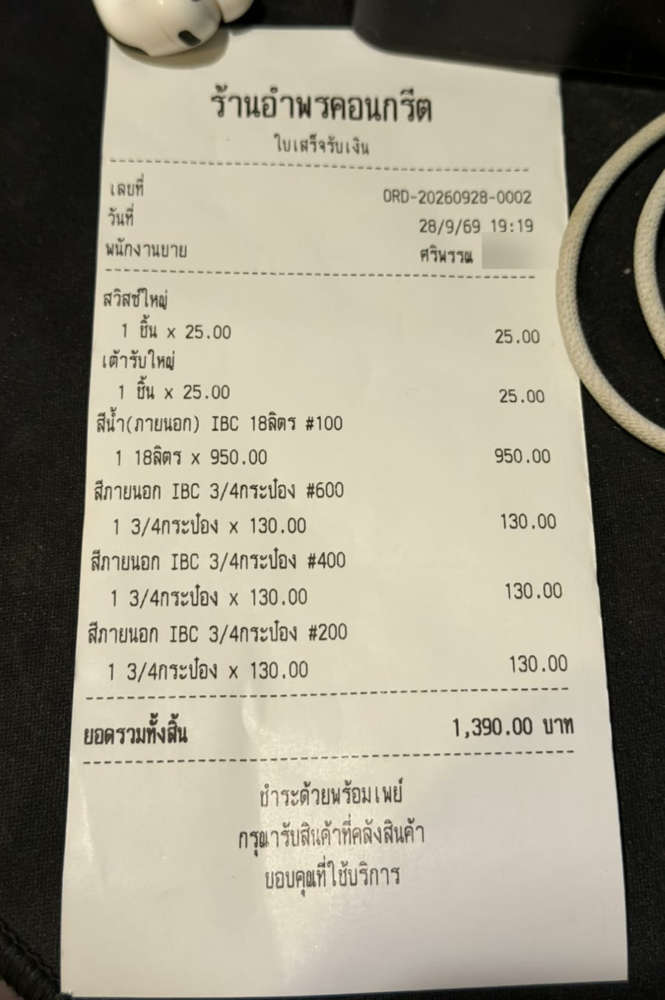{width=7cm}

**รูปที่ 10** ใบเสร็จที่พิมพ์จากเครื่องพิมพ์ความร้อนจริง

## TC-13 การรองรับผู้ใช้พร้อมกัน

| หัวข้อ | รายละเอียด |
|---|---|
| ทวนสอบ | NFR-06, AC-15 |
| เงื่อนไขก่อนทดสอบ | ระบบเปิดครบทั้งสี่หน่วย |
| ขั้นตอน | 1) เปิด 10 เซสชันจากสามบทบาท 2) ให้ทุกเซสชันเรียกใช้งานต่อเนื่องโดยไม่หยุด 20 วินาที 3) นับคำขอที่ล้มเหลวและวัดเวลาตอบสนอง |
| ผลที่คาดหวัง | ไม่มีคำขอใดล้มเหลว และบันทึกเวลาตอบสนองมัธยฐานและสูงสุดไว้ |
| ผลจริง | คำขอ 15,383 ครั้ง สำเร็จ 12,546 ครั้ง ถูกปฏิเสธตามกติกา 2,837 ครั้ง (พนักงานคลังหลายเซสชันกดจ่ายใบเดียวกัน ระบบให้สำเร็จเพียงคำขอเดียว) ไม่มีคำขอใดล้มเหลว เวลาตอบสนองมัธยฐาน 6 มิลลิวินาที สูงสุด 1,026 มิลลิวินาที |
| สถานะ | ผ่าน |
| หลักฐาน | `evidence/tc13.json` (สคริปต์ `evidence/measure-tc13.js`) |
| ข้อสังเกต | รอบแรกพบคำขอล้มเหลว 2 ครั้งจาก 14,231 ครั้ง แก้ไขแล้ววัดซ้ำ (บทที่ 5 หัวข้อ 5.2.1) |

# 4. การทวนสอบที่ไม่ใช่กรณีทดสอบ

| รหัส | วิธีทวนสอบ | ผล |
|---|---|---|
| NFR-03 | ตรวจหน้าจอคลังที่ความกว้างของแท็บเล็ตและสมาร์ตโฟน | ผ่าน |
| NFR-07 | รันการทดสอบระดับระบบบน โครเมียม และ ไฟร์ฟอกซ์ และสาธิตบน เอดจ์ | ผ่าน |
| NFR-08 | ตรวจโครงสร้างซอร์สโค้ดเทียบกับการออกแบบ | ผ่าน |
| NFR-09 | ผู้จัดการร้าน ซึ่งไม่ได้ร่วมพัฒนา ติดตั้งระบบบนเครื่องของร้านตามคู่มือ | ผ่าน ใช้เวลาประมาณ 5 นาที ระหว่างติดตั้งกรอกชื่อเครื่องพิมพ์คลาดเคลื่อน จึงปรับตัวติดตั้งให้ตรวจรูปแบบชื่อ |

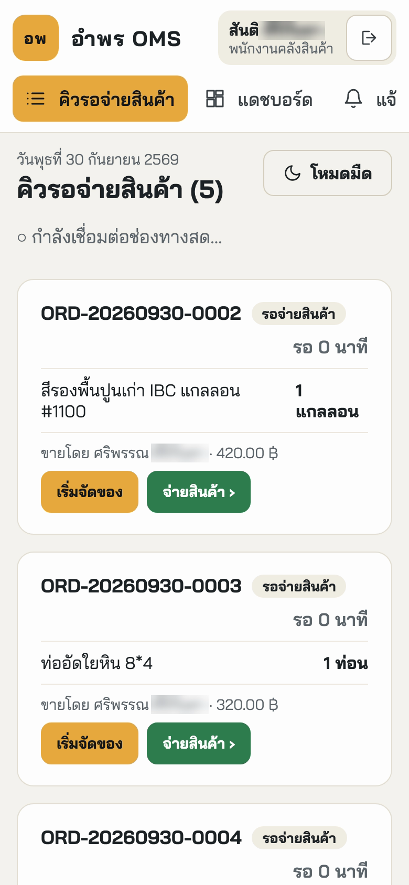{width=6cm}

**รูปที่ 11** หน้าจอคิวบนโทรศัพท์เคลื่อนที่ ใช้ทวนสอบ NFR-03
