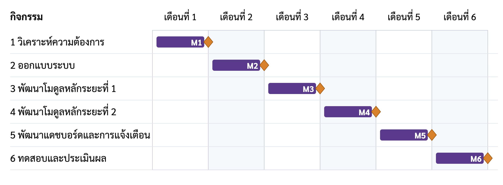

# บทที่ 1

## บทนำ

## 1.1 ความเป็นมาและความสำคัญของปัญหา (Background and Problem Statement)

ในปัจจุบัน ธุรกิจค้าปลีกวัสดุก่อสร้างขนาดกลางและขนาดย่อมจำนวนมากยังคงประสบปัญหาจากการขาดระบบจัดการข้อมูลในรูปแบบดิจิทัล ร้านจำหน่ายวัสดุก่อสร้างโดยทั่วไปยังไม่มีระบบบันทึกการขายและระบบจัดการสินค้าคงคลังที่เชื่อมโยงกัน พนักงานขายจึงต้องอาศัยใบเสร็จและบิลกระดาษในการบันทึกรายการสินค้าและยอดชำระเงิน ซึ่งเป็นกระบวนการที่ไม่มีระบบใดยืนยันความถูกต้อง ส่งผลให้ข้อมูลการขายกระจัดกระจาย ตรวจสอบย้อนหลังได้ยาก และมีความเสี่ยงต่อการสูญหายหรือการปลอมแปลงเอกสาร

ร้านวัสดุก่อสร้างอำพรคอนกรีตซึ่งเป็นกรณีศึกษาของโครงงานนี้มีลักษณะปัญหาดังกล่าวเช่นกัน จุดชำระเงินหน้าร้านและจุดรับสินค้าที่คลังสินค้าตั้งอยู่คนละพื้นที่ แต่ไม่มีช่องทางสื่อสารระหว่างกันแบบเรียลไทม์ พนักงานคลังสินค้าจึงไม่ทราบล่วงหน้าว่ามีคำสั่งซื้อใดรอการจัดเตรียม ลูกค้าต้องนำใบเสร็จกระดาษไปยื่นที่คลังสินค้าด้วยตนเอง แล้วพนักงานจึงเริ่มจัดสินค้า ส่งผลให้เกิดคอขวดและการรอคอยเป็นเวลานานในช่วงที่มีลูกค้าหนาแน่น นอกจากนี้ การที่พนักงานคลังสินค้าต้องจัดสินค้าตามใบเสร็จกระดาษยังเพิ่มโอกาสในการจัดสินค้าผิดประเภท ผิดจำนวน หรือการนำบิลเก่ามาใช้รับสินค้าซ้ำ ปัญหาเหล่านี้ทำให้ยอดสินค้าคงเหลือคลาดเคลื่อนจากความเป็นจริง ขณะที่ผู้จัดการต้องรอสรุปยอดขายและตรวจนับสินค้าด้วยมือในช่วงท้ายวัน การตัดสินใจสั่งซื้อสินค้าจึงอาศัยประสบการณ์มากกว่าข้อมูลจริง

ผู้มีส่วนได้ส่วนเสียจากปัญหานี้มีสี่กลุ่ม ได้แก่ พนักงานขายซึ่งต้องเขียนบิลและคำนวณยอดเงินด้วยตนเอง พนักงานคลังสินค้าซึ่งต้องอ่านบิลกระดาษและจดจำว่าใบใดจ่ายสินค้าไปแล้ว ผู้จัดการซึ่งเป็นเจ้าของร้านและต้องการทราบยอดขายและสินค้าคงคลังระหว่างวัน และลูกค้าซึ่งไม่ได้ใช้ระบบโดยตรงแต่ได้รับผลกระทบจากระยะเวลารอคอย ปัญหาทั้งหมดข้างต้นได้จากการสังเกตการทำงานจริงที่ร้านและการสอบถามเจ้าของร้านและพนักงาน และได้สรุปเป็นหลักฐานจากหน้างานเก้าข้อพร้อมรหัสกำกับไว้ในบทที่ 3 หัวข้อ 3.2.1

จากปัญหาข้างต้น คณะผู้จัดทำจึงออกแบบและพัฒนาระบบจัดการคำสั่งซื้อและตรวจสอบคลังสินค้า (อำพร OMS ย่อมาจาก Amporn Order Management System) กรณีศึกษาร้านวัสดุก่อสร้างอำพรคอนกรีต เพื่อเชื่อมโยงกระบวนการทำงานของหน้าร้านและคลังสินค้าเข้าด้วยกัน ลดข้อผิดพลาดจากการใช้เอกสารกระดาษ ลดระยะเวลารอคอยของลูกค้า และเพิ่มความสามารถในการติดตามการดำเนินงานของผู้บริหาร ปัญหาดังกล่าวเหมาะสมที่จะแก้ไขด้วยการพัฒนาซอฟต์แวร์ เนื่องจากสาเหตุหลักเกิดจากการขาดการส่งต่อข้อมูลระหว่างหน้าร้านและคลังสินค้า รวมถึงการขาดกลไกป้องกันการทำรายการซ้ำ ซึ่งเป็นสิ่งที่ระบบซอฟต์แวร์สามารถควบคุมได้โดยตรง

## 1.2 วัตถุประสงค์ของโครงงาน (Objectives)

วัตถุประสงค์ของโครงงานแบ่งออกเป็นสองกลุ่ม ได้แก่ วัตถุประสงค์เชิงผลิตภัณฑ์ซึ่งระบุความสามารถที่ระบบต้องมี และวัตถุประสงค์เชิงการเรียนรู้ซึ่งระบุทักษะที่ผู้จัดทำต้องได้รับการฝึกฝน วัตถุประสงค์ทุกข้อมีเกณฑ์ที่วัดผลได้ และต้องบรรลุภายในระยะเวลาโครงงาน 6 เดือนตามหัวข้อ 1.5 เพื่อใช้ในการสรุปผลในบทที่ 5

### 1.2.1 วัตถุประสงค์เชิงผลิตภัณฑ์ (Product Objectives)

1) เพื่อลดข้อผิดพลาดในการบันทึกการขายและการจัดการสินค้าคงคลังที่เกิดจากการใช้เอกสารกระดาษ โดยยอดเงินของทุกคำสั่งซื้อต้องคำนวณโดยระบบและตรงกับการคำนวณด้วยมือ และการทำรายการที่สำคัญทุกรายการต้องมีประวัติที่สามารถค้นหาย้อนหลังได้

2) เพื่อลดระยะเวลารอคอยของลูกค้า โดยคำสั่งซื้อที่ชำระเงินแล้วต้องปรากฏบนหน้าจอของคลังสินค้าภายใน 3 วินาที เพื่อให้พนักงานคลังสินค้าเริ่มจัดเตรียมสินค้าได้ก่อนที่ลูกค้าจะมาถึงจุดรับสินค้า

3) เพื่อให้ยอดสินค้าคงเหลือในระบบสอดคล้องกับจำนวนสินค้าจริงในคลัง โดยคำสั่งซื้อหนึ่งใบต้องจ่ายสินค้าได้เพียงครั้งเดียว แม้มีผู้ใช้ยืนยันการจ่ายสินค้าพร้อมกัน และยอดคงเหลือต้องไม่ติดลบ

4) เพื่อให้ผู้บริหารติดตามยอดขาย สินค้าคงคลัง และคิวงานได้แบบเรียลไทม์ โดยตัวเลขบนแดชบอร์ดต้องตรงกับผลรวมที่คำนวณจากฐานข้อมูล และระบบต้องแจ้งเตือนโดยอัตโนมัติเมื่อสินค้าต่ำกว่าจุดสั่งซื้อเพิ่ม

### 1.2.2 วัตถุประสงค์เชิงการเรียนรู้ (Learning Objectives)

1) เพื่อฝึกกระบวนการวิศวกรรมความต้องการ ตั้งแต่การเก็บหลักฐานจากหน้างาน การกำหนดความต้องการ การออกแบบ จนถึงการทดสอบ โดยความต้องการทุกข้อต้องสอบกลับไปยังที่มา และสอบกลับไปข้างหน้าถึงผลการทดสอบได้ครบถ้วน

2) เพื่อฝึกการออกแบบและพัฒนาระบบที่ประกอบด้วยหลายหน่วยติดตั้ง และรองรับการทำรายการพร้อมกันของผู้ใช้หลายคนได้อย่างถูกต้อง

## 1.3 ขอบเขตของโครงงาน (Project Scope)

### 1.3.1 ขอบเขตด้านหน้าที่ (Functional Scope)

สิ่งที่อยู่ในขอบเขตและไม่อยู่ในขอบเขตของโครงงานแสดงดังตารางที่ 1.1

**ตารางที่ 1.1** สิ่งที่อยู่ในขอบเขตและไม่อยู่ในขอบเขตของโครงงาน

| อยู่ในขอบเขต | ไม่อยู่ในขอบเขต |
|---|---|
| เข้าสู่ระบบและควบคุมสิทธิ์ตามบทบาท | ระบบบัญชีเต็มรูปแบบ |
| จัดการข้อมูลสินค้าและตั้งจุดสั่งซื้อเพิ่ม | การชำระเงินผ่านเพย์เมนต์เกตเวย์ (payment gateway) หรือเครื่องรูดบัตร |
| สร้างคำสั่งซื้อ แสดงรหัสคิวอาร์พร้อมเพย์ และพิมพ์ใบเสร็จด้วยเครื่องพิมพ์ใบเสร็จความร้อน | การตรวจสอบสถานะการชำระเงินอัตโนมัติผ่านบริการของธนาคาร |
| ส่งคำสั่งซื้อเข้าคิวคลังสินค้าแบบเรียลไทม์ | แอปพลิเคชันแบบเนทีฟบนโทรศัพท์เคลื่อนที่ |
| ยืนยันจ่ายสินค้าพร้อมตัดสต็อกแบบอะตอมมิก (atomic) และกันการจ่ายซ้ำ | การเชื่อมต่อระบบอีอาร์พี (ERP) หรือซัพพลายเออร์ภายนอก |
| แดชบอร์ดปฏิบัติการและแดชบอร์ดระดับบริหาร | การแจ้งเตือนผ่านบริการภายนอก เช่น อีเมลหรือแอปพลิเคชันสนทนา |
| บันทึกและค้นหาประวัติการทำรายการ | ใบสั่งซื้อสินค้าจากซัพพลายเออร์ |
| แจ้งเตือนภายในแอปพลิเคชันเมื่อสินค้าใกล้หมดและคิวค้าง | โมดูลปัญญาประดิษฐ์ช่วยวิเคราะห์ |

สิ่งที่อยู่ในขอบเขตทั้งแปดข้อในตารางที่ 1.1 เป็นที่มาของกรณีการใช้งาน UC-01 ถึง UC-11 ในบทที่ 3 ส่วนความสัมพันธ์ระหว่างขอบเขตกับกรณีการใช้งานแสดงไว้ในตารางที่ 3.13

### 1.3.2 ผู้ใช้ แพลตฟอร์ม และเทคโนโลยีหลัก (Users, Platform and Technology)

ผู้ใช้เป้าหมายของระบบมีสามบทบาท ได้แก่ พนักงานขาย พนักงานคลังสินค้า และผู้จัดการ ระบบพัฒนาเป็นเว็บแอปพลิเคชันแบบเรสปอนซีฟดีไซน์ (responsive design) ซึ่งปรับการแสดงผลตามขนาดหน้าจอ สามารถใช้งานผ่านเบราว์เซอร์บนคอมพิวเตอร์หน้าร้าน และบนโทรศัพท์เคลื่อนที่หรือแท็บเล็ตในคลังสินค้า ส่วนติดต่อผู้ใช้พัฒนาด้วยรีแอ็กต์ (React) ระบบหลังบ้านพัฒนาด้วยโหนดเจเอส (Node.js) และเอ็กซ์เพรสเจเอส (Express.js) และฐานข้อมูลใช้มายเอสคิวแอล (MySQL) ทั้งนี้ เหตุผลในการเลือกแต่ละเทคโนโลยีอธิบายไว้ในบทที่ 2 หัวข้อ 2.2

สถานที่ดำเนินโครงงานและทดสอบระบบคือร้านวัสดุก่อสร้างอำพรคอนกรีต ซึ่งแบ่งออกเป็นสามพื้นที่ ได้แก่ พื้นที่หน้าร้านสำหรับทดสอบงานขายและเครื่องพิมพ์ใบเสร็จ พื้นที่คลังสินค้าสำหรับทดสอบคิวงานและการยืนยันจ่ายสินค้า และพื้นที่สำนักงานสำหรับทดสอบแดชบอร์ด ประวัติการทำรายการ และการแจ้งเตือน

### 1.3.3 ข้อจำกัดและข้อสมมติ (Constraints and Assumptions)

ข้อจำกัดของโครงงาน หมายถึง ปัจจัยที่อยู่นอกเหนือการควบคุมของผู้จัดทำ ซึ่งมีสี่ข้อ ข้อแรก การตรวจสอบยอดเงินเข้าบัญชีโดยอัตโนมัติจำเป็นต้องใช้บริการเชื่อมต่อของธนาคารที่เจ้าของบัญชีต้องสมัครใช้บริการเอง ระบบจึงไม่สามารถทราบได้ว่าเงินเข้าบัญชีแล้วหรือไม่ ข้อที่สอง ข้อมูลสินค้าตั้งต้นได้มาจากไฟล์ตารางคำนวณของร้าน ซึ่งระบุยอดคงเหลือไว้เพียงบางรายการ และสินค้าบางหมวดไม่มีรหัสสินค้า ข้อที่สาม การทดสอบร่วมกับพนักงานดำเนินการได้เฉพาะวันที่ร้านเปิดทำการ และต้องไม่รบกวนการขายจริง และข้อที่สี่ โครงงานมีผู้จัดทำสองคนและมีระยะเวลาดำเนินงาน 6 เดือน

ข้อสมมติของโครงงานมีสามข้อ ข้อแรก พนักงานขายตรวจสอบการแจ้งเตือนเงินเข้าจากแอปพลิเคชันของธนาคารก่อนยืนยันการรับชำระเงินทุกครั้ง ข้อที่สอง ร้านมีเครือข่ายไร้สายที่โทรศัพท์ของพนักงานคลังสินค้าสามารถเชื่อมต่อกับคอมพิวเตอร์หน้าร้านได้ และข้อที่สาม ผู้ใช้แต่ละคนมีบัญชีของตนเองและไม่ใช้บัญชีร่วมกัน เนื่องจากประวัติการทำรายการระบุผู้กระทำจากบัญชีที่เข้าสู่ระบบ

## 1.4 กระบวนการพัฒนาซอฟต์แวร์ที่เลือกใช้ (Software Process)

โครงงานนี้ใช้แบบจำลองน้ำตกที่ทวนกลับได้ กล่าวคือ ดำเนินงานเป็นระยะตามลำดับ ได้แก่ การวิเคราะห์ความต้องการ การออกแบบ การพัฒนา และการทดสอบ แต่สามารถย้อนกลับไปแก้ไขผลงานของระยะก่อนหน้าได้เมื่อพบข้อบกพร่องในระยะถัดมา [1] เหตุผลในการเลือกแบบจำลองนี้มีสามข้อ ข้อแรก ขอบเขตของระบบสามารถกำหนดได้อย่างชัดเจนตั้งแต่ต้นจากหลักฐานหน้างาน และร้านมีผู้ใช้จริงจำนวนไม่มาก จึงไม่จำเป็นต้องใช้กระบวนการที่ปรับเปลี่ยนความต้องการบ่อยครั้งอย่างสกรัม (Scrum) ข้อที่สอง โมดูลบางส่วนต้องพัฒนาตามลำดับ เนื่องจากการยืนยันจ่ายสินค้าต้องอาศัยข้อมูลคำสั่งซื้อที่เกิดจากงานขาย ข้อที่สาม ความเสี่ยงหลักของโครงงานอยู่ที่ความถูกต้องของข้อมูลเมื่อมีผู้ใช้ทำรายการพร้อมกัน ซึ่งต้องออกแบบให้ชัดเจนก่อนการพัฒนา

การทวนกลับเกิดขึ้นจริงในโครงงานอย่างน้อยสองครั้ง ครั้งแรก การวัดภาระงานในระยะทดสอบพบว่าธุรกรรมเกิดการชนกันที่ขั้นตอนการออกเลขที่คำสั่งซื้อ จึงย้อนกลับไปแก้ไขในระยะพัฒนา ครั้งที่สอง การติดตั้งระบบบนเครื่องคอมพิวเตอร์ระบบปฏิบัติการวินโดวส์ (Windows) ของร้านพบว่าไม่สามารถส่งงานพิมพ์ได้ จึงย้อนกลับไปเพิ่มช่องทางการพิมพ์สำหรับวินโดวส์ รายละเอียดของทั้งสองกรณีอธิบายไว้ในบทที่ 5 หัวข้อ 5.2

## 1.5 แผนการดำเนินงานและระยะเวลา (Project Plan)

งานของโครงงานแบ่งออกเป็นหกกลุ่มงานตามระยะของกระบวนการในหัวข้อ 1.4 โดยแต่ละกลุ่มงานมีผลลัพธ์ที่ส่งมอบ (Milestone) กำกับไว้ ดังตารางที่ 1.2

**ตารางที่ 1.2** โครงสร้างการแบ่งงานและผลลัพธ์ที่ส่งมอบของโครงงาน

| ลำดับ | กลุ่มงาน | รายละเอียดการดำเนินงาน | ช่วงเวลา | ผลลัพธ์ที่ส่งมอบ |
|:---:|---|---|:---:|---|
| 1 | วิเคราะห์ความต้องการ | สำรวจปัญหาหน้างาน สัมภาษณ์ผู้ใช้งาน กำหนดกฎทางธุรกิจ ความต้องการเชิงหน้าที่ และความต้องการนอกเหนือหน้าที่ และตกลงขอบเขตการทำงาน | เดือนที่ 1 | M1 เอกสารข้อกำหนดความต้องการ |
| 2 | ออกแบบระบบ | ออกแบบสถาปัตยกรรมระดับ C1 C2 และ C3 ของแบบจำลองซีโฟร์ (หัวข้อ 3.3) กรณีการใช้งาน แผนภาพความสัมพันธ์ของฐานข้อมูล และต้นแบบหน้าจอ | เดือนที่ 2 | M2 เอกสารการออกแบบและต้นแบบหน้าจอ |
| 3 | พัฒนาโมดูลหลักระยะที่ 1 | พัฒนาการเข้าสู่ระบบและควบคุมสิทธิ์ ฐานข้อมูลสินค้า การสร้างคำสั่งซื้อ รหัสคิวอาร์พร้อมเพย์ และการเชื่อมต่อเครื่องพิมพ์ใบเสร็จ | เดือนที่ 3 | M3 ระบบต้นแบบระยะที่ 1 |
| 4 | พัฒนาโมดูลหลักระยะที่ 2 | พัฒนาคิวคลังสินค้าแบบเรียลไทม์ การยืนยันจ่ายสินค้าและตัดสต็อก และประวัติการทำรายการ | เดือนที่ 4 | M4 ระบบต้นแบบระยะที่ 2 |
| 5 | พัฒนาแดชบอร์ดและการแจ้งเตือน | พัฒนาแดชบอร์ดสำหรับผู้จัดการ การแจ้งเตือนภายในแอปพลิเคชัน และการตรวจจุดสั่งซื้อเพิ่ม | เดือนที่ 5 | M5 ระบบรุ่นสมบูรณ์สำหรับทดสอบ |
| 6 | ทดสอบและประเมินผล | ทดสอบการทำงาน ประสิทธิภาพ และการยอมรับจากผู้ใช้จริง พร้อมจัดทำรูปเล่ม | เดือนที่ 6 | M6 รายงานผลการทดสอบและเล่มฉบับสมบูรณ์ |

ช่วงเวลาของแต่ละกลุ่มงานและผลลัพธ์ที่ส่งมอบ M1 ถึง M6 ในตารางที่ 1.2 แสดงเป็นแผนภูมิแกนต์ดังรูปที่ 1.1

{width=15cm}

**รูปที่ 1.1** แผนภูมิแกนต์ของแผนการดำเนินงาน (Gantt Chart)

คณะผู้จัดทำโครงงานมีสองคน แบ่งความรับผิดชอบหลักตามหน่วยของระบบดังตารางที่ 1.3 ส่วนงานวิเคราะห์ความต้องการ การทดสอบ และการจัดทำรูปเล่ม ดำเนินการร่วมกันทั้งสองคน

**ตารางที่ 1.3** การแบ่งบทบาทในทีม

| ผู้จัดทำ | ความรับผิดชอบหลัก |
|---|---|
| นายตรัยรัตน์ วงษ์สิทธิ์ | ระบบหลังบ้าน โมดูล BE-01 ถึง BE-10 ส่วนสนับสนุน SP-01 ถึง SP-03 ฐานข้อมูล และบริการพิมพ์ใบเสร็จ |
| นายพนาวุฒน์ อภิปสันติ | ส่วนติดต่อผู้ใช้ หน้าจอ FE-01 ถึง FE-09 และการแสดงผลบนอุปกรณ์เคลื่อนที่ |

## 1.6 ประโยชน์ที่คาดว่าจะได้รับ (Expected Benefits)

ประโยชน์ที่ผู้ใช้และร้านได้รับมีสามข้อ ข้อแรก ลดระยะเวลารอคอยของลูกค้า เนื่องจากคลังสินค้าสามารถเริ่มจัดเตรียมสินค้าได้ทันทีที่รับชำระเงิน ซึ่งสอดคล้องกับวัตถุประสงค์ข้อ 2 ข้อที่สอง ลดข้อผิดพลาดที่เกิดจากบุคคล เนื่องจากพนักงานคลังสินค้าอ่านรายการจากหน้าจอที่ระบบสร้างขึ้นแทนการอ่านลายมือบนบิล และระบบไม่อนุญาตให้จ่ายสินค้าซ้ำจากใบเดิม ซึ่งสอดคล้องกับวัตถุประสงค์ข้อ 1 และข้อ 3 ข้อที่สาม ผู้จัดการสามารถวางแผนการสั่งซื้อสินค้าจากข้อมูลจริงซึ่งตรวจสอบย้อนหลังได้ทุกรายการ ทำให้ลดปัญหาสินค้าขาดและสินค้าค้างสต็อกได้ ซึ่งสอดคล้องกับวัตถุประสงค์ข้อ 4

ประโยชน์เชิงวิชาชีพ คือ ผู้จัดทำได้ฝึกกระบวนการวิศวกรรมซอฟต์แวร์อย่างครบวงจรกับปัญหาจริงของสถานประกอบการ ตั้งแต่การเก็บความต้องการจนถึงการติดตั้งใช้งาน ซึ่งสอดคล้องกับวัตถุประสงค์เชิงการเรียนรู้ข้อ 1 และข้อ 2