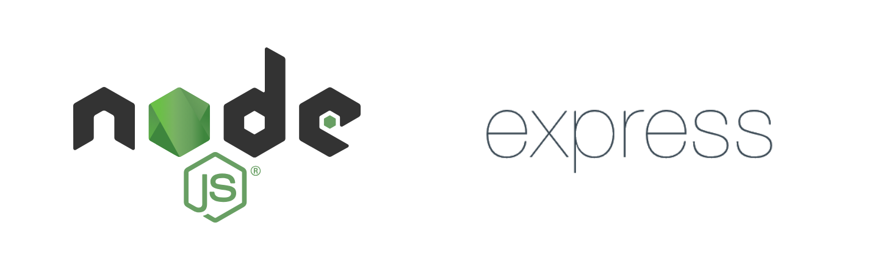

# บทที่ 2

## ทฤษฎี เทคโนโลยี และงานที่เกี่ยวข้อง

## 2.1 ทฤษฎีและหลักการที่เกี่ยวข้อง (Theories and Principles)

โครงงานวิศวกรรมนี้พัฒนาระบบจัดการคำสั่งซื้อและตรวจสอบคลังสินค้าสำหรับร้านวัสดุก่อสร้างอำพรคอนกรีต ซึ่งเดิมใช้ใบเสร็จกระดาษเป็นสื่อกลางระหว่างจุดชำระเงินหน้าร้านกับจุดจ่ายสินค้าที่คลังสินค้า ปัญหาหลักที่รวบรวมได้จากหน้างานมีสามประการ ได้แก่ ยอดสินค้าคงเหลือในบันทึกไม่ตรงกับจำนวนจริง การนำบิลเก่ามาใช้รับสินค้าซ้ำ และการที่คลังสินค้าไม่ทราบล่วงหน้าว่ามีคำสั่งซื้อใดรอการจัดเตรียม

ปัญหาทั้งสามประการมิใช่ปัญหาของการบันทึกข้อมูล แต่เป็นปัญหาของการควบคุมความถูกต้องของข้อมูลเมื่อมีผู้ใช้หลายคนทำรายการพร้อมกัน และการส่งข้อมูลถึงผู้เกี่ยวข้องได้ทันเวลา ทฤษฎีที่นำเสนอในหัวข้อนี้จึงคัดเลือกจากการตัดสินใจออกแบบที่เกิดขึ้นจริงในระบบ โดยแต่ละหัวข้อตอบคำถามว่าเหตุใดระบบจึงออกแบบในลักษณะดังกล่าว และหากไม่ออกแบบเช่นนั้นจะเกิดผลกระทบอย่างไร

### 2.1.1 การแบ่งชั้นซอฟต์แวร์และการแยกความรับผิดชอบ

การแยกความรับผิดชอบเป็นหลักการพื้นฐานของวิศวกรรมซอฟต์แวร์ ซึ่งกำหนดให้แต่ละส่วนของระบบรับผิดชอบเพียงเรื่องเดียวและไม่ก้าวก่ายหน้าที่ของส่วนอื่น [1] การประยุกต์หลักการนี้กับเว็บแอปพลิเคชันนิยมแบ่งระบบออกเป็นสามชั้นตามหน้าที่ ได้แก่ ชั้นการนำเสนอข้อมูล ชั้นตรรกะทางธุรกิจ และชั้นข้อมูล การแบ่งชั้นดังกล่าวทำให้แต่ละชั้นสามารถพัฒนา ทดสอบ และแก้ไขได้อย่างเป็นอิสระต่อกัน

อย่างไรก็ตาม การแบ่งชั้นเชิงตรรกะและการแบ่งหน่วยติดตั้งเป็นแนวคิดที่แตกต่างกัน [2] ชั้นเชิงตรรกะอธิบายว่าซอร์สโค้ดส่วนใดรับผิดชอบหน้าที่ใด ส่วนหน่วยติดตั้งอธิบายว่าส่วนใดทำงานเป็นกระบวนการแยกจากกัน ประเด็นเชิงออกแบบที่ต้องพิจารณาคือ เมื่อใดจึงควรแยกส่วนใดส่วนหนึ่งออกเป็นหน่วยติดตั้งต่างหาก ซึ่งเหตุผลอาจไม่ได้มาจากขนาดของซอร์สโค้ดเสมอไป แต่อาจมาจากข้อจำกัดของสภาพแวดล้อมที่ส่วนนั้นต้องทำงาน

โครงงานนี้แบ่งระบบออกเป็นสามชั้นเชิงตรรกะตามหลักการข้างต้น แต่มีหน่วยติดตั้งสี่หน่วย เนื่องจากบริการพิมพ์ใบเสร็จถูกแยกออกเป็นกระบวนการต่างหาก เหตุผลมิได้มาจากขนาดของซอร์สโค้ด แต่มาจากการที่เครื่องพิมพ์ความร้อนเชื่อมต่อทางกายภาพกับเครื่องคอมพิวเตอร์ที่ตั้งอยู่หน้าร้าน บริการนี้จึงต้องทำงานบนเครื่องดังกล่าวเสมอ ขณะที่ระบบหลังบ้านสามารถย้ายไปทำงานบนเครื่องใดก็ได้ นอกจากนี้ ภายในระบบหลังบ้านยังแบ่งย่อยตามความรับผิดชอบอีกชั้นหนึ่ง ได้แก่ ส่วนควบคุมตามหน้าที่ ส่วนตรวจสอบสิทธิ์ที่คั่นหน้าทุกเส้นทาง ส่วนตั้งค่าการเชื่อมต่อฐานข้อมูล และไลบรารีภายใน

การอธิบายสถาปัตยกรรมที่มีทั้งชั้นเชิงตรรกะและหน่วยติดตั้งให้ผู้อ่านต่างกลุ่มเข้าใจตรงกัน โครงงานนี้จึงใช้แบบจำลองซีโฟร์ (C4 model) ของบราวน์ [3] ซึ่งเสนอให้อธิบายซอฟต์แวร์ด้วยแผนภาพหลายระดับที่ขยายรายละเอียดเข้าไปทีละชั้น เริ่มจากระดับบริบทที่มองระบบเป็นกล่องเดียวและแสดงเพียงผู้ใช้และระบบภายนอกที่เกี่ยวข้อง ต่อด้วยระดับคอนเทนเนอร์ที่แสดงหน่วยติดตั้งที่แยกจากกัน และระดับส่วนประกอบที่แสดงโมดูลภายในแต่ละหน่วย แบบจำลองนี้เหมาะกับโครงงาน เพราะผู้อ่านแต่ละกลุ่มต้องการรายละเอียดต่างระดับกัน เจ้าของร้านต้องการทราบเพียงระดับบริบท ขณะที่ผู้พัฒนาต้องการทราบถึงระดับโมดูล การแบ่งเป็นชั้นจึงตอบสนองทั้งสองกลุ่มได้ด้วยแผนภาพชุดเดียวกัน บทที่ 3 ใช้แบบจำลองนี้อธิบายสถาปัตยกรรมของระบบทั้งสามระดับตามลำดับ

### 2.1.2 ขอบเขตของธุรกรรมและคุณสมบัติเอซิด (ACID)

ธุรกรรม คือ กลุ่มของคำสั่งที่ต้องดำเนินการสำเร็จทั้งหมดหรือไม่ดำเนินการเลย ระบบฐานข้อมูลที่รองรับธุรกรรมต้องรับประกันคุณสมบัติสี่ประการ ได้แก่ ความเป็นหน่วยเดียว ความสอดคล้อง การแยกจากกัน และความคงทน ซึ่งเรียกโดยรวมว่าคุณสมบัติเอซิด [4] คุณสมบัติเหล่านี้ป้องกันไม่ให้ข้อมูลอยู่ในสภาพที่ดำเนินการไม่ครบเมื่อเกิดข้อผิดพลาดระหว่างการทำงาน

ประเด็นที่ยากในทางปฏิบัติมิใช่การทำความเข้าใจนิยามของเอซิด แต่เป็นการตัดสินใจว่าคำสั่งใดควรอยู่ภายในขอบเขตของธุรกรรมและคำสั่งใดไม่ควร หากรวมงานไว้ในธุรกรรมมากเกินไป ระยะเวลาที่ธุรกรรมถือครองทรัพยากรจะยาวขึ้นและส่งผลกระทบต่อผู้ใช้รายอื่น ในทางกลับกัน หากแยกงานที่ควรอยู่ร่วมกันออกจากกัน ข้อมูลอาจไม่สอดคล้องกันเมื่อขั้นตอนหนึ่งสำเร็จแต่อีกขั้นตอนหนึ่งล้มเหลว หลักเกณฑ์ที่ใช้ตัดสินคือ งานที่หากล้มเหลวแล้วทำให้ข้อมูลไม่ถูกต้องต้องอยู่ในธุรกรรมเดียวกัน ส่วนงานที่เป็นผลพลอยได้และล้มเหลวได้โดยไม่กระทบความถูกต้องของข้อมูลควรอยู่นอกธุรกรรม

โครงงานนี้ใช้ระบบจัดการฐานข้อมูลที่รองรับธุรกรรมและกำหนดขอบเขตของธุรกรรมไว้อย่างชัดเจน ในขั้นตอนการยืนยันจ่ายสินค้า การเปลี่ยนสถานะคำสั่งซื้อ การหักยอดสินค้าคงเหลือ การบันทึกรายการเคลื่อนไหวของสต็อก และการบันทึกประวัติการทำรายการ ทั้งสี่งานอยู่ภายในธุรกรรมเดียวกัน เนื่องจากหากขั้นตอนใดล้มเหลวขณะที่ขั้นตอนอื่นยังคงอยู่ ยอดสินค้าในระบบจะไม่ตรงกับความเป็นจริงทันที ส่วนการตรวจสอบเงื่อนไขเพื่อสร้างการแจ้งเตือนออกแบบให้ทำงานหลังจากธุรกรรมยืนยันผลสำเร็จแล้วเท่านั้น เนื่องจากการแจ้งเตือนเป็นงานผลพลอยได้ หากการสร้างการแจ้งเตือนล้มเหลว ไม่ควรทำให้การจ่ายสินค้าที่เกิดขึ้นจริงแล้วถูกยกเลิกไปด้วย

### 2.1.3 การควบคุมภาวะพร้อมกัน: การล็อกเชิงบวกและการล็อกเชิงลบ

คุณสมบัติเอซิดรับประกันความถูกต้องของแต่ละธุรกรรม แต่ไม่ได้กำหนดว่าเมื่อธุรกรรมสองรายการแก้ไขข้อมูลชุดเดียวกันในเวลาเดียวกัน ระบบจะตัดสินอย่างไร ประเด็นนี้เป็นหน้าที่ของการควบคุมภาวะพร้อมกัน ซึ่งมีเป้าหมายเพื่อป้องกันความผิดปกติ เช่น การเขียนทับผลลัพธ์ของกันและกัน [5]

วิธีการควบคุมภาวะพร้อมกันแบ่งออกเป็นสองแนวทางหลัก แนวทางแรกคือการล็อกเชิงลบ ซึ่งตั้งสมมติฐานว่าการชนกันเกิดขึ้นบ่อย จึงล็อกข้อมูลไว้ตั้งแต่ขั้นตอนการอ่าน ผู้ที่เข้ามาภายหลังต้องรอจนกว่าธุรกรรมแรกจะสิ้นสุด วิธีนี้ให้ความถูกต้องสูงแต่ทำให้เกิดการรอคอย แนวทางที่สองคือการล็อกเชิงบวก ซึ่งตั้งสมมติฐานว่าการชนกันเกิดขึ้นไม่บ่อย จึงให้ธุรกรรมทำงานไปก่อนโดยไม่ล็อก แล้วตรวจสอบในขั้นตอนการเขียนว่ามีผู้อื่นแก้ไขข้อมูลไปก่อนหรือไม่ หากพบว่ามี ธุรกรรมนั้นจะถูกยกเลิก [6] ทั้งสองแนวทางมีข้อดีและข้อเสียแตกต่างกัน และเลือกใช้ตามลักษณะของงาน

โครงงานนี้ใช้ทั้งสองแนวทางร่วมกันในขั้นตอนการยืนยันจ่ายสินค้า เนื่องจากปัญหาที่ต้องป้องกันมีสองปัญหาซึ่งแยกจากกัน ปัญหาแรกคือการจ่ายสินค้าซ้ำสำหรับคำสั่งซื้อเดียวกัน ระบบป้องกันด้วยการล็อกเชิงบวก โดยคำสั่งเปลี่ยนสถานะคำสั่งซื้อมีเงื่อนไขกำกับว่าสถานะเดิมต้องเป็นรอจ่ายสินค้าหรือกำลังจัดของเท่านั้น หากพนักงานคนอื่นยืนยันการจ่ายสินค้าไปก่อนแล้ว จำนวนแถวที่ถูกแก้ไขจะเป็นศูนย์ ระบบจะยกเลิกธุรกรรมทั้งหมดและแจ้งว่าคำสั่งซื้อนี้ถูกจ่ายไปแล้ว ปัญหาที่สองคือยอดสินค้าคงเหลือคลาดเคลื่อนเมื่อมีการหักยอดพร้อมกัน ระบบป้องกันด้วยการล็อกเชิงลบ โดยคำสั่งหักยอดของสินค้าแต่ละรายการล็อกแถวของสินค้านั้นไว้จนกว่าธุรกรรมจะสิ้นสุด คำขอที่หักยอดสินค้ารายการเดียวกันในเวลาเดียวกันจึงต้องรอและดำเนินการตามลำดับ นอกจากนี้ คำสั่งหักยอดยังมีเงื่อนไขกำกับว่ายอดคงเหลือต้องไม่น้อยกว่าจำนวนที่จะหัก หากยอดไม่เพียงพอ ธุรกรรมทั้งหมดจะถูกยกเลิก

การใช้ทั้งสองแนวทางร่วมกันจึงมิใช่การทำงานซ้ำซ้อน แต่เป็นการแก้ปัญหาที่แตกต่างกันด้วยเครื่องมือที่เหมาะสมกับแต่ละปัญหา

### 2.1.4 เครื่องสถานะจำกัดกับวงจรชีวิตของคำสั่งซื้อ

ข้อมูลที่มีวงจรชีวิตชัดเจนสามารถอธิบายได้ด้วยเครื่องสถานะจำกัด ซึ่งกำหนดว่าข้อมูลมีสถานะใดได้บ้าง และเปลี่ยนจากสถานะหนึ่งไปยังอีกสถานะหนึ่งได้ทางใดบ้าง [7] ประโยชน์ของการอธิบายด้วยวิธีนี้คือ เส้นทางที่ไม่ได้ระบุไว้ถือว่าไม่อนุญาต ระบบจึงไม่จำเป็นต้องเขียนคำสั่งตรวจสอบแยกเป็นรายกรณีว่าการเปลี่ยนสถานะใดผิดกฎ

แนวคิดที่ต้องแยกแยะให้ชัดเจนคือ สถานะอาจถูกออกแบบให้เป็นค่าที่ผู้ใช้กำหนดได้โดยตรง หรือเป็นผลลัพธ์ที่เกิดจากการกระทำที่สำเร็จแล้วเท่านั้น แบบหลังมีความเข้มงวดมากกว่า เนื่องจากสถานะจะทำหน้าที่เป็นหลักฐานว่าการกระทำนั้นเกิดขึ้นจริง มิใช่เพียงค่าที่ผู้ใดก็กำหนดได้

โครงงานนี้กำหนดให้คำสั่งซื้อมีสี่สถานะ ได้แก่ รอจ่ายสินค้า กำลังจัดของ ส่งมอบสำเร็จ และยกเลิก โดยมีข้อกำหนดสองข้อที่ทำให้สถานะมีความหมายมากกว่าการบอกขั้นตอนของงาน ข้อแรก ไม่มีสถานะก่อนการชำระเงิน กล่าวคือ คำสั่งซื้อถูกบันทึกลงฐานข้อมูลเพียงครั้งเดียวเมื่อพนักงานยืนยันการรับชำระเงินแล้ว และคอลัมน์วันเวลาที่รับชำระถูกกำหนดให้ต้องมีค่าเสมอ ส่งผลให้คำสั่งซื้อทุกรายการในระบบที่นำเสนอวันสอบผ่านการชำระเงินแล้ว และไม่มีรายการค้างจากลูกค้าที่ยกเลิกการซื้อ (การขายเชื่อที่เพิ่มหลังการสอบอธิบายไว้ในภาคผนวก ซ) ข้อที่สอง สถานะส่งมอบสำเร็จเกิดขึ้นได้ทางเดียว คือผ่านธุรกรรมตัดสต็อกที่สำเร็จเท่านั้น ระบบปฏิเสธการกำหนดสถานะนี้โดยตรงผ่านเส้นทางปรับสถานะทั่วไป เนื่องจากหากอนุญาต สถานะดังกล่าวจะไม่เป็นหลักฐานอีกต่อไปว่าสต็อกถูกหักแล้วจริง

ข้อกำหนดข้อที่สองนี้เชื่อมโยงโดยตรงกับการล็อกเชิงบวกในหัวข้อ 2.1.3 เนื่องจากเงื่อนไขที่ตรวจสอบว่าสถานะเดิมต้องเป็นรอจ่ายสินค้าหรือกำลังจัดของก่อนจึงจะเปลี่ยนเป็นส่งมอบสำเร็จได้ ทำหน้าที่สองประการพร้อมกัน คือบังคับเส้นทางการเปลี่ยนสถานะตามเครื่องสถานะ และเป็นกลไกป้องกันการจ่ายสินค้าซ้ำในเวลาเดียวกัน

### 2.1.5 บันทึกแบบเพิ่มอย่างเดียว: บัญชีการเคลื่อนไหวและร่องรอยการตรวจสอบ

ข้อมูลที่เปลี่ยนแปลงอยู่ตลอดเวลาสามารถจัดเก็บได้สองแบบ แบบแรกจัดเก็บเฉพาะค่าปัจจุบันและเขียนทับทุกครั้งที่มีการเปลี่ยนแปลง แบบที่สองจัดเก็บการเปลี่ยนแปลงทุกครั้งเป็นรายการต่อเนื่องโดยไม่แก้ไขหรือลบรายการเดิม และค่าปัจจุบันเป็นผลรวมของรายการทั้งหมด แบบแรกประหยัดพื้นที่จัดเก็บแต่ไม่สามารถระบุที่มาของค่าปัจจุบันได้ ส่วนแบบที่สองตรวจสอบย้อนหลังได้ทุกขั้นตอน โดยแลกกับปริมาณข้อมูลที่เพิ่มขึ้นอย่างต่อเนื่อง

หลักการเดียวกันนี้ใช้กับบันทึกด้านความมั่นคงปลอดภัย กล่าวคือ บันทึกเหตุการณ์ต้องระบุได้ว่าผู้ใดกระทำสิ่งใด เมื่อใด และจากที่ใด และต้องไม่ถูกแก้ไขย้อนหลัง มิฉะนั้นจะไม่สามารถใช้บันทึกนั้นเป็นหลักฐานได้ [8]

โครงงานนี้ใช้แนวทางการจัดเก็บการเปลี่ยนแปลงทุกครั้งในสองเรื่อง เรื่องแรกคือการเคลื่อนไหวของสต็อก ทุกครั้งที่ยอดคงเหลือเปลี่ยนแปลง ระบบบันทึกจำนวนที่เปลี่ยน ยอดคงเหลือหลังการเปลี่ยนแปลง และสาเหตุ ได้แก่ การจ่ายตามคำสั่งซื้อ การปรับยอดโดยผู้จัดการ หรือการรับสินค้าเข้า การจัดเก็บยอดคงเหลือหลังการเปลี่ยนแปลงไว้ด้วยทำให้สามารถตรวจสอบย้อนหลังได้ว่ายอดเริ่มคลาดเคลื่อนจากความเป็นจริงตั้งแต่รายการใด โดยไม่ต้องคำนวณใหม่ทั้งหมด เรื่องที่สองคือประวัติการทำรายการ ซึ่งบันทึกผู้กระทำ การกระทำ ชนิดและรหัสของข้อมูลที่ถูกกระทำ และหมายเลขไอพีของผู้ใช้

ประเด็นสำคัญคือ บันทึกทั้งสองชนิดถูกเขียนภายในธุรกรรมเดียวกันกับการหักยอดสต็อก ตามขอบเขตที่กำหนดไว้ในหัวข้อ 2.1.2 หากเขียนนอกธุรกรรม อาจเกิดกรณีที่สต็อกถูกหักแล้วแต่ไม่มีบันทึก หรือมีบันทึกแต่สต็อกไม่ได้ถูกหัก ซึ่งทำให้บันทึกนั้นขาดความน่าเชื่อถือทันที

### 2.1.6 สถาปัตยกรรมขับเคลื่อนด้วยเหตุการณ์และการผลักข้อมูลผ่านช่องทางค้าง

การสื่อสารระหว่างเว็บเบราว์เซอร์กับเซิร์ฟเวอร์ตามรูปแบบดั้งเดิมเป็นแบบร้องขอแล้วตอบกลับ ฝ่ายไคลเอนต์ต้องเป็นผู้เริ่มการสื่อสารทุกครั้ง หากต้องการทราบว่ามีข้อมูลใหม่หรือไม่ ต้องส่งคำขอซ้ำทุกช่วงเวลาที่กำหนด ซึ่งเรียกว่าการถามซ้ำเป็นระยะ วิธีนี้สิ้นเปลืองทั้งปริมาณการรับส่งข้อมูลและภาระของฐานข้อมูล และมีความหน่วงเท่ากับช่วงเวลาที่เว้นระหว่างการสอบถามแต่ละครั้ง

สถาปัตยกรรมแบบขับเคลื่อนด้วยเหตุการณ์แก้ปัญหานี้ด้วยการเปิดช่องทางสื่อสารค้างไว้ และให้ฝ่ายเซิร์ฟเวอร์เป็นผู้ส่งข้อมูลไปยังไคลเอนต์เมื่อมีเหตุการณ์เกิดขึ้น มาตรฐานที่ใช้อย่างแพร่หลายมีสองแบบ แบบแรกคือเว็บซ็อกเก็ต (WebSocket) ซึ่งเปิดช่องทางสื่อสารสองทางบนการเชื่อมต่อเดียว [9] แบบที่สองคือเหตุการณ์ที่ส่งจากเซิร์ฟเวอร์ (Server-Sent Events) ซึ่งเป็นช่องทางทางเดียวจากเซิร์ฟเวอร์ไปยังไคลเอนต์ [10] แบบแรกมีความสามารถมากกว่า ส่วนแบบที่สองเรียบง่ายกว่าและทำงานบนโพรโทคอลเว็บปกติ จึงเหมาะสมที่จะใช้เป็นช่องทางสำรองเมื่อช่องทางหลักเชื่อมต่อไม่สำเร็จ

โครงงานนี้ใช้เว็บซ็อกเก็ตเป็นช่องทางหลัก และใช้เหตุการณ์ที่ส่งจากเซิร์ฟเวอร์เป็นช่องทางสำรอง เมื่อพนักงานขายยืนยันการรับชำระเงิน ระบบจะส่งคำสั่งซื้อใหม่ไปยังหน้าจอคิวงานของคลังสินค้าทันที พนักงานคลังสินค้าจึงเริ่มจัดเตรียมสินค้าได้ก่อนที่ลูกค้าจะนำใบเสร็จมาถึง โดยไม่จำเป็นต้องโหลดหน้าจอใหม่ การเลือกวิธีส่งข้อมูลจากเซิร์ฟเวอร์แทนการถามซ้ำเป็นระยะมีเหตุผลรองรับจากข้อกำหนดที่ระบุว่าคำสั่งซื้อใหม่ต้องปรากฏบนหน้าจอคิวภายใน 3 วินาที หากใช้การถามซ้ำเป็นระยะให้ได้ความหน่วงในระดับนี้ จะต้องส่งคำขอทุกหนึ่งถึงสองวินาทีตลอดเวลาทำการ ซึ่งไม่คุ้มค่าเมื่อเทียบกับจำนวนคำสั่งซื้อที่เกิดขึ้นจริง

### 2.1.7 การควบคุมสิทธิ์ตามบทบาทและความมั่นคงปลอดภัยของเว็บแอปพลิเคชัน

การควบคุมสิทธิ์การเข้าถึงตามบทบาทเป็นแบบจำลองที่ไม่ผูกสิทธิ์ไว้กับผู้ใช้แต่ละคนโดยตรง แต่ผูกไว้กับบทบาท แล้วจึงกำหนดบทบาทให้แก่ผู้ใช้อีกชั้นหนึ่ง [11] ข้อดีคือเมื่อผู้ใช้เปลี่ยนหน้าที่ ผู้ดูแลระบบเพียงเปลี่ยนบทบาทของผู้ใช้นั้น โดยไม่ต้องแก้ไขสิทธิ์ทีละรายการ และเมื่อต้องตรวจสอบว่าผู้ใดเข้าถึงสิ่งใดได้บ้าง สามารถตรวจสอบในระดับบทบาทแทนการตรวจสอบรายบุคคล

ประเด็นสำคัญในทางปฏิบัติคือ การควบคุมสิทธิ์ต้องบังคับใช้ที่ฝั่งเซิร์ฟเวอร์เสมอ การซ่อนเมนูหรือปุ่มที่ฝั่งหน้าเว็บเป็นเพียงการปรับประสบการณ์ของผู้ใช้ มิใช่มาตรการความปลอดภัย เนื่องจากผู้ใช้สามารถส่งคำขอไปยังเซิร์ฟเวอร์ได้โดยตรงโดยไม่ผ่านหน้าจอ นอกจากนี้ การพิสูจน์ตัวตนยังต้องพิจารณาสองเรื่องประกอบกัน คือ การจัดเก็บรหัสผ่านซึ่งต้องผ่านฟังก์ชันแฮชที่ออกแบบให้ทำงานช้าและเติมค่าสุ่ม เพื่อให้การเดารหัสผ่านไม่คุ้มค่า และการเข้ารหัสข้อมูลระหว่างการรับส่ง เพื่อป้องกันไม่ให้ผู้ที่ดักฟังเครือข่ายอ่านโทเคนหรือรหัสผ่านได้

โครงงานนี้กำหนดบทบาทไว้สามบทบาทในระดับโครงสร้างข้อมูล ได้แก่ พนักงานขาย พนักงานคลังสินค้า และผู้จัดการ โดยจำกัดค่าที่เป็นไปได้ไว้ในนิยามของตาราง ทำให้ไม่สามารถบันทึกบทบาทอื่นนอกเหนือจากสามค่านี้ได้ การตรวจสอบสิทธิ์ดำเนินการที่ฝั่งเซิร์ฟเวอร์ โดยวางส่วนตรวจสอบไว้หน้าทุกเส้นทางยกเว้นการเข้าสู่ระบบ และรหัสผ่านจัดเก็บในรูปแบบที่ผ่านการแฮชแล้ว สำหรับการเข้ารหัสข้อมูลระหว่างการรับส่งด้วยเอชทีทีพีเอส (HTTPS) เนื่องจากระบบทำงานภายในเครือข่ายของร้าน จึงเสนอให้เปิดใช้ไว้ในข้อเสนอแนะของบทที่ 5

### 2.1.8 การรวบรวมข้อมูลเพื่อสนับสนุนการตัดสินใจ

การรวบรวมข้อมูล คือ การนำข้อมูลรายการย่อยจำนวนมากมาสรุปเป็นตัวเลขจำนวนไม่มากที่ผู้บริหารใช้ตัดสินใจได้ทันที เครื่องมือที่นำแนวคิดนี้มาใช้คือแดชบอร์ด ซึ่งมีหลักสำคัญว่าต้องแสดงเฉพาะข้อมูลที่นำไปสู่การตัดสินใจ และต้องอ่านได้ครบถ้วนภายในหน้าจอเดียวโดยไม่ต้องเลื่อนหาข้อมูล [12]

ประเด็นเชิงออกแบบที่ต้องพิจารณาคือ ระบบควรคำนวณตัวเลขสรุปเมื่อใด ทางเลือกแรกคือการคำนวณในขณะอ่าน โดยทุกครั้งที่เปิดหน้าจอระบบจะรวมผลจากข้อมูลดิบใหม่ ตัวเลขจึงตรงกับฐานข้อมูลเสมอ แต่ใช้เวลามากขึ้นเมื่อข้อมูลสะสมมากขึ้น ทางเลือกที่สองคือการคำนวณในขณะเขียน โดยจัดเก็บยอดสรุปไว้ล่วงหน้าและปรับปรุงทุกครั้งที่มีรายการใหม่ วิธีนี้อ่านได้รวดเร็ว แต่มีความเสี่ยงที่ยอดสรุปจะไม่ตรงกับข้อมูลดิบ หากการปรับปรุงผิดพลาดแม้เพียงครั้งเดียว

โครงงานนี้เลือกคำนวณในขณะอ่านทั้งหมด โดยไม่มีการจัดเก็บค่าสรุปไว้ล่วงหน้า เนื่องจากเกณฑ์การยอมรับของระบบกำหนดให้ตัวเลขบนแดชบอร์ดต้องตรงกับผลรวมที่คำนวณจากฐานข้อมูลโดยตรง หากจัดเก็บค่าสรุปไว้ล่วงหน้าจะต้องพิสูจน์เพิ่มเติมว่าค่าที่จัดเก็บไว้ไม่เคยคลาดเคลื่อน ซึ่งเป็นภาระที่ไม่คุ้มค่ากับปริมาณรายการของร้านค้าปลีกขนาดเล็กหนึ่งแห่ง นอกจากนี้ แดชบอร์ดยังแบ่งออกเป็นสองระดับตามสิทธิ์การเข้าถึง ได้แก่ ระดับปฏิบัติการซึ่งแสดงคิวคงค้างและระดับสต็อก เพื่อให้ผู้จัดการและพนักงานคลังสินค้าใช้วางแผนงานประจำวัน และระดับบริหารซึ่งแสดงภาพรวมยอดขายสำหรับผู้จัดการเท่านั้น

### 2.1.9 การจัดการสินค้าคงคลัง: จุดสั่งซื้อเพิ่มและการเตือนเชิงรุก

การบริหารสินค้าคงคลังมีเป้าหมายเพื่อรักษาสมดุลระหว่างความเสี่ยงที่สินค้าจะขาดแคลนกับต้นทุนที่จมอยู่กับสินค้าค้างสต็อก [13] เครื่องมือพื้นฐานที่ใช้ควบคุมสมดุลดังกล่าวคือจุดสั่งซื้อเพิ่ม ซึ่งเป็นระดับสินค้าคงเหลือที่เมื่อลดลงต่ำกว่าระดับนี้แล้วต้องดำเนินการสั่งซื้อทันที โดยคำนวณจากอัตราการใช้สินค้าคูณกับระยะเวลารอคอยสินค้า บวกกับปริมาณสำรองเพื่อความปลอดภัย หากกำหนดค่านี้ต่ำเกินไป สินค้าจะขาดแคลนก่อนสินค้าใหม่มาถึง และหากกำหนดสูงเกินไป เงินทุนจะจมอยู่กับสินค้าที่ยังไม่จำเป็นต้องมี

การควบคุมระดับสินค้าคงคลังแบ่งออกเป็นสองแนวทาง แนวทางแรกคือการตรวจนับเป็นรอบ ซึ่งตรวจสอบตามช่วงเวลาที่กำหนด เช่น สิ้นวันหรือสิ้นสัปดาห์ แนวทางที่สองคือการตรวจสอบอย่างต่อเนื่อง ซึ่งตรวจสอบทุกครั้งที่ระดับสินค้าเปลี่ยนแปลง แนวทางแรกดำเนินการได้ง่ายกว่าในระบบที่บันทึกด้วยมือ แต่มีจุดอ่อนคือสินค้าอาจหมดลงระหว่างรอบการตรวจนับโดยไม่มีผู้ใดทราบ

นอกจากนี้ สินค้าแต่ละรายการไม่ควรได้รับความสำคัญเท่ากัน การจัดกลุ่มสินค้าตามมูลค่าด้วยการวิเคราะห์แบบเอบีซี (ABC analysis) แสดงให้เห็นว่า ในธุรกิจจำหน่ายวัสดุก่อสร้าง สินค้าจำนวนน้อยรายการมักคิดเป็นสัดส่วนมูลค่าการขายส่วนใหญ่ [14] ข้อค้นพบนี้บ่งชี้ว่าการกำหนดจุดสั่งซื้อเพิ่มควรพิจารณาเป็นรายสินค้า มิใช่ใช้ค่าเดียวกันทั้งร้าน

โครงงานนี้กำหนดจุดสั่งซื้อเพิ่มเป็นค่าประจำของสินค้าแต่ละรายการ ซึ่งผู้จัดการสามารถปรับค่าได้ และเลือกใช้แนวทางการตรวจสอบอย่างต่อเนื่อง โดยระบบตรวจสอบเงื่อนไขทุกครั้งหลังการตัดสต็อกเสร็จสิ้น เมื่อยอดคงเหลือลดลงต่ำกว่าจุดสั่งซื้อเพิ่ม ระบบจะสร้างการแจ้งเตือนถึงผู้จัดการทันที พร้อมระบุยอดคงเหลือปัจจุบันเทียบกับจุดที่กำหนดไว้ และจะไม่สร้างการแจ้งเตือนซ้ำหากรายการเดิมยังไม่ถูกอ่าน การออกแบบดังกล่าวตอบปัญหาที่พบจากหน้างานโดยตรง กล่าวคือ เดิมผู้จัดการต้องรอสรุปยอดและตรวจนับสต็อกด้วยมือในช่วงท้ายวัน และตัดสินใจสั่งซื้อจากประสบการณ์และการประมาณแทนข้อมูลจริง

## 2.2 เครื่องมือและเทคโนโลยีการพัฒนา (Technology Stack)

เทคโนโลยีที่นำเสนอในหัวข้อนี้คัดเลือกจากเทคโนโลยีที่ระบบใช้งานจริง โดยแต่ละหัวข้ออธิบายว่าเทคโนโลยีนั้นถูกเลือกเนื่องจากข้อจำกัดใดของโครงงาน และรองรับทฤษฎีข้อใดในหัวข้อ 2.1 ทั้งนี้ สัญลักษณ์ของเทคโนโลยีที่แสดงประกอบในหัวข้อนี้นำมาจากคลังสื่อเสรีวิกิมีเดียคอมมอนส์ ซึ่งเผยแพร่ภายใต้สัญญาอนุญาตแบบเปิด ส่วนหัวข้อที่เป็นโพรโทคอลมาตรฐานหรืออุปกรณ์ที่ไม่ได้ระบุยี่ห้อจะไม่มีภาพประกอบ เนื่องจากไม่มีสัญลักษณ์อย่างเป็นทางการ

เทคโนโลยีที่ใช้ในแต่ละส่วนของระบบและเหตุผลเชิงวิศวกรรมในการเลือกสรุปไว้ในตารางที่ 2.1 ส่วนรายละเอียดของแต่ละเทคโนโลยีอธิบายไว้ในหัวข้อย่อยถัดไป

**ตารางที่ 2.1** เทคโนโลยีที่ใช้ในแต่ละส่วนของระบบและเหตุผลของการเลือก

| ส่วนของระบบ | เทคโนโลยี | เหตุผลของการเลือก | หัวข้อ |
|---|---|---|:---:|
| ระบบหลังบ้าน | โหนดเจเอส (Node.js) เอ็กซ์เพรสเจเอส (Express.js) | ไม่บล็อกการทำงาน จึงเปิดช่องทางค้างกับหน้าจอคิวหลายเครื่องพร้อมกันได้ และมีมิดเดิลแวร์ (middleware) สำหรับตรวจสิทธิ์ในที่เดียว | 2.2.1 |
| ฐานข้อมูล | มายเอสคิวแอล (MySQL) เอนจินอินโนดีบี (InnoDB) | รองรับธุรกรรมแบบเอซิดและการล็อกระดับแถว ซึ่งการตัดสต็อกต้องใช้ | 2.2.2 |
| ส่วนติดต่อผู้ใช้ | รีแอ็กต์ (React) ไวต์ (Vite) รีแอ็กต์เราท์เตอร์ | ปรับหน้าจอเฉพาะส่วนที่เปลี่ยนเมื่อมีข้อมูลผลักเข้ามา และแยกเส้นทางหน้าจอตามบทบาท | 2.2.3 |
| การสื่อสารแบบเรียลไทม์ | เว็บซ็อกเก็ต และเหตุการณ์ที่ส่งจากเซิร์ฟเวอร์เป็นทางสำรอง | ให้เซิร์ฟเวอร์ผลักคำสั่งซื้อใหม่ไปยังคลังได้ทันทีโดยไม่ต้องถามซ้ำเป็นระยะ | 2.2.4 |
| การพิมพ์ใบเสร็จ | ชุดคำสั่งอีเอสซีโพส (ESC/POS) และรหัสอักขระ มอก. 620 | เป็นภาษาคำสั่งที่เครื่องพิมพ์ใบเสร็จความร้อนรับได้ และพิมพ์ภาษาไทยได้ถูกต้อง | 2.2.5 |
| การรับชำระเงิน | รหัสคิวอาร์พร้อมเพย์ | ลูกค้าสแกนจ่ายได้จากแอปพลิเคชันของทุกธนาคาร โดยร้านไม่ต้องมีเครื่องรับบัตร | 2.2.6 |
| การพิสูจน์ตัวตน | โทเคนเจดับเบิลยูที (JWT) และการแฮชรหัสผ่านด้วยบีคริปต์ (bcrypt) | ตรวจสิทธิ์ได้ทุกคำขอโดยไม่ต้องเก็บสถานะการเข้าสู่ระบบไว้ที่เซิร์ฟเวอร์ และไม่เก็บรหัสผ่านจริง | 2.1.7 |
| การทดสอบและจัดการเวอร์ชัน | เจสต์ (Jest) ซูเปอร์เทสต์ (Supertest) เพลย์ไรต์ (Playwright) และกิต | ทดสอบได้ครบสามระดับ คือระดับหน่วย ระดับการรวมส่วน และระดับระบบ และย้อนดูการเปลี่ยนแปลงของโค้ดได้ | 2.2.7 |

### 2.2.1 โหนดเจเอสและเอ็กซ์เพรสเจเอส (Node.js และ Express.js)

โหนดเจเอส (Node.js) เป็นสภาพแวดล้อมสำหรับประมวลผลโค้ดจาวาสคริปต์ฝั่งเซิร์ฟเวอร์ ใช้สถาปัตยกรรมแบบไม่บล็อกการทำงานและขับเคลื่อนด้วยเหตุการณ์ ทำให้สามารถจัดการการเชื่อมต่อจำนวนมากพร้อมกันได้โดยไม่ต้องสร้างเธรด (thread) ใหม่สำหรับทุกการเชื่อมต่อ [15] คุณสมบัตินี้เป็นเหตุผลหลักที่โครงงานเลือกใช้ เนื่องจากระบบต้องเปิดช่องทางสื่อสารค้างไว้กับหน้าจอคิวงานหลายเครื่องพร้อมกันตลอดเวลาทำการ ตามที่อธิบายไว้ในหัวข้อ 2.1.6 สัญลักษณ์ของเครื่องมือทั้งสองแสดงดังรูปที่ 2.1

{height=2.6cm}

**รูปที่ 2.1** สัญลักษณ์ของโหนดเจเอสและเอ็กซ์เพรสเจเอส (Node.js และ Express.js)

ที่มา (https://commons.wikimedia.org/wiki/File:Node.js_logo.svg) และ (https://commons.wikimedia.org/wiki/File:Expressjs.png)

เอ็กซ์เพรสเจเอสเป็นเฟรมเวิร์กที่ทำงานบนโหนดเจเอส ช่วยจัดการเส้นทางการเข้าถึงและมิดเดิลแวร์ (middleware) อย่างเป็นระบบ [16] กลไกมิดเดิลแวร์เป็นส่วนที่โครงงานใช้ประโยชน์มากที่สุด เนื่องจากทำให้สามารถวางส่วนตรวจสอบสิทธิ์ไว้หน้าทุกเส้นทางได้ในตำแหน่งเดียว โดยไม่ต้องเขียนคำสั่งตรวจสอบซ้ำในทุกฟังก์ชัน ซึ่งสอดคล้องกับหลักการแยกความรับผิดชอบในหัวข้อ 2.1.1

### 2.2.2 มายเอสคิวแอลและเอนจินอินโนดีบี (MySQL และ InnoDB)

มายเอสคิวแอลเป็นระบบจัดการฐานข้อมูลเชิงสัมพันธ์แบบโอเพนซอร์สที่ได้รับความนิยมในการพัฒนาเว็บแอปพลิเคชัน ประเด็นสำคัญสำหรับโครงงานนี้คือ มายเอสคิวแอลรองรับเอนจินจัดเก็บข้อมูลหลายแบบ และเอนจินที่เลือกใช้มีผลโดยตรงต่อความสามารถของระบบ เอนจินอินโนดีบีรองรับธุรกรรมตามคุณสมบัติเอซิดและการล็อกในระดับแถว ขณะที่เอนจินแบบอื่นที่ไม่รองรับธุรกรรมจะล็อกทั้งตารางเมื่อมีการแก้ไขข้อมูล [17]

โครงงานนี้จึงกำหนดให้ทุกตารางใช้เอนจินอินโนดีบี เนื่องจากหากไม่ใช้เอนจินนี้ กลไกที่อธิบายไว้ในหัวข้อ 2.1.2 และ 2.1.3 จะไม่สามารถทำงานได้ นอกจากนี้ ยังใช้ไดรเวอร์ที่รองรับการเรียกใช้แบบไม่บล็อกการทำงาน รองรับคำสั่งที่เตรียมไว้ล่วงหน้าเพื่อป้องกันการโจมตีด้วยการแทรกคำสั่งเอสคิวแอล และรองรับการจัดการกลุ่มการเชื่อมต่อ ซึ่งโครงงานนี้กำหนดไว้ 10 การเชื่อมต่อ เท่ากับจำนวนผู้ใช้งานพร้อมกันใน NFR-06 สัญลักษณ์ของมายเอสคิวแอลแสดงดังรูปที่ 2.2

{height=2.6cm}

**รูปที่ 2.2** สัญลักษณ์ของมายเอสคิวแอล (MySQL)

ที่มา (https://commons.wikimedia.org/wiki/File:MySQL_textlogo.svg)

### 2.2.3 รีแอ็กต์ ไวต์ และรีแอ็กต์เราท์เตอร์ (React, Vite และ React Router)

รีแอ็กต์ (React) เป็นไลบรารีจาวาสคริปต์สำหรับพัฒนาส่วนติดต่อผู้ใช้ ซึ่งแบ่งหน้าเว็บออกเป็นคอมโพเนนต์ย่อยที่นำกลับมาใช้ซ้ำได้ และใช้แนวคิดการกำหนดการแสดงผลของหน้าจอตามสถานะของข้อมูล [18] เมื่อสถานะเปลี่ยนแปลง ไลบรารีจะคำนวณส่วนที่ต้องปรับปรุงและแก้ไขเฉพาะส่วนนั้น คุณสมบัตินี้เหมาะสมกับหน้าจอคิวงานของคลังสินค้าซึ่งต้องเปลี่ยนแปลงทันทีเมื่อได้รับข้อความที่ส่งเข้ามาตามหัวข้อ 2.1.6 หากพัฒนาโดยแก้ไของค์ประกอบของหน้าเว็บทีละจุด จะควบคุมความถูกต้องได้ยากเมื่อมีข้อมูลเข้ามาอย่างต่อเนื่อง

รีแอ็กต์เราท์เตอร์ทำหน้าที่จัดการเส้นทางภายในเว็บแอปพลิเคชัน ทำให้ผู้ใช้ทั้งสามบทบาทเข้าถึงหน้าจอที่แตกต่างกันได้โดยไม่ต้องโหลดหน้าเว็บใหม่ทั้งหน้า ส่วนไวต์เป็นเครื่องมือสำหรับการพัฒนาและการรวมไฟล์ ทำหน้าที่ให้บริการหน้าเว็บระหว่างการพัฒนาและสร้างไฟล์สำหรับการใช้งานจริง สัญลักษณ์ของเครื่องมือทั้งสองแสดงดังรูปที่ 2.3

{height=2.6cm}

**รูปที่ 2.3** สัญลักษณ์ของรีแอ็กต์และไวต์ (React และ Vite)

ที่มา (https://commons.wikimedia.org/wiki/File:React-icon.svg) และ (https://commons.wikimedia.org/wiki/File:Vitejs-logo.svg)

### 2.2.4 เว็บซ็อกเก็ตและการตอบสนองแบบเรียลไทม์ (WebSocket and Real-time Communication)

โพรโทคอลเว็บโดยทั่วไปทำงานในลักษณะร้องขอและตอบกลับ กล่าวคือ เบราว์เซอร์ต้องส่งคำขอก่อน เซิร์ฟเวอร์จึงตอบกลับได้ เซิร์ฟเวอร์ไม่สามารถส่งข้อมูลไปยังเบราว์เซอร์ได้เองเมื่อมีเหตุการณ์ใหม่ ระบบที่ต้องการให้หน้าจอเปลี่ยนแปลงทันทีที่ข้อมูลเปลี่ยน เช่น หน้าจอคิวของคลังสินค้าที่ต้องแสดงคำสั่งซื้อใหม่ทันทีที่หน้าร้านรับชำระเงิน จึงต้องเลือกวิธีส่งข้อมูลที่เหมาะสม วิธีที่ใช้โดยทั่วไปมีสี่วิธี ซึ่งเปรียบเทียบได้ดังตารางที่ 2.2

**ตารางที่ 2.2** เปรียบเทียบวิธีส่งข้อมูลแบบเรียลไทม์จากเซิร์ฟเวอร์ไปยังหน้าจอ

| วิธี | หลักการทำงาน | ทิศทาง | ความหน่วงเมื่อมีเหตุการณ์ | ภาระของระบบ |
|---|---|---|---|---|
| การถามซ้ำเป็นระยะ (Polling) | หน้าจอส่งคำขอใหม่ทุกช่วงเวลาที่กำหนด เช่น ทุก 5 วินาที | หน้าจอถามเท่านั้น | สูงสุดเท่าระยะห่างของการถาม | สูง ส่งคำขอตลอดแม้ไม่มีข้อมูลใหม่ |
| การถามค้างไว้ (Long Polling) | หน้าจอส่งคำขอ เซิร์ฟเวอร์ถือคำขอไว้จนมีข้อมูลจึงตอบ แล้วหน้าจอถามใหม่ | หน้าจอถามเท่านั้น | ต่ำ | ปานกลาง เปิดคำขอใหม่หลังได้คำตอบทุกครั้ง |
| เหตุการณ์ที่ส่งจากเซิร์ฟเวอร์ (SSE) | เปิดการตอบกลับค้างไว้หนึ่งครั้ง เซิร์ฟเวอร์ทยอยส่งข้อความต่อเนื่อง [10] | เซิร์ฟเวอร์ส่งทางเดียว | ต่ำ | ต่ำ |
| เว็บซ็อกเก็ต (WebSocket) | ยกระดับการเชื่อมต่อเว็บเป็นช่องทางค้างที่ส่งได้สองทาง [9] | สองทาง | ต่ำ | ต่ำ |

เว็บซ็อกเก็ตกำหนดไว้ในมาตรฐาน RFC 6455 การเชื่อมต่อเริ่มจากคำขอเว็บปกติที่แนบหัวข้อ Upgrade: websocket และกุญแจสุ่ม Sec-WebSocket-Key เซิร์ฟเวอร์ที่รองรับจะตอบกลับด้วยรหัส 101 Switching Protocols พร้อมค่า Sec-WebSocket-Accept ที่คำนวณจากกุญแจดังกล่าว จากนั้นการเชื่อมต่อเดิมจะเปลี่ยนเป็นช่องทางที่ทั้งสองฝ่ายสามารถส่งข้อความในรูปแบบเฟรมขนาดเล็กได้ตลอดเวลา โดยไม่ต้องเปิดการเชื่อมต่อใหม่ [9] ส่วนเหตุการณ์ที่ส่งจากเซิร์ฟเวอร์กำหนดไว้ในมาตรฐานเอชทีเอ็มแอล (HTML) โดยใช้การตอบกลับชนิด text/event-stream ที่ไม่ปิดการเชื่อมต่อ และเบราว์เซอร์จะเชื่อมต่อใหม่โดยอัตโนมัติเมื่อการเชื่อมต่อขาด [10] ข้อดีของเหตุการณ์ที่ส่งจากเซิร์ฟเวอร์คือเป็นการเชื่อมต่อเว็บปกติ จึงสามารถผ่านอุปกรณ์เครือข่ายที่ไม่รองรับการยกระดับการเชื่อมต่อได้

ระบบอำพร OMS ใช้เว็บซ็อกเก็ตเป็นช่องทางหลัก เนื่องจากมีความหน่วงต่ำและสร้างภาระให้เครื่องคอมพิวเตอร์หน้าร้านน้อย ซึ่งสอดคล้องกับความต้องการ NFR-02 ที่กำหนดให้คำสั่งซื้อใหม่ปรากฏบนหน้าจอคิวภายใน 3 วินาที ส่วนการถามซ้ำเป็นระยะไม่ได้ถูกเลือก เนื่องจากหากโทรศัพท์ของพนักงานคลังสินค้าหลายเครื่องสอบถามทุกหนึ่งถึงสองวินาที เครื่องคอมพิวเตอร์หน้าร้านจะต้องตอบคำขอตลอดเวลาแม้ไม่มีคำสั่งซื้อใหม่ ส่วนเหตุการณ์ที่ส่งจากเซิร์ฟเวอร์ใช้เป็นช่องทางสำรอง การทำงานจริงในระบบประกอบด้วยสามส่วน ดังนี้

1) ระบบหลังบ้านเปิดช่องทางเว็บซ็อกเก็ตที่เส้นทาง /ws บนเซิร์ฟเวอร์เดียวกับเส้นทางบริการ จึงไม่ต้องเปิดพอร์ตเพิ่มเติม และเปิดช่องทางสำรองที่เส้นทาง /api/events โดยทั้งสองช่องทางตรวจสอบโทเคนของผู้ใช้ก่อนรับการเชื่อมต่อ
2) หน้าจอพยายามเชื่อมต่อเว็บซ็อกเก็ตก่อน หากเชื่อมต่อไม่สำเร็จภายใน 3 วินาที จะเปลี่ยนไปใช้ช่องทางสำรองโดยอัตโนมัติ และเมื่อการเชื่อมต่อขาด หน้าจอจะเชื่อมต่อใหม่ทุก 2 วินาที
3) เมื่อข้อมูลเปลี่ยนแปลงและธุรกรรมยืนยันผลแล้ว ระบบหลังบ้านจะส่งข้อความเดียวกันออกไปทั้งสองช่องทาง ข้อความมีสี่ชนิดตามตารางที่ 3.26 ได้แก่ order.created เมื่อมีคำสั่งซื้อใหม่ order.status เมื่อเปลี่ยนสถานะการจัดของ order.dispatched เมื่อจ่ายสินค้าแล้ว และ notification.created เมื่อมีการแจ้งเตือนใหม่ ส่วนข้อความที่เพิ่มหลังการสอบบันทึกไว้ในภาคผนวก ซ หน้าจอที่ได้รับข้อความจะโหลดข้อมูลส่วนนั้นใหม่จากฐานข้อมูล โดยไม่ใช้ตัวเลขในข้อความโดยตรง ตัวเลขบนหน้าจอจึงตรงกับฐานข้อมูลเสมอ

ข้อความจะถูกส่งออกไปหลังจากธุรกรรมยืนยันผลแล้วเท่านั้น เนื่องจากหากส่งก่อนแล้วธุรกรรมถูกย้อนกลับ หน้าจอจะแสดงข้อมูลที่ไม่มีอยู่จริง ผลการวัดความหน่วงจริงของช่องทางนี้รายงานไว้ในบทที่ 4

### 2.2.5 เครื่องพิมพ์ใบเสร็จความร้อนและชุดคำสั่งอีเอสซีโพส (ESC/POS)

เครื่องพิมพ์ใบเสร็จความร้อนเป็นอุปกรณ์ต่อพ่วงที่พิมพ์ด้วยความร้อนบนกระดาษเคลือบสารเคมี โดยไม่ต้องใช้หมึกพิมพ์ จึงมีต้นทุนต่อแผ่นต่ำและพิมพ์ได้รวดเร็ว อุปกรณ์กลุ่มนี้ไม่รับไฟล์เอกสารสำเร็จรูป แต่รับลำดับไบต์คำสั่งตามมาตรฐานอีเอสซีโพส ซึ่งใช้ควบคุมการจัดรูปแบบ การเลือกตารางรหัสอักขระ และการตัดกระดาษ [19]

ประเด็นเฉพาะสำหรับภาษาไทยคือ ข้อความที่จัดเก็บในฐานข้อมูลใช้การเข้ารหัสแบบยูนิโคด (Unicode) แต่เครื่องพิมพ์กลุ่มนี้ใช้ตารางรหัสอักขระไทยตามมาตรฐาน TIS-620 [20] ข้อความจึงต้องถูกแปลงชุดรหัสก่อนส่งออก และต้องส่งคำสั่งเลือกตารางรหัสให้ถูกต้อง มิฉะนั้นใบเสร็จจะพิมพ์ออกมาเป็นอักขระที่อ่านไม่ได้ โครงงานนี้สร้างชุดคำสั่งขึ้นเองในระดับไบต์แทนการใช้ไลบรารีสำเร็จรูป เพื่อให้ควบคุมรูปแบบใบเสร็จได้ตามต้องการและตรวจสอบข้อมูลที่ส่งออกได้จริง โดยในโหมดจำลองที่ใช้ระหว่างการทดสอบ ไบต์ที่ส่งออกถูกจัดเก็บเป็นไฟล์สำหรับตรวจสอบย้อนหลัง

### 2.2.6 การสร้างรหัสคิวอาร์ (QR Code) สำหรับการชำระเงินตามมาตรฐานพร้อมเพย์ (PromptPay)

รหัสคิวอาร์สำหรับการชำระเงินมิใช่ภาพที่สร้างขึ้นโดยอิสระ แต่เป็นข้อความที่เข้ารหัสตามข้อกำหนดรหัสคิวอาร์สำหรับระบบการชำระเงินของอีเอ็มวีโค (EMVCo) ในรูปแบบที่ร้านค้าเป็นผู้แสดงรหัส [21] โครงสร้างข้อมูลประกอบด้วยรหัสช่อง ความยาว และค่าข้อมูล เรียงต่อกันตามลำดับรหัสช่อง และปิดท้ายด้วยค่าตรวจสอบความถูกต้องของข้อมูล มาตรฐานนี้เป็นพื้นฐานของรหัสคิวอาร์สำหรับธุรกรรมการชำระเงินในประเทศตามแนวนโยบายของธนาคารแห่งประเทศไทย เพื่อให้สามารถสแกนชำระเงินข้ามผู้ให้บริการได้ [22]

โครงงานนี้แบ่งหน้าที่ระหว่างสองฝ่ายอย่างชัดเจน ระบบหลังบ้านทำหน้าที่ประกอบข้อความตามโครงสร้างข้างต้นให้ตรงกับยอดชำระของแต่ละคำสั่งซื้อ โดยพัฒนาขึ้นเองภายในระบบและไม่เรียกใช้บริการภายนอก ส่วนเว็บแอปพลิเคชันฝั่งผู้ใช้ทำหน้าที่แปลงข้อความดังกล่าวเป็นภาพรหัสคิวอาร์ให้ลูกค้าสแกน

ประเด็นที่ต้องระบุไว้อย่างชัดเจนคือ ระบบไม่ได้เชื่อมต่อกับผู้ให้บริการรับชำระเงินหรือระบบของธนาคาร จึงไม่สามารถตรวจสอบสถานะการชำระเงินได้โดยอัตโนมัติ พนักงานขายเป็นผู้ตรวจสอบการแจ้งเตือนจากแอปพลิเคชันของธนาคารและยืนยันการรับชำระเงินด้วยตนเอง ซึ่งเป็นขอบเขตที่กำหนดไว้ตั้งแต่ต้น สัญลักษณ์ของบริการพร้อมเพย์แสดงดังรูปที่ 2.4

{height=2.6cm}

**รูปที่ 2.4** สัญลักษณ์ของบริการพร้อมเพย์ (PromptPay)

ที่มา (https://commons.wikimedia.org/wiki/File:PromptPay-logo.png)

### 2.2.7 เครื่องมือทดสอบและการจัดการเวอร์ชัน (Testing and Version Control Tools)

การทดสอบใช้เครื่องมือสามชนิดตามระดับของการทดสอบ ได้แก่ เจสต์ (Jest) ซึ่งใช้ประมวลผลชุดทดสอบระดับหน่วยและวัดความครอบคลุมของโค้ด ซูเปอร์เทสต์ (Supertest) ซึ่งใช้ส่งคำขอไปยังเส้นทางบริการของระบบหลังบ้านจริงร่วมกับฐานข้อมูลทดสอบ และเพลย์ไรต์ (Playwright) ซึ่งใช้ควบคุมเบราว์เซอร์จริงให้ทำงานแทนผู้ใช้ เหตุผลที่ต้องมีเครื่องมือระดับระบบแยกต่างหากคือ การส่งข้อมูลผ่านช่องทางที่เปิดค้างไว้และสิ่งที่ผู้ใช้เห็นบนหน้าจอไม่สามารถตรวจสอบได้ด้วยการเรียกฟังก์ชันโดยตรง นอกจากนี้ ซอร์สโค้ดทั้งหมดจัดเก็บด้วยกิตบนคลังเก็บโค้ดกิตฮับ (GitHub) ทำให้สามารถตรวจสอบย้อนหลังได้ว่าการแก้ไขแต่ละครั้งเกิดขึ้นเมื่อใดและด้วยเหตุผลใด

## 2.3 มาตรฐานที่เกี่ยวข้อง (Related Standards)

หัวข้อนี้ระบุเฉพาะมาตรฐานที่โครงงานนำมาใช้จริง พร้อมทั้งระบุส่วนของระบบที่ใช้มาตรฐานนั้น

### 2.3.1 แบบจำลองคุณภาพซอฟต์แวร์ไอเอสโอ/ไออีซี 25010 (ISO/IEC 25010)

มาตรฐานไอเอสโอ/ไออีซี 25010 กำหนดแบบจำลองคุณภาพของผลิตภัณฑ์ซอฟต์แวร์ไว้แปดคุณลักษณะ ได้แก่ ความเหมาะสมเชิงหน้าที่ ประสิทธิภาพ ความเข้ากันได้ ความสามารถในการใช้งาน ความน่าเชื่อถือ ความมั่นคงปลอดภัย ความสามารถในการบำรุงรักษา และความสามารถในการเคลื่อนย้าย [23] โครงงานนี้ใช้แบบจำลองดังกล่าวจัดกลุ่มความต้องการนอกเหนือหน้าที่ในบทที่ 3 ตารางที่ 3.8 เพื่อตรวจสอบว่าความต้องการครอบคลุมคุณลักษณะที่สำคัญต่อร้าน และมิได้กำหนดขึ้นตามความสะดวกของผู้พัฒนา

### 2.3.2 รายการความเสี่ยงด้านความมั่นคงปลอดภัยโอวาสป์ (OWASP Top 10)

โอวาสป์ท็อปเท็นคือรายการความเสี่ยงด้านความมั่นคงปลอดภัยสิบประเภทที่พบบ่อยที่สุดในเว็บแอปพลิเคชัน [24] โครงงานนี้ใช้รายการดังกล่าวตรวจสอบมาตรการของระบบห้าประเภท ดังตารางที่ 2.3

**ตารางที่ 2.3** ความเสี่ยงตามโอวาสป์ท็อปเท็นและมาตรการของระบบ

| ความเสี่ยง | มาตรการในระบบอำพร OMS | สถานะ |
|---|---|---|
| A01 การควบคุมสิทธิ์การเข้าถึงที่บกพร่อง | ส่วนประกอบ SP-01 ตรวจโทเคนและบทบาทที่ฝั่งเซิร์ฟเวอร์ก่อนทุกเส้นทาง | มีมาตรการ ทวนสอบด้วย TC-01 |
| A02 ความล้มเหลวด้านการเข้ารหัส | รหัสผ่านเก็บเป็นค่าแฮชบีคริปต์ แต่การส่งข้อมูลในเครือข่ายร้านยังไม่เข้ารหัส | มีมาตรการบางส่วน |
| A03 การแทรกคำสั่ง | ทุกคำสั่งเอสคิวแอลส่งค่าที่ผู้ใช้กรอกผ่านตัวยึดตำแหน่งของไดรเวอร์ ไม่ต่อสตริงคำสั่งเอง | มีมาตรการ |
| A07 ความล้มเหลวในการระบุตัวตนและการพิสูจน์ตัวตน | เข้าสู่ระบบไม่สำเร็จได้ข้อความเดียวกันทุกกรณี และโทเคนหมดอายุใน 8 ชั่วโมง | มีมาตรการ ทวนสอบด้วย AC-12 |
| A09 ความล้มเหลวในการบันทึกและเฝ้าระวัง | ทุกการทำรายการสำคัญบันทึกผู้กระทำ เวลา และหมายเลขไอพีในประวัติการทำรายการ | มีมาตรการ ทวนสอบด้วย TC-11 |

### 2.3.3 พระราชบัญญัติคุ้มครองข้อมูลส่วนบุคคล พ.ศ. 2562

พระราชบัญญัติคุ้มครองข้อมูลส่วนบุคคล พ.ศ. 2562 กำหนดให้ผู้ควบคุมข้อมูลเก็บรวบรวมข้อมูลส่วนบุคคลเท่าที่จำเป็นตามวัตถุประสงค์ และต้องรักษาความมั่นคงปลอดภัยของข้อมูลนั้น [25] ข้อมูลส่วนบุคคลในระบบมีเพียงชื่อและนามสกุลของพนักงาน ชื่อผู้ใช้ และหมายเลขไอพีในประวัติการทำรายการ ซึ่งจำเป็นต่อการระบุผู้ทำรายการ ระบบที่นำเสนอในวันสอบไม่จัดเก็บข้อมูลส่วนบุคคลของลูกค้า เนื่องจากคำสั่งซื้อไม่ผูกกับตัวลูกค้า (ทะเบียนลูกค้าที่เพิ่มหลังการสอบอธิบายไว้ในภาคผนวก ซ) และใช้การกำหนดสถานะเลิกใช้งานแทนการลบบัญชีพนักงาน เพื่อให้ประวัติการทำรายการเดิมยังคงอ้างอิงถึงผู้กระทำได้

### 2.3.4 มาตรฐานรหัสคิวอาร์สำหรับการชำระเงินและรหัสอักขระไทย

รหัสคิวอาร์พร้อมเพย์ที่ระบบสร้างขึ้นเป็นไปตามข้อกำหนดรหัสคิวอาร์สำหรับระบบการชำระเงินของอีเอ็มวีโค [21] ตามแนวนโยบายของธนาคารแห่งประเทศไทย [22] ส่วนข้อความภาษาไทยบนใบเสร็จใช้รหัสอักขระตามมาตรฐาน มอก. 620-2533 [20] วิธีการนำมาตรฐานทั้งสองไปใช้อธิบายไว้ในหัวข้อ 2.2.5 และ 2.2.6

## 2.4 ระบบงานหรือซอฟต์แวร์ที่เกี่ยวข้อง (Related Systems and Benchmarking)

### 2.4.1 ระบบเดิมของร้านเทียบกับระบบอำพร OMS

ระบบเดิมของร้านคือกระบวนการที่ใช้บิลกระดาษเป็นสื่อกลางระหว่างหน้าร้านกับคลังสินค้า และใช้ไฟล์ตารางคำนวณจัดเก็บรายการสินค้า การเปรียบเทียบระบบเดิมกับระบบอำพร OMS ในแต่ละขั้นตอนของงานแสดงดังตารางที่ 2.4

**ตารางที่ 2.4** เปรียบเทียบกระบวนการเดิมของร้านกับระบบอำพร OMS

| ขั้นตอน | ระบบเดิมของร้าน | ระบบอำพร OMS |
|---|---|---|
| บันทึกการขาย | เขียนบิลกระดาษและคำนวณยอดด้วยมือ | เลือกสินค้าจากหน้าจอ ระบบคำนวณยอดจากราคาในฐานข้อมูล |
| แจ้งคลังสินค้า | ลูกค้าถือบิลเดินไปที่คลังสินค้า | คำสั่งซื้อปรากฏบนหน้าจอคิวคลังทันทีที่ยืนยันรับชำระ |
| จ่ายสินค้า | พนักงานคลังอ่านบิลด้วยสายตาและจำเองว่าใบใดจ่ายแล้ว | ระบบแสดงรายการที่ต้องจัด และไม่ยอมให้จ่ายใบเดิมซ้ำ |
| ปรับยอดสต็อก | ปรับในไฟล์ตารางคำนวณภายหลัง | ตัดสต็อกในธุรกรรมเดียวกับการจ่ายสินค้า |
| ติดตามยอดขาย | สรุปด้วยมือเมื่อปิดร้าน | แดชบอร์ดคำนวณสดระหว่างวัน |
| ตรวจสอบย้อนหลัง | ค้นจากบิลกระดาษ | ค้นประวัติการทำรายการตามช่วงเวลาและประเภทการกระทำ |

### 2.4.2 การเปรียบเทียบกับงานที่เกี่ยวข้องและช่องว่างที่โครงงานเติมเต็ม (Gap Analysis)

การเปรียบเทียบขอบเขตความสามารถของงานที่สืบค้นได้ในหัวข้อ 2.5 และซอฟต์แวร์สำเร็จรูปที่เชื่อมโยงการขายหน้าร้านเข้ากับคลังสินค้า กับระบบอำพร OMS สรุปได้ดังตารางที่ 2.5 ทั้งนี้ ช่องที่ระบุว่าไม่ระบุ หมายถึงเอกสารของงานหรือของผู้ให้บริการไม่ได้กล่าวถึงความสามารถนั้น

**ตารางที่ 2.5** เปรียบเทียบขอบเขตความสามารถของงานที่เกี่ยวข้องกับระบบอำพร OMS

| งานที่ศึกษา | บริบท | จัดการสต็อก | ตัดสต็อกอัตโนมัติ | แจ้งเตือนจุดสั่งซื้อ | เชื่อมการชำระเงิน | คิวงานเรียลไทม์ | ป้องกันการจ่ายซ้ำ |
|---|---|:---:|:---:|:---:|:---:|:---:|:---:|
| ชนะชัย สุรินทร์ และคณะ [26] | เอสเอ็มอีไทย ใช้ซอฟต์แวร์สำเร็จรูป | มี | มี | มี | ไม่มี | ไม่มี | ไม่มี |
| อมรรัตน์ หมื่นจิตน้อย และ วิศวะ อุนยะวงษ์ [14] | วัสดุก่อสร้าง ไทย เชิงกระบวนการ | เชิงวิเคราะห์ | ไม่มี | เชิงทฤษฎี | ไม่มี | ไม่มี | ไม่มี |
| ทานามัน และคณะ [27] | ธุรกิจสี่สาขาและคลัง ฟิลิปปินส์ | มี | ไม่ระบุ | ไม่มี | ไม่มี | ไม่มี | ไม่มี |
| แองเจลลิน และคณะ [28] | วิสาหกิจรายย่อย อินโดนีเซีย | มี | มี | ไม่มี | ไม่มี | ไม่มี | ไม่มี |
| ธนากร แซ่ลี่ และ จิรพัฒน์ อ่วมมั่น [29] | ร้านขายของชำ ไทย | มี | ไม่มี | ไม่มี | ไม่มี | ไม่มี | ไม่มี |
| เอก บำรุงศรี และ ธนชัย เกียรติก้องคีรี [30] | ร้านมินิมาร์ท ไทย | มี | มี | มี | ไม่มี | ไม่มี | ไม่มี |
| โอดู (Odoo) [31], [32] | ซอฟต์แวร์บริหารธุรกิจสำเร็จรูป | มี | มี | ไม่ระบุ | มี | มี (ใบส่งของในระบบคลัง) | ไม่ระบุ |
| ลอยเวิร์ส (Loyverse) [33] | ระบบขายหน้าร้านสำเร็จรูป | มี | มี | มี | มี | ไม่ระบุ | ไม่ระบุ |
| ระบบอำพร OMS (โครงงานนี้) | ร้านวัสดุก่อสร้างเอสเอ็มอีไทย | มี | มี | มี | มี | มี | มี |

จากตารางที่ 2.5 จะเห็นได้ว่างานวิจัยและโครงงานที่สืบค้นได้ครอบคลุมการจัดการสินค้าคงคลังเป็นหลัก และบางงานครอบคลุมถึงการตัดสต็อกและการแจ้งเตือนเมื่อสินค้าเหลือน้อย แต่ในงานวิจัยและโครงงานที่สืบค้นได้ยังไม่พบงานใดที่เชื่อมโยงกระบวนการชำระเงินหน้าร้านเข้ากับคิวงานของคลังสินค้าแบบทันที และไม่พบงานใดที่กล่าวถึงการควบคุมความถูกต้องของข้อมูลเมื่อมีการยืนยันจ่ายสินค้าพร้อมกันเพื่อป้องกันการจ่ายซ้ำ

ความแตกต่างของระบบอำพร OMS จากงานที่สืบค้นได้จึงอยู่ที่การรวมสามความสามารถไว้ในระบบเดียวกัน ได้แก่ การส่งคำสั่งซื้อเข้าคิวงานของคลังสินค้าทันทีที่ยืนยันการรับชำระเงิน การควบคุมสถานะคำสั่งซื้อร่วมกับการควบคุมภาวะพร้อมกันในระดับฐานข้อมูลเพื่อป้องกันการจ่ายสินค้าซ้ำ และการตัดสต็อกภายในธุรกรรมเดียวกันกับการบันทึกประวัติการทำรายการ ทั้งนี้ ข้อสรุปดังกล่าวตั้งอยู่บนขอบเขตของการสืบค้นที่ดำเนินการในโครงงานนี้ ซึ่งครอบคลุมฐานข้อมูลวารสารที่เปิดให้เข้าถึงได้และฐานข้อมูลงานวิจัยของสถาบันการศึกษาในประเทศ จึงไม่อาจสรุปได้ว่าไม่มีงานในลักษณะนี้อยู่เลย

สำหรับซอฟต์แวร์สำเร็จรูป มีระบบที่เชื่อมโยงการขายหน้าร้านกับคลังสินค้าแบบทันทีอยู่แล้ว โอดูเป็นระบบบริหารธุรกิจที่ทำงานผ่านเว็บเบราว์เซอร์ เมื่อขายสินค้าผ่านระบบขายหน้าร้าน ระบบจะบันทึกการเคลื่อนไหวของสต็อกโดยอัตโนมัติ [31] และหากเลือกส่งสินค้าภายหลัง ระบบจะสร้างใบส่งของจากคลังสินค้าทันที เพื่อให้พนักงานคลังสินค้าดำเนินการต่อในระบบคลัง [32] ส่วนลอยเวิร์สเป็นระบบขายหน้าร้านที่ติดตามสต็อกตามการขายและแจ้งเตือนเมื่อสินค้าใกล้หมด โดยเครื่องมือจัดการคลังสินค้าขั้นสูงเป็นบริการเสริมที่คิดค่าบริการรายเดือนต่อร้าน [33] เหตุผลที่โครงงานนี้ไม่เลือกใช้ซอฟต์แวร์สำเร็จรูปมีสามประการ ประการแรก ระบบเหล่านี้ออกแบบสำหรับธุรกิจทั่วไป การปรับให้ตรงกับขั้นตอนของร้าน ซึ่งรับชำระเงินที่หน้าร้านแล้วให้คลังสินค้ายืนยันการจ่ายสินค้าก่อนตัดสต็อก ต้องตั้งค่าหลายส่วนประกอบกัน ประการที่สอง ร้านต้องการระบบที่ติดตั้งบนเครื่องคอมพิวเตอร์ของร้านเองโดยไม่มีค่าบริการรายเดือน และประการที่สาม เอกสารของผู้ให้บริการไม่ได้กล่าวถึงการป้องกันการจ่ายสินค้าซ้ำเมื่อพนักงานสองคนยืนยันพร้อมกัน ซึ่งเป็นปัญหาหลักที่พบจากหน้างาน

## 2.5 งานวิจัยและโครงงานที่เกี่ยวข้อง (Related Research and Projects)

คณะผู้จัดทำได้สืบค้นงานวิจัยและระบบที่มีลักษณะใกล้เคียงกับระบบอำพร OMS เพื่อใช้เป็นแนวทางในการออกแบบและเพื่อระบุความแตกต่างของโครงงานนี้ โดยคัดเลือกเฉพาะงานที่ศึกษาระบบสารสนเทศสำหรับการจัดการสินค้าคงคลังของธุรกิจขนาดกลางและขนาดย่อม หรือศึกษากระบวนการจัดการสินค้าคงคลังในธุรกิจวัสดุก่อสร้างโดยตรง ซึ่งมีรายละเอียดดังนี้

ชนะชัย สุรินทร์ และคณะ ได้พัฒนาระบบสารสนเทศการบริหารสินค้าคงคลังสำหรับวิสาหกิจขนาดกลางและขนาดย่อม โดยพัฒนาบนซอฟต์แวร์โอเพนซอร์สสำเร็จรูปร่วมกับฐานข้อมูลเชิงสัมพันธ์ ระบบรองรับการจัดเก็บข้อมูลสินค้าคงคลัง การจัดการคำสั่งซื้อ การติดตามสินค้า และการแจ้งเตือนสถานะ และประเมินประสิทธิภาพโดยผู้เชี่ยวชาญด้านเทคโนโลยีสารสนเทศและผู้ประกอบการรวม 15 คน ได้ผลอยู่ในระดับมาก [26] งานนี้มีขอบเขตหน้าที่ใกล้เคียงกับระบบอำพร OMS มากที่สุดในกลุ่มงานที่สืบค้นได้ แต่มีความแตกต่างด้านวิธีการพัฒนา กล่าวคือ การใช้ซอฟต์แวร์สำเร็จรูปทำให้ได้ความสามารถครบถ้วนอย่างรวดเร็ว แต่ปรับให้เข้ากับกระบวนการเฉพาะของร้านได้จำกัด ขณะที่ระบบอำพร OMS พัฒนาขึ้นเอง จึงสามารถออกแบบกระบวนการยืนยันจ่ายสินค้าให้ตรงกับหน้างานได้ นอกจากนี้ ผู้วิจัยยังเสนอแนะว่าควรเพิ่มมาตรการรักษาความปลอดภัยของข้อมูล ซึ่งเป็นประเด็นที่ระบบอำพร OMS กำหนดไว้เป็นข้อกำหนดตั้งแต่ต้น

อมรรัตน์ หมื่นจิตน้อย และ วิศวะ อุนยะวงษ์ ได้ศึกษาการจัดการสินค้าคงคลังโดยประยุกต์ใช้การวิเคราะห์แบบเอบีซีสำหรับบริษัทจำหน่ายวัสดุก่อสร้าง โดยเก็บข้อมูลด้วยการสัมภาษณ์เชิงโครงสร้างจากผู้บริหาร เจ้าหน้าที่บัญชี และพนักงานคลังสินค้า แล้วจัดกลุ่มสินค้า 40 รายการตามสัดส่วนมูลค่าการขาย ผลการศึกษาพบว่าสินค้ากลุ่มเอจำนวน 8 รายการคิดเป็นร้อยละ 79.02 ของมูลค่าการขายทั้งหมด [14] งานนี้อยู่ในธุรกิจเดียวกับกรณีศึกษาของโครงงานนี้ จึงยืนยันว่าปัญหาการจัดการสินค้าคงคลังในธุรกิจวัสดุก่อสร้างเป็นปัญหาร่วมของอุตสาหกรรม มิใช่ปัญหาเฉพาะของร้าน อย่างไรก็ตาม งานนี้เป็นการศึกษาเชิงกระบวนการโดยไม่ได้พัฒนาระบบสารสนเทศ จึงเป็นงานที่เสริมกับโครงงานนี้มากกว่าจะทับซ้อนกัน และข้อค้นพบเรื่องการจัดกลุ่มสินค้าสามารถนำมาต่อยอดในการกำหนดจุดสั่งซื้อเพิ่มของระบบอำพร OMS ให้แตกต่างกันตามความสำคัญของสินค้าได้

ทานามัน และคณะ ได้พัฒนาระบบจัดการสินค้าคงคลังบนเว็บสำหรับธุรกิจขนาดเล็กในประเทศฟิลิปปินส์ ซึ่งมีสาขาสี่แห่ง ร้านเคลื่อนที่หนึ่งคัน และคลังสินค้าหนึ่งแห่ง โดยพัฒนาตามแบบจำลองน้ำตกร่วมกับข้อแนะนำของไอทริปเปิลอี (IEEE) และประเมินระบบตามคุณลักษณะด้านคุณภาพซอฟต์แวร์แปดด้าน [27] งานนี้มีความใกล้เคียงกับโครงงานนี้ในเชิงปัญหามากที่สุด เนื่องจากผู้วิจัยระบุว่าเดิมร้านใช้ใบกระดาษส่งคำขอสินค้าจากสาขาไปยังคลังสินค้า และพบปัญหาว่าพนักงานหลายคนบันทึกข้อมูลลงในใบเดียวกันภายในวันเดียว ทำให้ข้อมูลผิดพลาด ซึ่งเป็นลักษณะเดียวกับการเขียนทับกันของข้อมูลที่อธิบายไว้ในหัวข้อ 2.1.3 อย่างไรก็ตาม งานนี้แก้ปัญหาด้วยการเปลี่ยนจากเอกสารกระดาษเป็นระบบดิจิทัลเท่านั้น โดยไม่ได้กล่าวถึงการควบคุมความถูกต้องเมื่อมีการทำรายการพร้อมกันในระดับฐานข้อมูล และไม่มีการส่งคำสั่งซื้อไปยังคลังสินค้าแบบทันที

แองเจลลิน โอเอตามา และ อัมรี ได้พัฒนาระบบสารสนเทศสินค้าคงคลังและการขายบนเว็บสำหรับวิสาหกิจรายย่อยในประเทศอินโดนีเซีย กรณีศึกษาร้านจำหน่ายเนื้อสัตว์และอาหารแช่แข็ง โดยใช้วิธีการพัฒนาแบบรวดเร็ว ผู้วิจัยระบุปัญหาของระบบเดิมที่บันทึกด้วยมือไว้สามประการ ได้แก่ ความผิดพลาดจากบุคคล การทุจริต และข้อมูลที่ไม่ถูกต้อง [28] ประเด็นเรื่องการทุจริตมีความเกี่ยวข้องโดยตรงกับโครงงานนี้ เนื่องจากปัญหาที่พบจากหน้างานของร้านกรณีศึกษามีการนำบิลเก่ามาใช้รับสินค้าซ้ำ ระบบอำพร OMS จึงกำหนดให้บันทึกประวัติการทำรายการของทุกเหตุการณ์สำคัญพร้อมระบุผู้กระทำ และควบคุมสถานะคำสั่งซื้อไม่ให้จ่ายสินค้าซ้ำได้ ซึ่งเป็นมาตรการที่งานดังกล่าวยังไม่ได้กล่าวถึง

ธนากร แซ่ลี่ และ จิรพัฒน์ อ่วมมั่น ได้พัฒนาระบบบริหารจัดการหน้าร้านขายของชำ โดยแบ่งการทำงานเป็นส่วนของเจ้าของร้านและส่วนของพนักงาน รองรับการตรวจสอบและจัดการการสั่งซื้อสินค้า การตรวจสอบจำนวนสินค้าในคลัง และการออกรายงานและใบเสร็จ [29] ส่วนเอก บำรุงศรี และ ธนชัย เกียรติก้องคีรี ได้พัฒนาเว็บแอปพลิเคชันระบบจัดการสินค้าและการขายของร้านมินิมาร์ท ซึ่งเพิ่มความสามารถในการตัดสต็อกและแจ้งเตือนสินค้าที่มีจำนวนเหลือน้อย [30] งานแรกเป็นโครงงานปริญญาตรี ส่วนงานที่สองเป็นบทความในการประชุมวิชาการระดับชาติ ทั้งสองเป็นงานของนักศึกษาไทยที่มีบริบทใกล้เคียงกับโครงงานนี้ กล่าวคือเป็นร้านค้าปลีกขนาดเล็กที่เปลี่ยนจากกระบวนการที่ใช้เอกสารกระดาษมาเป็นเว็บแอปพลิเคชัน จึงใช้เปรียบเทียบขอบเขตของงานได้ แต่ทั้งสองระบบไม่มีการเชื่อมโยงกระบวนการชำระเงินหน้าร้านเข้ากับคิวงานของคลังสินค้า และไม่มีการควบคุมเพื่อป้องกันการรับสินค้าซ้ำ

สิ่งที่โครงงานนี้นำมาต่อยอดจากงานข้างต้นมีสองประการ ได้แก่ ข้อเสนอแนะเรื่องความปลอดภัยของข้อมูลจากงานของชนะชัยและคณะ ซึ่งโครงงานนี้กำหนดเป็นข้อกำหนดตั้งแต่ต้น และข้อค้นพบเรื่องการจัดกลุ่มสินค้าตามมูลค่าจากงานของอมรรัตน์และวิสุวะ ซึ่งนำมาใช้เป็นเหตุผลในการกำหนดจุดสั่งซื้อเพิ่มแยกเป็นรายสินค้า ส่วนสิ่งที่โครงงานนี้พัฒนาเพิ่มเติมจากงานทั้งหมดสรุปไว้ในหัวข้อ 2.4.2

---

# เอกสารอ้างอิง

[1] Sommerville I. Software engineering. 10th ed. Boston, MA: Pearson; 2015.

[2] Bass L, Clements P, Kazman R. Software architecture in practice. 4th ed. Boston, MA: Addison-Wesley; 2021.

[3] Brown S. Software architecture for developers volume 2: visualise, document and explore your software architecture. Leanpub; 2023.

[4] Härder T, Reuter A. Principles of transaction-oriented database recovery. ACM Computing Surveys. 1983;15(4):287-317. doi:10.1145/289.291

[5] Bernstein PA, Hadzilacos V, Goodman N. Concurrency control and recovery in database systems. Reading, MA: Addison-Wesley; 1987.

[6] Kung HT, Robinson JT. On optimistic methods for concurrency control. ACM Transactions on Database Systems. 1981;6(2):213-226. doi:10.1145/319566.319567

[7] Harel D. Statecharts: a visual formalism for complex systems. Science of Computer Programming. 1987;8(3):231-274. doi:10.1016/0167-6423(87)90035-9

[8] Kent K, Souppaya M. Guide to computer security log management. NIST Special Publication 800-92. Gaithersburg, MD: National Institute of Standards and Technology; 2006. [online] สืบค้นจาก URL: https://nvlpubs.nist.gov/nistpubs/legacy/SP/nistspecialpublication800-92.pdf (สืบค้นเมื่อ 10 กันยายน 2569).

[9] Fette I, Melnikov A. The WebSocket protocol. RFC 6455. Internet Engineering Task Force. [online] 2011. สืบค้นจาก URL: https://www.rfc-editor.org/rfc/rfc6455 (สืบค้นเมื่อ 9 กันยายน 2569).

[10] WHATWG. HTML living standard: server-sent events. [online] 2024. สืบค้นจาก URL: https://html.spec.whatwg.org/multipage/server-sent-events.html (สืบค้นเมื่อ 9 กันยายน 2569).

[11] Sandhu R, Coyne EJ, Feinstein HL, Youman CE. Role-based access control models. Computer. 1996;29(2):38-47. doi:10.1109/2.485845

[12] Few S. Information dashboard design: the effective visual communication of data. Sebastopol, CA: O'Reilly; 2006.

[13] Heizer J, Render B, Munson C. Operations management: sustainability and supply chain management. 13th ed. Harlow: Pearson; 2020.

[14] อมรรัตน์ หมื่นจิตน้อย, วิศวะ อุนยะวงษ์. การจัดการสินค้าคงคลังโดยการประยุกต์ ABC Analysis สำหรับบริษัทจำหน่ายวัสดุก่อสร้าง. วารสารการวิจัยการบริหารการพัฒนา. 2568;15(2):699-713. [online] สืบค้นจาก URL: https://so01.tci-thaijo.org/index.php/JDAR/article/view/277742 (สืบค้นเมื่อ 9 กันยายน 2569).

[15] OpenJS Foundation. Node.js documentation. [online] 2024. สืบค้นจาก URL: https://nodejs.org/docs/ (สืบค้นเมื่อ 9 กันยายน 2569).

[16] OpenJS Foundation. Express — Node.js web application framework. [online] 2024. สืบค้นจาก URL: https://expressjs.com (สืบค้นเมื่อ 9 กันยายน 2569).

[17] Oracle Corporation. MySQL 8.0 reference manual: the InnoDB storage engine. [online] 2024. สืบค้นจาก URL: https://dev.mysql.com/doc/refman/8.0/en/innodb-storage-engine.html (สืบค้นเมื่อ 9 กันยายน 2569).

[18] Meta Open Source. React documentation: the library for web and native user interfaces. [online] 2024. สืบค้นจาก URL: https://react.dev (สืบค้นเมื่อ 9 กันยายน 2569).

[19] Seiko Epson Corporation. ESC/POS command reference. [online] 2024. สืบค้นจาก URL: https://download4.epson.biz/sec_pubs/pos/reference_en/escpos/index.html (สืบค้นเมื่อ 9 กันยายน 2569).

[20] สำนักงานมาตรฐานผลิตภัณฑ์อุตสาหกรรม. 2533. มาตรฐานผลิตภัณฑ์อุตสาหกรรมรหัสสำหรับอักขระไทยที่ใช้กับคอมพิวเตอร์, มอก. 620-2533. กรุงเทพฯ: กระทรวงอุตสาหกรรม.

[21] EMVCo. EMV QR code specification for payment systems (EMV QRCPS): merchant-presented mode, version 1.1. [online] 2020. สืบค้นจาก URL: https://www.emvco.com/specifications/ (สืบค้นเมื่อ 9 กันยายน 2569).

[22] ธนาคารแห่งประเทศไทย. แนวนโยบายการใช้มาตรฐาน Thai QR Code ในธุรกรรมการชำระเงิน. [online] 2562. สืบค้นจาก URL: https://www.bot.or.th/content/dam/bot/documents/th/our-roles/payment-systems/payment/payment-all-hearing/policy-guideline-thai-qr-code.pdf (สืบค้นเมื่อ 9 กันยายน 2569).

[23] International Organization for Standardization, International Electrotechnical Commission. 2011. Systems and software engineering — Systems and software Quality Requirements and Evaluation (SQuaRE) — System and software quality models, ISO/IEC 25010:2011. Geneva: ISO.

[24] OWASP Foundation. OWASP Top 10:2021. [online] 2021. สืบค้นจาก URL: https://owasp.org/Top10/ (สืบค้นเมื่อ 1 ตุลาคม 2569).

[25] พระราชบัญญัติคุ้มครองข้อมูลส่วนบุคคล พ.ศ. 2562. ราชกิจจานุเบกษา เล่ม 136 ตอนที่ 69 ก (27 พฤษภาคม 2562).

[26] ชนะชัย สุรินทร์, ธนัชพงษ์ วังคำหาญ, เจษฎา สิงห์ทองชัย, ไพฑูรย์ ทิพย์สันเทียะ, ปนัดดา โพธินาม. การพัฒนาระบบสารสนเทศการบริหารสินค้าคงคลัง สำหรับวิสาหกิจขนาดกลางและขนาดย่อม. วารสารนวัตศาสตร์สหวิทยาการ. 2568;3(1):63-79. [online] สืบค้นจาก URL: https://so15.tci-thaijo.org/index.php/jiis/article/view/1710 (สืบค้นเมื่อ 9 กันยายน 2569).

[27] Tanaman MT, Baylosis JLA, Abiles BJA, Catungal MLP, Encarnacion PC. Web-based inventory management system. International Journal of Science and Applied Information Technology. 2023;12(5):44-48. doi:10.30534/ijsait/2023/021252023

[28] Angellin K, Oetama RS, Amri M. Web-based inventory and sales information system: Indonesian micro small medium enterprise case study. JOINS (Journal of Information System). 2023;8(1):57-66. doi:10.33633/joins.v8i1.7977

[29] ธนากร แซ่ลี่, จิรพัฒน์ อ่วมมั่น. ระบบบริหารจัดการหน้าร้านขายของชำ. โครงงานปริญญาตรี คณะวิทยาศาสตร์ มหาวิทยาลัยสยาม; 2563. [online] สืบค้นจาก URL: https://e-research.siam.edu/kb/frontend-management-system/ (สืบค้นเมื่อ 9 กันยายน 2569).

[30] เอก บำรุงศรี, ธนชัย เกียรติก้องคีรี. เว็บแอปพลิเคชันระบบจัดการสินค้าและการขายของร้านคิมแอนด์จิวมินิมาร์ท. ใน: การประชุมวิชาการระดับชาติ ประจำปี 2563 ครั้งที่ 5. กาญจนบุรี: มหาวิทยาลัยราชภัฏกาญจนบุรี; 2563. หน้า 478-487. [online] สืบค้นจาก URL: https://e-research.siam.edu/kb/web-application-of-product-and-sales-management-system-of-kim-jew-minimart/ (สืบค้นเมื่อ 9 กันยายน 2569).

[31] Odoo S.A. Odoo 17.0 documentation: Point of Sale. [online] 2024. สืบค้นจาก URL: https://www.odoo.com/documentation/17.0/applications/sales/point_of_sale.html (สืบค้นเมื่อ 19 ตุลาคม 2569).

[32] Odoo S.A. Odoo 17.0 documentation: Ship later. [online] 2024. สืบค้นจาก URL: https://www.odoo.com/documentation/17.0/applications/sales/point_of_sale/shop/ship_later.html (สืบค้นเมื่อ 19 ตุลาคม 2569).

[33] Loyverse. Advanced inventory. [online] ม.ป.ป. สืบค้นจาก URL: https://loyverse.com/advanced-inventory (สืบค้นเมื่อ 19 ตุลาคม 2569).
