# บทที่ 3

## การวิเคราะห์และออกแบบระบบ

บทนี้อธิบายการวิเคราะห์และออกแบบระบบจัดการคำสั่งซื้อและตรวจสอบคลังสินค้า โดยเรียงตามลำดับการดำเนินงานจริง เริ่มจากการเก็บความต้องการจากหน้างานและแปลงเป็นรายการความต้องการที่มีรหัสกำกับ การนำความต้องการไปกำหนดกรณีการใช้งานและขอบเขต การออกแบบสถาปัตยกรรมตั้งแต่ระดับบริบท (C1) ระดับคอนเทนเนอร์ (C2) จนถึงระดับส่วนประกอบ (C3) จากนั้นจึงออกแบบรายละเอียด ได้แก่ ข้อมูลที่แต่ละกรณีการใช้งานใช้ซึ่งรวมเป็นฐานข้อมูลเดียว พฤติกรรมของระบบ หน้าจอที่สัมพันธ์กับกรณีการใช้งาน และส่วนต่อประสาน และปิดท้ายด้วยแผนการทดสอบ

การเรียงลำดับในลักษณะนี้มีเหตุผล คือ ทุกสิ่งที่ปรากฏในหัวข้อหลังต้องสืบย้อนกลับไปยังที่มาในหัวข้อก่อนหน้าได้เสมอ หากมีองค์ประกอบใดในระบบที่สืบย้อนกลับไปไม่ถึงปัญหาข้อใดข้อหนึ่ง แสดงว่าองค์ประกอบนั้นไม่จำเป็น และหากมีปัญหาข้อใดที่ไม่มีองค์ประกอบใดรองรับ แสดงว่างานยังไม่ครบถ้วน ทฤษฎีที่ใช้สนับสนุนการตัดสินใจออกแบบในบทนี้อ้างอิงจากบทที่ 2 โดยระบุเลขหัวข้อกำกับไว้ทุกครั้งที่นำมาใช้

## 3.1 ภาพรวมวิธีดำเนินโครงงาน (Project Methodology Overview)

โครงงานดำเนินการตามแบบจำลองน้ำตกที่ทวนกลับได้ ตามเหตุผลที่อธิบายไว้ในบทที่ 1 หัวข้อ 1.4 และแบ่งงานเป็นหกระยะตามตารางที่ 1.2 กระบวนการตั้งแต่การเก็บความต้องการจนถึงการส่งมอบแสดงดังรูปที่ 3.1

ผลงานของแต่ละระยะในรูปที่ 3.1 ปรากฏในหัวข้อต่าง ๆ ของเล่ม ดังนี้ ระยะวิเคราะห์ความต้องการอยู่ในหัวข้อ 3.2 ระยะออกแบบอยู่ในหัวข้อ 3.3 และ 3.4 แผนการทดสอบอยู่ในหัวข้อ 3.5 ส่วนผลการพัฒนา ผลการทดสอบ และการติดตั้งใช้งานรายงานไว้ในบทที่ 4 การพัฒนาแบ่งออกเป็นสองระยะโดยเจตนา เนื่องจากโมดูลในระยะที่ 2 ต้องอาศัยข้อมูลคำสั่งซื้อที่เกิดจากโมดูลในระยะที่ 1 หากพัฒนาพร้อมกันจะไม่สามารถทดสอบการยืนยันจ่ายสินค้าด้วยข้อมูลจริงได้

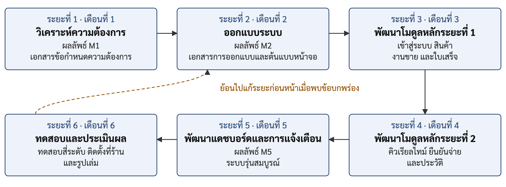{width=15cm}

**รูปที่ 3.1** กระบวนการดำเนินงานของโครงงาน

## 3.2 การวิเคราะห์ความต้องการ (Requirements Analysis)

หัวข้อนี้แปลงปัญหาที่บรรยายไว้ในบทที่ 1 หัวข้อ 1.1 ให้เป็นรายการที่มีรหัสกำกับและตรวจสอบได้ทีละข้อ เหตุผลที่ต้องดำเนินการขั้นตอนนี้คือ ข้อความบรรยายไม่สามารถนำไปทดสอบได้ว่าแก้ปัญหาสำเร็จหรือไม่ แต่รายการที่มีรหัสสามารถจับคู่กับผลการทดสอบได้โดยตรง รหัสที่ใช้มีเจ็ดกลุ่ม ได้แก่ หลักฐานจากหน้างาน (EV) เรื่องเล่าของผู้ใช้ (US) ความต้องการเชิงหน้าที่ (FR) กฎทางธุรกิจ (BR) ความต้องการนอกเหนือหน้าที่ (NFR) กรณีการใช้งาน (UC) และเกณฑ์การยอมรับ (AC) ในหัวข้อ 3.2.4 รายละเอียดฉบับเต็มของความต้องการทุกข้ออยู่ในเอกสารข้อกำหนดความต้องการซอฟต์แวร์ในภาคผนวก ก

### 3.2.1 การเก็บรวบรวมความต้องการ (Requirements Elicitation)

การเก็บความต้องการใช้สี่วิธี จากผู้ให้ข้อมูลซึ่งเป็นผู้ใช้งานจริงของร้านทั้งสามบทบาท ดังตารางที่ 3.1

**ตารางที่ 3.1** วิธีเก็บรวบรวมความต้องการและผู้ให้ข้อมูล

| วิธี | ผู้ให้ข้อมูล | สิ่งที่ได้ |
|---|---|---|
| สังเกตการณ์การทำงานจริงที่หน้าร้านและคลังสินค้า | พนักงานขายและพนักงานคลังสินค้า | ขั้นตอนการขายและการจ่ายสินค้าด้วยบิลกระดาษ จุดที่ลูกค้าต้องรอ และจุดที่เกิดการจัดสินค้าผิด |
| สัมภาษณ์เจ้าของร้าน | ผู้จัดการซึ่งเป็นเจ้าของร้าน | ปัญหาการสรุปยอดและนับสต็อกในช่วงท้ายวัน และวิธีตัดสินใจสั่งซื้อสินค้า |
| สอบถามพนักงาน | พนักงานขายและพนักงานคลังสินค้า | ปัญหาบิลเก่าถูกนำมาใช้รับสินค้าซ้ำ และการคำนวณยอดด้วยมือ |
| ตรวจเอกสารเดิมของร้าน | ไฟล์ตารางคำนวณรายการสินค้าและบิลกระดาษ | รายการสินค้ากว่า 700 รายการใน 18 แผ่นงานตามหมวดหมู่ และรูปแบบข้อมูลบนบิล |

ปัญหาที่ได้จากทั้งสี่วิธีสรุปเป็นหลักฐานเก้าข้อ โดยกำหนดรหัสขึ้นต้นด้วย EV เพื่อใช้อ้างอิงในหัวข้อถัดไป ดังตารางที่ 3.2

**ตารางที่ 3.2** หลักฐานจากหน้างานและวัตถุประสงค์ที่เกี่ยวข้อง

| รหัส | ปัญหาที่พบจากหน้างาน | วัตถุประสงค์ที่รองรับ |
|:---:|---|:---:|
| EV-01 | ไม่มีระบบบันทึกการขายที่เชื่อมกับสต็อก ใช้ใบเสร็จและบิลกระดาษ | ข้อ 1 |
| EV-02 | ข้อมูลรายการขายกระจัดกระจาย ตรวจสอบย้อนหลังได้ยาก | ข้อ 1 |
| EV-03 | หน้าร้านกับคลังสินค้าอยู่คนละพื้นที่ ไม่มีช่องทางสื่อสารแบบเรียลไทม์ | ข้อ 2 |
| EV-04 | ลูกค้าต้องถือใบเสร็จเดินไปคลังเอง เกิดคอขวดในชั่วโมงเร่งด่วน | ข้อ 2 |
| EV-05 | พนักงานคลังสินค้าอ่านใบเสร็จด้วยสายตา จึงจัดสินค้าผิดประเภทหรือผิดจำนวน | ข้อ 3 |
| EV-06 | มีการนำบิลเก่ามาใช้รับสินค้าซ้ำ | ข้อ 3 |
| EV-07 | ยอดสต็อกในบันทึกคลาดเคลื่อนจากจำนวนสินค้าจริง | ข้อ 3 |
| EV-08 | ผู้จัดการต้องรอสรุปยอดขายและนับสต็อกด้วยมือในช่วงท้ายวัน | ข้อ 4 |
| EV-09 | การตัดสินใจสั่งซื้อสินค้าพึ่งประสบการณ์แทนข้อมูลจริง | ข้อ 4 |

จากตารางที่ 3.2 หลักฐานทั้งเก้าข้อครอบคลุมวัตถุประสงค์เชิงผลิตภัณฑ์ครบทั้งสี่ข้อในหัวข้อ 1.2.1 และไม่มีวัตถุประสงค์ใดที่ไม่มีหลักฐานรองรับ นอกจากปัญหาทั้งเก้าข้อ การตรวจสอบเอกสารเดิมยังพบวิธีการทำงานหนึ่งประการที่ระบบต้องคงไว้ คือ พนักงานคุ้นเคยกับการค้นหาสินค้าจากหมวดหมู่ก่อนแล้วจึงค้นหาจากชื่อ ระบบจึงจัดเก็บหมวดหมู่เป็นข้อมูลของสินค้าและใช้เป็นตัวกรองบนหน้าจอขาย (FR-02 และตารางที่ 3.24) แทนการให้พิมพ์ค้นหาจากสินค้าทั้งหมดกว่า 700 รายการ

ผู้ใช้งานระบบมีสามบทบาท โดยแบ่งตามหน้าที่จริงของพนักงานในร้าน มิได้แบ่งตามระดับสิทธิ์ในระบบคอมพิวเตอร์ และไม่มีบทบาทผู้ดูแลระบบแยกต่างหาก เนื่องจากขนาดของร้านไม่จำเป็นต้องมีผู้ดูแลระบบเต็มเวลา บัญชีผู้ใช้ทั้งหมดสร้างขึ้นในขั้นตอนการติดตั้งระบบ ระบบจึงไม่มีหน้าจอจัดการบัญชีผู้ใช้ ดังตารางที่ 3.3

**ตารางที่ 3.3** ผู้ใช้งานระบบและขอบเขตงาน

| บทบาท | ขอบเขตงานในระบบ | หน้าจอแรกหลังเข้าสู่ระบบ |
|---|---|---|
| พนักงานขาย | สร้างคำสั่งซื้อ แสดงรหัสคิวอาร์ยืนยันรับชำระเงิน และสั่งพิมพ์ใบเสร็จ | หน้าขายหน้าร้าน |
| พนักงานคลังสินค้า | ดูคิวรอจ่ายสินค้า ปรับสถานะการจัดของ และยืนยันจ่ายสินค้า | หน้าคิวรอจ่ายสินค้า |
| ผู้จัดการ | จัดการข้อมูลสินค้า ดูแดชบอร์ดทั้งสองระดับ ตรวจประวัติการทำรายการ รับการแจ้งเตือน และทำงานแทนพนักงานทั้งสองบทบาทได้ | หน้าแดชบอร์ดปฏิบัติการ |

นอกจากสามบทบาทข้างต้น ระบบยังมีผู้กระทำอัตโนมัติ ซึ่งไม่ใช่บุคคลและไม่มีบัญชีผู้ใช้ โดยทำงานเมื่อเกิดเหตุการณ์ภายในระบบ ได้แก่ การตรวจสอบเงื่อนไขเพื่อสร้างการแจ้งเตือน

### 3.2.2 ความต้องการเชิงหน้าที่ (Functional Requirements)

ความต้องการเชิงหน้าที่เริ่มต้นจากเรื่องเล่าของผู้ใช้ ซึ่งเขียนด้วยภาษาของผู้ใช้ เพื่อให้เจ้าของร้านและพนักงานอ่านแล้วยืนยันได้ว่าตรงกับความต้องการจริงหรือไม่ ดังตารางที่ 3.4

**ตารางที่ 3.4** เรื่องเล่าของผู้ใช้

| รหัส | ในฐานะ | ฉันต้องการ | เพื่อที่จะ |
|:---:|---|---|---|
| US-01 | พนักงานขาย | บันทึกคำสั่งซื้อและออกใบเสร็จจากระบบในขั้นตอนเดียว | ไม่ต้องเขียนบิลด้วยมือและไม่ต้องคำนวณยอดด้วยตนเอง |
| US-02 | พนักงานคลังสินค้า | เห็นคำสั่งซื้อใหม่บนหน้าจอโดยอัตโนมัติโดยไม่ต้องโหลดหน้าจอใหม่ | เริ่มจัดเตรียมสินค้าได้ทันทีก่อนลูกค้ามาถึง |
| US-03 | พนักงานคลังสินค้า | ให้ระบบป้องกันการจ่ายสินค้าซ้ำจากคำสั่งซื้อเดิม | ไม่ต้องจดจำว่าคำสั่งซื้อใดจ่ายสินค้าแล้ว |
| US-04 | ผู้จัดการ | เห็นยอดขายและคิวงานระหว่างวันได้ทันที | ไม่ต้องรอสรุปยอดเมื่อปิดร้าน |
| US-05 | ผู้จัดการ | ให้ระบบเตือนเมื่อสินค้าใกล้หมด | สั่งของได้ทันก่อนของขาดมือ |
| US-06 | ผู้จัดการ | ค้นหาย้อนหลังได้ว่าใครทำรายการใดเมื่อไร | ตรวจสอบได้เมื่อยอดไม่ตรง |

จากเรื่องเล่าของผู้ใช้และหลักฐานในตารางที่ 3.2 จึงกำหนดความต้องการเชิงหน้าที่ซึ่งระบุสิ่งที่ระบบต้องทำได้ โดยกำหนดรหัสขึ้นต้นด้วย FR และแต่ละข้อเกิดจากหลักฐานอย่างน้อยหนึ่งข้อ ดังตารางที่ 3.5

**ตารางที่ 3.5** ความต้องการเชิงหน้าที่ของระบบ

| รหัส | ความต้องการ | มาจากหลักฐาน |
|:---:|---|:---:|
| FR-01 | เข้าสู่ระบบด้วยชื่อผู้ใช้และรหัสผ่าน และควบคุมสิทธิ์การเข้าถึงตามบทบาท | EV-02 |
| FR-02 | จัดการข้อมูลสินค้า หมวดหมู่ ราคา หน่วยนับ และจุดสั่งซื้อเพิ่ม | EV-09 |
| FR-03 | สร้างคำสั่งซื้อ คำนวณยอด แสดงรหัสคิวอาร์สำหรับชำระเงิน และสั่งพิมพ์ใบเสร็จ | EV-01 |
| FR-04 | แสดงคิวคำสั่งซื้อที่รอจ่ายสินค้าบนหน้าจอคลัง โดยอัปเดตเองเมื่อมีรายการใหม่ | EV-03, EV-04 |
| FR-05 | ให้พนักงานคลังยืนยันจ่ายสินค้าจากรายการในคิวได้ | EV-05 |
| FR-06 | ตัดยอดสินค้าคงเหลือในธุรกรรมเดียวกับการเปลี่ยนสถานะคำสั่งซื้อ และป้องกันการจ่ายซ้ำ | EV-06, EV-07 |
| FR-07 | แสดงแดชบอร์ดสรุปยอดขาย ระดับสต็อก และสถานะคิวงาน | EV-08 |
| FR-08 | แจ้งเตือนภายในแอปพลิเคชันเมื่อสินค้าต่ำกว่าจุดสั่งซื้อเพิ่มหรือคิวค้างผิดปกติ | EV-09 |
| FR-09 | บันทึกประวัติการทำรายการทุกเหตุการณ์สำคัญและค้นหาย้อนหลังได้ | EV-02 |

กฎทางธุรกิจเป็นกติกาของร้านที่มีอยู่แล้วไม่ว่าจะมีระบบคอมพิวเตอร์หรือไม่ จึงต้องแยกออกจากความต้องการเชิงหน้าที่ เนื่องจากกฎทางธุรกิจเป็นสิ่งที่ระบบต้องปฏิบัติตาม ส่วนความต้องการเชิงหน้าที่เป็นสิ่งที่ระบบต้องดำเนินการเพื่อให้กฎนั้นเป็นจริง กฎทางธุรกิจของร้านแสดงดังตารางที่ 3.6

**ตารางที่ 3.6** กฎทางธุรกิจของร้าน

| รหัส | กฎทางธุรกิจ | ข้อบังคับที่ตามมาต่อการออกแบบ |
|:---:|---|---|
| BR-01 | การออกใบเสร็จกระดาษและการส่งคำสั่งซื้อเข้าคิวคลังต้องเกิดจากการกระทำเดียวกัน | การยืนยันรับชำระเงินเป็นจุดเดียวที่ทั้งพิมพ์ใบเสร็จและผลักเข้าคิว |
| BR-02 | ตัวเลขสินค้าคงเหลือในระบบต้องตรงกับจำนวนสินค้าจริงในคลัง | การจ่ายสินค้าและการตัดสต็อกต้องอยู่ในธุรกรรมเดียวกัน และเจ้าของงานคือพนักงานคลังเท่านั้น |
| BR-03 | ต้องลดระยะเวลารอคอยของลูกค้า | คลังสินค้าต้องทราบคำสั่งซื้อก่อนลูกค้ามาถึง จึงต้องส่งข้อมูลจากฝั่งเซิร์ฟเวอร์ |
| BR-04 | ผู้บริหารต้องติดตามยอดขายและคิวงานได้ตลอดเวลา | ตัวชี้วัดต้องคำนวณสดจากฐานข้อมูล ไม่ใช้ค่าสรุปที่เก็บไว้ล่วงหน้า |
| BR-05 | ต้องแจ้งเตือนเชิงรุกเพื่อลดความเสี่ยงสินค้าขาดมือ | ระบบต้องตรวจเงื่อนไขเองหลังทุกครั้งที่สต็อกเปลี่ยน ไม่รอให้ผู้ใช้มาเปิดดู |

BR-04 เป็นกฎที่มีผลต่อการออกแบบมากกว่าที่ปรากฏในเบื้องต้น เนื่องจากการเลือกคำนวณตัวชี้วัดจากฐานข้อมูลในขณะแสดงผลแทนการจัดเก็บค่าสรุปไว้ล่วงหน้า เป็นการยอมแลกความเร็วเพื่อความถูกต้อง ตามเหตุผลที่อธิบายไว้ในบทที่ 2 หัวข้อ 2.1.8 ส่วน BR-05 กำหนดให้ระบบตรวจสอบเงื่อนไขโดยอัตโนมัติทุกครั้งที่สต็อกเปลี่ยนแปลง ตามเหตุผลในหัวข้อ 2.1.9

ความต้องการเชิงหน้าที่ถูกจัดเป็นกรณีการใช้งาน 11 กรณี ซึ่งระบุผู้กระทำหลักและความต้องการที่รองรับ ดังตารางที่ 3.7

**ตารางที่ 3.7** รายการกรณีการใช้งานของระบบ

| รหัส | ชื่อกรณีการใช้งาน | ผู้กระทำหลัก | ความต้องการที่รองรับ |
|:---:|---|---|:---:|
| UC-01 | เข้าสู่ระบบและควบคุมสิทธิ์ตามบทบาท | ทุกบทบาท | FR-01 |
| UC-02 | จัดการข้อมูลสินค้าและจุดสั่งซื้อเพิ่ม | ผู้จัดการ | FR-02 |
| UC-03 | สร้างคำสั่งซื้อและออกใบเสร็จ | พนักงานขาย | FR-03 |
| UC-04 | สร้างเลขที่คำสั่งซื้อไม่ซ้ำอัตโนมัติ | ระบบ ภายใน UC-03 | FR-03 |
| UC-05 | ดูคิวรอจ่ายสินค้าแบบเรียลไทม์ | พนักงานคลังสินค้า | FR-04 |
| UC-06 | ปรับสถานะการจัดของในคิวงาน | พนักงานคลังสินค้า | FR-04 |
| UC-07 | ยืนยันจ่ายสินค้าและตัดสต็อก | พนักงานคลังสินค้า | FR-05, FR-06 |
| UC-08 | แสดงแดชบอร์ดปฏิบัติการ | ผู้จัดการ, พนักงานคลังสินค้า | FR-07 |
| UC-09 | แสดงแดชบอร์ดระดับบริหาร | ผู้จัดการ | FR-07 |
| UC-10 | ค้นหาและดูประวัติการทำรายการ | ผู้จัดการ | FR-09 |
| UC-11 | รับการแจ้งเตือนภายในแอปพลิเคชัน | ผู้จัดการ, พนักงานคลังสินค้า, ระบบอัตโนมัติ | FR-08 |

UC-04 เป็นกรณีการใช้งานที่ไม่มีผู้ใช้คนใดเป็นผู้เริ่ม แต่เกิดขึ้นทุกครั้งระหว่างการทำงานของ UC-03 เหตุผลในการแยกเป็นรหัสต่างหากคือ การสร้างเลขที่ไม่ซ้ำมีเงื่อนไขความถูกต้องเฉพาะที่ต้องทดสอบแยก โดยเฉพาะกรณีที่พนักงานขายสองคนออกใบเสร็จพร้อมกันและขอเลขลำดับถัดไปเลขเดียวกัน

### 3.2.3 ความต้องการนอกเหนือหน้าที่ (Non-functional Requirements)

ความต้องการนอกเหนือหน้าที่ระบุว่าระบบต้องทำงานได้ดีเพียงใด โดยกำหนดรหัสขึ้นต้นด้วย NFR และจัดกลุ่มตามคุณลักษณะคุณภาพของมาตรฐานไอเอสโอ/ไออีซี 25010 ในบทที่ 2 หัวข้อ 2.3.1 ความต้องการทุกข้อต้องมีวิธีทวนสอบที่วัดผลได้ มิฉะนั้นจะไม่สามารถตัดสินได้ว่าผ่านหรือไม่ผ่าน ดังตารางที่ 3.8

**ตารางที่ 3.8** ความต้องการนอกเหนือหน้าที่ คุณลักษณะคุณภาพ และวิธีทวนสอบ

| รหัส | ความต้องการ | คุณลักษณะคุณภาพ | วิธีทวนสอบ |
|:---:|---|---|---|
| NFR-01 | ทุกคำขอต้องแนบโทเคน และถูกตรวจสิทธิ์ที่ฝั่งเซิร์ฟเวอร์ก่อนประมวลผล รหัสผ่านต้องเก็บเป็นค่าที่ผ่านการแฮช | ความมั่นคงปลอดภัย | เรียกทุกเส้นทางโดยไม่แนบโทเคน แนบโทเคนปลอม และแนบโทเคนของบทบาทที่ไม่มีสิทธิ์ |
| NFR-02 | คำสั่งซื้อใหม่ต้องปรากฏบนหน้าจอคิวภายใน 3 วินาที | ประสิทธิภาพด้านเวลา | จับเวลาตั้งแต่ยืนยันรับชำระจนรายการปรากฏบนหน้าจอคิว วัดซ้ำหลายครั้ง |
| NFR-03 | หน้าจอคิวและหน้าจอยืนยันจ่ายต้องใช้งานได้บนแท็บเล็ตและสมาร์ตโฟน | ความสามารถในการใช้งาน | เปิดทุกหน้าจอที่ความกว้างของอุปกรณ์เคลื่อนที่แล้วตรวจว่าใช้งานครบทุกปุ่ม |
| NFR-04 | ฐานข้อมูลต้องให้ผลถูกต้องเมื่อมีธุรกรรมพร้อมกัน โดยไม่เกิดสภาวะแข่งขัน | ความเหมาะสมเชิงหน้าที่ ด้านความถูกต้อง | ยิงคำขอยืนยันจ่ายพร้อมกันหลายคำขอต่อคำสั่งซื้อเดียว แล้วตรวจว่าสำเร็จเพียงคำขอเดียว |
| NFR-05 | เครื่องพิมพ์ใบเสร็จต้องพิมพ์สำเร็จภายใน 5 วินาทีหลังยืนยันรับชำระ | ประสิทธิภาพด้านเวลา | จับเวลากับเครื่องพิมพ์ความร้อนจริงที่สถานประกอบการ |
| NFR-06 | รองรับผู้ใช้งานพร้อมกันไม่น้อยกว่า 10 เซสชันในช่วงเวลาเร่งด่วน | ประสิทธิภาพด้านขีดความสามารถ | จำลองการใช้งานพร้อมกัน 10 เซสชันจากทั้งสามบทบาท |
| NFR-07 | ทำงานถูกต้องบนเบราว์เซอร์โครม (Chrome) เอดจ์ (Edge) และไฟร์ฟอกซ์ (Firefox) รุ่นล่าสุด | ความสามารถในการเคลื่อนย้าย ด้านการปรับตัว | เปิดทุกหน้าจอบนเบราว์เซอร์ที่กำหนดและตรวจข้อผิดพลาดในคอนโซล |
| NFR-08 | แยกชั้นและแยกส่วนประกอบตามที่ออกแบบไว้ เพื่อให้บำรุงรักษาแยกส่วนได้ | ความสามารถในการบำรุงรักษา ด้านความเป็นโมดูล | ตรวจโครงสร้างซอร์สโค้ดเทียบกับแผนภาพส่วนประกอบในรูปที่ 3.5 |
| NFR-09 | ติดตั้งซ้ำบนเครื่องใหม่ได้ด้วยเอกสารเพียงอย่างเดียว โดยไม่แก้ซอร์สโค้ด | ความสามารถในการเคลื่อนย้าย ด้านการติดตั้ง | ให้ผู้ที่ไม่ได้ร่วมพัฒนาติดตั้งตามคู่มือ |

เวลา 3 วินาทีใน NFR-02 เป็นเป้าหมายการออกแบบที่คณะผู้จัดทำกำหนดขึ้น มิใช่ค่าที่วัดจากร้าน เหตุผลคือลูกค้าใช้เวลาเดินจากจุดชำระเงินหน้าร้านไปถึงจุดรับสินค้าที่คลังสินค้าประมาณครึ่งนาทีถึงหนึ่งนาทีจากการสังเกตที่ร้าน หากคำสั่งซื้อไปถึงหน้าจอของคลังสินค้าภายใน 3 วินาที พนักงานจะมีเวลาเริ่มจัดเตรียมสินค้าก่อนลูกค้ามาถึงเสมอ แม้เวลาเดินจริงจะสั้นกว่าที่ประมาณไว้มาก ซึ่งสอดคล้องกับวัตถุประสงค์ข้อ 2 ส่วนตัวเลข 10 เซสชันใน NFR-06 เป็นเป้าหมายที่คณะผู้จัดทำกำหนดขึ้นเพื่อทดสอบว่าระบบเปิดใช้งานพร้อมกัน 10 หน้าจอได้โดยไม่มีคำขอล้มเหลว มิได้คำนวณจากจำนวนพนักงานของร้าน จากตารางที่ 3.8 ความต้องการครอบคลุมคุณลักษณะคุณภาพหกด้าน โดยคุณลักษณะด้านความเข้ากันได้ไม่มีความต้องการแยก เนื่องจากระบบไม่ต้องทำงานร่วมกับซอฟต์แวร์ภายนอกตามขอบเขตในหัวข้อ 1.3.1 ส่วนคุณลักษณะด้านความน่าเชื่อถือไม่ได้กำหนดเป็นตัวเลข เช่น ระยะเวลาที่ระบบต้องทำงานต่อเนื่อง เนื่องจากระยะเวลาทดสอบที่ร้านสั้นเกินกว่าจะวัดค่าดังกล่าวได้ แต่ระบบออกแบบให้ทำงานต่อได้เมื่อบางส่วนขัดข้อง ได้แก่ การขายต่อได้เมื่อเครื่องพิมพ์ขัดข้อง และช่องทางสำรองเมื่อเว็บซ็อกเก็ต (WebSocket) เชื่อมต่อไม่ได้

### 3.2.4 แบบจำลองความต้องการ (Requirements Models)

แบบจำลองความต้องการของระบบประกอบด้วยสามส่วน ได้แก่ แผนภาพบริบทซึ่งแสดงขอบเขตของระบบกับผู้ใช้และอุปกรณ์ภายนอก แผนภาพกรณีการใช้งาน และคำอธิบายกรณีการใช้งานพร้อมเกณฑ์การยอมรับ ทั้งนี้ แผนภาพบริบทนำเสนอไว้เป็นระดับ C1 ของสถาปัตยกรรมในหัวข้อ 3.3.2 หัวข้อนี้จึงแสดงเฉพาะสองส่วนหลังเพื่อไม่ให้ซ้ำซ้อน

แผนภาพกรณีการใช้งานของระบบทั้ง 11 กรณีแสดงดังรูปที่ 3.2 ผู้กระทำอยู่นอกกรอบระบบ และกรณีการใช้งานอยู่ภายในกรอบ เส้นทึบแสดงว่าผู้กระทำใดเป็นผู้เริ่มกรณีการใช้งานใด เส้นประที่มีคำว่าอินคลูด (include) แสดงว่า UC-03 เรียกใช้ UC-04 ทุกครั้ง และเส้นที่มีหัวลูกศรสามเหลี่ยมโปร่งแสดงว่าผู้จัดการได้รับสิทธิ์ทั้งหมดของพนักงานขายและพนักงานคลังสินค้า ผู้จัดการจึงสามารถเริ่ม UC-01 UC-03 และ UC-05 ถึง UC-07 ได้โดยไม่ต้องแสดงเส้นซ้ำ ซึ่งสอดคล้องกับตารางที่ 3.3

{height=19cm}

**รูปที่ 3.2** แผนภาพกรณีการใช้งานของระบบ (Use Case Diagram)

กรณีการใช้งานสองกรณีที่มีผลต่อการออกแบบมากที่สุดอธิบายไว้ในตารางที่ 3.9 และตารางที่ 3.10 ส่วนคำอธิบายของทุกกรณีพร้อมลำดับเหตุการณ์หลัก ลำดับเหตุการณ์ทางเลือก และลำดับเหตุการณ์ข้อยกเว้น อยู่ในภาคผนวก ก หัวข้อ ก.4

**ตารางที่ 3.9** คำอธิบายกรณีการใช้งาน UC-03 สร้างคำสั่งซื้อและออกใบเสร็จ

| หัวข้อ | รายละเอียด |
|---|---|
| ผู้กระทำหลัก | พนักงานขาย |
| เงื่อนไขก่อน | เข้าสู่ระบบด้วยบทบาทพนักงานขายแล้ว และมีข้อมูลสินค้าในระบบ |
| เงื่อนไขหลังสำเร็จ | มีคำสั่งซื้อสถานะรอจ่ายสินค้า (`awaiting_dispatch`) ในระบบ ใบเสร็จถูกพิมพ์ และรายการปรากฏบนหน้าจอคิวของคลัง |
| ลำดับขั้นตอนหลัก | 1) เลือกสินค้าและระบุจำนวน 2) ระบบคำนวณยอดรวม 3) ระบบแสดงรหัสคิวอาร์ตามยอดที่ต้องชำระ 4) ลูกค้าชำระเงิน 5) พนักงานตรวจสอบการรับเงินจากแอปพลิเคชันของธนาคารแล้วยืนยัน 6) ระบบบันทึกคำสั่งซื้อพร้อมเลขที่ไม่ซ้ำ (UC-04) สั่งพิมพ์ใบเสร็จ และผลักรายการเข้าคิวคลัง |
| ทางเลือกที่ยังสำเร็จ | หากเลขที่คำสั่งซื้อชนกับรายการที่เพิ่งสร้างพร้อมกัน ระบบจะขอเลขลำดับถัดไปใหม่แล้วบันทึกซ้ำ |
| ทางที่ล้มเหลว | หากสั่งพิมพ์ใบเสร็จไม่สำเร็จ ระบบยังคงบันทึกคำสั่งซื้อและผลักเข้าคิวตามปกติ พร้อมแจ้งว่าพิมพ์ไม่สำเร็จ พนักงานจึงแจ้งเลขที่คำสั่งซื้อให้ลูกค้าใช้รับสินค้าแทนใบเสร็จ เนื่องจากการพิมพ์เป็นงานผลพลอยได้ที่ไม่ควรทำให้การขายที่เกิดขึ้นจริงถูกยกเลิก ตามหลักการกำหนดขอบเขตธุรกรรมในหัวข้อ 2.1.2 |

**ตารางที่ 3.10** คำอธิบายกรณีการใช้งาน UC-07 ยืนยันจ่ายสินค้าและตัดสต็อก

| หัวข้อ | รายละเอียด |
|---|---|
| ผู้กระทำหลัก | พนักงานคลังสินค้า |
| เงื่อนไขก่อน | มีคำสั่งซื้อในคิวที่สถานะเป็นรอจ่ายสินค้าหรือกำลังจัดของ |
| เงื่อนไขหลังสำเร็จ | สถานะคำสั่งซื้อเป็นส่งมอบสำเร็จ ยอดสินค้าคงเหลือถูกหัก มีรายการเคลื่อนไหวสต็อกและประวัติการทำรายการถูกบันทึก |
| ลำดับขั้นตอนหลัก | 1) เลือกคำสั่งซื้อจากคิว 2) ตรวจสอบรายการสินค้ากับสินค้าจริง 3) กดยืนยันจ่ายสินค้า 4) ระบบเปิดธุรกรรม เปลี่ยนสถานะแบบมีเงื่อนไข หักยอดสินค้า บันทึกรายการเคลื่อนไหว และบันทึกประวัติ 5) ระบบยืนยันผลและปรับหน้าจอคิวของทุกเครื่อง |
| ทางที่ล้มเหลว E1 | หากคำสั่งซื้อถูกจ่ายไปแล้วโดยเครื่องอื่น การเปลี่ยนสถานะแบบมีเงื่อนไขจะไม่พบแถวที่ตรงเงื่อนไข ระบบยกเลิกธุรกรรมทั้งหมดและแจ้งว่าคำสั่งซื้อนี้ถูกจ่ายไปแล้ว |
| ทางที่ล้มเหลว E2 | หากยอดสินค้าคงเหลือไม่พอ ระบบยกเลิกธุรกรรมทั้งหมด ยอดสินค้าและสถานะคำสั่งซื้อกลับสู่สภาพเดิม |

ทางที่ล้มเหลว E1 เป็นการนำการล็อกเชิงบวกที่อธิบายไว้ในหัวข้อ 2.1.3 มาใช้จริง โดยไม่จองสิทธิ์ไว้ล่วงหน้า แต่ตรวจสอบในขั้นตอนการเขียนว่าสถานะยังเป็นค่าที่คาดไว้หรือไม่ หากไม่ใช่ แสดงว่ามีผู้อื่นทำรายการไปก่อนแล้ว การออกแบบดังกล่าวตอบวัตถุประสงค์ข้อ 3 โดยตรง และเป็นกลไกที่ป้องกันปัญหา EV-06

เกณฑ์การยอมรับเขียนในรูปแบบเงื่อนไขตั้งต้น การกระทำ และผลที่ต้องเกิดขึ้น เพื่อให้แปลงเป็นกรณีทดสอบได้โดยไม่ต้องตีความเพิ่มเติม ดังตารางที่ 3.11

**ตารางที่ 3.11** เกณฑ์การยอมรับของระบบ

| รหัส | เงื่อนไขตั้งต้น | การกระทำ | ผลที่ต้องเกิด | อ้างอิง |
|:---:|---|---|---|:---:|
| AC-01 | มีบัญชีผู้ใช้บทบาทพนักงานขาย | เรียกเส้นทางของผู้จัดการโดยตรง | ระบบปฏิเสธคำขอที่ฝั่งเซิร์ฟเวอร์ | FR-01 |
| AC-02 | เข้าสู่ระบบด้วยบทบาทผู้จัดการ | แก้ไขจุดสั่งซื้อเพิ่มของสินค้า | ค่าที่บันทึกตรงกับที่กรอก และมีบันทึกในประวัติการทำรายการ | FR-02 |
| AC-03 | มีสินค้าในระบบและสต็อกเพียงพอ | สร้างคำสั่งซื้อและยืนยันรับชำระ | มีคำสั่งซื้อสถานะรอจ่ายสินค้า พร้อมเลขที่ไม่ซ้ำ | FR-03 |
| AC-04 | มีคำสั่งซื้อในระบบอยู่แล้วจำนวนหนึ่ง | สร้างคำสั่งซื้อต่อเนื่องและพร้อมกันหลายรายการ | เลขที่คำสั่งซื้อไม่ซ้ำกันทุกรายการ | FR-03 |
| AC-05 | บริการพิมพ์ใบเสร็จขัดข้องหรือปิดอยู่ | พนักงานขายกดยืนยันรับชำระเงิน | คำสั่งซื้อยังถูกบันทึกและเข้าคิวคลังตามปกติ พร้อมแจ้งบนหน้าจอว่าพิมพ์ไม่สำเร็จ | FR-03, BR-01 |
| AC-06 | หน้าจอคิวเปิดค้างอยู่ | พนักงานขายยืนยันรับชำระคำสั่งซื้อใหม่ | รายการปรากฏบนหน้าจอคิวภายใน 3 วินาทีโดยไม่ต้องโหลดหน้าจอใหม่ | FR-04, NFR-02 |
| AC-07 | มีคำสั่งซื้อหนึ่งใบในสถานะรอจ่ายสินค้า | ส่งคำขอยืนยันจ่ายพร้อมกันสองคำขอ | สำเร็จเพียงคำขอเดียว อีกคำขอถูกปฏิเสธ และสต็อกถูกหักเพียงครั้งเดียว | FR-05, FR-06, NFR-04 |
| AC-08 | สต็อกสินค้าน้อยกว่าจำนวนที่สั่ง | ยืนยันจ่ายสินค้า | ธุรกรรมถูกยกเลิกทั้งหมด สถานะและยอดสต็อกไม่เปลี่ยน | FR-06 |
| AC-09 | มีคำสั่งซื้อที่ชำระเงินแล้วในระบบ | เปิดแดชบอร์ดปฏิบัติการ | ตัวเลขบนแดชบอร์ดตรงกับผลรวมที่คำนวณจากฐานข้อมูลโดยตรง | FR-07 |
| AC-10 | ตั้งจุดสั่งซื้อเพิ่มของสินค้าไว้ | จ่ายสินค้าจนยอดต่ำกว่าจุดสั่งซื้อเพิ่ม | ระบบสร้างการแจ้งเตือนโดยไม่ต้องรอให้ผู้ใช้เปิดดู | FR-08, BR-05 |
| AC-11 | มีการทำรายการเกิดขึ้นแล้ว | ค้นหาประวัติตามช่วงเวลาและประเภทการกระทำ | ระบบแสดงผู้กระทำ เวลา และข้อมูลที่ถูกกระทำ | FR-09 |
| AC-12 | ผู้ใช้มีบัญชีที่เปิดใช้งานอยู่ | เข้าสู่ระบบด้วยชื่อผู้ใช้และรหัสผ่านที่ถูกต้อง | ไปหน้าแรกของบทบาทและเห็นเฉพาะเมนูของตน ส่วนการเข้าไม่สำเร็จทุกกรณีได้ข้อความเดียวกัน | FR-01, NFR-01 |
| AC-13 | มีคำสั่งซื้อค้างอยู่ในคิวรอจ่ายสินค้า | เวลารอเกินเกณฑ์ที่กำหนดไว้ โดยไม่มีใครเปิดหน้าจอ | ระบบสร้างการแจ้งเตือนคิวงานค้างนานผิดปกติที่ระบุเลขที่คำสั่งซื้อและระยะเวลาที่รอ | FR-08 |
| AC-14 | เครื่องพิมพ์ใบเสร็จเชื่อมต่อและพร้อมทำงาน | พนักงานขายยืนยันรับชำระเงิน | ใบเสร็จพิมพ์เสร็จภายใน 5 วินาทีนับจากเวลาที่กดยืนยัน | NFR-05 |
| AC-15 | มีผู้ใช้งานเข้าสู่ระบบพร้อมกัน 10 เซสชันจากทั้งสามบทบาท | ทุกเซสชันเรียกใช้งานระบบพร้อมกันอย่างต่อเนื่อง | ไม่มีคำขอใดล้มเหลว | NFR-06 |

### 3.2.5 การเริ่มต้นการสอบกลับความต้องการ (Requirements Traceability)

การสอบกลับในหัวข้อนี้เป็นการสอบกลับย้อนหลัง กล่าวคือ เชื่อมโยงความต้องการทุกข้อกลับไปยังที่มา เพื่อตรวจสอบว่าไม่มีความต้องการข้อใดที่ไม่มีที่มา และไม่มีปัญหาข้อใดที่ไม่ได้รับการแก้ไข ส่วนการสอบกลับไปข้างหน้า คือจากความต้องการไปยังโมดูลและผลการทดสอบ แสดงไว้ในบทที่ 4 ตารางที่ 4.11 และตารางสอบกลับฉบับเต็มอยู่ในภาคผนวก ค

**ตารางที่ 3.12** ตารางสอบกลับจากหลักฐานถึงเกณฑ์การยอมรับ

| หลักฐาน | ความต้องการ | กรณีการใช้งาน | เกณฑ์การยอมรับ |
|:---:|---|:---:|:---:|
| EV-01 | FR-03, BR-01 | UC-03, UC-04 | AC-03, AC-04, AC-05 |
| EV-02 | FR-01, FR-09 | UC-01, UC-10 | AC-01, AC-11, AC-12 |
| EV-03, EV-04 | FR-04, BR-03, NFR-02 | UC-05, UC-06 | AC-06 |
| EV-05 | FR-05 | UC-07 | AC-07 |
| EV-06 | FR-06, BR-02, NFR-04 | UC-07 | AC-07 |
| EV-07 | FR-06, BR-02 | UC-07 | AC-08 |
| EV-08 | FR-07, BR-04 | UC-08, UC-09 | AC-09 |
| EV-09 | FR-02, FR-08, BR-05 | UC-02, UC-11 | AC-02, AC-10, AC-13 |

จากตารางที่ 3.12 หลักฐานทั้งเก้าข้อมีความต้องการรองรับครบถ้วน และความต้องการทุกข้อในตารางนี้มีกรณีการใช้งานและเกณฑ์การยอมรับกำกับ ส่วน AC-14 และ AC-15 เป็นเกณฑ์ของ NFR-05 และ NFR-06 ซึ่งกำหนดจากคุณภาพที่ระบบต้องมี มิได้สืบมาจากหลักฐานข้อใดโดยตรง จึงไม่ปรากฏในตารางนี้

นอกจากการสอบกลับไปยังหลักฐาน กรณีการใช้งานทุกกรณีต้องอยู่ในขอบเขตของโครงงานในบทที่ 1 ตารางที่ 1.1 และสิ่งที่อยู่ในขอบเขตทุกข้อต้องมีกรณีการใช้งานรองรับ ความสัมพันธ์ระหว่างขอบเขต กรณีการใช้งาน และความต้องการแสดงดังตารางที่ 3.13

**ตารางที่ 3.13** การจับคู่ขอบเขตของโครงงาน กรณีการใช้งาน และความต้องการ

| ขอบเขตในตารางที่ 1.1 | กรณีการใช้งาน | ความต้องการ |
|---|:---:|---|
| เข้าสู่ระบบและควบคุมสิทธิ์ตามบทบาท | UC-01 | FR-01, NFR-01 |
| จัดการข้อมูลสินค้าและตั้งจุดสั่งซื้อเพิ่ม | UC-02 | FR-02 |
| สร้างคำสั่งซื้อ แสดงรหัสคิวอาร์ และพิมพ์ใบเสร็จ | UC-03, UC-04 | FR-03, BR-01, NFR-05 |
| ส่งคำสั่งซื้อเข้าคิวคลังสินค้าแบบเรียลไทม์ | UC-05, UC-06 | FR-04, BR-03, NFR-02 |
| ยืนยันจ่ายสินค้าพร้อมตัดสต็อกและกันการจ่ายซ้ำ | UC-07 | FR-05, FR-06, BR-02, NFR-04 |
| แดชบอร์ดปฏิบัติการและแดชบอร์ดระดับบริหาร | UC-08, UC-09 | FR-07, BR-04 |
| บันทึกและค้นหาประวัติการทำรายการ | UC-10 | FR-09 |
| แจ้งเตือนภายในแอปพลิเคชัน | UC-11 | FR-08, BR-05 |
| ทุกขอบเขตข้างต้น | ทุกกรณี | NFR-03, NFR-06 ถึง NFR-09 |

จากตารางที่ 3.13 สิ่งที่อยู่ในขอบเขตทั้งแปดข้อมีกรณีการใช้งานรองรับครบถ้วน และกรณีการใช้งานทั้ง 11 กรณีอยู่ในขอบเขตทั้งหมด ส่วนสิ่งที่อยู่นอกขอบเขตในตารางที่ 1.1 ไม่มีกรณีการใช้งานใดรองรับ ซึ่งยืนยันว่าระบบไม่มีหน้าที่ส่วนเกินที่ไม่มีที่มา

## 3.3 การออกแบบสถาปัตยกรรมระบบ (Architecture Design)

### 3.3.1 รูปแบบสถาปัตยกรรม (Architecture Style)

ระบบใช้สถาปัตยกรรมแบบแบ่งชั้นสามชั้นเชิงตรรกะตามหลักการในหัวข้อ 2.1.1 ได้แก่ ชั้นการนำเสนอข้อมูล ชั้นตรรกะทางธุรกิจ และชั้นข้อมูล โดยทำงานแบบลูกข่ายและแม่ข่าย กล่าวคือ หน้าจอบนเบราว์เซอร์เป็นฝ่ายส่งคำขอไปยังระบบหลังบ้าน และเสริมด้วยสถาปัตยกรรมแบบขับเคลื่อนด้วยเหตุการณ์ตามหัวข้อ 2.1.6 สำหรับงานที่ระบบหลังบ้านต้องเป็นฝ่ายส่งข้อมูลไปยังหน้าจอคิว

การอธิบายสถาปัตยกรรมใช้แบบจำลองซีโฟร์ (C4 model) ตามที่กล่าวไว้ในหัวข้อ 2.1.1 ซึ่งอธิบายซอฟต์แวร์ด้วยแผนภาพหลายระดับที่ขยายรายละเอียดเข้าไปทีละชั้น เริ่มจากระดับบริบทที่มองระบบเป็นกล่องเดียวในหัวข้อ 3.3.2 ต่อด้วยระดับคอนเทนเนอร์ที่แสดงหน่วยติดตั้งที่แยกจากกันในหัวข้อ 3.3.3 และระดับส่วนประกอบที่แสดงโมดูลภายในในหัวข้อ 3.3.4 เหตุผลที่เลือกแบบจำลองนี้คือ ผู้อ่านแต่ละกลุ่มต้องการรายละเอียดต่างระดับกัน เจ้าของร้านต้องการทราบเพียงผู้ใช้ระบบและระบบภายนอกที่เกี่ยวข้อง ขณะที่ผู้พัฒนาต้องการทราบรายละเอียดถึงระดับโมดูล

### 3.3.2 ระดับบริบทของระบบ (System Context: C1)

องค์ประกอบในแผนภาพบริบทของระบบแสดงดังตารางที่ 3.14

**ตารางที่ 3.14** องค์ประกอบในแผนภาพบริบทของระบบ

| องค์ประกอบ | ประเภท | หน้าที่ |
|---|---|---|
| พนักงานขาย | บุคคล | บันทึกคำสั่งซื้อ แสดงรหัสคิวอาร์ยืนยันรับชำระเงิน และสั่งพิมพ์ใบเสร็จ |
| พนักงานคลังสินค้า | บุคคล | ดูคิวรอจ่ายสินค้า ยืนยันจ่ายสินค้า และตัดสต็อก |
| ผู้จัดการ | บุคคล | ดูแดชบอร์ด จัดการข้อมูลสินค้า ตรวจประวัติการทำรายการ และรับการแจ้งเตือน |
| ระบบอำพร OMS | ระบบซอฟต์แวร์ | ระบบหลักที่พัฒนาขึ้นในโครงงานนี้ |
| แอปพลิเคชันธนาคารของลูกค้า | ระบบภายนอก | สแกนรหัสคิวอาร์ที่ระบบแสดงเพื่อโอนเงินเข้าบัญชีของร้าน โดยไม่ส่งข้อมูลใดกลับมายังระบบ |
| เครื่องพิมพ์ใบเสร็จความร้อน | อุปกรณ์ภายนอก | รับคำสั่งอีเอสซีโพส (ESC/POS) เพื่อพิมพ์ใบเสร็จกระดาษ |

{width=14.5cm}

**รูปที่ 3.3** แผนภาพบริบทของระบบ (C1: System Context Diagram)

จากรูปที่ 3.3 ผู้ใช้ทั้งสามบทบาทเข้าถึงระบบผ่านเว็บเบราว์เซอร์เพียงช่องทางเดียว จึงไม่จำเป็นต้องติดตั้งโปรแกรมเพิ่มเติมบนเครื่องของผู้ใช้ ซึ่งสอดคล้องกับความต้องการ NFR-07 ที่กำหนดให้ระบบทำงานบนเบราว์เซอร์ที่กำหนด

ประเด็นที่ควรสังเกตคือ ลูกค้าไม่ปรากฏเป็นผู้ใช้ระบบ เนื่องจากลูกค้าไม่มีบัญชีผู้ใช้และไม่ได้กระทำการใดกับระบบโดยตรง นอกจากการสแกนรหัสคิวอาร์และรับใบเสร็จ นอกจากนี้ ระบบไม่เชื่อมต่อกับผู้ให้บริการรับชำระเงินหรือระบบของธนาคาร ซึ่งสอดคล้องกับขอบเขตและข้อจำกัดในบทที่ 1 หัวข้อ 1.3.1 และ 1.3.3 ระบบจึงไม่สามารถทราบได้เองว่าเงินเข้าบัญชีแล้วหรือไม่ พนักงานขายจึงเป็นผู้ตรวจสอบจากแอปพลิเคชันของธนาคารและยืนยันการรับชำระเงินด้วยตนเอง ส่วนการสร้างรหัสคิวอาร์พร้อมเพย์ทำโดยไลบรารีที่อยู่ภายในระบบหลังบ้าน จึงไม่ปรากฏเป็นระบบภายนอกในแผนภาพนี้ แต่ปรากฏเป็นส่วนประกอบ SP-03 ในหัวข้อ 3.3.4

### 3.3.3 ระดับคอนเทนเนอร์ (Container: C2)

หน่วยติดตั้งของระบบแสดงดังตารางที่ 3.15

**ตารางที่ 3.15** หน่วยติดตั้งของระบบ

| หน่วยติดตั้ง | ชั้นเชิงตรรกะ | เทคโนโลยี | เหตุผลที่แยกเป็นหน่วยต่างหาก |
|---|---|---|---|
| ส่วนติดต่อผู้ใช้บนเบราว์เซอร์ | ชั้นการนำเสนอ | รีแอ็กต์ (React) และไวต์ | ทำงานบนเครื่องของผู้ใช้แต่ละคน |
| ระบบหลังบ้าน | ชั้นตรรกะทางธุรกิจ | โหนดเจเอส (Node.js) และเอ็กซ์เพรสเจเอส (Express.js) | เป็นศูนย์กลางของตรรกะและสิทธิ์ ย้ายไปทำงานที่ใดก็ได้ |
| บริการพิมพ์ใบเสร็จ | ชั้นตรรกะทางธุรกิจ | โหนดเจเอสและชุดคำสั่งอีเอสซีโพส | ต้องทำงานบนเครื่องที่ต่อกับเครื่องพิมพ์เท่านั้น |
| ฐานข้อมูล | ชั้นข้อมูล | มายเอสคิวแอล (MySQL) บนเอนจินอินโนดีบี (InnoDB) | เป็นระบบจัดการฐานข้อมูลที่แยกกระบวนการอยู่แล้ว |

{width=14.5cm}

**รูปที่ 3.4** แผนภาพระดับคอนเทนเนอร์ของระบบ (C2: Container Diagram)

การที่ระบบมีสามชั้นเชิงตรรกะแต่มีหน่วยติดตั้งสี่หน่วยเป็นประเด็นที่ต้องอธิบายให้ชัดเจน บริการพิมพ์ใบเสร็จอยู่ในชั้นตรรกะทางธุรกิจเช่นเดียวกับระบบหลังบ้าน แต่ถูกแยกออกเป็นกระบวนการต่างหาก เหตุผลมิได้มาจากขนาดของซอร์สโค้ด แต่มาจากการที่เครื่องพิมพ์ความร้อนเชื่อมต่อทางกายภาพกับเครื่องคอมพิวเตอร์ที่ตั้งอยู่หน้าร้าน บริการนี้จึงต้องทำงานบนเครื่องดังกล่าวเสมอ ขณะที่ระบบหลังบ้านสามารถย้ายไปทำงานบนเครื่องอื่นได้ หากรวมสองส่วนนี้ไว้ด้วยกัน ระบบทั้งหมดจะถูกจำกัดให้ทำงานบนเครื่องคอมพิวเตอร์หน้าร้านเท่านั้น

จากรูปที่ 3.4 การสื่อสารระหว่างส่วนติดต่อผู้ใช้กับระบบหลังบ้านใช้สองช่องทางที่ทำงานร่วมกัน ช่องทางแรกคือการเรียกใช้บริการแบบคำขอและคำตอบ สำหรับงานที่ผู้ใช้เป็นฝ่ายเริ่ม เช่น การสร้างคำสั่งซื้อหรือการยืนยันจ่ายสินค้า ช่องทางที่สองคือช่องทางที่เปิดค้างไว้ เพื่อให้ระบบหลังบ้านเป็นฝ่ายส่งข้อมูลไปยังหน้าจอคิวเมื่อมีคำสั่งซื้อใหม่ การออกแบบดังกล่าวทำให้พนักงานคลังสินค้าไม่ต้องโหลดหน้าจอใหม่ และทำให้ระบบตอบสนองได้ภายในเกณฑ์ 3 วินาทีตาม NFR-02 ระบบเลือกเว็บซ็อกเก็ตเป็นช่องทางหลัก และใช้เหตุการณ์ที่ส่งจากเซิร์ฟเวอร์ (Server-Sent Events) เป็นช่องทางสำรอง เนื่องจากอุปกรณ์เครือข่ายบางรุ่นไม่อนุญาตให้ยกระดับการเชื่อมต่อเป็นช่องทางสองทาง หากไม่มีช่องทางสำรอง หน้าจอคิวจะไม่ปรับปรุงข้อมูลโดยอัตโนมัติ และวัตถุประสงค์ข้อ 2 จะไม่บรรลุ เมื่อช่องทางที่เปิดค้างไว้ขาดและเชื่อมต่อกลับได้ หน้าจอจะโหลดรายการคิวใหม่ทั้งหมดทันที เนื่องจากเหตุการณ์ที่เกิดขึ้นระหว่างการเชื่อมต่อขาดจะไม่ถูกส่งซ้ำ

### 3.3.4 ระดับส่วนประกอบ (Component: C3)

หัวข้อนี้ขยายรายละเอียดของหน่วยติดตั้งระบบหลังบ้านและส่วนติดต่อผู้ใช้จากรูปที่ 3.4 เพื่อตอบคำถามสองประการ คือ ระบบประกอบด้วยโมดูลใดบ้าง และแต่ละกรณีการใช้งานทำงานผ่านโมดูลใด การแบ่งโมดูลได้มาจากกรณีการใช้งานในตารางที่ 3.7 โดยยึดหลักการแยกความรับผิดชอบในหัวข้อ 2.1.1 กล่าวคือ แต่ละโมดูลรับผิดชอบเพียงเรื่องเดียวและเปลี่ยนแปลงด้วยเหตุผลเดียว ทุกโมดูลมีรหัสที่กำหนดขึ้นสำหรับโครงงานนี้ โดยขึ้นต้นด้วย BE สำหรับโมดูลของระบบหลังบ้าน SP สำหรับส่วนประกอบสนับสนุน และ FE สำหรับหน้าจอ เพื่อใช้อ้างอิงในแผนภาพ ตารางสอบกลับ และซอร์สโค้ด

**ตารางที่ 3.16** โมดูลฝั่งระบบหลังบ้าน ผู้ใช้ และความต้องการที่รองรับ

| รหัส | โมดูล | หน้าที่ | ผู้ใช้ | UC | FR |
|:--:|---|---|---|:---:|:---:|
| BE-01 | ส่วนควบคุมการเข้าสู่ระบบ | ตรวจสอบชื่อผู้ใช้และรหัสผ่าน ออกโทเคน และคืนข้อมูลผู้ใช้ปัจจุบัน | ทุกบทบาท | UC-01 | FR-01 |
| BE-02 | ส่วนควบคุมข้อมูลสินค้า | เพิ่ม แก้ไข ค้นหาสินค้า ตั้งจุดสั่งซื้อเพิ่ม และปรับสต็อกด้วยมือพร้อมเหตุผล | อ่านได้ทุกบทบาท เขียนได้เฉพาะผู้จัดการ | UC-02 | FR-02 |
| BE-03 | ส่วนควบคุมคำสั่งซื้อ | คำนวณยอด สร้างเลขที่ไม่ซ้ำ บันทึกคำสั่งซื้อ และเรียกโมดูลสร้างรหัสคิวอาร์ | พนักงานขาย, ผู้จัดการ | UC-03, UC-04 | FR-03 |
| BE-04 | ส่วนจัดการคิวงาน | ให้รายการคิว ปรับสถานะการจัดของ และผลักเหตุการณ์ผ่านช่องทางค้าง | พนักงานคลังสินค้า, ผู้จัดการ | UC-05, UC-06 | FR-04 |
| BE-05 | ส่วนควบคุมการจ่ายสินค้า | รับคำขอยืนยันจ่ายสินค้าและควบคุมลำดับการทำงานของธุรกรรม | พนักงานคลังสินค้า, ผู้จัดการ | UC-07 | FR-05 |
| BE-06 | บริการตัดสต็อก | ดำเนินธุรกรรมตัดสต็อกแบบอะตอมมิก (atomic) และกันการจ่ายซ้ำ | ไม่มีผู้ใช้เรียกโดยตรง ถูกเรียกจาก BE-05 | UC-07 | FR-06 |
| BE-07 | ส่วนรวบรวมข้อมูลแดชบอร์ด | รวบรวมสถิติสำหรับแดชบอร์ดปฏิบัติการและระดับบริหาร | ระดับปฏิบัติการเปิดให้ผู้จัดการและพนักงานคลัง ระดับบริหารเฉพาะผู้จัดการ | UC-08, UC-09 | FR-07 |
| BE-08 | ส่วนตรวจเงื่อนไขแจ้งเตือน | ตรวจจุดสั่งซื้อเพิ่มและคิวค้าง แล้วสร้างการแจ้งเตือน | อ่านได้ผู้จัดการและพนักงานคลัง ทำเครื่องหมายอ่านแล้วเฉพาะผู้จัดการ | UC-11 | FR-08 |
| BE-09 | บริการบันทึกประวัติ | บันทึกเหตุการณ์สำคัญและให้บริการค้นหาย้อนหลัง | ทุกโมดูลเรียกเพื่อเขียน ผู้จัดการเป็นผู้อ่าน | UC-10 | FR-09 |
| BE-10 | ส่วนเชื่อมต่อบริการพิมพ์ | ส่งคำสั่งพิมพ์ใบเสร็จไปยังบริการพิมพ์ | ไม่มีผู้ใช้เรียกโดยตรง ถูกเรียกจาก BE-03 | UC-03 | FR-03 |

โมดูล BE-06 และ BE-10 ไม่มีผู้ใช้เรียกใช้โดยตรง การแยกทั้งสองโมดูลออกมาเป็นการตัดสินใจโดยเจตนาด้วยเหตุผลที่แตกต่างกัน BE-06 แยกออกมาเนื่องจากเป็นตรรกะที่อ่อนไหวที่สุดของระบบ การรวมไว้ในตำแหน่งเดียวทำให้สามารถเขียนชุดทดสอบสำหรับกรณีการเข้าถึงพร้อมกันได้โดยไม่ต้องจำลองคำขอทั้งเส้นทาง ส่วน BE-10 แยกออกมาเนื่องจากเป็นส่วนเดียวที่ผูกกับอุปกรณ์ทางกายภาพ นอกจากสิบโมดูลข้างต้น ระบบยังมีส่วนประกอบสนับสนุนที่ไม่ใช่ตรรกะทางธุรกิจอีกสามส่วน ดังตารางที่ 3.17

**ตารางที่ 3.17** ส่วนประกอบสนับสนุน

| รหัส | ส่วนประกอบ | หน้าที่ | ผู้เรียกใช้ |
|:--:|---|---|---|
| SP-01 | ส่วนตรวจสิทธิ์คั่นหน้าเส้นทาง | ตรวจโทเคนและบทบาทก่อนเข้าถึงทุกเส้นทางที่ต้องเข้าสู่ระบบ | ระบบเรียกอัตโนมัติทุกคำขอ |
| SP-02 | ส่วนตั้งค่าการเชื่อมต่อฐานข้อมูล | จัดการพูลการเชื่อมต่อ และการแปลงชนิดข้อมูล | ทุกโมดูลที่เข้าถึงฐานข้อมูล |
| SP-03 | ไลบรารีสร้างรหัสคิวอาร์พร้อมเพย์ | ประกอบข้อมูลตามมาตรฐานอีเอ็มวีโค (EMVCo) | BE-03 |

ส่วนตรวจสอบสิทธิ์ออกแบบให้วางไว้หน้าทุกเส้นทางในตำแหน่งเดียว แทนการเขียนคำสั่งตรวจสอบซ้ำในแต่ละโมดูล ซึ่งเป็นการประยุกต์หลักการควบคุมสิทธิ์ตามบทบาทในหัวข้อ 2.1.7 การออกแบบดังกล่าวช่วยป้องกันการละเว้นการตรวจสอบสิทธิ์เมื่อมีการเพิ่มเส้นทางใหม่ เนื่องจากการตรวจสอบสิทธิ์ดำเนินการก่อนที่คำขอจะถูกส่งต่อไปยังโมดูลใด ๆ ส่วนฝั่งส่วนติดต่อผู้ใช้แบ่งออกเป็นเก้าหน้าจอ ดังตารางที่ 3.18

**ตารางที่ 3.18** หน้าจอของระบบและบทบาทที่เข้าถึงได้

| รหัส | หน้าจอ | บทบาทที่เข้าถึงได้ | UC ที่รองรับ |
|:--:|---|---|:---:|
| FE-01 | เข้าสู่ระบบ | ทุกคนที่ยังไม่เข้าสู่ระบบ | UC-01 |
| FE-02 | ขายหน้าร้าน | พนักงานขาย, ผู้จัดการ | UC-03 |
| FE-03 | คิวรอจ่ายสินค้า | พนักงานคลังสินค้า, ผู้จัดการ | UC-05, UC-06 |
| FE-04 | ยืนยันจ่ายสินค้า | พนักงานคลังสินค้า, ผู้จัดการ | UC-07 |
| FE-05 | แดชบอร์ดปฏิบัติการ | ผู้จัดการ, พนักงานคลังสินค้า | UC-08 |
| FE-06 | แดชบอร์ดระดับบริหาร | ผู้จัดการ | UC-09 |
| FE-07 | จัดการข้อมูลสินค้า | ผู้จัดการ | UC-02 |
| FE-08 | การแจ้งเตือน | ผู้จัดการ, พนักงานคลังสินค้า | UC-11 |
| FE-09 | ประวัติการทำรายการ | ผู้จัดการ | UC-10 |

ผู้จัดการเข้าถึงได้เกือบทุกหน้าจอ เนื่องจากต้องปฏิบัติงานแทนพนักงานได้เมื่อมีพนักงานไม่เพียงพอ ซึ่งเป็นเงื่อนไขจริงของร้านขนาดเล็ก อย่างไรก็ตาม สิทธิ์การเข้าถึงหน้าจอมิได้หมายถึงสิทธิ์ในการกระทำทุกอย่าง ตัวอย่างเช่น หน้าการแจ้งเตือนเปิดให้พนักงานคลังสินค้าอ่านได้ แต่สิทธิ์ในการทำเครื่องหมายว่าอ่านแล้วจำกัดไว้เฉพาะผู้จัดการ กล่าวคือ แต่ละบทบาทได้รับสิทธิ์เท่าที่จำเป็นต่อหน้าที่ ซึ่งเป็นแนวทางของการควบคุมสิทธิ์ตามบทบาทในหัวข้อ 2.1.7

ความสัมพันธ์ระหว่างโมดูลภายในระบบหลังบ้านแสดงดังรูปที่ 3.5

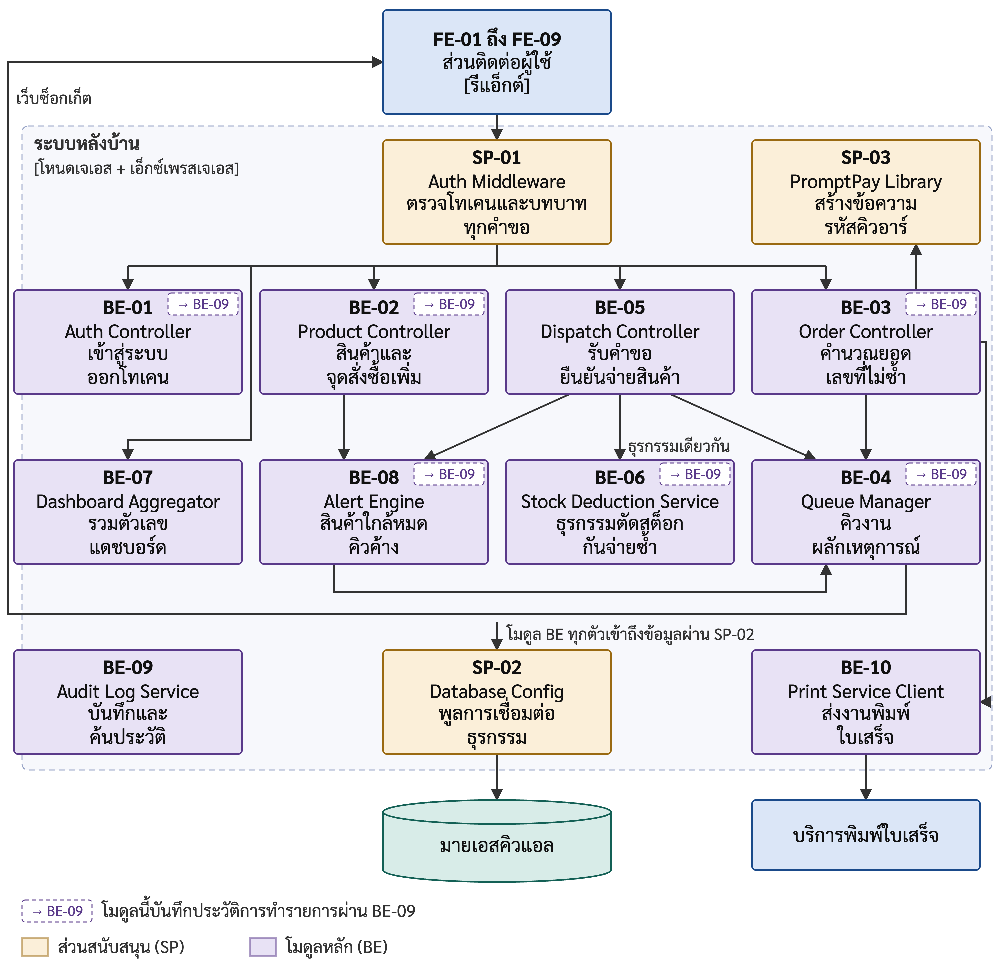{width=14.5cm}

**รูปที่ 3.5** แผนภาพส่วนประกอบภายในระบบหลังบ้าน (C3: Component Diagram)

จากรูปที่ 3.5 แต่ละกล่องระบุรหัสตามตารางที่ 3.16 และ 3.17 ทุกคำขอจากส่วนติดต่อผู้ใช้ที่ต้องเข้าสู่ระบบผ่าน SP-01 ก่อนถึงโมดูล โมดูลชั้นบนรับคำขอแล้วเรียกใช้โมดูลชั้นล่างตามทิศทางของลูกศร เช่น BE-05 เรียกใช้ BE-06 เพื่อตัดสต็อกในธุรกรรมเดียวกัน แล้วแจ้ง BE-04 และ BE-08 ส่วน BE-04 ส่งเหตุการณ์กลับไปยังหน้าจอผ่านเว็บซ็อกเก็ต โมดูลหลักทุกโมดูลเข้าถึงฐานข้อมูลผ่าน SP-02 และกล่องที่มีป้าย BE-09 ที่มุมขวาบนคือโมดูลที่บันทึกประวัติการทำรายการผ่าน BE-09 ซึ่งมีหกโมดูล ได้แก่ BE-01 BE-02 BE-03 BE-04 BE-06 และ BE-08

เส้นทางที่สำคัญที่สุดของระบบคือเส้นทางการยืนยันจ่ายสินค้า ซึ่งดำเนินการจาก BE-05 ไปยัง BE-06 การแยกสองโมดูลนี้ออกจากกันเป็นการตัดสินใจโดยเจตนา โดย BE-05 รับผิดชอบการรับคำขอและแปลงผลลัพธ์เป็นคำตอบ ส่วน BE-06 รับผิดชอบเฉพาะตรรกะของธุรกรรม ประโยชน์ที่ได้รับคือสามารถเขียนชุดทดสอบสำหรับกรณีที่มีคำขอเข้ามาพร้อมกันได้โดยเรียกใช้บริการตัดสต็อกโดยตรง ทำให้ทดสอบ NFR-04 ได้อย่างน่าเชื่อถือ

เมื่อนำกรณีการใช้งานมาพิจารณาตามเส้นทางในรูปที่ 3.5 จะได้ว่าแต่ละกรณีการใช้งานทำงานผ่านหน้าจอและโมดูลใด ดังตารางที่ 3.19 ทั้งนี้ ทุกกรณียกเว้นการเข้าสู่ระบบทำงานผ่าน SP-01 และทุกกรณีที่อ่านหรือเขียนข้อมูลทำงานผ่าน SP-02 จึงไม่ได้ระบุซ้ำไว้ในตาราง

**ตารางที่ 3.19** หน้าจอและโมดูลที่แต่ละกรณีการใช้งานผ่าน

| กรณีการใช้งาน | หน้าจอ | โมดูลระบบหลังบ้าน | ส่วนสนับสนุนเพิ่มเติม |
|:---:|:---:|---|:---:|
| UC-01 | FE-01 | BE-01, BE-09 | - |
| UC-02 | FE-07 | BE-02, BE-08, BE-09 | - |
| UC-03 | FE-02 | BE-03, BE-10, BE-04, BE-09 | SP-03 |
| UC-04 | FE-02 | BE-03 | - |
| UC-05 | FE-03 | BE-04 | - |
| UC-06 | FE-03 | BE-04, BE-09 | - |
| UC-07 | FE-04 | BE-03, BE-05, BE-06, BE-04, BE-08, BE-09 | - |
| UC-08 | FE-05 | BE-07, BE-08 | - |
| UC-09 | FE-06 | BE-07 | - |
| UC-10 | FE-09 | BE-09 | - |
| UC-11 | FE-08 | BE-08, BE-04, BE-09 | - |

จากตารางที่ 3.19 UC-07 ทำงานผ่านโมดูลมากที่สุด เนื่องจากการจ่ายสินค้าหนึ่งครั้งต้องอ่านข้อมูลคำสั่งซื้อ ตัดสต็อก บันทึกประวัติการทำรายการ ส่งเหตุการณ์ไปยังทุกหน้าจอ และตรวจสอบเงื่อนไขการแจ้งเตือน ส่วน UC-08 ทำงานผ่าน BE-08 ด้วย เนื่องจากส่วน "ต้องดูแลวันนี้" บนแดชบอร์ดแสดงจำนวนการแจ้งเตือนที่ยังไม่ได้อ่าน

### 3.3.5 แผนภาพการติดตั้ง (Deployment Diagram)

แผนภาพการติดตั้งแสดงว่าหน่วยติดตั้งทั้งสี่ในตารางที่ 3.15 ทำงานบนฮาร์ดแวร์ใดของร้าน และเชื่อมต่อกันผ่านพอร์ตและช่องทางใด ดังรูปที่ 3.6

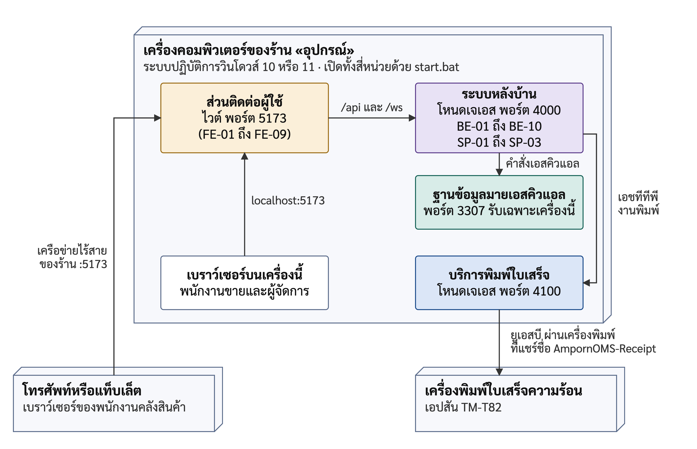{width=15cm}

**รูปที่ 3.6** แผนภาพการติดตั้งระบบที่ร้าน (Deployment Diagram)

จากรูปที่ 3.6 หน่วยติดตั้งทั้งสี่ทำงานบนคอมพิวเตอร์หน้าร้านเครื่องเดียว เนื่องจากเป็นเครื่องที่เชื่อมต่อกับเครื่องพิมพ์ใบเสร็จ และร้านไม่ต้องจัดซื้อเครื่องแม่ข่ายเพิ่มเติม ส่วนติดต่อผู้ใช้ให้บริการที่พอร์ต 5173 และส่งต่อคำขอที่ขึ้นต้นด้วย `/api` และ `/ws` ไปยังระบบหลังบ้านที่พอร์ต 4000 ผู้ใช้ทุกเครื่องจึงติดต่อระบบผ่านที่อยู่เดียวกัน ฐานข้อมูลรับการเชื่อมต่อจากเครื่องนี้เท่านั้น เครื่องอื่นในเครือข่ายจึงไม่สามารถเข้าถึงฐานข้อมูลได้โดยตรง ส่วนโทรศัพท์ของพนักงานคลังสินค้าเข้าใช้งานระบบผ่านเครือข่ายไร้สายของร้านโดยไม่ต้องติดตั้งแอปพลิเคชัน การติดตั้งจริงตามแผนภาพนี้รายงานไว้ในบทที่ 4 หัวข้อ 4.5

### 3.3.6 การตัดสินใจเชิงสถาปัตยกรรม (Architecture Decisions)

การตัดสินใจเชิงสถาปัตยกรรมที่สำคัญของระบบสรุปไว้ในตารางที่ 3.20 โดยแต่ละข้อระบุทางเลือกที่พิจารณาแต่ไม่ได้เลือก และความต้องการที่เป็นเหตุผลของการตัดสินใจ

**ตารางที่ 3.20** การตัดสินใจเชิงสถาปัตยกรรม

| รหัส | การตัดสินใจ | ทางเลือกที่ไม่เลือก | เหตุผล |
|:---:|---|---|---|
| ADR-01 | แยกบริการพิมพ์ใบเสร็จเป็นหน่วยติดตั้งต่างหาก | รวมการพิมพ์ไว้ในระบบหลังบ้าน | เครื่องพิมพ์ต่อกับเครื่องหน้าร้าน และร้านต้องขายได้แม้พิมพ์ไม่ได้ (AC-05) |
| ADR-02 | ผลักคำสั่งซื้อด้วยเว็บซ็อกเก็ต มีเหตุการณ์ที่ส่งจากเซิร์ฟเวอร์เป็นทางสำรอง | ให้หน้าจอถามซ้ำเป็นระยะทุกหนึ่งถึงสองวินาที | ได้ความหน่วงต่ำกว่า 3 วินาทีตาม NFR-02 โดยไม่สร้างภาระฐานข้อมูล |
| ADR-03 | ตรวจสิทธิ์ที่ SP-01 จุดเดียวฝั่งเซิร์ฟเวอร์ | ตรวจในแต่ละโมดูล หรือซ่อนเมนูที่หน้าจอ | ไม่มีเส้นทางใดละเว้นการตรวจสอบสิทธิ์ (NFR-01) |
| ADR-04 | ตัดสต็อกด้วยการล็อกเชิงบวกที่สถานะคำสั่งซื้อและการล็อกแถวสินค้าในธุรกรรมเดียวของ BE-06 | ตรวจสถานะก่อนแล้วจึงเขียนแยกขั้นตอน | ป้องกันการจ่ายซ้ำและยอดติดลบเมื่อยืนยันพร้อมกัน (FR-06, NFR-04) |
| ADR-05 | คำนวณตัวเลขแดชบอร์ดในขณะอ่านทุกครั้ง | เก็บค่าสรุปไว้ล่วงหน้า | ตัวเลขต้องตรงกับฐานข้อมูลเสมอ (BR-04, AC-09) |
| ADR-06 | บันทึกคำสั่งซื้อเมื่อชำระเงินแล้วเท่านั้น ไม่มีสถานะตะกร้า | บันทึกตะกร้าไว้ก่อนชำระ | ไม่มีคำสั่งซื้อค้างจากลูกค้าที่เปลี่ยนใจ ยอดขายจึงไม่เพี้ยน |
| ADR-07 | คำนวณยอดเงินที่ระบบหลังบ้านจากราคาในฐานข้อมูล | เชื่อยอดเงินที่หน้าจอส่งมา | หากเชื่อยอดจากหน้าจอ ผู้ใช้อาจแก้ราคาที่ส่งมาได้ ยอดในใบเสร็จจึงต้องคำนวณจากระบบ (FR-03) |

## 3.4 การออกแบบรายละเอียด (Detailed Design)

### 3.4.1 การออกแบบข้อมูลและฐานข้อมูล (Data and Database Design)

#### 3.4.1.1 ข้อมูลที่แต่ละกรณีการใช้งานใช้

การออกแบบข้อมูลเริ่มจากกรณีการใช้งาน โดยพิจารณาว่าแต่ละกรณีต้องสร้าง อ่าน หรือแก้ไขข้อมูลใด แล้วจึงรวมข้อมูลของทุกกรณีเป็นฐานข้อมูลเดียว ผลการตรวจสอบจากซอร์สโค้ดของแต่ละโมดูลแสดงดังตารางที่ 3.21 โดย ส หมายถึงสร้าง อ หมายถึงอ่าน และ ก หมายถึงแก้ไข ส่วนหัวคอลัมน์แต่ละคอลัมน์คือตารางในฐานข้อมูล ได้แก่ `users` `products` `orders` `order_items` `stock_movements` `notifications` และ `audit_logs` ตามลำดับ โดยรายละเอียดของตารางเหล่านี้แสดงในตารางที่ 3.22

**ตารางที่ 3.21** ข้อมูลที่แต่ละกรณีการใช้งานสร้าง อ่าน หรือแก้ไข

| กรณีการใช้งาน | ผู้ใช้ | สินค้า | คำสั่งซื้อ | รายการสินค้าในคำสั่งซื้อ | การเคลื่อนไหวสต็อก | การแจ้งเตือน | ประวัติการทำรายการ |
|:---:|:---:|:---:|:---:|:---:|:---:|:---:|:---:|
| UC-01 | อ | | | | | | ส |
| UC-02 | | ส อ ก | | | ส | ส | ส |
| UC-03 | อ | อ | ส | ส | | | ส |
| UC-04 | | | อ | | | | |
| UC-05 | อ | อ | อ | อ | | | |
| UC-06 | | | ก | | | | ส |
| UC-07 | | อ ก | อ ก | อ | ส | ส | ส |
| UC-08 | | อ | อ | อ | | อ | |
| UC-09 | | อ | อ | อ | | | |
| UC-10 | อ | อ | อ | อ | | อ | อ |
| UC-11 | | อ | อ | | | ส อ ก | ส |

จากตารางที่ 3.21 ทุกตารางมีกรณีการใช้งานที่สร้างข้อมูลอย่างน้อยหนึ่งกรณี ยกเว้นตาราง `users` ซึ่งสร้างขึ้นในขั้นตอนการติดตั้งระบบตามภาคผนวก จ และมีเพียงสี่กรณีที่เขียนข้อมูลในตาราง `products` หรือ `orders` ได้แก่ UC-02 UC-03 UC-06 และ UC-07 ประเด็นที่ควรสังเกตคือ UC-07 เป็นกรณีเดียวที่ทั้งอ่านและแก้ไข `products` และ `orders` ในการกระทำเดียว จึงเป็นกรณีที่ต้องออกแบบธุรกรรมอย่างรอบคอบที่สุดตามหัวข้อ 3.4.2.2 ส่วนตาราง `audit_logs` ถูกเขียนจากหกกรณี ซึ่งตรงกับหกโมดูลที่มีป้าย BE-09 ในรูปที่ 3.5

#### 3.4.1.2 แผนภาพความสัมพันธ์ระหว่างข้อมูล (Entity Relationship Diagram)

เมื่อรวมข้อมูลของทุกกรณีการใช้งานในตารางที่ 3.21 เป็นฐานข้อมูลเดียว ได้ตารางทั้งหมดเจ็ดตาราง ทุกตารางใช้เอนจินอินโนดีบีเพื่อให้ได้คุณสมบัติเอซิดและการล็อกระดับแถว ตามที่อธิบายไว้ในหัวข้อ 2.1.2 และ 2.1.3 ความสัมพันธ์ระหว่างตารางแสดงดังรูปที่ 3.7 และหน้าที่ของแต่ละตารางแสดงดังตารางที่ 3.22 ส่วนพจนานุกรมข้อมูลซึ่งระบุชนิดและข้อบังคับของทุกคอลัมน์อยู่ในภาคผนวก ข

**ตารางที่ 3.22** ตารางข้อมูลของระบบ

| ตาราง | ข้อมูลที่จัดเก็บ | รองรับความต้องการ |
|---|---|---|
| `users` | ผู้ใช้งานระบบ รหัสผ่านที่ผ่านการแฮช และบทบาท | FR-01 |
| `products` | ข้อมูลสินค้า หมวดหมู่ ราคา หน่วยนับ ยอดคงเหลือ และจุดสั่งซื้อเพิ่ม | FR-02 |
| `orders` | คำสั่งซื้อ เลขที่ไม่ซ้ำ ยอดรวม และสถานะวงจรชีวิต | FR-03, FR-05 |
| `order_items` | รายการสินค้าย่อยของแต่ละคำสั่งซื้อ พร้อมราคา ณ เวลาที่ขาย | FR-03 |
| `stock_movements` | การเคลื่อนไหวของสต็อกทุกครั้ง พร้อมยอดคงเหลือหลังเปลี่ยนและสาเหตุ | FR-06 |
| `notifications` | การแจ้งเตือนสินค้าใกล้หมดและคิวค้างผิดปกติ | FR-08 |
| `audit_logs` | ประวัติเหตุการณ์สำคัญ พร้อมผู้กระทำ เวลา และหมายเลขไอพี | FR-09 |

{width=14.5cm}

**รูปที่ 3.7** แผนภาพความสัมพันธ์ระหว่างข้อมูล (Entity Relationship Diagram)

#### 3.4.1.3 การตัดสินใจสำคัญในการออกแบบฐานข้อมูล

โครงสร้างฐานข้อมูลมีการตัดสินใจสี่ประการที่มิได้เกิดจากความสะดวก แต่เกิดจากทฤษฎีในบทที่ 2 โดยตรง ดังนี้

ประการแรก จัดเก็บราคาต่อหน่วย ณ เวลาที่ขายไว้ในตาราง `order_items` แยกจากราคาปัจจุบันในตาราง `products` เนื่องจากราคาวัสดุก่อสร้างเปลี่ยนแปลงบ่อย หากใบเสร็จจัดเก็บเพียงรหัสสินค้าและจำนวน แล้วนำราคาปัจจุบันมาคำนวณในขณะแสดงผล ยอดของใบเสร็จเดิมจะเปลี่ยนตามราคาใหม่ทันที ส่งผลให้ยอดขายย้อนหลังคลาดเคลื่อนทั้งหมด

ประการที่สอง ตาราง `stock_movements` จัดเก็บทั้งจำนวนที่เปลี่ยนแปลงและยอดคงเหลือหลังการเปลี่ยนแปลง แม้การจัดเก็บยอดคงเหลือเช่นนี้จะดูเหมือนเป็นข้อมูลซ้ำซ้อน แต่มีความจำเป็นตามหลักการบันทึกแบบเพิ่มอย่างเดียวในหัวข้อ 2.1.5 เนื่องจากทำให้ตรวจสอบย้อนหลังได้ว่ายอดเริ่มคลาดเคลื่อนที่รายการใด นอกจากนี้ ยังมีช่องจัดเก็บสาเหตุสามประเภท ได้แก่ การจ่ายสินค้าตามคำสั่งซื้อ การปรับยอดโดยผู้จัดการ และการรับสินค้าเข้า

ประการที่สาม ตาราง `orders` ไม่มีสถานะตะกร้าสินค้า และช่องวันเวลาที่ยืนยันรับชำระเงินกำหนดให้ต้องมีค่าเสมอ หมายความว่าคำสั่งซื้อจะถูกบันทึกลงฐานข้อมูลก็ต่อเมื่อชำระเงินแล้วเท่านั้น ตาม ADR-06 ในตารางที่ 3.20 ซึ่งเป็นการประยุกต์แนวคิดเครื่องสถานะจำกัดในหัวข้อ 2.1.4 ที่กำหนดว่าสถานะใดมีอยู่จริงในระบบและสถานะใดไม่ควรมี

ประการที่สี่ ตาราง `products` มีเงื่อนไขบังคับว่ายอดคงเหลือต้องไม่ติดลบ เงื่อนไขนี้เป็นการป้องกันชั้นสุดท้ายในระดับฐานข้อมูล แม้ตรรกะในโปรแกรมจะตรวจสอบยอดก่อนหักอยู่แล้ว แต่หากตรรกะผิดพลาด ฐานข้อมูลจะปฏิเสธการเขียนและทำให้ธุรกรรมทั้งหมดถูกยกเลิก แทนการบันทึกข้อมูลที่ไม่ถูกต้องไว้โดยไม่มีผู้ใดทราบ

### 3.4.2 การออกแบบเชิงโครงสร้างและพฤติกรรม (Structural and Behavioral Design)

โครงสร้างเชิงสถิตของระบบแสดงด้วยแผนภาพส่วนประกอบในรูปที่ 3.5 ร่วมกับตารางที่ 3.16 ถึง 3.18 และโครงสร้างข้อมูลแสดงด้วยแผนภาพในรูปที่ 3.7 ระบบไม่มีแผนภาพคลาส เนื่องจากซอร์สโค้ดเขียนด้วยจาวาสคริปต์แบบโมดูล แต่ละโมดูลเป็นหนึ่งโฟลเดอร์ที่ส่งออกฟังก์ชันให้โมดูลอื่นเรียกใช้ และมิได้ออกแบบเป็นคลาสที่มีสถานะภายใน ยกเว้นคลาสแทนข้อผิดพลาดที่ใช้ปฏิเสธการจ่ายสินค้าเพียงคลาสเดียว หัวข้อนี้จึงเน้นพฤติกรรมของระบบ กล่าวคือ ระบบทำงานอย่างไรตามลำดับเวลา

#### 3.4.2.1 แผนภาพลำดับของการสร้างคำสั่งซื้อและออกใบเสร็จ

ลำดับการทำงานของ UC-03 ตั้งแต่พนักงานขายเลือกสินค้าจนระบบออกใบเสร็จแสดงดังรูปที่ 3.8

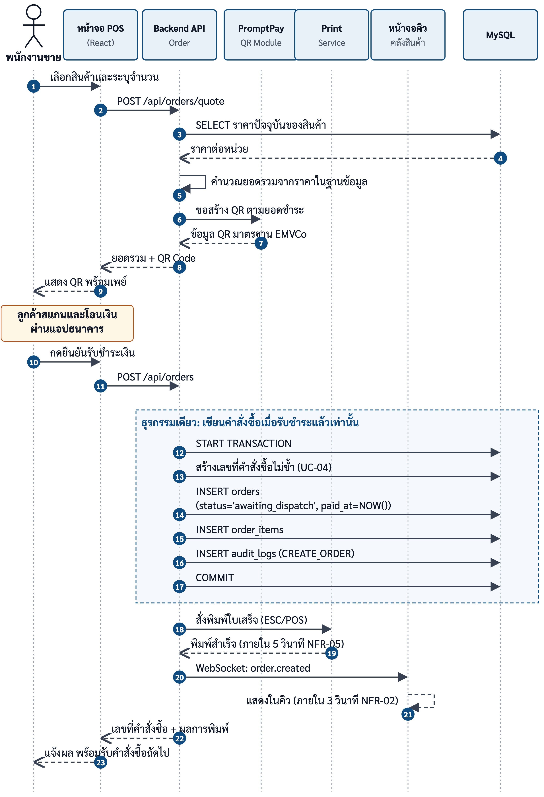{width=14.5cm}

**รูปที่ 3.8** แผนภาพลำดับของการสร้างคำสั่งซื้อและออกใบเสร็จ (Sequence Diagram: UC-03)

รูปที่ 3.8 แสดงลำดับข้อความระหว่างพนักงานขาย หน้าจอ ระบบหลังบ้าน ฐานข้อมูล และบริการพิมพ์ ตั้งแต่บันทึกรายการสินค้าจนพิมพ์ใบเสร็จ ประเด็นที่ควรสังเกตคือ การยืนยันรับชำระเงินเพียงครั้งเดียวทำให้เกิดผลสามประการพร้อมกัน ได้แก่ การบันทึกคำสั่งซื้อ การสั่งพิมพ์ใบเสร็จ และการส่งรายการเข้าคิวของคลังสินค้า ซึ่งเป็นข้อบังคับจากกฎทางธุรกิจ BR-01 การรวมทั้งสามประการไว้ในการกระทำเดียวป้องกันไม่ให้เกิดกรณีที่ออกใบเสร็จแล้วแต่คลังสินค้าไม่ได้รับคำสั่งซื้อ

#### 3.4.2.2 ธุรกรรมการตัดสต็อกและการป้องกันการจ่ายซ้ำ

ขั้นตอนการยืนยันจ่ายสินค้าเป็นจุดที่ประยุกต์ทฤษฎีจากบทที่ 2 มากที่สุด และเป็นกลไกที่ตอบวัตถุประสงค์ข้อ 3 โดยตรง ลำดับการยืนยันจ่ายสินค้าเป็นดังนี้ โดยขั้นตอนที่ 1 ถึง 6 อยู่ในธุรกรรมเดียวกัน และขั้นตอนที่ 2 ถึง 5 เป็นหน้าที่ของ BE-06

1) เปิดธุรกรรม
2) เปลี่ยนสถานะคำสั่งซื้อแบบมีเงื่อนไข โดยกำหนดเงื่อนไขว่าสถานะปัจจุบันต้องเป็นรอจ่ายสินค้าหรือกำลังจัดของ หากจำนวนแถวที่ถูกแก้ไขเป็นศูนย์ แสดงว่ามีผู้อื่นจ่ายสินค้าของคำสั่งซื้อนี้ไปก่อนแล้ว ให้ยกเลิกธุรกรรมทันที
3) หักยอดสินค้าคงเหลือแบบมีเงื่อนไข โดยกำหนดเงื่อนไขว่ายอดคงเหลือต้องมากกว่าหรือเท่ากับจำนวนที่จะหัก คำสั่งนี้ล็อกแถวของสินค้าไว้จนจบธุรกรรม หากจำนวนแถวที่ถูกแก้ไขเป็นศูนย์ แสดงว่าสินค้าไม่เพียงพอ ให้ยกเลิกธุรกรรม
4) บันทึกรายการเคลื่อนไหวของสต็อกพร้อมยอดคงเหลือหลังการเปลี่ยนแปลง
5) บันทึกประวัติการทำรายการ
6) ยืนยันธุรกรรม
7) ตรวจสอบเงื่อนไขการแจ้งเตือนหลังจากธุรกรรมสำเร็จแล้วเท่านั้น

ขั้นตอนที่ 2 และ 3 ป้องกันปัญหาที่แตกต่างกัน ขั้นตอนที่ 2 ป้องกันการจ่ายสินค้าซ้ำในระดับคำสั่งซื้อ ส่วนขั้นตอนที่ 3 ป้องกันยอดสต็อกติดลบในระดับสินค้า ทั้งสองขั้นตอนต้องป้องกันแยกกัน เนื่องจากการป้องกันปัญหาหนึ่งไม่ได้ป้องกันอีกปัญหาหนึ่งโดยอัตโนมัติ ส่วนขั้นตอนที่ 7 อยู่นอกธุรกรรมโดยเจตนา ตามหลักการกำหนดขอบเขตธุรกรรมในหัวข้อ 2.1.2 เนื่องจากการสร้างการแจ้งเตือนเป็นงานผลพลอยได้ หากล้มเหลวไม่ควรทำให้การจ่ายสินค้าที่เกิดขึ้นจริงแล้วถูกยกเลิกไปด้วย ลำดับการทำงานเดียวกันนี้แสดงเป็นแผนภาพลำดับในรูปที่ 3.9

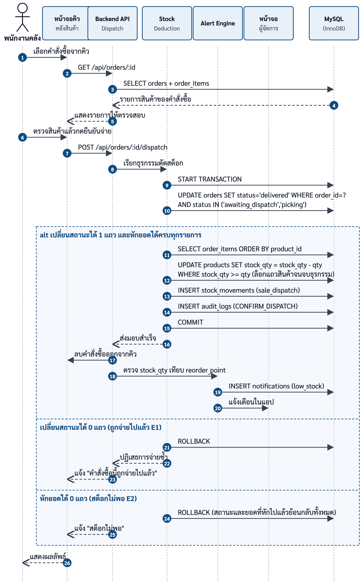{width=14.5cm}

**รูปที่ 3.9** แผนภาพลำดับของการยืนยันจ่ายสินค้าและตัดสต็อก (Sequence Diagram: UC-07)

รูปที่ 3.9 แสดงขอบเขตของธุรกรรมว่าครอบคลุมขั้นตอนใดบ้าง และแสดงว่าการตรวจสอบเงื่อนไขการแจ้งเตือนอยู่นอกขอบเขตดังกล่าว

#### 3.4.2.3 แผนภาพกิจกรรมของกระบวนการขายและส่งมอบสินค้า

รูปที่ 3.10 แสดงกระบวนการตั้งแต่ลูกค้าเลือกสินค้าจนถึงรับสินค้า ซึ่งมีการทำงานคู่ขนานสองฝั่ง ได้แก่ ฝั่งหน้าร้านและฝั่งคลังสินค้า จุดที่ระบบเปลี่ยนแปลงกระบวนการเดิมคือช่วงหลังการยืนยันรับชำระเงิน ซึ่งเดิมคลังสินค้าจะทราบคำสั่งซื้อก็ต่อเมื่อลูกค้านำใบเสร็จมาถึง แต่ในกระบวนการใหม่ คลังสินค้าทราบทันทีและเริ่มจัดเตรียมสินค้าได้ก่อน ซึ่งเป็นจุดที่ลดระยะเวลารอคอยตามวัตถุประสงค์ข้อ 2

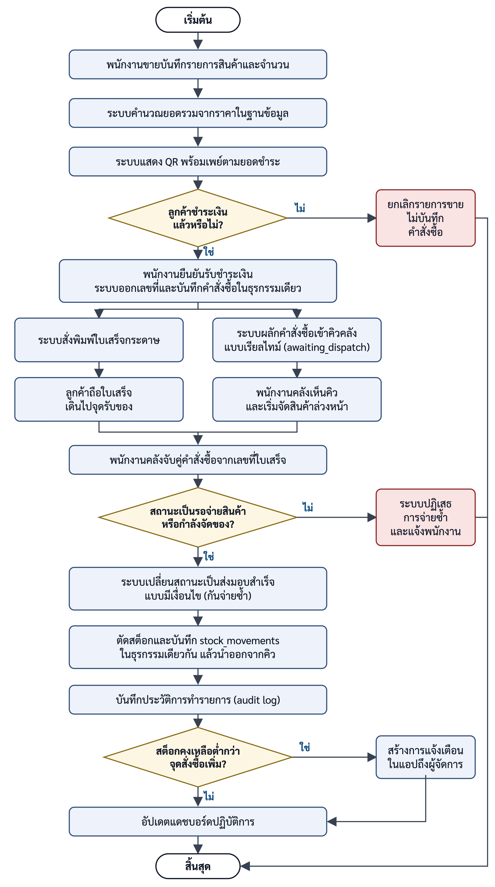{height=20cm}

**รูปที่ 3.10** แผนภาพกิจกรรมของกระบวนการขายและส่งมอบสินค้า (Activity Diagram)

แผนภาพมีจุดตัดสินใจสามจุด จุดแรกคือลูกค้าชำระเงินหรือไม่ หากไม่ พนักงานขายจะยกเลิกรายการขายบนหน้าจอ และระบบไม่บันทึกคำสั่งซื้อใด เนื่องจากคำสั่งซื้อถูกบันทึกและได้รับเลขที่เมื่อยืนยันรับชำระเงินแล้วเท่านั้นตาม ADR-06 จุดที่สองอยู่ที่คลังสินค้า คือคำสั่งซื้อยังมีสถานะรอจ่ายสินค้าหรือกำลังจัดของหรือไม่ หากถูกจ่ายไปแล้ว ระบบจะปฏิเสธการจ่ายซ้ำ เพื่อให้ยอดคงเหลือในระบบสอดคล้องกับสินค้าจริงตามกฎทางธุรกิจ BR-02 จุดที่สามอยู่หลังการตัดสต็อกสำเร็จ คือยอดคงเหลือต่ำกว่าจุดสั่งซื้อเพิ่มหรือไม่ หากใช่ ระบบจะสร้างการแจ้งเตือนถึงผู้จัดการ ทั้งนี้ จุดตัดสินใจที่สองตรงกับขั้นตอนที่ 2 ในธุรกรรมของ BE-06 ส่วนจุดที่สามคือขั้นตอนที่ 7 ซึ่งอยู่นอกธุรกรรมและทำโดย BE-08 ตามหัวข้อ 3.4.2.2

#### 3.4.2.4 แผนภาพสถานะของคำสั่งซื้อ

รูปที่ 3.11 แสดงสถานะของคำสั่งซื้อตั้งแต่สร้างจนส่งมอบ และตารางที่ 3.23 อธิบายความหมายของแต่ละสถานะ

{width=12.5cm}

**รูปที่ 3.11** แผนภาพสถานะของคำสั่งซื้อ (Order State Diagram)

**ตารางที่ 3.23** สถานะของคำสั่งซื้อ

| สถานะ | ความหมาย | เปลี่ยนไปสถานะใดได้บ้าง |
|---|---|---|
| รอจ่ายสินค้า (`awaiting_dispatch`) | ชำระเงินแล้ว รอคลังจัดของ | กำลังจัดของ, ส่งมอบสำเร็จ, ยกเลิก |
| กำลังจัดของ (`picking`) | พนักงานคลังรับงานแล้วและกำลังจัดของ | รอจ่ายสินค้า, ส่งมอบสำเร็จ, ยกเลิก |
| ส่งมอบสำเร็จ (`delivered`) | จ่ายสินค้าและตัดสต็อกเรียบร้อยแล้ว | ไม่มี เป็นสถานะปลายทาง |
| ยกเลิก (`cancelled`) | คำสั่งซื้อถูกยกเลิก | ไม่มี เป็นสถานะปลายทาง |

จากรูปที่ 3.11 และตารางที่ 3.23 คำสั่งซื้อเข้าสู่ระบบด้วยสถานะรอจ่ายสินค้าทันทีที่พนักงานขายยืนยันรับชำระเงิน โดยไม่มีสถานะก่อนหน้านั้น ซึ่งสอดคล้องกับการตัดสินใจประการที่สามในหัวข้อ 3.4.1.3 ประเด็นที่ต้องเน้นคือ สถานะส่งมอบสำเร็จเป็นสถานะปลายทางที่ไม่มีเส้นทางย้อนกลับ และเกิดขึ้นได้ทางเดียว คือผ่านธุรกรรมตัดสต็อกที่สำเร็จ ระบบไม่เปิดให้กำหนดสถานะนี้โดยตรง เนื่องจากหากอนุญาต สถานะดังกล่าวจะไม่เป็นหลักฐานอีกต่อไปว่าสต็อกถูกหักแล้วจริง ซึ่งจะทำให้กลไกป้องกันการรับสินค้าซ้ำไม่มีผล การออกแบบนี้เป็นการนำแนวคิดเครื่องสถานะจำกัดในหัวข้อ 2.1.4 มาใช้เป็นกลไกป้องกัน

### 3.4.3 การออกแบบส่วนติดต่อผู้ใช้ (UI/UX Design)

#### 3.4.3.1 หลักการออกแบบ

ส่วนติดต่อผู้ใช้ของระบบยึดหลักการสามประการ ซึ่งคัดเลือกจากเงื่อนไขการใช้งานจริงของร้าน ประการแรก หนึ่งหน้าจอมีงานหลักเพียงงานเดียว เนื่องจากผู้ใช้ระบบเป็นพนักงานที่ไม่จำเป็นต้องมีความรู้ด้านเทคโนโลยีสารสนเทศ และต้องใช้งานในช่วงเวลาเร่งด่วนที่มีลูกค้ารออยู่ ปุ่มของงานหลักจึงถูกวางให้เด่นที่สุดในแต่ละหน้าจอ ประการที่สอง ตัวเลขที่ใช้ในการตัดสินใจต้องอ่านง่ายที่สุด ยอดเงินและจำนวนสินค้าจึงแสดงด้วยขนาดใหญ่และจัดชิดขวาเพื่อให้เปรียบเทียบกันได้ในแนวตั้ง ประการที่สาม ต้องยืนยันก่อนการกระทำที่ย้อนกลับไม่ได้ เนื่องจากการยืนยันจ่ายสินค้าทำให้คำสั่งซื้อเข้าสู่สถานะปลายทางที่ย้อนกลับไม่ได้ตามตารางที่ 3.23 ระบบจึงให้ผู้ใช้ยืนยันอีกครั้งก่อน เพื่อลดความเสี่ยงจากการกดผิดพลาด

นอกจากหลักการสามประการข้างต้น ทุกหน้าจอมีปุ่มสลับโหมดสว่างและโหมดมืด เนื่องจากหน้าจอของระบบถูกใช้งานในพื้นที่ที่มีแสงแตกต่างกัน กล่าวคือ หน้าร้านมีแสงสว่าง ส่วนคลังสินค้ามีแสงน้อย การสลับโหมดเปลี่ยนเฉพาะสีที่แสดงผล โดยไม่กระทบข้อมูลหรือการทำงานของระบบ

#### 3.4.3.2 หน้าจอที่จับคู่กับกรณีการใช้งาน

หน้าจอทุกหน้าออกแบบจากกรณีการใช้งาน และไม่มีหน้าจอใดที่ไม่มีกรณีการใช้งานรองรับ ผู้ใช้แต่ละบทบาทเห็นเฉพาะเมนูของงานตนเอง และเมื่อเข้าสู่ระบบสำเร็จจะถูกนำไปยังหน้าจอแรกของบทบาทตามตารางที่ 3.3 ความสัมพันธ์ระหว่างหน้าจอกับกรณีการใช้งาน องค์ประกอบหลัก และภาพประกอบแสดงดังตารางที่ 3.24

**ตารางที่ 3.24** หน้าจอ กรณีการใช้งาน องค์ประกอบหลัก และภาพประกอบ

| หน้าจอ | กรณีการใช้งาน | องค์ประกอบหลัก | ต้นแบบ | หน้าจอจริง |
|---|:---:|---|:---:|:---:|
| FE-01 เข้าสู่ระบบ | UC-01 | ช่องชื่อผู้ใช้ ช่องรหัสผ่าน และปุ่มเข้าสู่ระบบ | - | รูปที่ 4.1 |
| FE-02 ขายหน้าร้าน | UC-03, UC-04 | ปุ่มเลือกหมวดหมู่สินค้า ช่องค้นหาสินค้า ตารางรายการที่เลือก ยอดรวม ปุ่มแสดงรหัสคิวอาร์และปุ่มยืนยันรับชำระเงิน | รูปที่ 3.13, 3.14 | รูปที่ 4.2, 4.3 |
| FE-03 คิวรอจ่ายสินค้า | UC-05, UC-06 | รายการคำสั่งซื้อเรียงตามเวลาชำระเงิน พร้อมสถานะและเวลารอคอยของแต่ละรายการ | รูปที่ 3.15, 3.18 | รูปที่ 4.4, 4.12 |
| FE-04 ยืนยันจ่ายสินค้า | UC-07 | รายการสินค้าที่ต้องจัด จำนวน และปุ่มยืนยันที่ต้องกดยืนยันซ้ำ | รูปที่ 3.16 | รูปที่ 4.5, 4.6 |
| FE-05 แดชบอร์ดปฏิบัติการ | UC-08 | กล่องต้องดูแลวันนี้ ยอดขายวันนี้ จำนวนคิวค้าง และรายการสินค้าที่ต่ำกว่าจุดสั่งซื้อเพิ่ม | รูปที่ 3.17 | รูปที่ 4.7 |
| FE-06 แดชบอร์ดระดับบริหาร | UC-09 | แนวโน้มยอดขายย้อนหลัง และสินค้าขายดี | - | รูปที่ 4.8 |
| FE-07 จัดการข้อมูลสินค้า | UC-02 | ตารางสินค้ากรองตามหมวดหมู่ ช่องแก้ไขราคาและจุดสั่งซื้อเพิ่ม และการปรับสต็อกพร้อมเหตุผล | - | รูปที่ 4.9 |
| FE-08 การแจ้งเตือน | UC-11 | รายการแจ้งเตือนที่ยังไม่อ่านอยู่ก่อน และปุ่มทำเครื่องหมายอ่านแล้ว | - | รูปที่ 4.10 |
| FE-09 ประวัติการทำรายการ | UC-10 | ตัวกรองตามช่วงเวลาและประเภทการกระทำ พร้อมผลการค้นหา | - | รูปที่ 4.11 |

จากตารางที่ 3.24 ต้นแบบหน้าจอจัดทำไว้เฉพาะหน้าจอที่อยู่บนเส้นทางหลักของกระบวนการขายและส่งมอบสินค้า ได้แก่ FE-02 ถึง FE-05 ส่วนหน้าจอที่เหลือเป็นหน้าจอจัดการข้อมูลที่มีรูปแบบตารางทั่วไป จึงออกแบบจากองค์ประกอบในตารางโดยตรง ทั้งนี้ หน้าจอที่พัฒนาจริงของทุกหน้าจอแสดงไว้ในบทที่ 4

#### 3.4.3.3 ลำดับการใช้หน้าจอของผู้ใช้ (User Flow)

ลำดับการใช้หน้าจอของผู้ใช้แต่ละบทบาทแสดงดังรูปที่ 3.12 พนักงานขายใช้งานหน้าจอขายและการยืนยันรับชำระเงินสลับกัน พนักงานคลังสินค้าใช้งานหน้าจอคิวและการยืนยันจ่ายสินค้าสลับกัน ส่วนผู้จัดการเริ่มต้นที่แดชบอร์ดปฏิบัติการแล้วเปิดหน้าจออื่นจากลิงก์ในส่วน "ต้องดูแลวันนี้" สำหรับผู้จัดการและพนักงานคลังสินค้า เมนูการแจ้งเตือนแสดงจำนวนการแจ้งเตือนที่ยังไม่ได้อ่านไว้ในทุกหน้าจอ เพื่อให้ทราบว่ามีเรื่องรอรับทราบโดยไม่ต้องเปิดหน้าการแจ้งเตือน

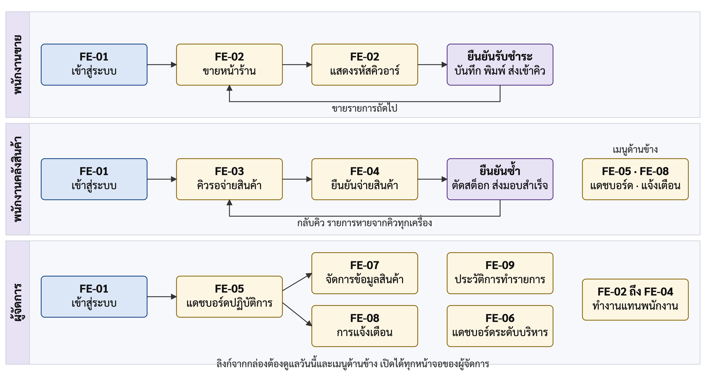{width=15cm}

**รูปที่ 3.12** ลำดับการใช้หน้าจอของผู้ใช้แต่ละบทบาท (User Flow)

#### 3.4.3.4 ต้นแบบหน้าจอ (Mockup)

ต้นแบบหน้าจอแสดงในรูปที่ 3.13 ถึงรูปที่ 3.18 ต้นแบบทั้งหมดแสดงในโหมดสว่าง และตัวเลขกับเลขที่คำสั่งซื้อในภาพเป็นข้อมูลตัวอย่างสำหรับการออกแบบ

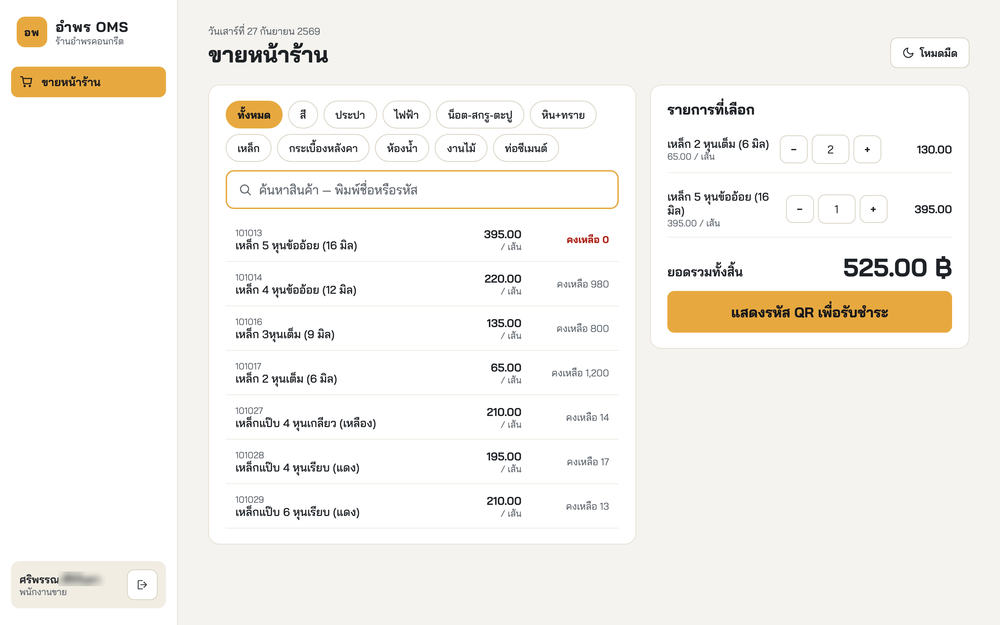{width=14.5cm}

**รูปที่ 3.13** ต้นแบบหน้าจอขายหน้าร้านของพนักงานขาย (FE-02)

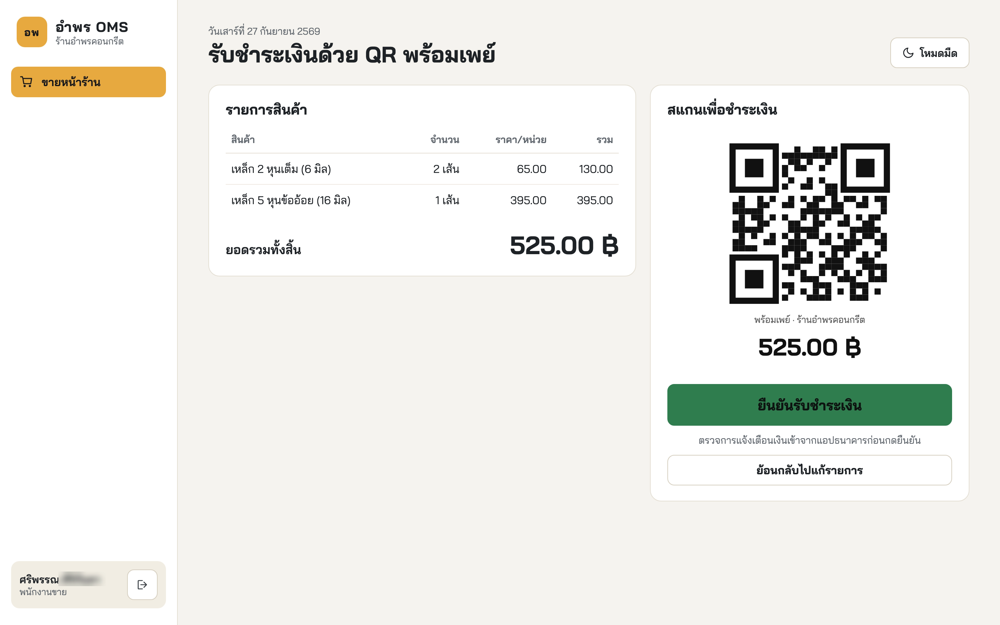{width=14.5cm}

**รูปที่ 3.14** ต้นแบบหน้าจอแสดงรหัสคิวอาร์ (QR Code) และการยืนยันรับชำระเงิน (FE-02)

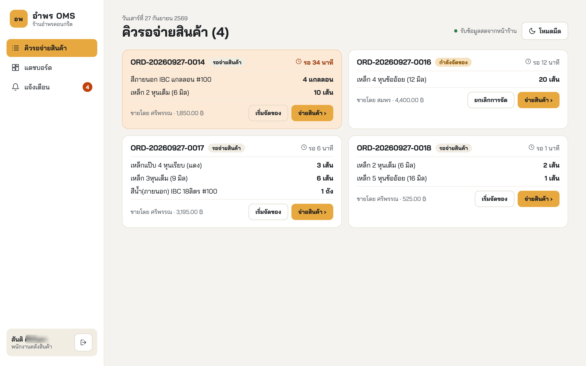{width=14.5cm}

**รูปที่ 3.15** ต้นแบบหน้าจอคิวรอจ่ายสินค้าของพนักงานคลังสินค้า (FE-03)

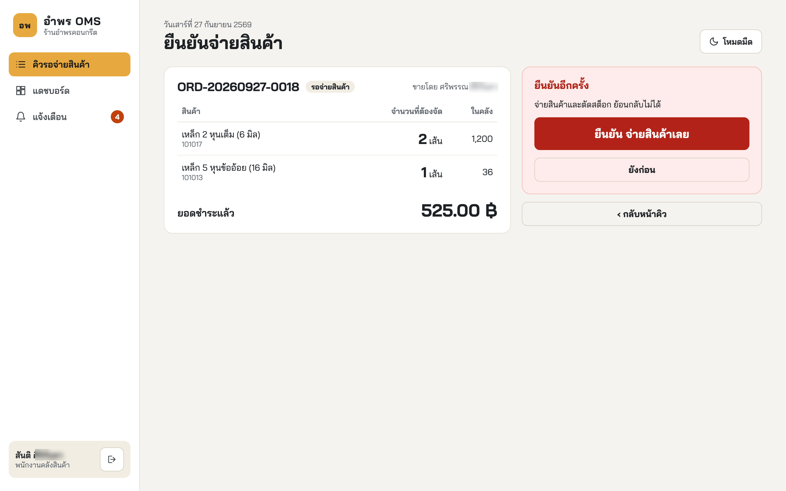{width=14.5cm}

**รูปที่ 3.16** ต้นแบบหน้าจอยืนยันจ่ายสินค้าและตัดสต็อก (FE-04)

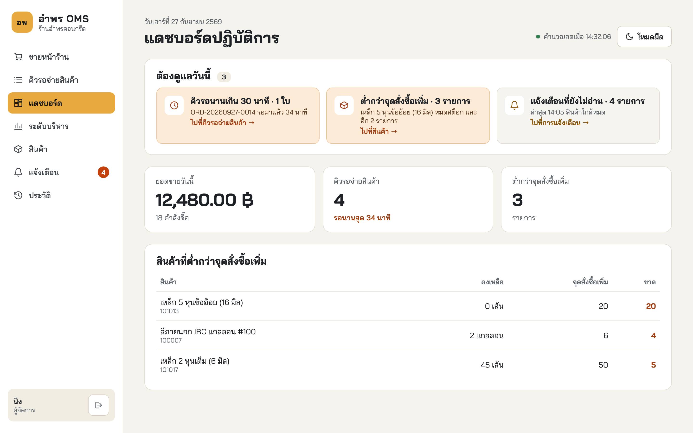{width=14.5cm}

**รูปที่ 3.17** ต้นแบบหน้าจอแดชบอร์ดปฏิบัติการของผู้จัดการ (FE-05)

หน้าจอคิวรอจ่ายสินค้าและหน้าจอยืนยันจ่ายสินค้าต้องใช้งานได้บนแท็บเล็ตและสมาร์ตโฟนตาม NFR-03 เนื่องจากพนักงานคลังสินค้าทำงานเคลื่อนที่อยู่ภายในคลังสินค้า มิได้ปฏิบัติงานประจำที่หน้าคอมพิวเตอร์ ปุ่มยืนยันจ่ายสินค้าจึงต้องมีขนาดใหญ่เพียงพอที่จะกดด้วยนิ้วได้อย่างแม่นยำแม้ขณะสวมถุงมือ ส่วนหน้าจอของพนักงานขายและผู้จัดการออกแบบสำหรับจอคอมพิวเตอร์เป็นหลัก ต้นแบบหน้าจอคิวรอจ่ายสินค้าเมื่อแสดงบนอุปกรณ์เคลื่อนที่แสดงในรูปที่ 3.18

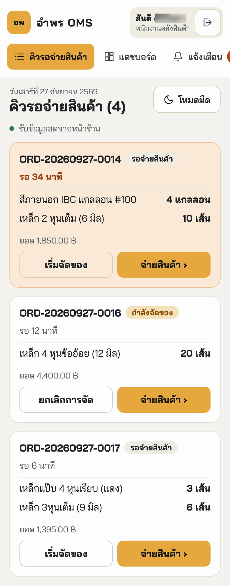{height=14cm}

**รูปที่ 3.18** ต้นแบบหน้าจอคิวรอจ่ายสินค้าบนอุปกรณ์เคลื่อนที่ (FE-03)

### 3.4.4 การออกแบบส่วนต่อประสาน (Interface Design)

ส่วนติดต่อผู้ใช้สื่อสารกับระบบหลังบ้านผ่านเส้นทางบริการที่รับส่งข้อมูลในรูปแบบเจสัน (JSON) ทุกเส้นทางยกเว้นการเข้าสู่ระบบต้องแนบโทเคนเจดับเบิลยูที (JWT) โดยส่งในส่วนหัวของคำขอ `Authorization` ยกเว้นช่องทางที่เปิดค้างไว้ซึ่งส่งในสตริงคำค้น โทเคนนี้ได้รับจากการเข้าสู่ระบบและหมดอายุภายใน 8 ชั่วโมง เส้นทางทั้งหมดและบทบาทที่เรียกใช้ได้แสดงดังตารางที่ 3.25

**ตารางที่ 3.25** เส้นทางการเรียกใช้บริการของระบบ

| กรณีการใช้งาน | วิธี | เส้นทาง | บทบาทที่เรียกได้ |
|:---:|---|---|---|
| UC-01 | POST | `/api/auth/login` | ไม่ต้องเข้าสู่ระบบก่อน |
| UC-01 | GET | `/api/auth/me` | ทุกบทบาทที่เข้าสู่ระบบแล้ว |
| UC-02 | GET | `/api/products` | ทุกบทบาท |
| UC-02 | POST, PUT, PATCH | `/api/products` และเส้นทางย่อย | ผู้จัดการ |
| UC-03 | POST | `/api/orders/quote`, `/api/orders` | พนักงานขาย, ผู้จัดการ |
| UC-05 | GET | `/api/queue` | พนักงานคลังสินค้า, ผู้จัดการ |
| UC-05 | GET | `/api/events` (ช่องทางสำรอง) | ทุกบทบาทที่เข้าสู่ระบบแล้ว |
| UC-06 | PATCH | `/api/orders/:id/status` | พนักงานคลังสินค้า, ผู้จัดการ |
| UC-07 | GET, POST | `/api/orders/:id` และ `/api/orders/:id/dispatch` | ดูรายละเอียดได้ทุกบทบาท ยืนยันจ่ายเฉพาะพนักงานคลังสินค้าและผู้จัดการ |
| UC-08 | GET | `/api/dashboard/ops` | ผู้จัดการ, พนักงานคลังสินค้า |
| UC-09 | GET | `/api/dashboard/exec` | ผู้จัดการ |
| UC-10 | GET | `/api/audit-logs` | ผู้จัดการ |
| UC-11 | GET, PATCH | `/api/notifications` และเส้นทางย่อย | อ่านได้ผู้จัดการและพนักงานคลัง ทำเครื่องหมายอ่านแล้วเฉพาะผู้จัดการ |

UC-04 ไม่มีเส้นทางเฉพาะในตารางที่ 3.25 เนื่องจากเป็นพฤติกรรมที่ระบบดำเนินการเองระหว่างการทำงานของ UC-03 มิใช่บริการที่ผู้ใช้เรียกใช้ได้ เมื่อคำขอไม่สำเร็จ ระบบตอบกลับด้วยรหัสสถานะที่ระบุสาเหตุ ได้แก่ 400 เมื่อข้อมูลที่ส่งมาไม่ถูกต้อง 401 เมื่อไม่มีโทเคนหรือโทเคนไม่ถูกต้อง 403 เมื่อบทบาทไม่มีสิทธิ์ 404 เมื่อไม่พบข้อมูล 409 เมื่อข้อมูลขัดแย้งกับสถานะปัจจุบัน เช่น การยืนยันจ่ายสินค้าของคำสั่งซื้อที่ถูกจ่ายไปแล้ว และ 503 เมื่อระบบยังไม่ได้ตั้งค่าหมายเลขพร้อมเพย์ของร้าน

นอกจากเส้นทางแบบคำขอและคำตอบ ระบบหลังบ้านยังส่งเหตุการณ์ไปยังหน้าจอที่เปิดค้างไว้ผ่านเส้นทาง `/ws` ของเว็บซ็อกเก็ต และส่งข้อความเดียวกันผ่าน `/api/events` เป็นช่องทางสำรอง เหตุการณ์มีสี่ชนิด ดังตารางที่ 3.26

**ตารางที่ 3.26** เหตุการณ์ที่ระบบหลังบ้านผลักไปยังหน้าจอ

| เหตุการณ์ | เกิดเมื่อ | หน้าจอที่ใช้ |
|---|---|---|
| `order.created` | ยืนยันรับชำระและบันทึกคำสั่งซื้อสำเร็จ | FE-03 คิวรอจ่ายสินค้า, FE-05 แดชบอร์ดปฏิบัติการ |
| `order.status` | ปรับสถานะการจัดของในคิว | FE-03 คิวรอจ่ายสินค้า |
| `order.dispatched` | ยืนยันจ่ายสินค้าและตัดสต็อกสำเร็จ | FE-03 คิวรอจ่ายสินค้า, FE-05 แดชบอร์ดปฏิบัติการ |
| `notification.created` | ระบบสร้างการแจ้งเตือนใหม่ | FE-08 การแจ้งเตือน และตัวเลขบนเมนูการแจ้งเตือน |

ข้อสังเกตคือ ช่องทางที่เปิดค้างไว้ทั้งสองช่องทาง ได้แก่ /ws และ /api/events รับโทเคนผ่านสตริงคำค้นแทนการรับผ่านส่วนหัวของคำขอเช่นเดียวกับเส้นทางอื่น เนื่องจากเบราว์เซอร์ไม่เปิดให้กำหนดส่วนหัวของคำขอสำหรับช่องทางที่เปิดค้างไว้ ระบบจึงผ่อนปรนเฉพาะในจุดนี้ แต่ยังคงตรวจสอบโทเคนด้วยกลไกเดียวกับเส้นทางอื่นทุกประการ และจำกัดการผ่อนปรนไว้เฉพาะช่องทางที่อ่านข้อมูลอย่างเดียวเท่านั้น

## 3.5 การวางแผนการทดสอบ (Test Planning)

หัวข้อนี้กำหนดกลยุทธ์ ระดับ และกรณีทดสอบทั้งหมดไว้ก่อนการทดสอบ โดยแต่ละกรณีระบุเงื่อนไขก่อนทดสอบ ขั้นตอน และผลที่คาดหวัง ส่วนผลที่ได้จริงรายงานไว้ในบทที่ 4 หัวข้อ 4.3

### 3.5.1 กลยุทธ์และระดับการทดสอบ (Test Strategy and Levels)

การทดสอบแบ่งออกเป็นสี่ระดับตามแบบจำลองรูปตัววี (V-Model) แต่ละระดับตอบคำถามที่แตกต่างกัน ใช้ผลงานจากขั้นตอนการออกแบบที่แตกต่างกันเป็นฐาน และใช้เครื่องมือต่างชนิดกัน ดังตารางที่ 3.27

**ตารางที่ 3.27** ระดับการทดสอบ ฐานของการทดสอบ และเครื่องมือ

| ระดับ | ตอบคำถามว่า | ฐานของการทดสอบ | เครื่องมือและสภาพแวดล้อม | ช่วงเวลา |
|---|---|---|---|---|
| การทดสอบหน่วย | ตรรกะภายในโมดูลถูกต้องหรือไม่ | การแบ่งโมดูลในตารางที่ 3.16 และ 3.17 | เจสต์ (Jest) เรียกฟังก์ชันโดยตรง ไม่แตะฐานข้อมูล | ระหว่างพัฒนา |
| การทดสอบการรวมส่วน | โมดูลทำงานร่วมกับฐานข้อมูลจริงได้ถูกต้องหรือไม่ | สถาปัตยกรรมและการออกแบบข้อมูลในหัวข้อ 3.3 และ 3.4 | เจสต์ร่วมกับซูเปอร์เทสต์ (Supertest) เรียกผ่านเส้นทางบริการจริงกับฐานข้อมูลทดสอบที่สร้างใหม่ทุกครั้ง | ระหว่างพัฒนา |
| การทดสอบระบบ | ผู้ใช้ทำงานจนจบกระบวนการได้หรือไม่ | ความต้องการในตารางที่ 3.5 และ 3.8 กับเกณฑ์การยอมรับในตารางที่ 3.11 | เพลย์ไรต์ (Playwright) ควบคุมเบราว์เซอร์จริง กับระบบที่เปิดครบสี่หน่วย และเครื่องพิมพ์จริง | หลังพัฒนาครบ |
| การทดสอบการยอมรับโดยผู้ใช้ | ผู้ใช้งานจริงยอมรับและใช้งานได้จริงหรือไม่ | วัตถุประสงค์ในบทที่ 1 | ผู้ใช้จริงที่ร้าน กับแบบประเมินในภาคผนวก ช | หลังระบบนิ่ง ตามหัวข้อ 3.5.4 |

เทคนิคที่ใช้ออกแบบกรณีทดสอบมีสองแบบ แบบแรกคือการแบ่งกลุ่มข้อมูลนำเข้าที่ให้ผลลัพธ์เหมือนกัน เพื่อลดจำนวนกรณีทดสอบโดยยังคงครอบคลุม แบบที่สองคือการทดสอบค่าขอบเขต ซึ่งมีความสำคัญเป็นพิเศษสำหรับกรณีที่สต็อกเท่ากับจำนวนที่สั่งพอดี เนื่องจากเป็นจุดที่เงื่อนไขการหักยอดเปลี่ยนผลลัพธ์

### 3.5.2 การออกแบบการทดสอบระดับหน่วยและการรวมส่วน (Unit and Integration Test Design)

ชุดทดสอบระดับหน่วยและระดับการรวมส่วนออกแบบให้หนึ่งชุดทดสอบตรวจสอบหนึ่งโมดูลหรือหนึ่งส่วนประกอบสนับสนุน เพื่อให้ทราบได้ทันทีว่าข้อผิดพลาดเกิดขึ้นที่โมดูลใด ดังตารางที่ 3.28

**ตารางที่ 3.28** ชุดทดสอบระดับหน่วยและระดับการรวมส่วน

| ระดับ | ชุดทดสอบ | ส่วนที่ทดสอบ | สิ่งที่ตรวจ | ความต้องการ |
|---|---|---|---|---|
| หน่วย | `promptpay.test.js` | SP-03 | การประกอบข้อความรหัสคิวอาร์พร้อมเพย์และค่าตรวจสอบความถูกต้อง | FR-03 |
| หน่วย | `escpos.test.js` | บริการพิมพ์ใบเสร็จ | การแปลงใบเสร็จเป็นชุดคำสั่งอีเอสซีโพสและการจัดคอลัมน์ 48 ตัวอักษร | FR-03, NFR-05 |
| หน่วย | `print-client.test.js` | BE-10 | ส่วนเชื่อมต่อบริการพิมพ์ต้องไม่โยนข้อผิดพลาดแม้บริการล่ม | FR-03, BR-01 |
| หน่วย | `print-service.test.js` | บริการพิมพ์ใบเสร็จ | บริการพิมพ์รับข้อมูลใบเสร็จและตอบผลอย่างถูกต้อง | FR-03 |
| หน่วย | `transport.test.js` | บริการพิมพ์ใบเสร็จ | คำสั่งส่งงานพิมพ์ของเครื่องพิมพ์ยูเอสบี (USB) บนแมค (macOS) ลินุกซ์ (Linux) และวินโดวส์ (Windows) | NFR-05 |
| การรวมส่วน | `db.test.js` | SP-02 | การเชื่อมต่อฐานข้อมูลและการย้อนกลับของธุรกรรม | FR-06 |
| การรวมส่วน | `auth.test.js` | BE-01 | การเข้าสู่ระบบ การออกโทเคน และข้อความเมื่อเข้าไม่สำเร็จ | FR-01 |
| การรวมส่วน | `auth-middleware.test.js` | SP-01 | การปฏิเสธคำขอที่ไม่มีสิทธิ์ทุกรูปแบบ | NFR-01 |
| การรวมส่วน | `product.test.js` | BE-02 | การจัดการสินค้า จุดสั่งซื้อเพิ่ม และการปรับสต็อกด้วยมือ | FR-02 |
| การรวมส่วน | `order.test.js` | BE-03 | การคำนวณยอด การออกเลขที่ไม่ซ้ำ และการบันทึกคำสั่งซื้อ | FR-03 |
| การรวมส่วน | `queue.test.js` | BE-04 | คิวงาน การเปลี่ยนสถานะตามแผนภาพสถานะ และช่องทางค้าง | FR-04 |
| การรวมส่วน | `dispatch.test.js` | BE-05, BE-06 | การจ่ายสินค้า การตัดสต็อกแบบอะตอมมิก และการกันจ่ายซ้ำ | FR-05, FR-06, NFR-04 |
| การรวมส่วน | `alert-dashboard.test.js` | BE-07, BE-08 | การแจ้งเตือนเชิงรุกและความถูกต้องของแดชบอร์ด | FR-07, FR-08 |
| การรวมส่วน | `audit-log.test.js` | BE-09 | การบันทึกและการค้นหาประวัติการทำรายการ | FR-09 |

จากตารางที่ 3.28 โมดูล BE-01 ถึง BE-10 และส่วนประกอบสนับสนุน SP-01 ถึง SP-03 มีชุดทดสอบรองรับครบทุกส่วน สำหรับการส่งงานเข้าคิวพิมพ์ของระบบปฏิบัติการไม่สามารถทดสอบโดยอัตโนมัติได้ จึงทวนสอบด้วยการพิมพ์กับเครื่องพิมพ์จริงใน TC-12

### 3.5.3 กรณีทดสอบระดับระบบ (System Test Cases)

กรณีทดสอบระดับระบบออกแบบจากเกณฑ์การยอมรับในตารางที่ 3.11 โดยแต่ละกรณีระบุเงื่อนไขก่อนทดสอบ ขั้นตอน และผลที่คาดหวัง ดังตารางที่ 3.29

**ตารางที่ 3.29** กรณีทดสอบระดับระบบ

| กรณีทดสอบ | เงื่อนไขก่อนทดสอบ | ขั้นตอน | ผลที่คาดหวัง |
|---|---|---|---|
| TC-01 การควบคุมสิทธิ์ตามบทบาท (FR-01, NFR-01, AC-01) | มีบัญชีพนักงานขาย พนักงานคลังสินค้า และผู้จัดการ | 1) เข้าสู่ระบบด้วยบัญชีพนักงานขาย 2) เรียกเส้นทางของผู้จัดการโดยไม่แนบโทเคน 3) เรียกซ้ำโดยแนบโทเคนปลอม 4) เรียกซ้ำโดยแนบโทเคนของพนักงานขาย 5) ตรวจเมนูบนหน้าจอพนักงานขาย | ถูกปฏิเสธทุกกรณีที่ฝั่งเซิร์ฟเวอร์ และเมนูของผู้จัดการไม่ปรากฏ |
| TC-02 การตั้งจุดสั่งซื้อเพิ่ม (FR-02, AC-02) | เข้าสู่ระบบด้วยบัญชีผู้จัดการ | 1) เปิดหน้าจอจัดการข้อมูลสินค้า 2) แก้จุดสั่งซื้อเพิ่มของสินค้าหนึ่งรายการแล้วบันทึก 3) เทียบค่าในฐานข้อมูล 4) เปิดประวัติการทำรายการ | ค่าที่บันทึกตรงกับที่กรอก และมีบันทึกในประวัติการทำรายการ |
| TC-03 ความถูกต้องของยอดและรหัสคิวอาร์ (FR-03, AC-03) | เข้าสู่ระบบด้วยบัญชีพนักงานขาย | 1) เลือกสินค้าลงตะกร้าสามรายการ 2) คำนวณยอดรวมด้วยมือ 3) กดแสดงรหัสคิวอาร์ 4) เทียบยอดบนหน้าจอและยอดที่อยู่ในรหัสคิวอาร์ | ยอดรวมถูกต้อง และรหัสคิวอาร์ ระบุยอดตรงกัน |
| TC-04 ความไม่ซ้ำของเลขที่คำสั่งซื้อ (FR-03, AC-04) | ฐานข้อมูลทดสอบที่มีคำสั่งซื้อเดิมอยู่แล้ว | 1) สร้างคำสั่งซื้อต่อเนื่อง 100 รายการ 2) สร้างพร้อมกัน 20 รายการจากสองบัญชี 3) ตรวจเลขที่ทั้งหมดในฐานข้อมูล | ไม่มีเลขที่ซ้ำกันแม้แต่รายการเดียว |
| TC-05 ความหน่วงของคิวเรียลไทม์ (FR-04, NFR-02, AC-06) | เปิดหน้าจอคิวรอจ่ายสินค้าค้างไว้ | 1) ยืนยันรับชำระเงินหนึ่งคำสั่งซื้อพร้อมเริ่มจับเวลา 2) หยุดเวลาเมื่อคำสั่งซื้อไปถึงหน้าจอคิว 3) ทำซ้ำ 20 รอบผ่านช่องทางหลัก และ 20 รอบผ่านช่องทางสำรอง | ไม่เกิน 3 วินาทีทุกครั้ง โดยไม่ต้องโหลดหน้าจอใหม่ |
| TC-06 การป้องกันการจ่ายซ้ำ (FR-05, FR-06, NFR-04, AC-07) | มีคำสั่งซื้อสถานะรอจ่ายสินค้าหนึ่งใบ | 1) ส่งคำขอยืนยันจ่ายคำสั่งซื้อเดียวกันพร้อมกันสองคำขอ 2) เรียกบริการตัดสต็อกพร้อมกัน 10 ธุรกรรม 3) ตรวจยอดสต็อกและสถานะคำสั่งซื้อ | สำเร็จเพียงคำขอเดียว อีกคำขอถูกปฏิเสธ และสต็อกถูกหักครั้งเดียว |
| TC-07 การป้องกันสต็อกไม่พอ (FR-06, AC-08) | มีคำสั่งซื้อที่จำนวนสินค้าเกินยอดคงเหลือในคลัง | 1) ส่งคำขอยืนยันจ่ายคำสั่งซื้อนั้นไปยังเส้นทางบริการโดยตรง เนื่องจากหน้าจอไม่แสดงปุ่มจ่ายเมื่อสต็อกไม่พอ 2) ตรวจสต็อกของทุกรายการในคำสั่งซื้อ 3) ตรวจสถานะคำสั่งซื้อและบันทึกการเคลื่อนไหว | ธุรกรรมถูกยกเลิกทั้งหมด สต็อกและสถานะไม่เปลี่ยน |
| TC-08 ความถูกต้องของแดชบอร์ด (FR-07, AC-09) | มีคำสั่งซื้อและการจ่ายสินค้าในฐานข้อมูลทดสอบ | 1) เปิดแดชบอร์ด 2) คำนวณตัวชี้วัดเดียวกันจากฐานข้อมูลโดยตรงในเวลาเดียวกัน 3) เทียบทีละตัว | ตรงกันทุกตัวชี้วัด |
| TC-09 การแจ้งเตือนสินค้าใกล้หมด (FR-08, AC-10) | สินค้าหนึ่งรายการตั้งจุดสั่งซื้อเพิ่มไว้แล้ว | 1) จ่ายสินค้าจนยอดต่ำกว่าจุดสั่งซื้อเพิ่ม 2) ตรวจรายการแจ้งเตือน 3) จ่ายซ้ำอีกครั้งขณะที่ยังไม่อ่านการแจ้งเตือน | ระบบสร้างการแจ้งเตือนเองและแสดงทันที โดยไม่แจ้งซ้ำขณะที่ยังไม่อ่าน |
| TC-10 การแจ้งเตือนคิวค้าง (FR-08, AC-13) | ตั้งเกณฑ์เวลาคิวค้างไว้ใน `.env` (ค่าเริ่มต้น 30 นาที) | 1) สร้างคำสั่งซื้อแล้วปล่อยค้างในคิวเกินเกณฑ์ 2) ตรวจรายการแจ้งเตือน | ระบบสร้างการแจ้งเตือนคิวค้างนานผิดปกติ |
| TC-11 ความครบถ้วนของประวัติการทำรายการ (FR-09, AC-11) | มีการทำรายการหลายประเภทในฐานข้อมูลทดสอบ | 1) เปิดหน้าจอประวัติการทำรายการ 2) กรองตามช่วงวันที่ 3) กรองตามประเภทการกระทำ 4) ตรวจทุกแถวที่ได้ | ผลลัพธ์ตรงตามเงื่อนไข และมีผู้กระทำ เวลา และข้อมูลที่ถูกกระทำครบ |
| TC-12 การพิมพ์ใบเสร็จภาษาไทย (NFR-05, AC-14) | เครื่องพิมพ์เอปสัน (Epson) TM-T82 ต่อยูเอสบีกับเครื่องคอมพิวเตอร์วินโดวส์ และแชร์ชื่อ `AmpornOMS-Receipt` | 1) ขายสินค้าผ่านโทรศัพท์เคลื่อนที่ 2) กดยืนยันรับชำระพร้อมเริ่มจับเวลา 3) หยุดเวลาเมื่อเครื่องพิมพ์ตัดกระดาษ 4) ตรวจข้อความภาษาไทยและการจัดคอลัมน์ | ข้อความภาษาไทยถูกต้อง คอลัมน์ตรง และเสร็จภายใน 5 วินาที |
| TC-13 การรองรับผู้ใช้พร้อมกัน (NFR-06, AC-15) | ระบบเปิดครบทั้งสี่หน่วย | 1) เปิด 10 เซสชันจากสามบทบาท 2) ให้ทุกเซสชันเรียกใช้งานต่อเนื่องโดยไม่หยุด 20 วินาที 3) นับคำขอที่ล้มเหลวและวัดเวลาตอบสนอง | ไม่มีคำขอใดล้มเหลว และบันทึกเวลาตอบสนองมัธยฐานและสูงสุดไว้ |

นอกจากกรณีทดสอบในตารางที่ 3.29 ยังมีการทวนสอบที่ไม่ได้ใช้การทดสอบเป็นเครื่องมือ ได้แก่ NFR-08 ซึ่งใช้การตรวจทานโครงสร้างซอร์สโค้ดเปรียบเทียบกับรูปที่ 3.5 NFR-07 ซึ่งใช้การสาธิตบนเบราว์เซอร์ที่กำหนด NFR-09 ซึ่งให้ผู้ที่ไม่ได้ร่วมพัฒนาระบบติดตั้งตามคู่มือ และ NFR-03 ซึ่งตรวจหน้าจอคิวและหน้าจอยืนยันจ่ายสินค้าที่ความกว้าง 390 พิกเซล

TC-06 เป็นกรณีทดสอบที่สำคัญที่สุดของโครงงาน เพราะพิสูจน์วัตถุประสงค์ข้อ 3 โดยตรง และเป็นกรณีที่ทดสอบด้วยมือได้ยาก เพราะการยืนยันจากสองเครื่องให้เกิดการชนกันจริงในระดับเสี้ยววินาทีทำได้ยาก จึงต้องส่งคำขอพร้อมกันด้วยสคริปต์ เพื่อให้ทดสอบซ้ำได้และได้ผลเหมือนกันทุกครั้ง ประเด็นที่ต้องแยกให้ชัดเจนคือ TC-06 และ TC-07 ทดสอบกลไกที่แตกต่างกัน TC-06 ทดสอบการล็อกในระดับคำสั่งซื้อเพื่อป้องกันไม่ให้คำสั่งซื้อเดียวถูกจ่ายสองครั้ง ส่วน TC-07 ทดสอบการล็อกในระดับสินค้าเพื่อป้องกันยอดติดลบ ทั้งสองกรณีต้องผ่านจึงจะถือว่ากลไกในหัวข้อ 3.4.2.2 ทำงานครบถ้วน

### 3.5.4 แผนการทดสอบการยอมรับโดยผู้ใช้ (User Acceptance Test Plan)

การทดสอบการยอมรับโดยผู้ใช้กำหนดให้ดำเนินการหลังจากระบบมีเสถียรภาพแล้ว กล่าวคือ ผ่านการทดสอบระดับหน่วย ระดับการรวมส่วน และระดับระบบครบถ้วน และติดตั้งที่ร้านพร้อมใช้งานแล้ว ผู้ทดสอบคือพนักงานของร้านทั้งสามบทบาท ซึ่งใช้ระบบกับงานประจำของตนเองตามลำดับการทำงานจริง ตั้งแต่การขายหน้าร้าน การรับคำสั่งซื้อที่คลังสินค้า การจ่ายสินค้า จนถึงการดูแดชบอร์ดและประวัติการทำรายการ แล้วประเมินด้วยแบบประเมินมาตรวัดห้าระดับในภาคผนวก ช โดยข้อคำถามแต่ละข้อออกแบบให้สอดคล้องกับความต้องการ เพื่อให้ผลการประเมินสืบกลับไปยังความต้องการได้ ดังตารางที่ 3.30

**ตารางที่ 3.30** ข้อคำถามในแบบประเมินและความต้องการที่ข้อคำถามนั้นวัด

| ข้อ | ข้อคำถาม | ผู้ตอบ | วัดความต้องการ |
|:---:|---|---|:---:|
| 1 | เข้าสู่ระบบได้ง่าย และเห็นเฉพาะเมนูที่ตรงกับหน้าที่ของตน | ทุกบทบาท | FR-01 |
| 2 | บันทึกการขายได้เร็วกว่าการเขียนบิลด้วยมือ | พนักงานขาย | FR-03 |
| 3 | ยอดเงินที่ระบบคำนวณถูกต้อง ไม่ต้องคิดเลขเอง | พนักงานขาย | FR-03 |
| 4 | ลูกค้าสแกนรหัสคิวอาร์เพื่อชำระเงินได้โดยไม่ติดขัด | พนักงานขาย | FR-03 |
| 5 | ใบเสร็จที่พิมพ์ออกมาอ่านง่ายและข้อมูลครบถ้วน | พนักงานขาย | FR-03, NFR-05 |
| 6 | เห็นคำสั่งซื้อใหม่บนหน้าจอคิวได้เองโดยไม่ต้องกดรีเฟรช | พนักงานคลังสินค้า | FR-04, NFR-02 |
| 7 | เริ่มจัดสินค้าได้ก่อนลูกค้าเดินมาถึงคลัง ทำให้ลูกค้ารอน้อยลง | พนักงานคลังสินค้า | FR-04, BR-03 |
| 8 | ขั้นตอนยืนยันจ่ายสินค้าเข้าใจง่ายและป้องกันการกดผิดได้ | พนักงานคลังสินค้า | FR-05 |
| 9 | มั่นใจว่าสินค้าที่จ่ายออกไปแล้วจะไม่ถูกจ่ายซ้ำจากใบเดิม | พนักงานคลังสินค้า | FR-06, BR-02 |
| 10 | ใช้งานบนโทรศัพท์มือถือในคลังได้สะดวก ปุ่มกดง่าย | พนักงานคลังสินค้า | NFR-03 |
| 11 | แดชบอร์ดช่วยให้เห็นยอดขายและคิวงานระหว่างวันได้ทันที | ผู้จัดการ | FR-07, BR-04 |
| 12 | การแจ้งเตือนสินค้าใกล้หมดช่วยให้สั่งซื้อได้ทันก่อนของขาด | ผู้จัดการ | FR-08, BR-05 |
| 13 | ค้นหาย้อนหลังได้ว่าใครทำรายการใดเมื่อไร เมื่อยอดไม่ตรง | ผู้จัดการ | FR-09 |
| 14 | โดยรวมแล้วระบบนี้ช่วยให้ทำงานได้ดีกว่าวิธีเดิมของร้าน | ทุกบทบาท | วัตถุประสงค์ข้อ 1 ถึง 4 |

เกณฑ์การยอมรับของระดับนี้คือค่าเฉลี่ยรวมไม่ต่ำกว่า 3.51 จากคะแนนเต็ม 5 ซึ่งแปลผลเป็นระดับมาก และไม่มีข้อคำถามใดได้ค่าเฉลี่ยต่ำกว่า 3.51 ส่วนข้อเสนอแนะปลายเปิดที่ได้รับจะนำไปจัดทำเป็นข้อเสนอแนะในการพัฒนาต่อไป

### 3.5.5 เกณฑ์การผ่านการทดสอบ (Pass Criteria)

ระบบจะถือว่าผ่านการทดสอบเมื่อชุดทดสอบในตารางที่ 3.28 ผ่านทุกข้อ กรณีทดสอบทั้ง 13 ข้อในตารางที่ 3.29 ให้ผลตรงตามที่คาดหวัง และเกณฑ์การยอมรับในตารางที่ 3.11 ผ่านครบทุกข้อ หลังจากนั้นจึงดำเนินการทดสอบการยอมรับโดยผู้ใช้ตามหัวข้อ 3.5.4