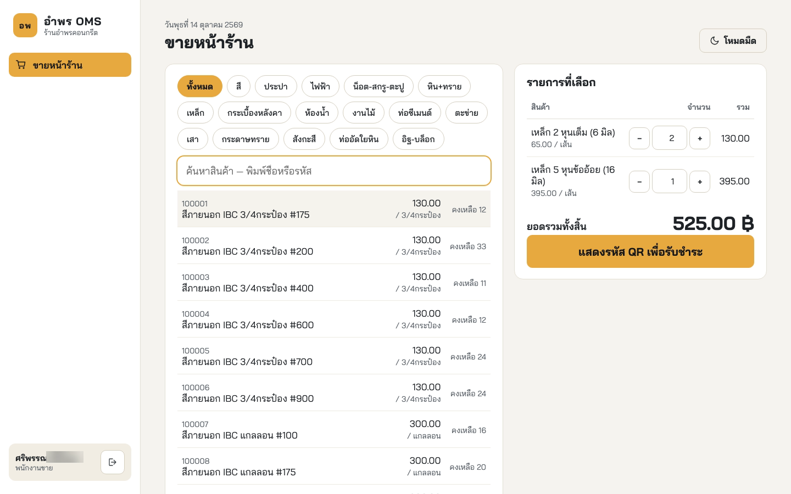
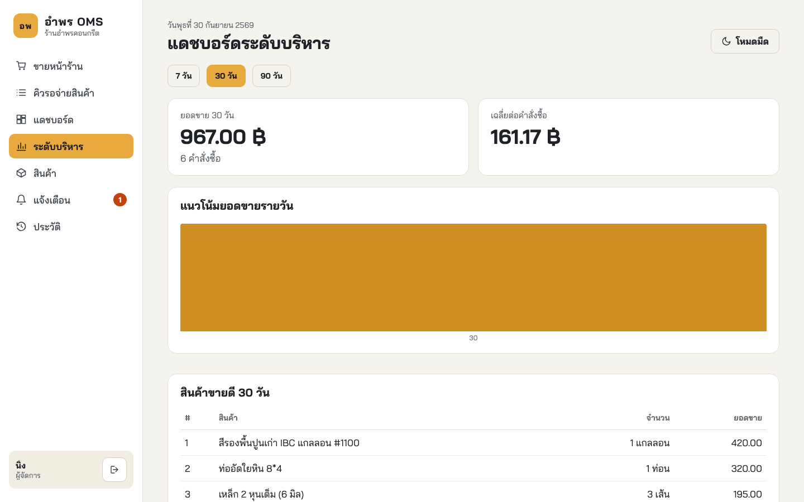
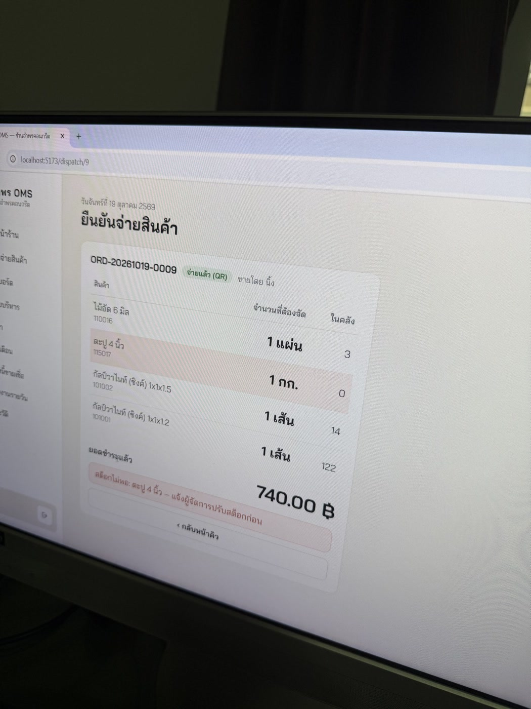
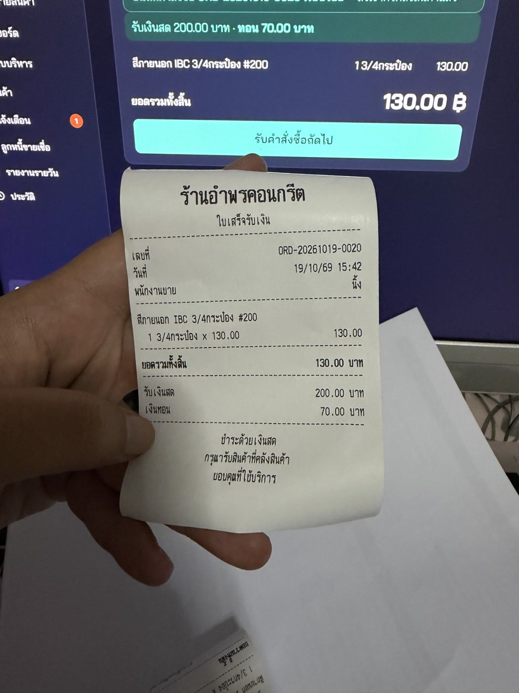

# บทที่ 4

## การพัฒนา ทดสอบ ผล และอภิปรายผล

บทนี้นำเสนอผลการพัฒนาระบบจัดการคำสั่งซื้อและตรวจสอบคลังสินค้าตามที่ออกแบบไว้ในบทที่ 3 ประกอบด้วย สภาพแวดล้อมและโครงสร้างซอร์สโค้ด ผลการพัฒนาของแต่ละหน้าจอ ผลการทดสอบตามแผนในหัวข้อ 3.5 ผลการประเมินจากผู้ใช้งานจริง การติดตั้งใช้งานที่ร้าน และการอภิปรายผล

ตัวเลขทุกค่าที่รายงานในบทนี้ได้จากการทำงานของระบบจริง โดยบันทึกผลไว้เป็นไฟล์หลักฐานในโฟลเดอร์ `evidence` ของโครงงาน เพื่อให้ตรวจสอบย้อนหลังได้ว่าผลที่รายงานมิได้เกิดจากการประมาณ ส่วนรายการที่ยังไม่สามารถทวนสอบได้ภายในระยะเวลาของโครงงาน ได้ระบุไว้ตามจริงพร้อมเหตุผลและแนวทางการดำเนินการต่อไป

## 4.1 การพัฒนาระบบ (Implementation)

### 4.1.1 สภาพแวดล้อมการพัฒนา (Development Environment)

สภาพแวดล้อมที่ใช้ในการพัฒนาและทดสอบระบบแสดงดังตารางที่ 4.1

**ตารางที่ 4.1** สภาพแวดล้อมการพัฒนาและการทดสอบ

| รายการ | สิ่งที่ใช้ |
|---|---|
| เครื่องพัฒนา | คอมพิวเตอร์ระบบปฏิบัติการแมคโอเอส (macOS) |
| เครื่องใช้งานจริง | คอมพิวเตอร์ระบบปฏิบัติการวินโดวส์ (Windows) ของร้าน ต่อเครื่องพิมพ์ใบเสร็จเอปสัน (Epson) TM-T82 ผ่านพอร์ตยูเอสบี (USB) |
| สภาพแวดล้อมการทำงาน | โหนดเจเอส (Node.js) รุ่น 22 |
| ฐานข้อมูล | มายเอสคิวแอล (MySQL) รุ่น 8.0 เอนจินอินโนดีบี (InnoDB) ฐานข้อมูลใช้งานและฐานข้อมูลทดสอบแยกกัน |
| ไลบรารีหลัก | เอ็กซ์เพรสเจเอส (Express.js) รีแอ็กต์ (React) ไวต์ (Vite) ไลบรารีเว็บซ็อกเก็ต (WebSocket) ไดรเวอร์มายเอสคิวแอล และไลบรารีโทเคนกับการแฮชรหัสผ่านตามตารางที่ 2.1 |
| เครื่องมือทดสอบ | เจสต์ (Jest) ซูเปอร์เทสต์ (Supertest) และเพลย์ไรต์ (Playwright) |
| การจัดการเวอร์ชัน | กิตบนคลังเก็บโค้ดกิตฮับ (GitHub) มีการบันทึกการเปลี่ยนแปลง 49 ครั้ง ณ วันที่ 22 ตุลาคม 2569 ซึ่งรวมโค้ดฉบับสุดท้ายหลังการสอบ |

### 4.1.2 โครงสร้างซอร์สโค้ด (Source Code Structure)

ซอร์สโค้ดจัดแบ่งเป็นสี่ส่วนตามหน่วยติดตั้งในตารางที่ 3.15 และภายในระบบหลังบ้านแบ่งเป็นหนึ่งโฟลเดอร์ต่อหนึ่งโมดูล ทำให้สามารถจับคู่รหัสโมดูลในบทที่ 3 กับซอร์สโค้ดได้โดยตรง ดังตารางที่ 4.2

**ตารางที่ 4.2** โครงสร้างซอร์สโค้ดเทียบกับรหัสโมดูล

| โฟลเดอร์ | เนื้อหาที่จัดเก็บ | รหัสในบทที่ 3 |
|---|---|:---:|
| `backend/modules/` | สิบโฟลเดอร์ของโมดูลระบบหลังบ้าน เช่น `auth` `order` `stock-deduction` (เพิ่ม `credit` และ `report` หลังการสอบตามภาคผนวก ซ) | BE-01 ถึง BE-10 |
| `backend/middleware/auth.js` | ส่วนตรวจสิทธิ์คั่นหน้าเส้นทาง | SP-01 |
| `backend/config/db.js` | ส่วนตั้งค่าการเชื่อมต่อฐานข้อมูลและตัวช่วยเปิดธุรกรรม | SP-02 |
| `backend/lib/promptpay.js` | ไลบรารีสร้างรหัสคิวอาร์พร้อมเพย์ | SP-03 |
| `backend/app.js` | ประกาศเส้นทางทั้งหมดพร้อมบทบาทที่เรียกได้ในไฟล์เดียว | ตารางที่ 3.25 |
| `print-service/` | บริการพิมพ์ใบเสร็จและการสร้างชุดคำสั่งอีเอสซีโพส (ESC/POS) | หน่วยติดตั้งที่ 3 |
| `frontend/src/pages/` | เก้าโฟลเดอร์ของหน้าจอ (เพิ่มอีกสองโฟลเดอร์หลังการสอบตามภาคผนวก ซ) | FE-01 ถึง FE-09 |
| `db/schema/schema.sql` | โครงสร้างฐานข้อมูลเจ็ดตาราง (เพิ่มอีกสองตารางหลังการสอบตามภาคผนวก ซ) | รูปที่ 3.7 |
| `backend/tests/` และ `tests/system/` | ชุดทดสอบระดับหน่วย ระดับการรวมส่วน และระดับระบบ | ตารางที่ 3.27 |

### 4.1.3 แนวปฏิบัติในการเขียนโค้ด (Coding Practices)

การเขียนซอร์สโค้ดยึดแนวปฏิบัติสี่ประการที่สืบเนื่องจากการออกแบบ ประการแรก แต่ละโมดูลเปิดให้โมดูลอื่นเรียกใช้ได้เฉพาะฟังก์ชันที่ประกาศไว้ในไฟล์หลักของโฟลเดอร์ โมดูลอื่นจึงไม่สามารถแก้ไขข้อมูลภายในได้โดยตรง ประการที่สอง ทุกคำสั่งเอสคิวแอลส่งค่าจากผู้ใช้ผ่านตัวยึดตำแหน่ง ตามมาตรการในตารางที่ 2.3 ประการที่สาม งานที่ต้องสำเร็จพร้อมกันเปิดธุรกรรมผ่านฟังก์ชันช่วยของ SP-02 ซึ่งยกเลิกธุรกรรมโดยอัตโนมัติเมื่อเกิดข้อผิดพลาด ส่วนงานผลพลอยได้ เช่น การพิมพ์และการแจ้งเตือน ดำเนินการหลังจากยืนยันธุรกรรมแล้วเท่านั้น และประการที่สี่ การแก้ไขทุกครั้งที่เปลี่ยนพฤติกรรมของระบบต้องมีชุดทดสอบรองรับก่อนบันทึกเข้าคลังเก็บโค้ด ทั้งนี้ คำอธิบายซอร์สโค้ดที่สำคัญพร้อมตำแหน่งไฟล์อยู่ในภาคผนวก ฉ

## 4.2 ผลการพัฒนาระบบ (System Results)

ระบบได้รับการพัฒนาครบถ้วนตามที่ออกแบบไว้ในบทที่ 3 ส่วนติดต่อผู้ใช้พัฒนาด้วยไลบรารีรีแอ็กต์ (React) ร่วมกับเครื่องมือไวต์ ระบบหลังบ้านพัฒนาด้วยโหนดเจเอส (Node.js) และเฟรมเวิร์กเอ็กซ์เพรสเจเอส (Express.js) ฐานข้อมูลใช้มายเอสคิวแอล (MySQL) บนเอนจินอินโนดีบี และบริการพิมพ์ใบเสร็จแยกเป็นหน่วยติดตั้งต่างหาก เพื่อให้ทำงานบนเครื่องที่เชื่อมต่อกับเครื่องพิมพ์ได้ตามข้อจำกัดในตารางที่ 3.15 ผลการพัฒนาในภาพรวมสรุปได้ดังตารางที่ 4.3

**ตารางที่ 4.3** ภาพรวมของระบบที่พัฒนาสำเร็จเทียบกับที่ออกแบบไว้ในบทที่ 3

| สิ่งที่ออกแบบไว้ | อ้างอิงในบทที่ 3 | ผลการพัฒนา |
|--------------------------------|:-------------------:|-----------------------------------------------|
| หน่วยติดตั้ง 4 หน่วย | ตารางที่ 3.15 | พัฒนาครบ 4 หน่วย คือ ส่วนติดต่อผู้ใช้ ระบบหลังบ้าน บริการพิมพ์ใบเสร็จ และฐานข้อมูล |
| โมดูลของระบบหลังบ้าน 10 โมดูล (BE-01 ถึง BE-10) | ตารางที่ 3.16 | พัฒนาครบ 10 โมดูล โดยหนึ่งโมดูลเท่ากับหนึ่งโฟลเดอร์ตามที่ออกแบบ |
| ส่วนสนับสนุน 3 ส่วน (SP-01 ถึง SP-03) | ตารางที่ 3.17 | พัฒนาครบ คือ ส่วนตั้งค่าฐานข้อมูล ส่วนตรวจสอบสิทธิ์ และไลบรารีสร้างรหัสคิวอาร์ |
| เส้นทางการเรียกใช้บริการ | ตารางที่ 3.25 | พัฒนาครบทุกเส้นทาง รวม 19 เส้นทาง ประกาศพร้อมสิทธิ์ของแต่ละเส้นทางในไฟล์เดียว |
| ตารางข้อมูล 7 ตาราง | ตารางที่ 3.22 | สร้างครบ 7 ตาราง พร้อมข้อจำกัดที่ฐานข้อมูลบังคับเอง เช่น เลขที่คำสั่งซื้อห้ามซ้ำ และยอดคงเหลือห้ามติดลบ |
| หน้าจอ 9 หน้าจอ (FE-01 ถึง FE-09) | ตารางที่ 3.18 | พัฒนาครบ 9 หน้าจอ ตามสิทธิ์ของแต่ละบทบาท |
| ความต้องการเชิงหน้าที่ FR-01 ถึง FR-09 | ตารางที่ 3.5 | พัฒนาครบทุกข้อ และมีกรณีทดสอบรองรับตามหัวข้อ 4.3 |
| ข้อมูลตั้งต้นของร้าน | หัวข้อ 3.4.1 | นำเข้าสินค้าจริงของร้าน 783 รายการใน 16 หมวดหมู่ จากไฟล์ตารางคำนวณซึ่งมี 18 แผ่นงาน นำเข้าได้ 16 แผ่นงาน ส่วนแผ่นงานปูนและอุปกรณ์ช่างไม่มีรหัสสินค้าจึงยังไม่ได้นำเข้า และบัญชีพนักงานจริง 4 บัญชีตามบทบาท |

ความต้องการเชิงหน้าที่ทุกข้อได้รับการพัฒนาเป็นโมดูลและหน้าจอที่ใช้งานได้จริง การสอบกลับโดยย่อจากความต้องการไปยังสิ่งที่พัฒนาแสดงดังตารางที่ 4.4 ส่วนการสอบกลับจนถึงผลการทดสอบอยู่ในหัวข้อ 4.3.5

**ตารางที่ 4.4** ตารางสอบกลับย่อจากความต้องการเชิงหน้าที่ไปยังสิ่งที่พัฒนา

| รหัส | โมดูลที่พัฒนา | หน้าจอ | หัวข้อที่แสดงผล |
|:---:|---|:---:|:---:|
| FR-01 | BE-01, SP-01 | FE-01 | 4.2.1 |
| FR-02 | BE-02 | FE-07 | 4.2.7 |
| FR-03 | BE-03, BE-10, SP-03 | FE-02 | 4.2.2 |
| FR-04 | BE-04 | FE-03 | 4.2.3 |
| FR-05 | BE-05 | FE-04 | 4.2.4 |
| FR-06 | BE-06 | FE-04 | 4.2.4 |
| FR-07 | BE-07 | FE-05, FE-06 | 4.2.5, 4.2.6 |
| FR-08 | BE-08 | FE-08 | 4.2.8 |
| FR-09 | BE-09 | FE-09 | 4.2.9 |

ทุกหน้าจอหลังการเข้าสู่ระบบใช้โครงหน้าจอเดียวกัน ด้านซ้ายเป็นเมนูที่แสดงเฉพาะหน้าจอของบทบาทผู้ใช้ตามตารางที่ 3.18 เมนูการแจ้งเตือนมีตัวเลขกำกับจำนวนการแจ้งเตือนที่ยังไม่ได้อ่าน ด้านล่างของเมนูแสดงชื่อและบทบาทของผู้ใช้พร้อมปุ่มออกจากระบบ และมุมขวาบนของทุกหน้าจอมีปุ่มสลับโหมดสว่างและโหมดมืดตามหัวข้อ 3.4.3.1 ทั้งนี้ ภาพหน้าจอในบทนี้บันทึกในโหมดสว่าง

ผลการพัฒนาของแต่ละหน้าจอมีรายละเอียดดังนี้

### 4.2.1 หน้าจอเข้าสู่ระบบ

เมื่อผู้ใช้เปิดระบบ ระบบจะแสดงหน้าจอเข้าสู่ระบบให้กรอกชื่อผู้ใช้และรหัสผ่าน จากนั้นระบบเปรียบเทียบรหัสผ่านกับค่าแฮชที่จัดเก็บไว้ในฐานข้อมูล ตรวจสอบว่าบัญชียังเปิดใช้งานอยู่ แล้วจึงออกโทเคนที่ระบุบทบาทของผู้ใช้ และนำผู้ใช้ไปยังหน้าแรกของบทบาทนั้นโดยอัตโนมัติ ได้แก่ พนักงานขายไปยังหน้าขายหน้าร้าน พนักงานคลังสินค้าไปยังหน้าคิวรอจ่ายสินค้า และผู้จัดการไปยังหน้าแดชบอร์ดปฏิบัติการ การทำงานนี้สอดคล้องกับกรณีการใช้งาน UC-01 "เข้าสู่ระบบและควบคุมสิทธิ์ตามบทบาท"

{width=15cm}

**รูปที่ 4.1** หน้าจอเข้าสู่ระบบ

จากรูปที่ 4.1 หน้าจอเข้าสู่ระบบมีเพียงช่องกรอกข้อมูลสองช่องและปุ่มเดียว ตามหลักการหนึ่งหน้าจอทำงานเดียวในหัวข้อ 3.4.3.1 เมื่อเข้าสู่ระบบไม่สำเร็จ ระบบแสดงข้อความเดียวกันในทุกกรณีโดยไม่ระบุว่าชื่อผู้ใช้หรือรหัสผ่านไม่ถูกต้อง เพื่อไม่ให้ผู้ที่ไม่มีสิทธิ์ทราบว่าบัญชีใดมีอยู่จริง

### 4.2.2 หน้าจอขายหน้าร้าน

พนักงานขายใช้หน้าจอนี้บันทึกการขาย โดยเลือกหมวดหมู่สินค้าจากปุ่มด้านบน ค้นหาด้วยชื่อหรือรหัสสินค้า แล้วแตะสินค้าเพื่อเพิ่มลงในรายการที่เลือก ระบบส่งรายการไปให้ระบบหลังบ้านคำนวณยอดรวมจากราคาในฐานข้อมูลทุกครั้งที่รายการเปลี่ยนแปลง มิได้คำนวณที่หน้าจอ เมื่อกดปุ่มแสดงรหัสคิวอาร์ ระบบจะสร้างรหัสคิวอาร์พร้อมเพย์ตามยอดที่คำนวณได้ และเมื่อพนักงานตรวจสอบการแจ้งเตือนเงินเข้าจากแอปพลิเคชันของธนาคารแล้วยืนยันการรับชำระเงิน ระบบจึงบันทึกคำสั่งซื้อ สั่งพิมพ์ใบเสร็จ และส่งคำสั่งซื้อเข้าคิวของคลังสินค้าในการกระทำเดียว การทำงานนี้สอดคล้องกับ UC-03 "สร้างคำสั่งซื้อและออกใบเสร็จ" และ UC-04 "สร้างเลขที่คำสั่งซื้อไม่ซ้ำอัตโนมัติ"

{width=15cm}

**รูปที่ 4.2** หน้าจอขายหน้าร้าน

จากรูปที่ 4.2 ด้านบนเป็นปุ่มหมวดหมู่สินค้าจริงของร้านทั้ง 16 หมวด ช่องค้นหา และรายการสินค้าที่แสดงรหัส ชื่อ ราคาต่อหน่วย และยอดคงเหลือ โดยรายการที่มียอดคงเหลือเป็นศูนย์แสดงด้วยสีแดงเพื่อเตือนพนักงานตั้งแต่ก่อนการขาย ด้านขวาเป็นรายการที่เลือกพร้อมปุ่มเพิ่มและลดจำนวน และยอดรวมทั้งสิ้นที่คำนวณโดยระบบหลังบ้าน

{width=15cm}

**รูปที่ 4.3** หน้าจอแสดงรหัสคิวอาร์ (QR Code) พร้อมเพย์และการยืนยันรับชำระเงิน

จากรูปที่ 4.3 ระบบแสดงรายการสินค้าพร้อมราคาต่อหน่วยไว้ด้านซ้าย และแสดงรหัสคิวอาร์พร้อมยอดเงินไว้ด้านขวาเพื่อให้ลูกค้าสแกนชำระเงิน ใต้ปุ่มยืนยันรับชำระเงินมีข้อความเตือนให้พนักงานตรวจสอบการแจ้งเตือนเงินเข้าจากแอปพลิเคชันของธนาคารก่อนยืนยัน เนื่องจากระบบไม่ได้เชื่อมต่อกับธนาคาร การยืนยันจึงเป็นการกระทำของพนักงานตามข้อสมมติของโครงงาน

### 4.2.3 หน้าจอคิวรอจ่ายสินค้า

หน้าจอนี้แสดงคำสั่งซื้อที่ชำระเงินแล้วและรอการจ่ายสินค้า เรียงตามเวลาที่รับชำระจากเก่าไปใหม่ พร้อมแสดงสถานะและเวลารอคอยของแต่ละรายการ เมื่อพนักงานขายยืนยันการรับชำระเงินที่หน้าร้าน ระบบหลังบ้านจะส่งเหตุการณ์ผ่านช่องทางที่เปิดค้างไว้มายังหน้าจอนี้ทันที รายการใหม่จึงปรากฏขึ้นโดยอัตโนมัติโดยพนักงานไม่ต้องโหลดหน้าจอใหม่ พนักงานสามารถกดเริ่มจัดของเพื่อแจ้งเพื่อนร่วมงานว่ามีผู้รับผิดชอบคำสั่งซื้อนี้แล้ว การทำงานนี้สอดคล้องกับ UC-05 "ดูคิวรอจ่ายสินค้าแบบเรียลไทม์" และ UC-06 "ปรับสถานะการจัดของในคิวงาน"

{width=15cm}

**รูปที่ 4.4** หน้าจอคิวรอจ่ายสินค้าของพนักงานคลังสินค้า

จากรูปที่ 4.4 ข้อความ "รับข้อมูลสดจากหน้าร้าน" ใต้ชื่อหน้าจอยืนยันว่าช่องทางที่เปิดค้างไว้เชื่อมต่ออยู่จริงขณะบันทึกภาพ ภาพนี้บันทึกในขณะที่มีการขายจากอีกเครื่องหนึ่ง และรายการใหม่ปรากฏขึ้นบนหน้าจอนี้โดยอัตโนมัติ แต่ละรายการแสดงเป็นการ์ดที่แตะเลือกได้ทั้งใบ ระบุเลขที่คำสั่งซื้อ สถานะ เวลารอคอย รายการสินค้าพร้อมจำนวน ผู้ขาย และยอดเงิน

### 4.2.4 หน้าจอยืนยันจ่ายสินค้า

เมื่อพนักงานคลังสินค้าเลือกคำสั่งซื้อจากคิว ระบบแสดงรายการสินค้าที่ต้องจัด จำนวนที่ต้องจ่าย และยอดคงเหลือในคลังของแต่ละรายการ เพื่อให้ตรวจสอบก่อนจัดสินค้า เมื่อกดยืนยันจ่ายสินค้า ระบบจะขอให้ยืนยันอีกครั้งก่อนดำเนินการ เนื่องจากการจ่ายสินค้าทำให้สถานะเปลี่ยนเป็นส่งมอบสำเร็จซึ่งย้อนกลับไม่ได้ ตามหลักการประการที่สามในหัวข้อ 3.4.3.1 การทำงานนี้สอดคล้องกับ UC-07 "ยืนยันจ่ายสินค้าและตัดสต็อก"

{width=15cm}

**รูปที่ 4.5** หน้าจอยืนยันจ่ายสินค้า

จากรูปที่ 4.5 ระบบแสดงจำนวนที่ต้องจัดด้วยตัวเลขขนาดใหญ่ เพื่อให้อ่านได้ขณะยืนอยู่หน้าชั้นวางสินค้า และแสดงยอดคงเหลือในคลังไว้คู่กัน เพื่อให้ทราบทันทีว่าสินค้าเพียงพอหรือไม่ หากสินค้ารายการใดไม่เพียงพอ ระบบจะแสดงคำเตือนและไม่แสดงปุ่มยืนยัน

{width=15cm}

**รูปที่ 4.6** ขั้นยืนยันซ้ำก่อนจ่ายสินค้าและตัดสต็อก

จากรูปที่ 4.6 เมื่อกดปุ่มยืนยันครั้งแรก ระบบจะแสดงกล่องยืนยันซ้ำซึ่งระบุอย่างชัดเจนว่าการจ่ายสินค้าและการตัดสต็อกไม่สามารถย้อนกลับได้ พร้อมปุ่มยกเลิกสำหรับกรณีที่กดผิดพลาด

### 4.2.5 หน้าจอแดชบอร์ดปฏิบัติการ

หน้าจอนี้เริ่มต้นด้วยส่วน "ต้องดูแลวันนี้" ซึ่งรวมเรื่องที่ต้องดำเนินการไว้ในที่เดียว ได้แก่ คำสั่งซื้อที่รอจ่ายเกินเกณฑ์ สินค้าที่ต่ำกว่าจุดสั่งซื้อเพิ่ม และการแจ้งเตือนที่ยังไม่ได้อ่าน โดยแต่ละเรื่องมีลิงก์ไปยังหน้าจอที่ใช้ดำเนินการ ถัดลงมาเป็นตัวชี้วัดที่ผู้จัดการและพนักงานคลังสินค้าใช้ระหว่างวัน ได้แก่ ยอดขายวันนี้พร้อมจำนวนคำสั่งซื้อ จำนวนคิวที่รอจ่ายพร้อมเวลารอนานที่สุด และจำนวนสินค้าที่ต่ำกว่าจุดสั่งซื้อเพิ่ม ทุกตัวเลขคำนวณจากฐานข้อมูลในขณะที่เรียกดู มิได้ใช้ค่าสรุปที่จัดเก็บไว้ล่วงหน้า และหน้าจอโหลดข้อมูลใหม่โดยอัตโนมัติเมื่อได้รับเหตุการณ์จากระบบหลังบ้าน การทำงานนี้สอดคล้องกับ UC-08 "แสดงแดชบอร์ดปฏิบัติการ"

{width=15cm}

**รูปที่ 4.7** หน้าจอแดชบอร์ดปฏิบัติการ

รูปที่ 4.7 บันทึกหลังจากผู้จัดการกำหนดจุดสั่งซื้อเพิ่มของสินค้ารายการหนึ่งให้สูงกว่ายอดคงเหลือ และพนักงานคลังสินค้ายืนยันการจ่ายสินค้ารายการดังกล่าวหนึ่งรายการ ระบบจึงสร้างการแจ้งเตือนโดยอัตโนมัติ ส่งผลให้ส่วน "ต้องดูแลวันนี้" แสดงสองเรื่อง ได้แก่ สินค้าที่ต่ำกว่าจุดสั่งซื้อเพิ่มและการแจ้งเตือนที่ยังไม่ได้อ่าน ส่วนเรื่องคิวที่รอเกินเกณฑ์ไม่ปรากฏ เนื่องจากไม่มีคำสั่งซื้อใดรอเกิน 30 นาทีในขณะบันทึกภาพ เรื่องที่ต้องดำเนินการโดยเร็วแสดงด้วยพื้นสีส้มเพื่อให้สังเกตได้โดยไม่ต้องอ่านตัวเลข ด้านล่างเป็นรายการสินค้าที่ต่ำกว่าจุดสั่งซื้อเพิ่ม เรียงจากรายการที่ขาดมากที่สุด และมุมขวาบนระบุเวลาที่คำนวณ เพื่อยืนยันว่าตัวเลขเป็นค่าปัจจุบัน

### 4.2.6 หน้าจอแดชบอร์ดระดับบริหาร

หน้าจอนี้สำหรับผู้จัดการโดยเฉพาะ แสดงแนวโน้มยอดขายรายวันย้อนหลังในรูปแบบกราฟแท่ง และสินค้าขายดีเรียงตามยอดเงิน โดยเลือกช่วงเวลาได้ 7, 30 หรือ 90 วัน เพื่อใช้ประกอบการตัดสินใจสั่งซื้อสินค้าจากข้อมูลจริงแทนการอาศัยประสบการณ์ การทำงานนี้สอดคล้องกับ UC-09 "แสดงแดชบอร์ดระดับบริหาร"

{width=15cm}

**รูปที่ 4.8** หน้าจอแดชบอร์ดระดับบริหาร

จากรูปที่ 4.8 กราฟแท่งวาดด้วยความสามารถของเบราว์เซอร์โดยตรงโดยไม่ใช้ไลบรารีภายนอก จึงไม่เพิ่มส่วนพึ่งพาให้แก่ระบบ ข้อมูลที่แสดงเป็นข้อมูลของช่วงเวลาที่เลือก หากยังไม่มียอดขายในช่วงเวลาดังกล่าว ระบบจะแสดงข้อความแจ้งแทนการแสดงกราฟที่ไม่มีข้อมูล

### 4.2.7 หน้าจอจัดการข้อมูลสินค้า

ผู้จัดการใช้หน้าจอนี้เพิ่มสินค้าใหม่ แก้ไขหมวดหมู่ ราคา และจุดสั่งซื้อเพิ่ม เปิดหรือปิดการขายสินค้า และปรับยอดคงเหลือพร้อมระบุเหตุผล การปรับยอดคงเหลือทุกครั้งจะถูกบันทึกเป็นการเคลื่อนไหวของสต็อกพร้อมยอดหลังการเปลี่ยนแปลง ทำให้ตรวจสอบย้อนหลังได้ว่ายอดเปลี่ยนแปลงด้วยเหตุใด การทำงานนี้สอดคล้องกับ UC-02 "จัดการข้อมูลสินค้าและจุดสั่งซื้อเพิ่ม"

{width=15cm}

**รูปที่ 4.9** หน้าจอจัดการข้อมูลสินค้า

จากรูปที่ 4.9 ตารางสินค้ากรองตามหมวดหมู่และค้นหาด้วยชื่อหรือรหัสได้ แต่ละแถวแสดงรหัส ชื่อ หมวดหมู่ ราคา ยอดคงเหลือ และจุดสั่งซื้อเพิ่ม โดยยอดคงเหลือที่ต่ำกว่าจุดสั่งซื้อเพิ่มแสดงด้วยสีแดง และปุ่มท้ายแถวใช้สำหรับแก้ไขข้อมูลและปรับยอดสต็อก

### 4.2.8 หน้าจอการแจ้งเตือน

หน้าจอนี้แสดงการแจ้งเตือนที่ระบบสร้างขึ้นโดยอัตโนมัติ ได้แก่ การแจ้งเตือนสินค้าใกล้หมดเมื่อยอดคงเหลือต่ำกว่าจุดสั่งซื้อเพิ่ม และการแจ้งเตือนคิวงานที่ค้างนานผิดปกติ โดยแสดงรายการที่ยังไม่ได้อ่านไว้ก่อน ผู้จัดการสามารถทำเครื่องหมายว่าอ่านแล้ว ส่วนพนักงานคลังสินค้าอ่านได้อย่างเดียว การทำงานนี้สอดคล้องกับ UC-11 "รับการแจ้งเตือนภายในแอปพลิเคชัน"

{width=15cm}

**รูปที่ 4.10** หน้าจอการแจ้งเตือน

จากรูปที่ 4.10 การแจ้งเตือนแต่ละรายการระบุชนิด ข้อความที่ระบุชื่อสินค้า ยอดคงเหลือ และจุดสั่งซื้อเพิ่ม พร้อมเวลาที่เกิดขึ้น การแจ้งเตือนเหล่านี้เกิดขึ้นโดยอัตโนมัติหลังจากธุรกรรมที่เปลี่ยนยอดคงเหลือสำเร็จ โดยไม่ต้องรอให้ผู้ใช้เปิดหน้าจอ ตัวเลขบนเมนูการแจ้งเตือนเท่ากับจำนวนรายการที่ยังไม่ได้อ่าน และลดลงทันทีเมื่อผู้จัดการทำเครื่องหมายว่าอ่านแล้ว

### 4.2.9 หน้าจอประวัติการทำรายการ

หน้าจอนี้ให้ผู้จัดการตรวจสอบย้อนหลังว่าผู้ใดทำรายการใด เมื่อใด กับข้อมูลรายการใด และจากเครื่องใด โดยกรองตามช่วงวันที่และประเภทการกระทำได้ ข้อมูลที่ถูกกระทำแสดงในรูปแบบที่อ่านเข้าใจได้ เช่น เลขที่คำสั่งซื้อพร้อมสรุปรายการสินค้า หรือรหัสและชื่อสินค้า แทนการแสดงเพียงหมายเลขอ้างอิง การทำงานนี้สอดคล้องกับ UC-10 "ค้นหาและดูประวัติการทำรายการ"

{width=15cm}

**รูปที่ 4.11** หน้าจอประวัติการทำรายการ

จากรูปที่ 4.11 ตารางประวัติแสดงเวลา ผู้กระทำ การกระทำ ข้อมูลที่ถูกกระทำ และหมายเลขไอพี เรียงจากใหม่ไปเก่า เหตุการณ์ที่ระบบดำเนินการเอง เช่น การสร้างการแจ้งเตือน แสดงผู้กระทำเป็น "ระบบ" เนื่องจากมิได้เกิดจากผู้ใช้คนใด

### 4.2.10 การแสดงผลบนอุปกรณ์เคลื่อนที่

พนักงานคลังสินค้าใช้งานระบบขณะเคลื่อนที่อยู่ภายในคลังสินค้า หน้าจอคิวรอจ่ายสินค้าและหน้าจอยืนยันจ่ายสินค้าจึงต้องใช้งานได้บนสมาร์ตโฟนและแท็บเล็ต ตามความต้องการ NFR-03

{height=15cm}

**รูปที่ 4.12** หน้าจอคิวรอจ่ายสินค้าบนสมาร์ตโฟนที่ความกว้าง 390 พิกเซล

จากรูปที่ 4.12 เมื่อความกว้างของหน้าจอลดลง เมนูด้านซ้ายจะย้ายขึ้นไปเป็นแถบด้านบนที่เลื่อนในแนวนอนได้ การ์ดคิวจัดเรียงเป็นคอลัมน์เดียว ปุ่มมีขนาดใหญ่เพียงพอให้กดด้วยนิ้ว และไม่เกิดการเลื่อนหน้าจอในแนวนอน ซึ่งได้รับการตรวจสอบด้วยการทดสอบระดับระบบอัตโนมัติว่าความกว้างของเนื้อหาไม่เกินความกว้างของหน้าจอ

## 4.3 การทดสอบและผลการทดสอบ (Testing and Test Results)

หัวข้อนี้รายงานผลการทดสอบตามแผนในบทที่ 3 หัวข้อ 3.5 สถานะของการทดสอบแต่ละระดับแสดงดังตารางที่ 4.5

**ตารางที่ 4.5** การทดสอบที่ดำเนินการแล้วในแต่ละระดับ

| ระดับการทดสอบ | สิ่งที่ทดสอบ | สถานะ | ผลอยู่ที่ |
|---|---|---|---|
| การทดสอบหน่วยและการรวมส่วน | ชุดทดสอบ 14 ชุดตามตารางที่ 3.28 | ดำเนินการแล้ว | หัวข้อ 4.3.1 |
| การทดสอบระบบ | เกณฑ์การยอมรับ AC-01 ถึง AC-15 และกรณีทดสอบ TC-01 ถึง TC-13 ตามตารางที่ 3.29 | ดำเนินการแล้ว | หัวข้อ 4.3.2 และ 4.3.3 |
| การทดสอบการยอมรับโดยผู้ใช้ | 16 สถานการณ์ทดสอบ ที่ร้าน 16 ถึง 20 ตุลาคม 2569 | ดำเนินการแล้ว | หัวข้อ 4.3.4 และ 4.4 |

การทดสอบระดับหน่วยและระดับการรวมส่วนใช้ฐานข้อมูลทดสอบชื่อ `soml_new_test` ซึ่งแยกจากฐานข้อมูลใช้งานโดยสิ้นเชิง และถูกสร้างใหม่ทุกครั้งก่อนเริ่มทดสอบ ผลการทดสอบจึงไม่ขึ้นอยู่กับข้อมูลที่ค้างจากการทดสอบครั้งก่อน ส่วนการทดสอบระดับระบบดำเนินการกับระบบที่เปิดใช้งานจริงครบทั้งสี่หน่วยติดตั้ง

การตัดสินว่ากรณีทดสอบใดผ่านหรือไม่ผ่าน ใช้เกณฑ์การยอมรับในตารางที่ 3.11 เป็นเกณฑ์ตัดสิน มิได้ใช้ดุลยพินิจของผู้ทดสอบ เนื่องจากเกณฑ์การยอมรับแต่ละข้อเขียนไว้ตั้งแต่ขั้นตอนการออกแบบในรูปแบบที่ตรวจสอบได้ด้วยโปรแกรม ผลการทดสอบทุกครั้งถูกบันทึกเป็นไฟล์ไว้ในโฟลเดอร์ `evidence` ของโครงงาน

### 4.3.1 การทดสอบระดับหน่วยและการรวมส่วน (Unit and Integration Testing)

ผลการทดสอบชุดทดสอบทั้ง 14 ชุดตามตารางที่ 3.28 สรุปได้ดังตารางที่ 4.6

**ตารางที่ 4.6** ผลการทดสอบระดับหน่วยและระดับการรวมส่วน

| ระดับ | ชุดทดสอบ | สิ่งที่ตรวจ | จำนวน | ผ่าน | ไม่ผ่าน |
|---------|-----------------------------------------------|-----------------|:-------:|:-------:|:-------:|
| หน่วย | `promptpay.test.js` | การประกอบสตริงรหัสคิวอาร์พร้อมเพย์และค่าตรวจสอบความถูกต้อง | 12 | 12 | 0 |
| หน่วย | `escpos.test.js` | การแปลงใบเสร็จเป็นชุดคำสั่งอีเอสซีโพสและการจัดคอลัมน์ 48 ตัวอักษร | 14 | 14 | 0 |
| หน่วย | `print-client.test.js` | ส่วนเชื่อมต่อบริการพิมพ์ต้องไม่โยนข้อผิดพลาดแม้บริการล่ม | 4 | 4 | 0 |
| หน่วย | `print-service.test.js` | บริการพิมพ์รับข้อมูลใบเสร็จและตอบผลอย่างถูกต้อง | 4 | 4 | 0 |
| หน่วย | `transport.test.js` | คำสั่งส่งงานเข้าคิวพิมพ์ของเครื่องพิมพ์ยูเอสบีบนแมค (macOS) ลินุกซ์ (Linux) และวินโดวส์ | 3 | 3 | 0 |
| การรวมส่วน | `db.test.js` | การเชื่อมต่อฐานข้อมูลและการย้อนกลับของธุรกรรม | 4 | 4 | 0 |
| การรวมส่วน | `auth.test.js` | การเข้าสู่ระบบ การออกโทเคน และข้อความเมื่อเข้าไม่สำเร็จ | 12 | 12 | 0 |
| การรวมส่วน | `auth-middleware.test.js` | การปฏิเสธคำขอที่ไม่มีสิทธิ์ทุกรูปแบบ | 8 | 8 | 0 |
| การรวมส่วน | `product.test.js` | การจัดการสินค้า จุดสั่งซื้อเพิ่ม และการปรับสต็อกด้วยมือ | 16 | 16 | 0 |
| การรวมส่วน | `order.test.js` | การคำนวณยอด การออกเลขที่ไม่ซ้ำ และการบันทึกคำสั่งซื้อ | 16 | 16 | 0 |
| การรวมส่วน | `queue.test.js` | คิวงาน การเปลี่ยนสถานะตามแผนภาพสถานะ และช่องทางค้าง | 11 | 11 | 0 |
| การรวมส่วน | `dispatch.test.js` | การจ่ายสินค้า การตัดสต็อกแบบอะตอมมิก (atomic) และการกันจ่ายซ้ำ | 11 | 11 | 0 |
| การรวมส่วน | `alert-dashboard.test.js` | การแจ้งเตือนเชิงรุกและความถูกต้องของแดชบอร์ด | 10 | 10 | 0 |
| การรวมส่วน | `audit-log.test.js` | การบันทึกและการค้นหาประวัติการทำรายการ | 9 | 9 | 0 |
| รวม | 14 ชุด | | 134 | 134 | 0 |

จากตารางที่ 4.6 การทดสอบทั้ง 134 ข้อผ่านทั้งหมด ใช้เวลารวม 4.2 วินาที ความครอบคลุมของโค้ดโดยรวมอยู่ที่ร้อยละ 89.93 ของคำสั่ง โดยโมดูลบริการตัดสต็อกซึ่งเป็นส่วนที่สำคัญที่สุดของระบบมีความครอบคลุมร้อยละ 100 ทั้งในระดับคำสั่ง เงื่อนไข และฟังก์ชัน ส่วนที่มีความครอบคลุมต่ำกว่าส่วนอื่นคือโมดูลส่งข้อมูลไปยังเครื่องพิมพ์ เนื่องจากต้องเรียกใช้คิวพิมพ์ของระบบปฏิบัติการซึ่งไม่สามารถทดสอบโดยอัตโนมัติได้ จึงทวนสอบด้วยการพิมพ์จริงแทนตามกรณีทดสอบ TC-12

### 4.3.2 ผลการทดสอบระบบ (System Testing)

การทดสอบระดับนี้ควบคุมเบราว์เซอร์จริงให้ทำงานแทนผู้ใช้ทั้งสามบทบาท ตั้งแต่การกรอกชื่อผู้ใช้และรหัสผ่าน การเลือกสินค้า การยืนยันรับชำระเงิน ไปจนถึงการยืนยันจ่ายสินค้าและการเปิดดูประวัติ จึงตรวจสอบได้ทั้งพฤติกรรมของหน้าจอและของระบบหลังบ้านพร้อมกัน ผลสรุปดังตารางที่ 4.7

**ตารางที่ 4.7** ผลการทดสอบระดับระบบเทียบกับเกณฑ์การยอมรับ

| ข้อทดสอบ | ความต้องการหรือเกณฑ์ที่ตรวจ | ผลการทดสอบ |
|-------------------------------------------------------|:-----------------------:|:------------------:|
| เข้าสู่ระบบสำเร็จแล้วไปหน้าแรกของบทบาทและเห็นเฉพาะเมนูของตน | AC-12 | ผ่าน |
| เข้าสู่ระบบไม่สำเร็จได้ข้อความเดียวกันทุกกรณี | AC-12, NFR-01 | ผ่าน |
| พนักงานขายเรียกเส้นทางของผู้จัดการถูกปฏิเสธที่ฝั่งเซิร์ฟเวอร์ | AC-01 | ผ่าน |
| ยอดรวมและรหัสคิวอาร์ตรงกัน และได้คำสั่งซื้อที่มีเลขที่ไม่ซ้ำ | AC-03 | ผ่าน |
| ขายต่อเนื่องหลายรายการแล้วเลขที่ไม่ซ้ำกัน | AC-04 | ผ่าน |
| บริการพิมพ์ใช้ไม่ได้ การขายยังสำเร็จและมีคำเตือน | AC-05 | ผ่าน |
| คำสั่งซื้อใหม่ปรากฏบนหน้าจอคิวโดยอัตโนมัติภายใน 3 วินาที โดยไม่ต้องโหลดหน้าจอใหม่ | AC-06 | ผ่าน |
| จ่ายสำเร็จหนึ่งครั้ง และเปิดใบเดิมอีกครั้งแล้วจ่ายซ้ำไม่ได้ | AC-07 | ผ่าน |
| สต็อกไม่พอ หน้าจอแสดงคำเตือนและไม่มีปุ่มจ่ายสินค้า | AC-08 | ผ่าน |
| แก้จุดสั่งซื้อเพิ่มแล้วค่าตรงและมีบันทึกในประวัติ | AC-02 | ผ่าน |
| ตัวเลขบนแดชบอร์ดตรงกับผลรวมที่คำนวณจากฐานข้อมูล | AC-09 | ผ่าน |
| จ่ายสินค้าจนต่ำกว่าจุดสั่งซื้อเพิ่มแล้วมีการแจ้งเตือนเอง | AC-10 | ผ่าน |
| ค้นประวัติตามช่วงเวลาและประเภทการกระทำได้ครบ | AC-11 | ผ่าน |
| รวม | AC-01 ถึง AC-12 ครบทุกข้อ | 13 ข้อ ผ่านทั้งหมด |

จากตารางที่ 4.7 การทดสอบระดับระบบผ่านทั้ง 13 ข้อ สำหรับ AC-07 และ AC-08 การทดสอบระดับระบบตรวจสิ่งที่ผู้ใช้เห็นบนหน้าจอ ส่วนการจ่ายพร้อมกันจากสองคำขอและการย้อนกลับของธุรกรรมเมื่อสต็อกไม่พอ ทวนสอบที่ระดับการรวมส่วนใน TC-06 และ TC-07 การทดสอบระดับระบบทั้ง 13 ข้อใช้เวลารวม 15.0 วินาที และเมื่อทดสอบซ้ำสามรอบติดต่อกันโดยไม่ล้างฐานข้อมูลระหว่างรอบ ผลยังผ่านครบทุกรอบ แสดงว่าการทดสอบไม่ขึ้นอยู่กับสภาพข้อมูลที่ค้างอยู่ก่อนหน้า นอกจากนี้ เมื่อทดสอบชุดเดียวกันบนเบราว์เซอร์ไฟร์ฟอกซ์ (Firefox) 155 ก็ผ่านครบทั้ง 13 ข้อ ใช้เวลารวม 24.7 วินาที ส่วนเบราว์เซอร์เอดจ์ (Edge) รุ่น 154.0.4258.37 ทวนสอบด้วยวิธีการสาธิตบนเครื่องคอมพิวเตอร์ระบบปฏิบัติการวินโดวส์ (Windows) โดยดำเนินการตามลำดับงานของผู้ใช้ทั้งสามบทบาท ได้แก่ การเข้าสู่ระบบ การขายสินค้าและรับชำระเงิน การพิมพ์ใบเสร็จ การจ่ายสินค้า และการค้นหาประวัติการทำรายการ ผลปรากฏว่าทุกหน้าจอทำงานได้ถูกต้องครบถ้วน การทดสอบชุดนี้ครอบคลุมเกณฑ์การยอมรับ AC-01 ถึง AC-12 ในตารางที่ 3.11 ครบทุกข้อ โดย AC-12 ตรวจสอบด้วยสองข้อ ได้แก่ การเข้าสู่ระบบที่สำเร็จและข้อความเมื่อเข้าสู่ระบบไม่สำเร็จ ส่วน AC-13 ถึง AC-15 ทวนสอบด้วยกรณีทดสอบ TC-10 TC-12 และ TC-13 ในตารางที่ 4.8

นอกจากการทดสอบตามเกณฑ์การยอมรับ กรณีทดสอบทั้ง 13 ข้อในตารางที่ 3.29 ได้ดำเนินการตามวิธีที่ระบุไว้ ผลสรุปดังตารางที่ 4.8

**ตารางที่ 4.8** ผลการทดสอบตามกรณีทดสอบ TC-01 ถึง TC-13

| รหัส | สถานการณ์ทดสอบ | ผลการทดสอบจริง | สถานะ |
|:-----------------:|------------------------|------------------------------------------|:-------------:|
| TC-01 | การควบคุมสิทธิ์ตามบทบาท | คำขอที่ไม่แนบโทเคน แนบโทเคนปลอม และแนบโทเคนของบทบาทที่ไม่มีสิทธิ์ ถูกปฏิเสธที่ฝั่งเซิร์ฟเวอร์ครบทุกกรณีด้วยรหัส 401 และ 403 | ผ่าน |
| TC-02 | การตั้งจุดสั่งซื้อเพิ่ม | ค่าที่บันทึกในฐานข้อมูลตรงกับที่กรอกทุกครั้ง และมีบันทึกการแก้ไขในประวัติการทำรายการพร้อมผู้กระทำและเวลา | ผ่าน |
| TC-03 | ความถูกต้องของยอดและรหัสคิวอาร์ | ยอดรวมตรงกับการคำนวณด้วยมือ และยอดที่ปรากฏคู่กับรหัสคิวอาร์ตรงกับยอดในตะกร้าทุกครั้ง | ผ่าน |
| TC-04 | ความไม่ซ้ำของเลขที่คำสั่งซื้อ | สร้างต่อเนื่อง 100 รายการและพร้อมกัน 20 รายการจากสองบัญชี ได้เลขที่ไม่ซ้ำกันทั้ง 120 รายการ และฐานข้อมูลมีคำสั่งซื้อ 183 รายการ เลขที่ไม่ซ้ำกัน 183 รายการ | ผ่าน |
| TC-05 | ความหน่วงของคิวเรียลไทม์ | วัด 20 รอบผ่านช่องทางหลัก ได้สูงสุด 80 มิลลิวินาที และผ่านช่องทางสำรอง ได้สูงสุด 43 มิลลิวินาที ต่ำกว่าเกณฑ์ 3 วินาทีทุกรอบ | ผ่าน |
| TC-06 | การป้องกันการจ่ายซ้ำ | ส่งคำขอยืนยันจ่ายพร้อมกันสองคำขอต่อคำสั่งซื้อเดียว สำเร็จเพียงคำขอเดียว และเมื่อเรียกบริการตัดสต็อกพร้อมกัน 10 ธุรกรรม สต็อกถูกหักครั้งเดียว | ผ่าน |
| TC-07 | การป้องกันสต็อกไม่พอ | ธุรกรรมถูกยกเลิกทั้งหมด สินค้ารายการที่หักไปแล้วในธุรกรรมย้อนกลับสู่ค่าเดิม สถานะคำสั่งซื้อไม่เปลี่ยน และไม่มีบันทึกการเคลื่อนไหว | ผ่าน |
| TC-08 | ความถูกต้องของแดชบอร์ด | ตัวเลขทุกตัวชี้วัดบนแดชบอร์ดตรงกับผลรวมที่คำนวณจากฐานข้อมูลโดยตรงในขณะเดียวกัน | ผ่าน |
| TC-09 | การแจ้งเตือนสินค้าใกล้หมด | เมื่อจ่ายสินค้าจนยอดต่ำกว่าจุดสั่งซื้อเพิ่ม ระบบสร้างการแจ้งเตือนโดยอัตโนมัติโดยไม่ต้องเปิดหน้าจอ และไม่สร้างซ้ำขณะที่ใบเดิมยังไม่ถูกอ่าน | ผ่าน |
| TC-10 | การแจ้งเตือนคิวค้าง | เมื่อปล่อยคำสั่งซื้อค้างในคิวเกินเกณฑ์เวลาที่ตั้งไว้ ระบบสร้างการแจ้งเตือนคิวงานค้างนานผิดปกติที่ระบุเลขที่คำสั่งซื้อและระยะเวลาที่รอ | ผ่าน |
| TC-11 | ความครบถ้วนของประวัติการทำรายการ | กรองตามช่วงวันที่และประเภทการกระทำได้ผลตรงตามเงื่อนไขทุกแถว และทุกแถวมีผู้กระทำ เวลา ข้อมูลที่ถูกกระทำ และหมายเลขไอพีครบ | ผ่าน |
| TC-12 | การพิมพ์ใบเสร็จภาษาไทย | พิมพ์กับเครื่องพิมพ์ความร้อนจริงที่ต่อผ่านพอร์ตยูเอสบีข้อความภาษาไทยถูกต้อง และใช้เวลาประมาณ 2.3 วินาทีนับจากกดยืนยันรับชำระจนตัดกระดาษเสร็จ ต่ำกว่าเกณฑ์ 5 วินาที | ผ่าน |
| TC-13 | การรองรับผู้ใช้พร้อมกัน | 10 เซสชันจากสามบทบาทใช้งานต่อเนื่อง 20 วินาที เกิดคำขอ 15,383 ครั้ง ไม่มีคำขอใดล้มเหลว เวลาตอบสนองมัธยฐาน 6 มิลลิวินาที สูงสุด 1,026 มิลลิวินาที | ผ่าน |

จากตารางที่ 4.8 กรณีทดสอบผ่านครบทั้ง 13 ข้อ รายละเอียดของกรณีที่ต้องอธิบายเพิ่มเติมมีดังนี้

TC-04 ความไม่ซ้ำของเลขที่คำสั่งซื้อ การสร้างคำสั่งซื้อพร้อมกันจากสองบัญชีทำให้ธุรกรรมเกิดการชนกันจริงที่ขั้นตอนการออกเลขที่ ซึ่งเป็นสถานการณ์ที่ต้องการทดสอบ ผลคือทุกคำขอได้รับเลขที่ของตนเองโดยไม่ซ้ำกัน เนื่องจากระบบล็อกเลขล่าสุดของวันไว้จนสิ้นสุดธุรกรรม และมีข้อบังคับห้ามเลขที่ซ้ำในฐานข้อมูลเป็นการป้องกันอีกชั้นหนึ่ง

TC-05 ความหน่วงของคิวแบบเรียลไทม์ เวลาที่วัดได้นับตั้งแต่ส่งคำขอยืนยันรับชำระเงิน จนถึงเวลาที่เหตุการณ์ของคำสั่งซื้อนั้นไปถึงผู้รับที่เปิดหน้าจอคิวไว้ จึงรวมเวลาของธุรกรรมฐานข้อมูล การสั่งพิมพ์ใบเสร็จ และการส่งข้อมูลผ่านเครือข่ายไว้ครบถ้วน ค่าที่ได้ต่ำกว่าเกณฑ์อย่างมากเนื่องจากการทดสอบดำเนินการบนเครื่องเดียวกัน การวัดบนเครือข่ายจริงของร้านจึงยังเป็นรายการที่ต้องดำเนินการต่อไป

TC-12 การพิมพ์ใบเสร็จภาษาไทย ทดสอบโดยเชื่อมต่อเครื่องพิมพ์ใบเสร็จความร้อนเข้ากับเครื่องคอมพิวเตอร์ที่ติดตั้งบริการพิมพ์ผ่านพอร์ตยูเอสบี แล้วขายสินค้าจริงผ่านโทรศัพท์เคลื่อนที่ ใบเสร็จที่ได้แสดงข้อความภาษาไทยในรหัสอักขระ TIS-620 ได้ถูกต้อง ทั้งชื่อร้าน ชื่อสินค้า ชื่อพนักงาน และวันที่ตามปฏิทินไทย เวลานับจากที่หน้าจอแสดงผลการยืนยันรับชำระสำเร็จจนเครื่องพิมพ์ตัดกระดาษเสร็จประมาณ 2.3 วินาที ซึ่งต่ำกว่าเกณฑ์ 5 วินาทีตาม NFR-05 ตัวอย่างใบเสร็จที่พิมพ์จากเครื่องพิมพ์จริงแสดงในรูปที่ 4.13

**รูปที่ 4.13** ใบเสร็จที่พิมพ์จากเครื่องพิมพ์ความร้อนจริง (ปิดนามสกุลของพนักงานในภาพ)

จากรูปที่ 4.13 ข้อความภาษาไทยพิมพ์ได้ถูกต้องทุกบรรทัด ค่าทางขวาของเลขที่ วันที่ พนักงานขาย ยอดของแต่ละรายการ และยอดรวมทั้งสิ้น อยู่บรรทัดเดียวกับหัวข้อทางซ้ายตามการจัดสองคอลัมน์ และยอดรวม 1,390.00 บาทตรงกับผลรวมของรายการทั้งหกรายการ คือ 25 + 25 + 950 + 130 + 130 + 130 บาท ทั้งนี้ ใบเสร็จนี้เป็นการพิมพ์แยกจากครั้งที่ใช้จับเวลา

TC-13 การรองรับผู้ใช้พร้อมกัน การทดสอบนี้เป็นการใช้งานที่หนักกว่าสภาพการใช้งานจริงของร้านอย่างมาก เนื่องจากทุกเซสชันเรียกใช้งานต่อเนื่องโดยไม่มีช่วงหยุด การวัดรอบแรกพบคำขอล้มเหลว 2 ครั้งจาก 14,231 ครั้ง ซึ่งนำไปสู่การแก้ไขที่อธิบายไว้ในหัวข้อ 5.2 ของบทที่ 5 และเมื่อวัดซ้ำหลังการแก้ไขแล้วไม่มีคำขอใดล้มเหลว

### 4.3.3 การทดสอบนอกเหนือหน้าที่ (Non-functional Testing)

ผลการทวนสอบความต้องการนอกเหนือหน้าที่ทั้งเก้าข้อ จัดกลุ่มตามคุณลักษณะคุณภาพในตารางที่ 3.8 แสดงดังตารางที่ 4.9

**ตารางที่ 4.9** ผลการทวนสอบความต้องการนอกเหนือหน้าที่

| รหัส | คุณลักษณะคุณภาพ | วิธีทวนสอบ | ผลที่ได้ |
|:---:|---|---|---|
| NFR-01 | ความมั่นคงปลอดภัย | TC-01 | คำขอที่ไม่มีสิทธิ์ถูกปฏิเสธครบทุกกรณีด้วยรหัส 401 และ 403 |
| NFR-02 | ประสิทธิภาพด้านเวลา | TC-05 | สูงสุด 80 มิลลิวินาทีผ่านช่องทางหลัก และ 43 มิลลิวินาทีผ่านช่องทางสำรอง เกณฑ์ 3 วินาที |
| NFR-03 | ความสามารถในการใช้งาน | ตรวจที่ความกว้าง 390 พิกเซล | ใช้งานได้ครบทุกปุ่มโดยไม่เลื่อนหน้าจอในแนวนอน |
| NFR-04 | ความเหมาะสมเชิงหน้าที่ | TC-06 | จ่ายพร้อมกันสำเร็จเพียงครั้งเดียว สต็อกถูกหักครั้งเดียว |
| NFR-05 | ประสิทธิภาพด้านเวลา | TC-12 | ประมาณ 2.3 วินาที เกณฑ์ 5 วินาที |
| NFR-06 | ประสิทธิภาพด้านขีดความสามารถ | TC-13 | คำขอ 15,383 ครั้งจาก 10 เซสชัน ไม่มีคำขอใดล้มเหลว |
| NFR-07 | ความสามารถในการเคลื่อนย้าย | ทดสอบระดับระบบบนโครเมียม (Chromium) และไฟร์ฟอกซ์ และสาธิตบนเอดจ์ | ผ่านครบ 13 ข้อบนโครเมียม 153 ซึ่งเป็นเอนจินเดียวกับโครม (Chrome) และไฟร์ฟอกซ์ 155 เอดจ์ 154 ทำงานถูกต้องทุกหน้าจอ |
| NFR-08 | ความสามารถในการบำรุงรักษา | ตรวจโครงสร้างซอร์สโค้ดเทียบกับรูปที่ 3.5 | หนึ่งโมดูลเท่ากับหนึ่งโฟลเดอร์ตามตารางที่ 4.2 |
| NFR-09 | ความสามารถในการเคลื่อนย้าย | ให้ผู้ที่ไม่ได้ร่วมพัฒนาติดตั้งตามคู่มือ | ผู้จัดการร้านติดตั้งเองได้ในเวลาประมาณ 5 นาที |

นอกจากการวัดตามเกณฑ์ข้างต้น ระบบยังได้รับการออกแบบให้ทำงานได้ในสภาวะที่ไม่สมบูรณ์ซึ่งเกิดขึ้นได้จริงที่หน้าร้าน ได้แก่ เครื่องพิมพ์ใช้งานไม่ได้ เครือข่ายไม่รองรับช่องทางสื่อสารบางชนิด และผู้ใช้หลายคนทำรายการชนกัน ผลการทดสอบแต่ละประเด็นมีดังนี้

#### 4.3.3.1 ธุรกรรมที่ย้อนกลับได้ครบถ้วน

การเปลี่ยนแปลงที่เกี่ยวข้องกันทั้งหมดถูกรวมไว้ในธุรกรรมเดียวตามหลักการในหัวข้อ 2.1.2 หากขั้นตอนใดล้มเหลว ระบบจะย้อนกลับทั้งหมด การทดสอบใช้คำสั่งซื้อที่มีสินค้าสองรายการ โดยรายการแรกมีสินค้าเพียงพอและรายการที่สองมีไม่เพียงพอ ผลคือยอดคงเหลือของรายการแรกที่ถูกหักไปแล้วภายในธุรกรรมกลับคืนสู่ค่าเดิม สถานะคำสั่งซื้อไม่เปลี่ยนแปลง และไม่มีบันทึกการเคลื่อนไหวของสต็อกค้างอยู่ จึงไม่เกิดสภาพที่ข้อมูลถูกแก้ไขเพียงบางส่วน

#### 4.3.3.2 ช่องทางสำรองเมื่อเปิดช่องทางหลักไม่ได้

ระบบส่งข้อมูลไปยังหน้าจอคิวผ่านช่องทางที่เปิดค้างไว้สองชนิด ได้แก่ เว็บซ็อกเก็ต (WebSocket) เป็นช่องทางหลัก และเหตุการณ์ที่ส่งจากเซิร์ฟเวอร์ (Server-Sent Events) เป็นช่องทางสำรอง เนื่องจากอุปกรณ์เครือข่ายบางรุ่นไม่สามารถยกระดับการเชื่อมต่อเป็นเว็บซ็อกเก็ตได้ ตามที่ระบุไว้ในหัวข้อ 3.3.3 การทดสอบวัดเวลาผ่านทั้งสองช่องทางด้วยวิธีเดียวกัน ได้เวลาสูงสุด 80 มิลลิวินาทีสำหรับช่องทางหลัก และ 43 มิลลิวินาทีสำหรับช่องทางสำรอง ทั้งสองค่าต่ำกว่าเกณฑ์ 3 วินาทีอย่างมาก แสดงว่าหากระบบต้องใช้ช่องทางสำรอง ผู้ใช้ยังได้รับข้อมูลทันเวลาเช่นเดิม การทดสอบนี้วัดแต่ละช่องทางแยกกันโดยตรง ส่วนการสลับจากช่องทางหลักไปช่องทางสำรองทดสอบภายหลังตามหัวข้อ ซ.4

#### 4.3.3.3 การขายที่ยังสำเร็จแม้พิมพ์ใบเสร็จไม่ได้

ส่วนเชื่อมต่อบริการพิมพ์ออกแบบให้คืนผลว่าสำเร็จหรือไม่สำเร็จเสมอ โดยไม่ส่งข้อผิดพลาดออกมา และการสั่งพิมพ์เกิดขึ้นหลังจากธุรกรรมบันทึกคำสั่งซื้อยืนยันผลแล้ว การทดสอบโดยปิดบริการพิมพ์แล้วขายสินค้าพบว่าคำสั่งซื้อยังถูกบันทึกและเข้าคิวของคลังสินค้าตามปกติ พร้อมคำเตือนบนหน้าจอว่าพิมพ์ใบเสร็จไม่สำเร็จ ซึ่งตรงกับเกณฑ์การยอมรับ AC-05 ผลดังกล่าวมีความสำคัญ เนื่องจากเครื่องพิมพ์เป็นอุปกรณ์ที่ขัดข้องได้บ่อยที่สุดในระบบ

#### 4.3.3.4 การลองใหม่เองเมื่อธุรกรรมชนกัน

เมื่อพนักงานหลายคนยืนยันการรับชำระเงินในเวลาใกล้เคียงกัน ธุรกรรมอาจชนกันที่ขั้นตอนการออกเลขที่คำสั่งซื้อ ระบบจะรอเป็นระยะเวลาสั้น ๆ แล้วขอเลขใหม่โดยอัตโนมัติ โดยผู้ใช้ไม่รับรู้ถึงเหตุการณ์ดังกล่าว การวัดภาระงานพร้อมกันตาม TC-13 ซึ่งมีพนักงานขาย 5 เซสชันสร้างคำสั่งซื้อต่อเนื่องพร้อมกับบทบาทอื่น เกิดคำขอ 15,383 ครั้งในช่วงเวลา 20 วินาที สำเร็จ 12,546 ครั้ง อีก 2,837 ครั้งถูกปฏิเสธตามกติกา เนื่องจากเป็นการยืนยันจ่ายสินค้าของคำสั่งซื้อที่ถูกจ่ายไปแล้ว และไม่มีคำขอใดล้มเหลว ส่วนความไม่ซ้ำของเลขที่คำสั่งซื้อทวนสอบแยกไว้ใน TC-04 ทั้งนี้ กลไกนี้ได้รับการปรับปรุงระหว่างการทดสอบตามที่อธิบายไว้ในหัวข้อ 5.2 ของบทที่ 5

### 4.3.4 การทดสอบการยอมรับโดยผู้ใช้ (User Acceptance Testing)

การทดสอบการยอมรับโดยผู้ใช้ดำเนินการที่ร้านระหว่างวันที่ 16 ถึง 20 ตุลาคม 2569 โดยวันที่ 16 ถึง 18 ตุลาคมใช้ระบบรุ่นที่นำเสนอในวันสอบ ส่วนวันที่ 19 ถึง 20 ตุลาคมใช้ระบบที่แก้ไขตามข้อเสนอแนะของคณะกรรมการแล้ว (ภาคผนวก ซ) พนักงานของร้านทั้งสามบทบาทใช้ระบบกับงานประจำจริงตามสถานการณ์ทดสอบ 16 สถานการณ์ โดย UAT-01 ถึง UAT-10 เริ่มจากปัญหาเดิมของร้านในตารางที่ 3.2 ส่วน UAT-11 ถึง UAT-16 ทดสอบความสามารถที่แก้ไขหรือเพิ่มตามข้อเสนอแนะในภาคผนวก ซ ผู้ทดสอบบันทึกผลและลงนามในใบบันทึกผลทุกวันที่ทดสอบ และผู้จัดทำบันทึกภาพหน้าจอเป็นหลักฐาน ทั้งนี้ เมื่อวันที่ 19 ตุลาคม 2569 คณะผู้จัดทำติดตั้งระบบรุ่นใหม่ที่ร้านด้วยฐานข้อมูลว่างตามแผนการทดสอบ เพื่อให้พนักงานเริ่มใช้ความสามารถใหม่ได้โดยไม่ปนกับข้อมูลทดลอง ข้อมูลการขายวันที่ 16 ถึง 18 ตุลาคมจึงเหลือเพียงใบบันทึกผลและภาพถ่าย ส่วนการปรับโครงสร้างฐานข้อมูลโดยไม่ลบข้อมูลเดิมตามภาคผนวก ซ.3 ใช้กับการปรับรุ่นครั้งถัดไป ผลการทดสอบแสดงดังตารางที่ 4.10

**ตารางที่ 4.10** ผลการทดสอบการยอมรับโดยผู้ใช้

| รหัส | สถานการณ์ทดสอบ | ผลที่คาดหวัง | ผู้ทดสอบ | วันที่ทดสอบ (ต.ค. 2569) | ผล |
|:---:|---|---|---|:---:|---|
| UAT-01 | ขายด้วยระบบแทนเขียนบิล | ยอดเงินถูกทุกใบ ใบเสร็จภาษาไทยออกทุกใบ | พนักงานขาย | 16, 17 | ผ่าน |
| UAT-02 | คลังเห็นคำสั่งซื้อทันทีที่จ่ายเงิน | คำสั่งซื้อขึ้นที่คลังเองภายใน 3 วินาที | พนักงานขายและคลัง | 16, 17 | ผ่าน |
| UAT-03 | จัดของตามรายการบนจอแล้วยืนยันจ่าย | รายการบนจอชัด ยืนยันสองครั้ง ใบหายจากคิวหลังจ่าย | พนักงานคลัง | 17, 19 | ผ่าน |
| UAT-04 | คำสั่งซื้อเดิมรับสินค้าซ้ำไม่ได้ | ระบบแจ้งว่าจ่ายไปแล้ว สต็อกลดครั้งเดียว | พนักงานคลัง | 17, 19 | ผ่าน ตามภาพหลักฐาน (ไม่ได้ทำเครื่องหมายในใบบันทึกผล) |
| UAT-05 | สต็อกในระบบตรงกับสินค้าจริง | ยอดในระบบตรงกับที่นับได้ทุกรายการ | พนักงานคลังและผู้จัดการ | 16, 20 | ไม่มีข้อมูลยืนยัน (ไม่ได้นับสต็อก) |
| UAT-06 | สต็อกไม่พอ จ่ายไม่ได้ | ระบบแจ้งสต็อกไม่พอ สต็อกไม่ติดลบ | พนักงานขายและคลัง | 19 | ผ่าน ตามภาพหลักฐาน (ไม่ได้ทำเครื่องหมายในใบบันทึกผล) |
| UAT-07 | ผู้จัดการเห็นยอดระหว่างวัน | เห็นยอดขาย คิวค้าง สินค้าใกล้หมดทันที | ผู้จัดการ | 17, 19, 20 | ผ่าน |
| UAT-08 | แจ้งเตือนก่อนของหมด | แจ้งเตือนเองเมื่อต่ำกว่าจุดสั่งซื้อเพิ่ม | ผู้จัดการ | 16, 19, 20 | ผ่าน |
| UAT-09 | ค้นหาย้อนหลังว่าผู้ใดทำรายการใด | ค้นพบรายการพร้อมผู้ทำและเวลา | ผู้จัดการ | 20 | ผ่าน |
| UAT-10 | ใช้บนมือถือในโกดัง และเข้าระบบตามบทบาท | เห็นเฉพาะเมนูของบทบาท ปุ่มกดง่าย | ทุกบทบาท | 16, 20 | ผ่าน |
| UAT-11 | ขายเชื่อ พิมพ์ใบส่งของ 2 ใบ | พิมพ์ใบส่งของครบ 2 ใบ มีชื่อลูกค้า | พนักงานขาย | 19, 20 | ผ่าน |
| UAT-12 | คิวคลังติดป้ายสถานะการชำระ | ป้ายวิธีชำระถูกต้องทุกใบ | พนักงานคลัง | 19, 20 | ผ่าน |
| UAT-13 | รับชำระหนี้ขายเชื่อ | ยอดค้างถูกต้อง รับเกินยอดไม่ได้ | ผู้จัดการ | 20 | ผ่าน |
| UAT-14 | พิมพ์รายงานการขายรายวัน | ยอดแยกตามวิธีชำระตรงกับเงินเข้าจริง | ผู้จัดการ | 20 | ผ่าน |
| UAT-15 | ใบเสร็จชื่อย่อ และกันรหัสคิวอาร์ผิด | ใบเสร็จพิมพ์ชื่อย่อ ไม่ยืนยันตรวจแอปธนาคารกดรับชำระไม่ได้ | พนักงานขาย | 19 | ผ่าน ตามภาพหลักฐาน (ไม่ได้ทำเครื่องหมายในใบบันทึกผล) |
| UAT-16 | ขายด้วยเงินสด คิดเงินทอน | เงินทอนถูกต้อง เงินไม่พอกดยืนยันไม่ได้ | พนักงานขายและผู้จัดการ | 19, 20 | ผ่าน |

จากตารางที่ 4.10 สถานการณ์ 15 สถานการณ์ได้ผลตามที่คาดหวัง ส่วน UAT-05 ไม่มีข้อมูลยืนยัน เนื่องจากไม่ได้นับสต็อกจริงเทียบกับระบบระหว่างการทดสอบ ในสถานการณ์ที่ผ่าน มีสามสถานการณ์ ได้แก่ UAT-04 UAT-06 และ UAT-15 ผู้ทดสอบลงนามแต่ไม่ได้ทำเครื่องหมายในช่องผล ผลจึงยืนยันจากภาพหน้าจอที่บันทึกไว้เมื่อวันที่ 19 ตุลาคม ได้แก่ ข้อความ "คำสั่งซื้อนี้ถูกจ่ายไปแล้ว ไม่สามารถจ่ายซ้ำได้" เมื่อเปิดคำสั่งซื้อเดิมจากสองเครื่อง ข้อความ "สต็อกไม่พอ" ดังรูปที่ 4.14 และหน้ารหัสคิวอาร์ที่แสดงเลขพร้อมเพย์ปลายทางแบบปิดบางหลัก พร้อมช่องให้ยืนยันว่าตรวจสอบแอปพลิเคชันของธนาคารแล้ว ส่วนการรับเงินสดแสดงเงินทอนบนหน้าจอและพิมพ์ลงใบเสร็จได้ตรงกัน ดังรูปที่ 4.15

{height=9cm}

**รูปที่ 4.14** หน้าจอยืนยันจ่ายสินค้าเมื่อสต็อกไม่พอ ถ่ายที่ร้านวันที่ 19 ตุลาคม 2569 (UAT-06)

{height=9cm}

**รูปที่ 4.15** ใบเสร็จรับเงินสดพร้อมเงินทอน พิมพ์ที่ร้านวันที่ 19 ตุลาคม 2569 (UAT-16)

การจับเวลารอคอยของลูกค้าตาม UAT-02 บันทึกได้ 2 ราย จากที่วางแผนไว้ 10 ราย คำสั่งซื้อ ORD-20261016-0019 คลังสินค้าจัดเตรียมเสร็จใน 5 นาที ลูกค้าได้รับสินค้าที่ 8 นาที และบันทึกเวลารอรวม 15 นาที ส่วนคำสั่งซื้อ ORD-20261017-0020 คลังสินค้าจัดเตรียมเสร็จใน 6 นาที ลูกค้าได้รับสินค้าที่ 7 นาที และบันทึกเวลารอรวม 13 นาที โดยทั้งสองรายการใช้เวลายืนยันรับเงิน 2 ถึง 3 วินาที ทั้งนี้ ตัวเลขในช่องเวลารอรวมเป็นค่าตามที่ผู้ทดสอบบันทึก ซึ่งแบบฟอร์มไม่ได้กำหนดจุดเริ่มนับไว้ จึงมากกว่าเวลาที่ลูกค้าได้รับสินค้า เนื่องจากจำนวนที่จับเวลาได้มีน้อยและยังไม่มีข้อมูลก่อนการใช้ระบบสำหรับเปรียบเทียบ จึงยังไม่สามารถสรุปได้ว่าเวลารอคอยของลูกค้าลดลงเท่าใด

### 4.3.5 สรุปผลการทดสอบและการสอบกลับ (Test Summary and Traceability)

ตารางที่ 4.11 แสดงการสอบกลับจากความต้องการแต่ละข้อไปยังกรณีการใช้งานที่รองรับ โมดูลที่พัฒนาตามรหัสในตารางที่ 3.16 ถึง 3.18 กรณีทดสอบที่ใช้ทวนสอบ และผลที่ได้จริง ทำให้ตรวจสอบได้ว่าความต้องการทุกข้อที่กำหนดไว้ในบทที่ 3 ได้รับการพัฒนาและทวนสอบแล้วหรือไม่

**ตารางที่ 4.11** ตารางสอบกลับความต้องการฉบับสมบูรณ์

| รหัส | ความต้องการโดยย่อ | กรณีการใช้งาน | โมดูลที่พัฒนา | กรณีทดสอบ | ผล |
|:-----:|---------------------------------|:-------------------:|:-------------------:|:-------------:|:--------------:|
| FR-01 | เข้าสู่ระบบและควบคุมสิทธิ์ตามบทบาท | UC-01 | FE-01, BE-01, SP-01 | TC-01 | ผ่าน |
| FR-02 | จัดการข้อมูลสินค้าและจุดสั่งซื้อเพิ่ม | UC-02 | FE-07, BE-02 | TC-02 | ผ่าน |
| FR-03 | สร้างคำสั่งซื้อ คำนวณยอด แสดงรหัสคิวอาร์และพิมพ์ใบเสร็จ | UC-03, UC-04 | FE-02, BE-03, BE-10, SP-03 | TC-03, TC-04, TC-12 | ผ่าน |
| FR-04 | แสดงคิวรอจ่ายสินค้าที่อัปเดตเอง | UC-05, UC-06 | FE-03, BE-04 | TC-05 | ผ่าน |
| FR-05 | ยืนยันจ่ายสินค้าจากรายการในคิว | UC-07 | FE-04, BE-05 | TC-06 | ผ่าน |
| FR-06 | ตัดสต็อกในธุรกรรมเดียวและป้องกันการจ่ายซ้ำ | UC-07 | BE-06 | TC-06, TC-07 | ผ่าน |
| FR-07 | แสดงแดชบอร์ดสรุปยอดขาย สต็อก และคิวงาน | UC-08, UC-09 | FE-05, FE-06, BE-07 | TC-08 | ผ่าน |
| FR-08 | แจ้งเตือนสินค้าใกล้หมดและคิวค้าง | UC-11 | FE-08, BE-08 | TC-09, TC-10 | ผ่าน |
| FR-09 | บันทึกและค้นหาประวัติการทำรายการ | UC-10 | FE-09, BE-09 | TC-11 | ผ่าน |
| NFR-01 | ตรวจสิทธิ์ทุกคำขอและเก็บรหัสผ่านเป็นค่าแฮช | UC-01 | SP-01, BE-01 | TC-01 | ผ่าน |
| NFR-02 | คำสั่งซื้อใหม่ปรากฏบนหน้าจอคิวภายใน 3 วินาที | UC-05 | FE-03, BE-04 | TC-05 | ผ่าน สูงสุด 80 มิลลิวินาที |
| NFR-03 | หน้าจอคลังใช้งานได้บนแท็บเล็ตและสมาร์ตโฟน | UC-05, UC-07 | FE-03, FE-04 | ตรวจที่ความกว้าง 390 พิกเซล | ผ่าน |
| NFR-04 | ทนทานต่อธุรกรรมพร้อมกันโดยไม่เกิดสภาวะแข่งขัน | UC-07 | BE-06 | TC-06 | ผ่าน |
| NFR-05 | พิมพ์ใบเสร็จสำเร็จภายใน 5 วินาที | UC-03 | BE-10 | TC-12 | ผ่าน |
| NFR-06 | รองรับผู้ใช้พร้อมกันไม่น้อยกว่า 10 เซสชัน | ทุกกรณี | ทุกโมดูล | TC-13 | ผ่าน ไม่มีคำขอล้มเหลว |
| NFR-07 | ทำงานถูกต้องบนเบราว์เซอร์ที่กำหนด | ทุกกรณี | FE-01 ถึง FE-09 | ทดสอบระดับระบบบนโครเมียมและไฟร์ฟอกซ์ และทวนสอบด้วยวิธีสาธิตบนเอดจ์ | ผ่าน การทดสอบระบบ 13 ข้อผ่านครบบนโครเมียม 153 และไฟร์ฟอกซ์ 155 ส่วนเอดจ์ 154 ทำงานถูกต้องทุกหน้าจอ |
| NFR-08 | แยกชั้นและแยกส่วนประกอบตามที่ออกแบบ | ทุกกรณี | BE-01 ถึง BE-10, SP-01 ถึง SP-03 | ตรวจโครงสร้างซอร์สโค้ดเทียบตารางที่ 3.16 | ผ่าน |
| NFR-09 | ติดตั้งซ้ำบนเครื่องใหม่ได้ด้วยเอกสารอย่างเดียว | ทุกกรณี | ชุดติดตั้ง | ให้ผู้ที่ไม่ได้ร่วมพัฒนาติดตั้งตามคู่มือ | ผ่าน ผู้จัดการร้านติดตั้งบนเครื่องของร้านตามคู่มือ ใช้เวลาประมาณ 5 นาที |

จากตารางที่ 4.11 ความต้องการเชิงหน้าที่ทั้ง 9 ข้อได้รับการพัฒนาและทวนสอบครบทุกข้อ และความต้องการนอกเหนือหน้าที่ผ่านครบทั้ง 9 ข้อ โดย NFR-09 ทวนสอบด้วยการให้ผู้จัดการร้าน ซึ่งไม่ได้ร่วมพัฒนาระบบ ติดตั้งระบบบนเครื่องคอมพิวเตอร์ของร้านตามคู่มือการติดตั้งเพียงอย่างเดียว การติดตั้งใช้เวลาประมาณ 5 นาที โดยไม่ต้องขอความช่วยเหลือจากผู้จัดทำ ระหว่างการติดตั้งพบว่าผู้ติดตั้งกรอกชื่อเครื่องพิมพ์ที่แชร์ไว้คลาดเคลื่อน ผู้จัดทำจึงปรับปรุงตัวติดตั้งให้อธิบายช่องดังกล่าวชัดเจนขึ้น และไม่รับชื่อที่มีรูปแบบไม่ถูกต้อง

ข้อบกพร่องที่พบระหว่างการทดสอบและการติดตั้ง พร้อมการแก้ไข บันทึกไว้ดังตารางที่ 4.12 ข้อบกพร่องทุกข้อได้รับการแก้ไขและทดสอบซ้ำผ่านแล้ว รายละเอียดของสาเหตุอยู่ในบทที่ 5 หัวข้อ 5.2

**ตารางที่ 4.12** บันทึกข้อบกพร่อง

| รหัส | ข้อบกพร่อง | พบจาก | การแก้ไข | สถานะ |
|:---:|---|---|---|:---:|
| DF-01 | คำขอสร้างคำสั่งซื้อล้มเหลว 2 ครั้งจาก 14,231 ครั้ง เพราะธุรกรรมชนกันที่ขั้นตอนออกเลขที่ | TC-13 รอบแรก | รอแบบทวีคูณก่อนลองใหม่และเพิ่มจำนวนครั้งที่ลองใหม่ | แก้แล้ว วัดซ้ำไม่มีคำขอล้มเหลว |
| DF-02 | หน้าจอคิวแสดงเวลารอเป็นค่าติดลบ | ตรวจภาพหน้าจอ | ไม่ให้เวลารอต่ำกว่าศูนย์ | แก้แล้ว |
| DF-03 | ส่งงานพิมพ์ไปยังเครื่องพิมพ์ยูเอสบีบนวินโดวส์ไม่ได้ | ติดตั้งที่ร้าน | เพิ่มช่องทางพิมพ์ผ่านเครื่องพิมพ์ที่แชร์ และชุดทดสอบ `transport.test.js` | แก้แล้ว ผ่าน TC-12 |
| DF-04 | ผู้ติดตั้งกรอกชื่อเครื่องพิมพ์ที่แชร์คลาดเคลื่อนได้ | ทวนสอบ NFR-09 | ตัวติดตั้งอธิบายช่องนี้ชัดขึ้นและไม่รับชื่อที่รูปแบบไม่ถูกต้อง | แก้แล้ว |

## 4.4 การประเมินผลระบบ (Evaluation)

การประเมินผลระบบแบ่งออกเป็นสองส่วน ส่วนแรกคือการทดสอบการยอมรับโดยผู้ใช้ตามสถานการณ์ในหัวข้อ 4.3.4 ซึ่งผ่าน 15 จาก 16 สถานการณ์ และ UAT-05 ไม่มีข้อมูลยืนยัน ส่วนที่สองคือแบบประเมินความพึงพอใจในภาคผนวก ช ซึ่งใช้ข้อคำถามตามตารางที่ 3.30 ผู้ประเมินคือผู้ใช้งานจริงของร้านบทบาทละหนึ่งคน ทั้งสามคนทำงานกับร้านมากกว่า 3 ปี และประเมินเมื่อวันที่ 29 กันยายน 2569 หลังทดลองใช้ระบบรุ่นที่นำเสนอในวันสอบกับงานประจำของตนเอง การประเมินนี้จึงเกิดขึ้นก่อนการทดสอบการยอมรับโดยผู้ใช้ และไม่รวมความสามารถที่เพิ่มหลังการสอบ ค่าเฉลี่ยของพนักงานขายเท่ากับ 4.67 พนักงานคลังสินค้าเท่ากับ 4.86 และผู้จัดการเท่ากับ 4.80 ค่าเฉลี่ยรวมเท่ากับ 4.78 จากคะแนนเต็ม 5 ซึ่งสูงกว่าเกณฑ์ 3.51 โดยไม่มีข้อคำถามใดต่ำกว่าเกณฑ์ และมีข้อคำถามที่ได้คะแนน 4 อยู่สี่ข้อ ได้แก่ ข้อ 2 ข้อ 6 ข้อ 11 และข้อ 14 ข้อเสนอแนะที่ตรงกันจากพนักงานขายและพนักงานคลังสินค้าคือต้องการให้ระบบรองรับการสแกนบาร์โค้ด ซึ่งอยู่นอกขอบเขตของโครงงานนี้ จึงนำไปเสนอไว้ในบทที่ 5

## 4.5 การติดตั้งใช้งานจริง (Deployment)

ระบบติดตั้งบนเครื่องคอมพิวเตอร์ระบบปฏิบัติการวินโดวส์ของร้านหนึ่งเครื่อง ซึ่งเป็นเครื่องเดียวกับที่เชื่อมต่อเครื่องพิมพ์ใบเสร็จผ่านพอร์ตยูเอสบี หน่วยติดตั้งทั้งสี่ตามตารางที่ 3.15 จึงทำงานอยู่บนเครื่องนี้ทั้งหมด ตามแผนภาพการติดตั้งในรูปที่ 3.6 พนักงานคลังสินค้าใช้โทรศัพท์เคลื่อนที่เข้าใช้งานผ่านเบราว์เซอร์ในเครือข่ายไร้สายเดียวกันของร้าน โดยไม่ต้องติดตั้งแอปพลิเคชันเพิ่มเติม

ชุดติดตั้งรวมโหนดเจเอสและมายเอสคิวแอลไว้ในตัว ร้านจึงไม่ต้องติดตั้งโปรแกรมอื่นเพิ่มเติม และไม่ต้องเชื่อมต่ออินเทอร์เน็ตระหว่างการติดตั้ง ขั้นตอนการติดตั้งมีสามขั้นตอนตามตารางที่ 4.13

**ตารางที่ 4.13** ขั้นตอนการติดตั้งระบบบนเครื่องของร้าน

| ขั้นตอน | สิ่งที่ผู้ติดตั้งทำ | สิ่งที่ระบบทำ |
|---|---|---|
| 1 ติดตั้ง | แตกไฟล์ชุดติดตั้ง แล้วเปิดไฟล์ `install.bat` | ถามเบอร์พร้อมเพย์ของร้าน รหัสผ่านเริ่มต้นของพนักงาน และชื่อเครื่องพิมพ์ที่แชร์ไว้ จากนั้นสร้างฐานข้อมูล 7 ตาราง (9 ตารางในระบบหลังแก้ไขตามภาคผนวก ซ) นำเข้าสินค้า 783 รายการ และสร้างบัญชีผู้ใช้ 4 บัญชี |
| 2 เปิดระบบ | เปิดไฟล์ `start.bat` | เปิดฐานข้อมูล ระบบหลังบ้าน บริการพิมพ์ใบเสร็จ และส่วนติดต่อผู้ใช้ แล้วแสดงที่อยู่สำหรับเปิดจากเครื่องอื่นในร้าน |
| 3 ทดสอบพิมพ์ | ขายสินค้าหนึ่งรายการ | พิมพ์ใบเสร็จจริงตาม TC-12 เพื่อยืนยันว่าเครื่องพิมพ์พร้อมใช้งาน |

การติดตั้งจริงดำเนินการโดยผู้จัดการร้าน ซึ่งไม่ได้ร่วมพัฒนาระบบ ใช้เวลาประมาณ 5 นาทีตามคู่มือในภาคผนวก จ โดยไม่ต้องขอความช่วยเหลือจากผู้จัดทำ จึงผ่านเกณฑ์ของ NFR-09 ปัญหาเดียวที่พบคือชื่อเครื่องพิมพ์ที่แชร์ไว้ถูกกรอกคลาดเคลื่อน ผู้จัดทำจึงปรับปรุงตัวติดตั้งให้อธิบายช่องนี้ชัดเจนขึ้น และไม่รับชื่อที่มีรูปแบบไม่ถูกต้อง

## 4.6 การอภิปรายผล (Discussion)

ผลในหัวข้อ 4.2 ถึง 4.5 แสดงว่าระบบทำงานได้ตามความต้องการที่กำหนดไว้ในบทที่ 3 หัวข้อนี้อธิบายว่าผลที่ได้เกิดจากการออกแบบส่วนใด เปรียบเทียบกับงานที่เกี่ยวข้องในบทที่ 2 และระบุส่วนที่ยังไม่เป็นไปตามเป้าหมาย

ผลที่ดีที่สุดของระบบเกิดจากการตัดสินใจเชิงออกแบบสี่ประการ ประการแรก ระบบส่งคำสั่งซื้อไปยังหน้าจอของคลังสินค้าผ่านเว็บซ็อกเก็ตทันทีที่ยืนยันการรับชำระเงิน แทนการให้หน้าจอถามซ้ำเป็นระยะ เหตุการณ์คำสั่งซื้อจึงไปถึงผู้รับบนช่องทางค้างภายใน 80 มิลลิวินาทีตาม TC-05 ประการที่สอง การยืนยันจ่ายสินค้าและการตัดสต็อกอยู่ในธุรกรรมเดียวของโมดูล BE-06 และใช้คำสั่งปรับปรุงข้อมูลแบบมีเงื่อนไขตามหลักการล็อกเชิงบวกในหัวข้อ 2.1.3 เมื่อยืนยันการจ่ายสินค้าของคำสั่งซื้อเดียวกันจากสองเครื่องพร้อมกัน ระบบจึงอนุญาตให้สำเร็จเพียงครั้งเดียว และเมื่อสต็อกไม่เพียงพอ ธุรกรรมจะย้อนกลับทั้งหมดตาม TC-06 และ TC-07 ประการที่สาม การตรวจสอบสิทธิ์อยู่ที่ส่วนประกอบ SP-01 เพียงจุดเดียว ทุกเส้นทางจึงได้รับการตรวจสอบเหมือนกันโดยไม่มีเส้นทางใดตกหล่นตาม TC-01 และประการที่สี่ การแยกบริการพิมพ์ใบเสร็จเป็นหน่วยติดตั้งต่างหาก ทำให้ร้านยังขายสินค้าได้แม้เครื่องพิมพ์ขัดข้อง ตามหัวข้อ 4.3.3.3

เมื่อเปรียบเทียบกับงานที่เกี่ยวข้องในตารางที่ 2.5 งานที่สืบค้นได้ส่วนใหญ่ครอบคลุมการจัดการสินค้าคงคลังและการขาย แต่ในขอบเขตที่สืบค้นได้ยังไม่พบงานใดที่เชื่อมโยงการรับชำระเงินหน้าร้านเข้ากับคิวงานของคลังสินค้าแบบเรียลไทม์ และยังไม่พบงานใดที่กล่าวถึงการป้องกันการจ่ายสินค้าซ้ำเมื่อมีผู้ใช้หลายคนทำรายการพร้อมกัน ความสามารถที่ระบบนี้เพิ่มขึ้นจึงตรงกับปัญหาที่พบจากหน้างานของร้าน กล่าวคือ คลังสินค้าไม่ทราบล่วงหน้าว่ามีคำสั่งซื้อรออยู่ และมีการนำบิลเก่ามาใช้รับสินค้าซ้ำ

ผลบางส่วนยังไม่เป็นไปตามเป้าหมายทั้งหมด ประการแรก การวัดภาระงานตาม TC-13 ในรอบแรกพบคำขอสร้างคำสั่งซื้อล้มเหลว 2 ครั้ง เนื่องจากธุรกรรมชนกันที่ขั้นตอนการออกเลขที่คำสั่งซื้อ ผู้จัดทำจึงเพิ่มการลองใหม่โดยอัตโนมัติตามหัวข้อ 4.3.3.4 และวัดซ้ำจนไม่มีคำขอใดล้มเหลว ประการที่สอง UC-06 และ UC-09 ไม่มีกรณีทดสอบเฉพาะ แต่ทวนสอบร่วมกับ TC-05 และ TC-08 ตามความต้องการ FR-04 และ FR-07 ที่รองรับร่วมกัน ประการที่สาม การทดสอบการยอมรับโดยผู้ใช้ผ่าน 15 จาก 16 สถานการณ์ แต่จับเวลารอคอยของลูกค้าได้เพียง 2 ราย และไม่ได้นับสต็อกจริง UAT-05 จึงไม่มีข้อมูลยืนยัน ข้อสรุปเชิงตัวเลขเรื่องเวลารอคอยของลูกค้าที่ลดลงและความถูกต้องของยอดสต็อกเมื่อเทียบกับสินค้าจริง จึงยังต้องเก็บข้อมูลเพิ่มเติมหลังจากร้านใช้งานระบบอย่างต่อเนื่อง