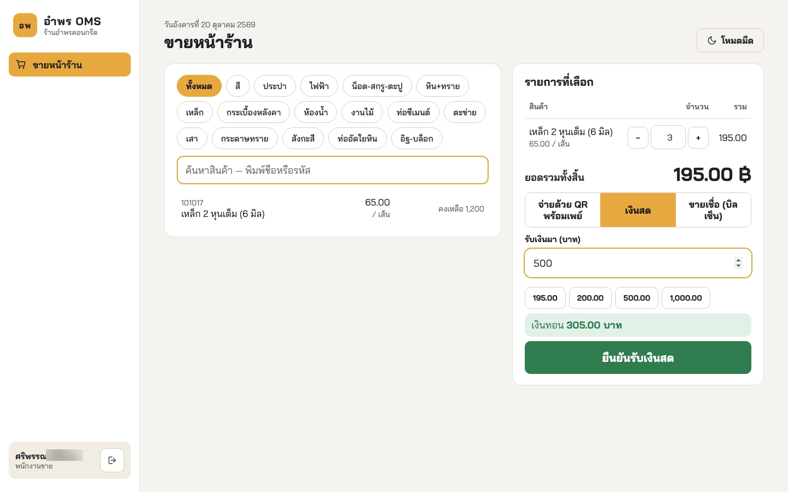
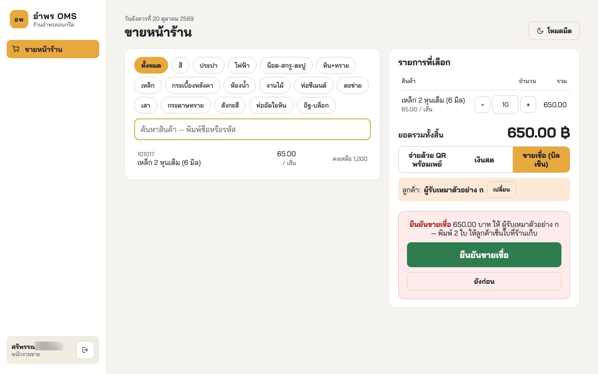
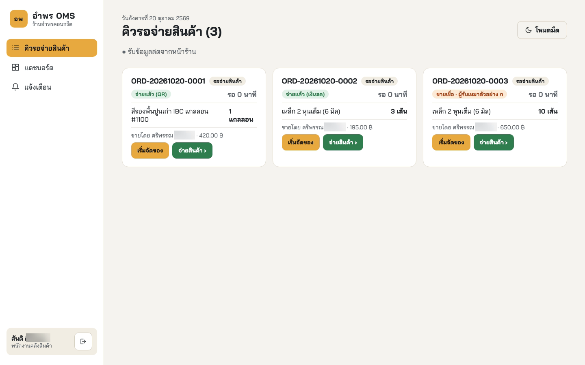
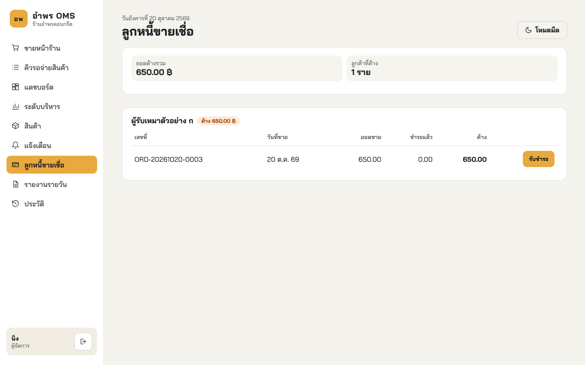
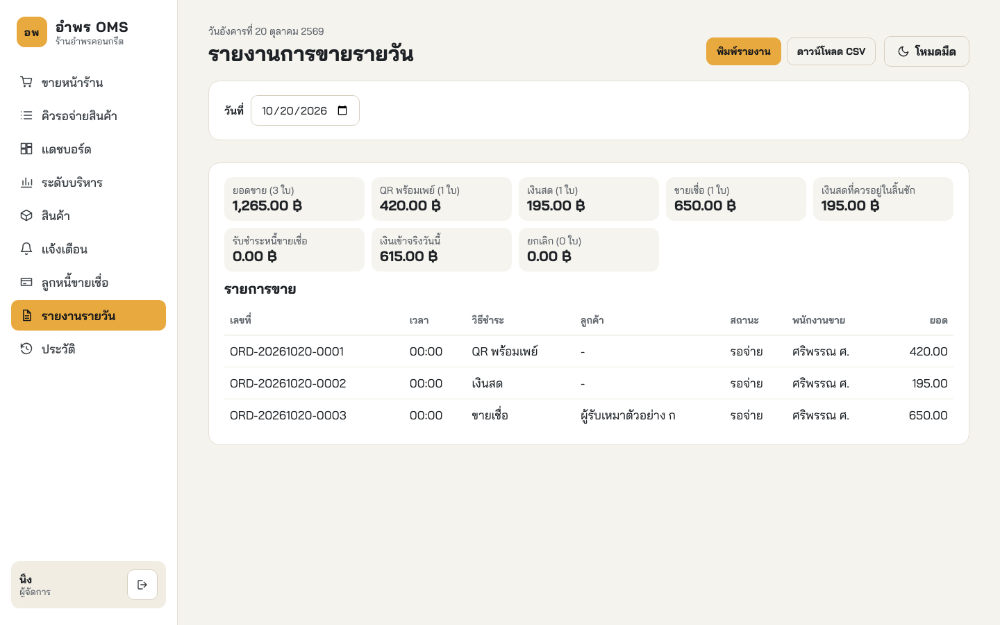

# ภาคผนวก ซ

# การปรับปรุงระบบหลังการสอบ (Post-examination Improvements)

ภาคผนวกนี้บันทึกการแก้ไขระบบตามข้อเสนอแนะของคณะกรรมการสอบโครงงานเมื่อวันที่ 16 ตุลาคม 2569 และความสามารถที่เพิ่มเติมหลังการสอบ ความสามารถดังกล่าวไม่อยู่ในขอบเขตของโครงงานตามตารางที่ 1.1 และไม่อยู่ในการออกแบบของบทที่ 3 จึงแยกไว้ในภาคผนวกนี้ทั้งหมด เพื่อให้ขอบเขต ความต้องการ และผลการทดสอบในบทที่ 1 ถึง 4 ยังคงเป็นของระบบที่นำเสนอในวันสอบ ส่วนผลการทดสอบการยอมรับโดยผู้ใช้ที่ร้านรายงานไว้ในบทที่ 4

## ซ.1 ข้อเสนอแนะของคณะกรรมการและการแก้ไข (Committee Comments)

ข้อเสนอแนะของคณะกรรมการ ได้แก่ อาจารย์ ธนิต เกตุแก้ว อาจารย์ นริศ กำแพงแก้ว และอาจารย์ นุรักษ์ ไชยศรี แต่ละข้อกำหนดรหัส K-1 ถึง K-10 ตามลำดับที่บันทึกไว้ในวันสอบ การแก้ไขและวิธีการทดสอบของแต่ละข้อแสดงดังตารางที่ ซ.1

**ตารางที่ ซ.1** ข้อเสนอแนะของคณะกรรมการสอบและการแก้ไข

| รหัส | กรรมการ | ข้อเสนอแนะ | สิ่งที่แก้ไข | การทดสอบ |
|---|---|---|---|---|
| K-1 | อ.นุรักษ์ | ยืนยันจ่ายสินค้าชนิดเดียวกันจากสองเครื่องพร้อมกันเมื่อคลังสินค้าเหลือ 1 ชิ้น หน้าจอแสดงว่าสำเร็จทั้งสองเครื่อง | ตรวจแล้วพบว่าฐานข้อมูลหักสต็อกถูกต้อง สำเร็จเพียงใบเดียว แต่หน้าจอยังแสดงยอดสต็อกเดิม จึงเพิ่มข้อความ product.stock ให้หน้าขายหน้าร้าน หน้าจัดการสินค้า และหน้ายืนยันจ่ายสินค้าโหลดยอดใหม่ทันทีที่สต็อกเปลี่ยน | ทดสอบการรวมส่วนกรณีสองใบสต็อก 1 และสิบใบสต็อก 3 ยิงพร้อมกัน และทดสอบระดับระบบด้วยหน้าจอสองเครื่อง |
| K-2 | อ.นริศ | ใบเสร็จไม่ควรพิมพ์ชื่อเต็มของพนักงาน | ใบเสร็จพิมพ์ชื่อต้นกับอักษรแรกของนามสกุล เช่น ศริพรรณ ศ. | ทดสอบระดับหน่วยของฟังก์ชันย่อชื่อและข้อความบนใบเสร็จ |
| K-3 | อ.นริศ | ต้องป้องกันความเสียหายหากรหัส QR สร้างผิด | ตรวจสอบรูปแบบเลขพร้อมเพย์ในขั้นตอนการติดตั้งและก่อนสร้างรหัส QR หน้าจอแสดงเลขปลายทางแบบปิดบางหลัก พนักงานต้องยืนยันว่าตรวจสอบแอปพลิเคชันของธนาคารแล้วก่อนรับชำระ และระบบตรวจยอดซ้ำตอนยืนยัน ถ้าราคาเปลี่ยนระหว่างนั้นจะปฏิเสธ | ทดสอบระดับหน่วยของการตรวจเลขพร้อมเพย์ และทดสอบระดับระบบเดิมทุกข้อซึ่งต้องยืนยันการตรวจสอบเงินเข้าก่อนรับชำระ |
| K-4 | อ.นริศ | บทที่ 2 ควรอธิบายเว็บซ็อกเก็ต (WebSocket) และการตอบสนองแบบเรียลไทม์ให้โยงกับระบบ | ขยายหัวข้อ 2.2.4 เปรียบเทียบสี่วิธีส่งข้อมูลในตารางที่ 2.2 และอธิบายช่องทางที่ระบบใช้จริง | ไม่มี (แก้รูปเล่ม) |
| K-5 | อ.นริศ และ อ.นุรักษ์ | แก้รูปเล่มตามที่ทำเครื่องหมายไว้ในเล่ม | แก้ตามเอกสารสรุปการแก้ไขรูปเล่มที่แยกไว้ต่างหาก | ไม่มี (แก้รูปเล่ม) |
| K-6 | อ.ธนิต | เพิ่มการขายเชื่อ ลูกค้ารับสินค้าไปก่อนแล้วชำระภายหลัง | เพิ่มการขายเชื่อพร้อมทะเบียนลูกค้า พิมพ์ใบส่งของสองใบ (สำเนาลูกค้าและสำเนาร้านที่มีช่องลงชื่อ) และหน้าลูกหนี้ให้ผู้จัดการรับชำระทั้งหมดหรือบางส่วน | ทดสอบการรวมส่วนของการขายเชื่อและการรับชำระ และทดสอบระดับระบบตั้งแต่ขายจนรับชำระครบ |
| K-7 | อ.ธนิต | วางแผนและดำเนินการทดสอบการยอมรับโดยผู้ใช้ | จัดทำแผนและทดสอบที่ร้านระหว่างวันที่ 16 ถึง 20 ตุลาคม 2569 ผลอยู่ในบทที่ 4 | การทดสอบการยอมรับโดยผู้ใช้ |
| K-8 | อ.นุรักษ์ | ควรทำให้ระบบรันด้วยด็อกเกอร์ (Docker) ได้ | เพิ่มไฟล์สร้างคอนเทนเนอร์สี่ตัว คือ ฐานข้อมูล ระบบหลังบ้าน บริการพิมพ์ และหน้าเว็บ เปิดทั้งระบบได้ด้วยคำสั่งเดียว | ทดสอบระดับระบบทั้งหมดกับระบบที่รันบนด็อกเกอร์ |
| K-9 | อ.นุรักษ์ | หน้าจอคิวของคลังสินค้าควรแสดงว่าคำสั่งซื้อใดชำระเงินแล้ว และคำสั่งซื้อใดเป็นการขายเชื่อ | การ์ดในคิวและหน้ายืนยันจ่ายสินค้าแสดงป้าย จ่ายแล้ว (QR) จ่ายแล้ว (เงินสด) หรือ ขายเชื่อ พร้อมชื่อลูกค้า | ทดสอบระดับระบบว่าป้ายแสดงโดยอัตโนมัติโดยไม่ต้องโหลดหน้าจอใหม่ |
| K-10 | อ.นุรักษ์ | ควรมีบันทึกการขายรายวันที่พิมพ์ได้ ใช้ทำเรื่องภาษี | เพิ่มหน้ารายงานการขายรายวันของผู้จัดการ แยกยอดตามวิธีชำระ พิมพ์เป็นกระดาษ A4 และดาวน์โหลดเป็นไฟล์ CSV | ทดสอบระดับระบบว่ายอดบนหน้าจอตรงกับข้อมูลในฐานข้อมูล |

นอกจากข้อเสนอแนะข้างต้น คณะผู้จัดทำได้เพิ่มการรับชำระเงินด้วยเงินสด เนื่องจากลูกค้าส่วนหนึ่งของร้านยังชำระด้วยเงินสด ขณะที่ระบบเดิมรับชำระด้วยรหัสคิวอาร์เพียงวิธีเดียว

## ซ.2 ความสามารถที่เพิ่มหลังการสอบ (New Functions)

หน้าจอขายหน้าร้านมีตัวเลือกวิธีชำระเงินสามแบบ ได้แก่ ชำระด้วย QR พร้อมเพย์ เงินสด และขายเชื่อ เมื่อเลือกเงินสด พนักงานกรอกจำนวนเงินที่รับมาหรือกดปุ่มจำนวนเงินที่ใช้บ่อย ระบบจะคำนวณเงินทอนให้ และปุ่มยืนยันจะกดได้เมื่อรับเงินครบตามยอดเท่านั้น ดังรูปที่ ซ.1

{width=14.5cm}

**รูปที่ ซ.1** หน้าจอขายหน้าร้านเมื่อรับชำระด้วยเงินสด

เมื่อเลือกขายเชื่อ พนักงานเลือกลูกค้าจากทะเบียนหรือเพิ่มลูกค้าใหม่ แล้วต้องยืนยันอีกครั้ง เนื่องจากสินค้าออกจากร้านโดยยังไม่ได้รับเงิน ระบบพิมพ์ใบส่งของสองใบ ใบแรกมอบให้ลูกค้า และใบที่สองมีช่องให้ลูกค้าลงนามรับสินค้าเพื่อให้ร้านเก็บไว้ ดังรูปที่ ซ.2

{width=14.5cm}

**รูปที่ ซ.2** หน้าจอขายหน้าร้านเมื่อขายเชื่อให้ลูกค้าที่เลือก

หน้าจอคิวรอจ่ายสินค้าแสดงป้ายวิธีชำระเงินบนการ์ดทุกใบ พนักงานคลังสินค้าจึงทราบว่าคำสั่งซื้อใดชำระเงินแล้ว และคำสั่งซื้อใดเป็นการขายเชื่อที่ต้องให้ลูกค้าลงนามรับสินค้า ดังรูปที่ ซ.3

{width=14.5cm}

**รูปที่ ซ.3** หน้าจอคิวรอจ่ายสินค้าพร้อมป้ายวิธีชำระ

ผู้จัดการดูยอดค้างชำระแยกตามลูกค้า และบันทึกการรับชำระได้ทั้งจำนวนหรือบางส่วน ด้วยเงินสด พร้อมเพย์ หรือการโอนเงิน เมื่อรับชำระครบถ้วน รายการขายเชื่อนั้นจะถูกปิด และหน้าลูกหนี้ที่เปิดค้างไว้บนเครื่องอื่นจะปรับปรุงยอดทันทีผ่านข้อความ order.payment ดังรูปที่ ซ.4 ทะเบียนลูกค้าเก็บเพียงชื่อ หมายเลขโทรศัพท์ และหมายเหตุ ข้อมูลเหล่านี้เป็นข้อมูลส่วนบุคคลตามหัวข้อ 2.3.3 ระบบใช้ข้อมูลนี้เพื่อติดตามการชำระหนี้และการส่งมอบสินค้าเท่านั้น ทะเบียนลูกค้าเปิดให้เฉพาะพนักงานขายและผู้จัดการเข้าถึง ส่วนพนักงานคลังสินค้าเห็นเพียงชื่อลูกค้าบนการ์ดคิวและหน้ายืนยันจ่ายสินค้าเพื่อส่งมอบสินค้าให้ถูกคน

{width=14.5cm}

**รูปที่ ซ.4** หน้าจอลูกหนี้ขายเชื่อของผู้จัดการ

รายงานการขายรายวันแสดงคำสั่งซื้อทั้งหมดของวันที่เลือก พร้อมยอดแยกตามวิธีชำระเงิน เงินสดที่ควรอยู่ในลิ้นชัก และเงินที่ได้รับจริงของวัน ซึ่งไม่นับยอดขายเชื่อที่ยังไม่ได้รับเงิน ปุ่มพิมพ์จัดหน้าเป็นกระดาษขนาด A4 และไฟล์ CSV สามารถเปิดในโปรแกรมตารางคำนวณเพื่อใช้ประกอบการจัดทำภาษีได้ ดังรูปที่ ซ.5

{width=14.5cm}

**รูปที่ ซ.5** หน้าจอรายงานการขายรายวัน

## ซ.3 การเปลี่ยนแปลงของฐานข้อมูล (Database Changes)

การขายเชื่อและการรับเงินสดจำเป็นต้องเพิ่มโครงสร้างข้อมูลจากที่ออกแบบไว้ในรูปที่ 3.7 ดังตารางที่ ซ.2 ตาราง customers เก็บทะเบียนลูกค้าที่ซื้อเชื่อ แต่ละใบขายเชื่อใน orders อ้างถึงลูกค้าผ่านคอลัมน์ customer_id ส่วนตาราง credit_payments เก็บการรับชำระหนี้แต่ละครั้ง และอ้างถึงใบขายเชื่อผ่าน order_id ลูกค้าหนึ่งรายจึงมีใบขายเชื่อได้หลายใบ และใบขายเชื่อหนึ่งใบรับชำระได้หลายครั้งจนครบ สำหรับใบขายเชื่อ คอลัมน์ paid_at ของ orders เก็บเวลาที่ขาย ส่วนเวลาที่ได้รับเงินครบเก็บในคอลัมน์ settled_at ระบบหลังบ้านตรวจสอบโครงสร้างทุกครั้งที่เริ่มทำงาน และเพิ่มเฉพาะส่วนที่ยังไม่มี โดยข้อมูลเดิมไม่สูญหาย กลไกนี้ใช้สำหรับการปรับรุ่นครั้งถัดไปบนเครื่องของร้าน ส่วนการติดตั้งเมื่อวันที่ 19 ตุลาคม 2569 เป็นการติดตั้งใหม่ด้วยฐานข้อมูลว่างตามหัวข้อ 4.3.4

**ตารางที่ ซ.2** การเปลี่ยนแปลงของฐานข้อมูลหลังการสอบ

| ตารางหรือคอลัมน์ | ข้อมูลที่จัดเก็บ | ใช้กับ |
|---|---|---|
| ตาราง customers | ทะเบียนลูกค้าที่ซื้อเชื่อ ชื่อ เบอร์โทรศัพท์ และหมายเหตุ | K-6 |
| ตาราง credit_payments | การรับชำระหนี้แต่ละครั้ง จำนวนเงิน วิธีรับเงิน ผู้รับ และเวลา | K-6, K-10 |
| orders.payment_method | วิธีชำระของคำสั่งซื้อ คือ promptpay cash หรือ credit | K-6, K-9, K-10, เงินสด |
| orders.customer_id | ลูกค้าของใบขายเชื่อ | K-6 |
| orders.settled_at | เวลาที่ใบขายเชื่อได้รับชำระครบ สำหรับใบขายเชื่อ คอลัมน์ paid_at เก็บเวลาที่ขาย ส่วนเวลาที่ได้รับเงินครบเก็บในคอลัมน์นี้ | K-6 |
| orders.cash_received | จำนวนเงินสดที่รับมา ใช้คำนวณเงินทอนบนใบเสร็จ | เงินสด |

## ซ.4 ผลการทดสอบหลังการแก้ไข (Test Results)

ชุดทดสอบทั้งหมดได้รับการทดสอบใหม่กับซอร์สโค้ดหลังการแก้ไขเมื่อวันที่ 20 ตุลาคม 2569 ผลแสดงดังตารางที่ ซ.3 ทั้งนี้ การทดสอบระดับระบบดำเนินการกับระบบที่ติดตั้งบนด็อกเกอร์ (Docker) ซึ่งเป็นการทดสอบ K-8 ไปพร้อมกัน

**ตารางที่ ซ.3** ผลการทดสอบหลังการแก้ไขเทียบกับก่อนการสอบ

| ระดับการทดสอบ | ก่อนการสอบ (บทที่ 4) | หลังการแก้ไข | ผล |
|---|---|---|---|
| ระดับหน่วยและระดับการรวมส่วน | 134 ข้อ | 167 ข้อ (ระดับหน่วย 52 ข้อ ระดับการรวมส่วน 115 ข้อ) | ผ่านทั้งหมด |
| ระดับระบบตามเกณฑ์การยอมรับ | 13 ข้อ | 13 ข้อ | ผ่านทั้งหมด |
| ระดับระบบของงานหลังสอบ | ไม่มี | 4 ข้อ (K-1, K-6 และ K-9, เงินสด, K-10) | ผ่านทั้งหมด |

ชุดทดสอบระดับหน่วยและระดับการรวมส่วนเพิ่มขึ้น 33 ข้อ ครอบคลุมการขายเชื่อและการรับชำระหนี้ ชื่อย่อบนใบเสร็จ การตรวจสอบเลขพร้อมเพย์ การรับเงินสด และการจ่ายสินค้าพร้อมกันของ K-1 ส่วนชุดทดสอบระดับระบบเดิมทั้ง 13 ข้อยังผ่านทั้งหมด แสดงว่าการแก้ไขไม่กระทบความสามารถเดิมของระบบ

นอกจากนี้ การตรวจรูปเล่มก่อนส่งฉบับสมบูรณ์พบว่าระบบทำงานไม่ตรงกับข้อกำหนดสามจุด จึงแก้ไขเมื่อวันที่ 21 ตุลาคม 2569 ดังนี้ ประการแรก พร็อกซี (proxy) ของส่วนติดต่อผู้ใช้ส่งหมายเลขไอพีของเครื่องผู้ใช้ต่อไปยังระบบหลังบ้าน ก่อนแก้ไขประวัติการทำรายการบันทึกหมายเลขของเครื่องแม่ข่ายทุกแถว (FR-09) ประการที่สอง เมื่อการเชื่อมต่อเว็บซ็อกเก็ต (WebSocket) ถูกปฏิเสธทันที หน้าจอเปลี่ยนไปใช้ช่องทางสำรองโดยไม่ต้องรอ ก่อนแก้ไขหน้าจอเปลี่ยนเฉพาะกรณีที่ไม่ตอบสนองภายใน 3 วินาที (NFR-02) การจำลองทั้งสองกรณีพบว่าหน้าจอเปิดช่องทางสำรองเพียงครั้งเดียวทุกกรณี และประการที่สาม ปุ่มบนการ์ดคิวสูง 44 พิกเซลตาม NFR-03 จากเดิม 40 พิกเซล หลังการแก้ไข ชุดทดสอบระดับหน่วยและระดับการรวมส่วนทั้ง 167 ข้อยังผ่านทั้งหมด
